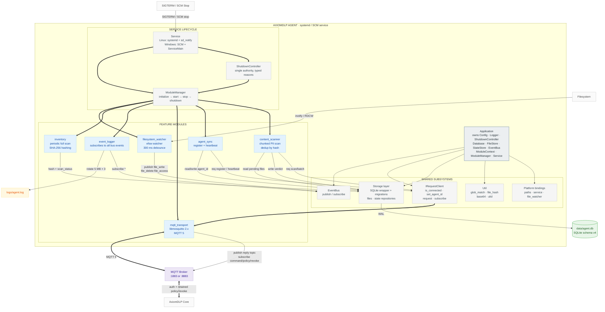

# AxiomDLP Agent — README

Cross-platform endpoint data-loss-prevention agent written in C++20. Watches the filesystem, inventories files, hashes content, stores metadata in SQLite, scans text files for PII over a persistent **MQTT 5** session with the AxiomDLP Core, and shuts down atomically with a typed reason.

The agent runs as a system service on Linux (systemd) and Windows (Service Control Manager) and also supports a foreground mode for development.

---

## 1. Overview

AxiomDLP Agent is the client-side component of the AxiomDLP platform. It:

- Observes filesystem activity in real time
- Builds and maintains a local inventory of files with content hashes
- Sends file content chunks to the Core server for PII detection over MQTT 5
- Receives server-pushed policy updates, commands, and revocation notices on per-agent MQTT topics
- Reports agent identity and liveness via periodic heartbeats
- Shuts down cleanly when instructed by the server, the user, or an internal failure

The current release covers the **observe and report** layer: filesystem watching, inventory, hashing, SQLite storage, MQTT 5 connectivity, enrollment and heartbeat, and content scanning. MQTT 5 is the sole server-facing transport; there is no gRPC, no HTTP client, and no protobuf in the dependency tree.

The codebase is organized around a strict separation between:

- **Framework** — `foundation/`, `events/`, `modules/`
- **Feature modules** — `features/<name>/`
- **Platform bindings** — `platform/<os>/`
- **Transport contract** — `net/i_request_client.h` plus the concrete implementation in `features/mqtt_transport/`
- **Wire protocol** — `docs/mqtt_protocol.md` (kept byte-identical with the matching file in the Core repository)

Every capability the agent offers is implemented as a module. Adding a new capability means adding a folder under `src/features/` and registering it in `application.cpp`. The framework itself does not change.

---

## 2. Architecture



Layering rules reflected in the source tree:

- Higher layers depend on lower layers; lower layers never depend on higher layers.
- Business logic never includes OS-specific headers. Only files under `src/platform/<os>/` do.
- Modules communicate through the in-process `EventBus` or through interfaces exposed on `ModuleContext` (such as `IRequestClient`). Direct calls between feature modules are not used.
- Every capability is a module implementing `IModule` and receiving a `ModuleContext`.
- `ShutdownController` is the only place a shutdown is requested. Every module reads the same reason.
- Bad configuration, missing paths, and failed modules never crash the agent.

Source tree:

| Directory | Responsibility |
| --- | --- |
| `src/foundation/` | Application orchestration, config, logging, shutdown |
| `src/events/` | Event model and in-process publish/subscribe bus |
| `src/modules/` | Module framework (interface, base, context, manager, health) |
| `src/features/` | One folder per capability (see section 6) |
| `src/platform/` | OS-specific implementations behind interfaces |
| `src/net/` | The `IRequestClient` interface (transport-agnostic) |
| `src/util/` | Hashing, glob matching, base64, ULID |
| `src/storage/` | SQLite wrapper, migrations, repositories |

---

## 3. Build

### 3.1 Supported targets

| Platform | Toolchain | Triplet / toolchain file |
| --- | --- | --- |
| Linux x86_64 | GCC + `.deps/` cache | `cmake/toolchains/linux-x86_64.cmake` |
| Linux i686 | GCC `-m32` + `.deps/` | `cmake/toolchains/linux-i686.cmake` |
| Windows x86_64 | MSVC 2022 + vcpkg | `x64-windows-static` |
| Windows x86 | MSVC 2022 + vcpkg | `x86-windows-static` |

Linux x86_64 and i686 are verified to build, link, and connect to a live Core broker end-to-end. Windows x64 and x86 build cleanly via the CMake/vcpkg workflow.

### 3.2 Linux prerequisites

Tested on Debian, Ubuntu, and Kali Linux.

```bash
sudo dpkg --add-architecture i386
sudo apt update
sudo apt install -y \
    build-essential \
    gcc-multilib g++-multilib \
    ninja-build git file clangd \
    libsystemd-dev libsystemd-dev:i386 \
    libmosquitto-dev libmosquitto-dev:i386 \
    pkg-config curl make
```

`gcc-multilib` and `g++-multilib` are required only for the i686 target. `libsystemd-dev:i386` and `libmosquitto-dev:i386` are required for the i686 target. `curl` is used by `scripts/linux/build-openssl.sh`.

### 3.3 Linux build

One-shot:

```bash
./scripts/linux/build-all.sh release
```

On first run this script:

1. Clones the nlohmann/json source into `.deps/nlohmann_json-src` if missing.
2. Runs `scripts/linux/build-openssl.sh` if either OpenSSL tree is incomplete — downloads and builds OpenSSL 3.3.2 for both `linux-x86_64` and `linux-i686` (15–25 minutes).
3. Configures and builds the agent for both targets.

On subsequent runs, everything is incremental and completes in around 30 seconds.

`libmosquitto` is not built by the script. It must be installed as a system package (`libmosquitto-dev` and, for i686, `libmosquitto-dev:i386`). CMake finds it via pkg-config and fails with a clear message if the package is missing.

Manual:

```bash
cmake --preset linux-x86_64-release
cmake --build --preset linux-x86_64-release

cmake --preset linux-i686-release
cmake --build --preset linux-i686-release
```

### 3.4 Linux presets

| Preset | Build type | Output |
| --- | --- | --- |
| `linux-x86_64-debug` | Debug | `build/linux-x86_64-debug/axiomdlp-agent` |
| `linux-x86_64-release` | Release | `build/linux-x86_64-release/axiomdlp-agent` |
| `linux-i686-debug` | Debug | `build/linux-i686-debug/axiomdlp-agent` |
| `linux-i686-release` | Release | `build/linux-i686-release/axiomdlp-agent` |

### 3.5 Verifying the Linux build

```bash
file build/linux-x86_64-release/axiomdlp-agent
# ELF 64-bit LSB pie executable, x86-64

file build/linux-i686-release/axiomdlp-agent
# ELF 32-bit LSB pie executable, Intel 80386

ldd build/linux-x86_64-release/axiomdlp-agent | grep -E 'ssl|mosquitto|grpc|protobuf'
# libmosquitto.so.1 (system lib — the only external dependency)
```

The one runtime dependency outside libc is `libmosquitto.so.1`. OpenSSL, SQLite, spdlog, efsw, and nlohmann/json are statically linked.

### 3.6 Windows prerequisites

Required:

- Visual Studio 2022 with the "Desktop development with C++" workload (Build Tools also works)
- CMake 3.24 or newer on `PATH`
- Ninja on `PATH`
- vcpkg cloned to `C:\Users\<user>\vcpkg` with `VCPKG_ROOT` set — the setup script handles this automatically
- Long paths enabled: `HKLM\SYSTEM\CurrentControlSet\Control\FileSystem\LongPathsEnabled` set to `1`

Optional: PowerShell 7. The setup scripts work with PowerShell 5.1 but assume ASCII-only file content.

### 3.7 Windows one-time setup

```powershell
.\scripts\win\setup-windows-msvc.ps1
```

This script:

1. Verifies Visual Studio 2022 with the C++ workload is present
2. Downloads vcpkg as a ZIP from `codeload.github.com` (about 25 MB)
3. Downloads a prebuilt `vcpkg.exe` from `vcpkg-tool/releases` (about 3 MB)
4. Sets `VCPKG_ROOT` persistently for the current user

Runtime is approximately 3 minutes.

### 3.8 Windows build

```powershell
# x64 Release
.\scripts\win\build-windows-msvc.ps1 -Arch x64

# x86 Release
.\scripts\win\build-windows-msvc.ps1 -Arch x86

# Debug
.\scripts\win\build-windows-msvc.ps1 -Arch x64 -Configuration Debug
```

The build script:

- Initializes the Visual Studio environment via `vcvarsall.bat` so it works from any PowerShell window
- Preserves `VCPKG_ROOT` across VS environment initialization
- Sets `CC=cl.exe` and `CXX=cl.exe` to override any GCC on `PATH`
- Detects and cleans stale `CMakeCache.txt` files referencing a non-MSVC compiler
- Cleans the build directory when `-Clean` is passed

First Windows build takes 20–30 minutes per architecture while vcpkg compiles the dependency tree. Subsequent builds restore from vcpkg's binary cache in 5–10 seconds.

### 3.9 Windows presets

| Preset | Build type | Output |
| --- | --- | --- |
| `windows-x64-msvc-debug` | Debug | `build/windows-x64-msvc-debug/axiomdlp-agent.exe` |
| `windows-x64-msvc-release` | Release | `build/windows-x64-msvc-release/axiomdlp-agent.exe` |
| `windows-x86-msvc-debug` | Debug | `build/windows-x86-msvc-debug/axiomdlp-agent.exe` |
| `windows-x86-msvc-release` | Release | `build/windows-x86-msvc-release/axiomdlp-agent.exe` |

### 3.10 Verifying the Windows build

```powershell
dumpbin /headers build\windows-x64-msvc-release\axiomdlp-agent.exe | Select-String "machine"
dumpbin /dependents build\windows-x64-msvc-release\axiomdlp-agent.exe
# Expected: KERNEL32, ADVAPI32, WS2_32, SHELL32, ole32, USER32, CRYPT32
```

On Windows, vcpkg's `mosquitto` port is linked statically by the `x64-windows-static` and `x86-windows-static` triplets, so `libmosquitto.dll` does not appear in the dependency list. The resulting binary is fully self-contained.

---

## 4. Run

### 4.1 Foreground mode

Linux:

```bash
./build/linux-x86_64-release/axiomdlp-agent \
    --foreground \
    --config config/agent.default.json
```

Windows:

```powershell
.\build\windows-x64-msvc-release\axiomdlp-agent.exe `
    --foreground `
    --config config\agent.default_win.json
```

Console output is colored and always available. File output goes to `logs/agent.log` with rotation.

### 4.2 Service mode

Linux:

```bash
sudo ./build/linux-x86_64-release/axiomdlp-agent --install
```

This writes a systemd unit file to `/etc/systemd/system/axiomdlp-agent.service`, runs `systemctl daemon-reload`, and enables the service.

Windows:

```powershell
.\build\windows-x64-msvc-release\axiomdlp-agent.exe --install
```

This registers the service with the Service Control Manager, sets it to auto-start, and starts it immediately.

### 4.3 Uninstall

Linux:

```bash
sudo ./build/linux-x86_64-release/axiomdlp-agent --uninstall
```

Windows:

```powershell
.\build\windows-x64-msvc-release\axiomdlp-agent.exe --uninstall
```

### 4.4 Command line arguments

| Argument | Meaning |
| --- | --- |
| `--install` | Install as a system service and exit |
| `--uninstall` | Remove the service and exit |
| `--foreground` | Run in foreground mode (blocks; logs to console) |
| `--config PATH` | Use this configuration file instead of the default |

Any unrecognized argument produces a warning and is ignored.

### 4.5 Logs

Format:

```
[YYYY-MM-DD HH:MM:SS.mmm] [level] [t:thread-id] message
```

Levels: `trace`, `debug`, `info`, `warn`, `error`, `critical`. Default is `info`. Rotation is 5 MB per file, 3 historical files (approximately 20 MB total).

### 4.6 Getting an API token

Before the first run, obtain an `axdlp_user_...` token from the Core:

```bash
curl -s -X POST http://127.0.0.1:3000/api/v1/register \
  -H 'Content-Type: application/json' \
  -d '{"organization_name":"MyOrg","admin_username":"admin",
       "admin_email":"admin@myorg.local","admin_password":"TestPass123x"}' \
  | jq -r '.api_token'
```

Paste the resulting `axdlp_user_...` into `config/agent.default.json` at `server.api_token`. The token is shown only once by the server. If it is lost, generate a fresh one via `POST /api/v1/me/tokens` (from an authenticated session) or `POST /api/v1/users/:id/tokens` (as an `org_admin`).

---

## 5. Configuration

### 5.1 Location

The agent looks for its configuration in this order:

1. Path passed via `--config <path>` on the command line
2. `config/agent.default.json` relative to the current working directory
3. Platform default:
   - Linux: `/etc/axiomdlp/agent.json`
   - Windows: `%ProgramData%\AxiomDLP\agent.json`

If no configuration file is found, the agent starts with built-in defaults and logs a warning. It never fails to start because of a missing or invalid configuration file.

### 5.2 Structure

Configuration is a single JSON object with four top-level sections:

```json
{
  "logging": { ... },
  "storage": { ... },
  "server":  { ... },
  "modules": { ... }
}
```

### 5.3 The `server` section

All server-facing configuration lives in one place. Every module that talks to the Core reads from this section.

```json
"server": {
  "base_url": "http://127.0.0.1:3000",
  "api_token": "axdlp_user_...",
  "heartbeat_interval_seconds": 60,
  "reconnect_backoff_seconds": 10,
  "reconnect_backoff_max_seconds": 300,
  "mqtt_port": 1883,
  "mqtt_tls": false,
  "mqtt_ca_path": "",
  "mqtt_keepalive_seconds": 60
}
```

| Field | Type | Default | Purpose |
| --- | --- | --- | --- |
| `base_url` | string | `http://127.0.0.1:3000` | Core base URL; the host is reused as the MQTT target |
| `api_token` | string | `""` | Bearer token (`axdlp_user_...`); sent as MQTT username |
| `heartbeat_interval_seconds` | integer | `60` | Heartbeat period for `agent_sync` |
| `reconnect_backoff_seconds` | integer | `10` | Initial backoff for reconnect |
| `reconnect_backoff_max_seconds` | integer | `300` | Maximum backoff cap |
| `mqtt_port` | integer | `8883` (TLS default) | TCP port for the MQTT broker. `1883` for plaintext. |
| `mqtt_tls` | boolean | `true` | Enable TLS on the MQTT connection |
| `mqtt_ca_path` | string | `""` | Optional PEM CA bundle; empty means system roots |
| `mqtt_keepalive_seconds` | integer | `60` | MQTT CONNECT keep-alive interval (seconds) |

`mqtt_tls` must be `true` in production. The dev configs (`agent.default.json`, `agent.default_win.json`) ship with it set to `false` because the local dev broker is plaintext on `1883`. Before deploying anywhere, set:

```json
"mqtt_port": 8883,
"mqtt_tls": true,
"mqtt_ca_path": "/path/to/ca.pem"
```

`mqtt_ca_path` is ignored when `mqtt_tls` is false. The config loader logs a warning if you set it while TLS is off, so the mismatch is visible at startup.

### 5.4 Module sections

Each module reads its own subsection under `modules`:

- `modules.filesystem_watcher` — watch paths, exclude patterns, debounce window
- `modules.inventory` — scan interval, hash policy, size limits, scannable categories
- `modules.agent_sync` — `enabled` only; all other fields come from `server`
- `modules.content_scanner` — batch size, chunk size, overlap, retry limits, text-extension allowlist

See `config/agent.schema.json` for the full schema.

### 5.5 Environment variable expansion

String values in the configuration can reference environment variables:

- Windows: `%VAR%`
- POSIX: `${VAR}`

Example:

```json
"watch_paths": [ "%USERPROFILE%" ]
```

Expansion happens at load time. Unresolved variables are passed through unchanged.

### 5.6 Fail-safe behavior

The following are handled without aborting startup:

- Missing configuration file
- Malformed JSON
- Wrong-typed fields
- Out-of-range integer values
- Invalid enum values

Every problem produces a warning in the log and a fallback to the safe default for that field. The agent always starts.

### 5.7 Removed fields

`grpc_port`, `grpc_tls`, and `grpc_ca_path` are silently ignored if present; replace them with the `mqtt_*` equivalents.

`verify_tls` at any level produces a warning that the field is ignored. The agent always verifies TLS certificates and hostnames on `mqtts://` and `https://`.

---

## 6. Modules

### 6.1 `filesystem_watcher`

**Purpose:** Observe real-time filesystem changes.

**Implementation:** `efsw` library (inotify on Linux, ReadDirectoryChangesW on Windows).

**Behavior:**

- 300 ms trailing-edge debounce (configurable)
- Coalesces multiple events on the same path within the debounce window
- Priority merge: `modified` (4) > `created` (3) > `moved` (2) > `deleted` (1)
- Self-excludes the agent's own log and data directories to prevent a feedback loop
- Two-tier exclusion: glob patterns plus explicit directory prefixes
- Watcher initialization runs asynchronously so slow recursive watches don't block service startup

**Events published:** `file_write`, `file_delete`, `file_access` (depending on the underlying event type).

### 6.2 `inventory`

**Purpose:** Periodic full-filesystem scan to keep the `files` table complete.

**Behavior:**

- Runs on a configurable interval (default 900 s)
- Captures rich metadata: path decomposition, nanosecond timestamps, POSIX mode, uid/gid, nlink, file type, category
- Computes SHA-256 for files that pass the scanner's eligibility filter
- Assigns explicit `scan_status`:
  - `pending` — file is eligible for scanning, has a hash, waiting for the content scanner
  - `not_applicable` — file is not a regular text file (directory, symlink, binary format)
  - `skipped_too_large` — exceeds the configured size limit
  - `scan_error` — hashing failed
- Batches inserts in groups of 5,000 rows inside a single transaction
- Graceful stop within about 20 ms of a shutdown request; partial progress is committed

**Events published:** none directly (writes to the `files` table).

### 6.3 `event_logger`

**Purpose:** Observability.

**Behavior:** Subscribes to all events on the bus and logs them at INFO level. Includes `mqtt_state` events (connect / disconnect) published by the transport module. No business logic.

**Events published:** none.

### 6.4 `mqtt_transport`

**Purpose:** The sole server-facing transport. Implements `IRequestClient` so feature modules can reach the Core without knowing the transport is MQTT-specific.

**Implementation:** libmosquitto 2.x with MQTT 5 protocol mode, plus a manager thread, a bounded request/response correlation map, and per-topic subscriber dispatch.

**Lifecycle:**

1. `initialize` reads `server.base_url` (host), `mqtt_port`, `mqtt_tls`, `mqtt_ca_path`, `mqtt_keepalive_seconds`, `api_token`, and the two backoff bounds from config. Registers `mosquitto_lib_init()`. Loads or generates `instance_uuid` from the state table.
2. `start` spawns the manager thread.
3. Manager thread calls `connect_and_setup`:
   - `mosquitto_new(client_id="axiomdlp-{instance_uuid}", clean_start=false, this)`
   - `mosquitto_int_option(MOSQ_OPT_PROTOCOL_VERSION, MQTT_PROTOCOL_V5)`
   - `mosquitto_username_pw_set(username=token, password=nullptr)` — the `nullptr` is important: `""` sets the MQTT 5 password flag to an empty value, which mochi-mqtt rejects with CONNACK `0x82`
   - `mosquitto_tls_set` / `mosquitto_tls_opts_set` if `mqtt_tls`
   - Registers v5 callbacks (connect, disconnect, message) and a log callback
   - `mosquitto_will_set_v5` for the LWT (5-second Will Delay)
   - `mosquitto_connect_bind_v5` with CONNECT properties (`Session Expiry=3600`, `Receive Max=100`, `Max Packet Size=128 MB`, `Topic Alias Max=0`)
   - `mosquitto_loop_start`
   - Waits up to 5 s for CONNACK (`connect_attempt_done_`)
   - Subscribes to `axiomdlp/replies/{instance_uuid}` and, if `agent_id` is already known, to `axiomdlp/agents/{id}/{command,policy,revoke}`
4. Manager thread parks on `connect_cv_` until `connected_` flips to false (disconnect) or shutdown is requested.
5. On reconnect, applies jittered backoff, tears down the client, and repeats.

**Server-to-agent messages:**

| Topic | Delivered to |
| --- | --- |
| `axiomdlp/agents/{id}/command` | `subscribe(...)` handler, if installed |
| `axiomdlp/agents/{id}/policy` (retained) | `subscribe(...)` handler, if installed |
| `axiomdlp/agents/{id}/revoke` (retained) | Handled internally — maps `token_revoked` → `AuthRevoked`, `agent_revoked` → `AgentRevoked` |

**Correlation-ID handling:** every PUBLISH response is matched against the in-flight `pending_` map by `Correlation-Data` (MQTT 5 property) or, as a fallback, by the JSON `correlation_id` field. On match, the `PendingRequest` is woken and its response returned to the caller.

**Error mapping** (from CONNACK reason codes and response bodies):

| Condition | Action |
| --- | --- |
| CONNACK `0x87` (Not authorized) | `ShutdownController::request(AuthRevoked)` — permanent, no retry |
| Network failure (any `errno`) | Reconnect with jittered backoff |
| Response `{"error":"agent_revoked"}` | `ShutdownController::request(AgentRevoked)` |
| Response `{"error":"not_found"}` on heartbeat | Clear local `agent_id`, re-enroll |
| Server `ServerRevoke{token_revoked}` | `ShutdownController::request(AuthRevoked)` |
| Server `ServerRevoke{agent_revoked}` | `ShutdownController::request(AgentRevoked)` |

**Thread safety:** `mosq_` is guarded by `mosq_mu_` for cross-thread access (request, publish, subscribe, teardown). The manager thread owns the connect/teardown lifecycle; the loop thread handles callbacks; `set_agent_id()` is safe to call from `agent_sync`'s thread. All three synchronize through `mosq_mu_`.

**Health:** returns `ok("connected")` when the MQTT session is live, `degraded("disconnected")` when the module is running but the session is down, `failed` when the module isn't running.

### 6.5 `agent_sync`

**Purpose:** Agent identity management and liveness over MQTT.

**Behavior:**

- Calls `req_->request("axiomdlp/register", ...)` on first run when `agent_id` is not present in the local `state` table
- Persists the returned `agent_id` to `state` and calls `req_->set_agent_id(id)` so the transport subscribes to the agent-scoped `command`/`policy`/`revoke` topics
- Sends a heartbeat to `axiomdlp/agents/{id}/heartbeat` every `server.heartbeat_interval_seconds` (default 60 s)
- Sends an immediate validation heartbeat at startup when a saved `agent_id` exists — a revoked token or unknown agent is detected within milliseconds
- Interruptible sleep — wakes immediately on shutdown request
- Waits up to 30 s for the transport to report `is_connected()` before the first register attempt, so a slow broker connect doesn't trigger a spurious retry

**Error handling:**

| Response | Action |
| --- | --- |
| `{"ok":true, "agent_id":N, ...}` | Persist `agent_id`, call `set_agent_id(N)`, enter heartbeat loop |
| `{"ok":false, "error":"agent_revoked"}` | `ShutdownController::request(AgentRevoked)` |
| `{"ok":false, "error":"not_found"}` (heartbeat) | Clear `agent_id` from `state`, call `set_agent_id(0)`, re-enroll after 5 s |
| Timeout or transport not connected | Retry next interval (60 s) |
| CONNACK rejection (broker → transport) | Handled by the transport — triggers shutdown via `AuthRevoked` |

### 6.6 `content_scanner`

**Purpose:** Detect PII in text files by sending content chunks to the Core over MQTT and merging the verdicts.

**Behavior:**

- Waits for `agent_id` to appear in the local `state` table (populated by `agent_sync`), then enters its scan loop
- Queries `fetch_pending_for_scan` on the local `files` table
- Filters by extension (against `text_extensions`), size, existence
- Computes SHA-256 of the current content; if an identical hash was previously scanned, reuses the cached verdict without an MQTT call
- Splits content into overlapping chunks:
  - Default 1 MB chunk size, 256-byte overlap
  - Overlap prevents PII from straddling a chunk boundary
- Batches chunks to respect `batch_size` (max chunks per request) and `batch_max_bytes` (max estimated payload per request)
- Publishes to `axiomdlp/agents/{id}/scan/batch` with `content_b64` fields (base64 — matches the server's `ScanChunk.ContentB64`)
- Merges per-chunk verdicts by `file_hash + chunk_index`
- Writes results back to the `files` table via `update_scan_result_by_path`
- **Never commits a partial verdict** — if any chunk in a file is missing a score (chunk error, timeout, or rejected batch), the whole file stays `pending` and is retried next cycle
- Content is never persisted on disk; read into memory, transmitted, and discarded

**Error handling:**

| Condition | Action |
| --- | --- |
| Transport not connected | Skip this cycle, retry next interval |
| `agent_id` not yet known | Skip this cycle, retry next interval |
| Request timeout | Leave chunks buffered, retry next cycle |
| `{"ok":false, "error":"agent_revoked"}` | `ShutdownController::request(AgentRevoked)` |
| `{"ok":false, "error":"not_found"}` | Clear `agent_id` from `state`, wait for `agent_sync` to re-enroll |
| Chunk-level `error` in `results[]` | Skip that chunk; file stays `pending` |
| Batch-level `{"ok":false, "error":"invalid_request"}` | Log, retry next cycle |

---

## 7. Storage

SQLite database at `data/agent.db` (gitignored). Schema version 4. Migrations run at startup and are a no-op if the database is already at the current version.

Two tables are used by the current modules:

- `files` — one row per inventoried file. Columns cover path decomposition, file metadata, SHA-256 hash, `scan_status`, `is_sensitive`, `sensitivity`, and the last scan timestamp. The content scanner reads from and writes to this table.
- `state` — key/value store for agent state. Holds `instance_uuid` (generated on first run) and `agent_id` (populated by `agent_sync` after registration).

Content itself is never written to disk. The scanner reads it into memory, transmits it, and discards it.

---

## 8. MQTT transport

### 8.1 Topics

Every frame the agent sends is defined in `docs/mqtt_protocol.md`. Summary:

| Message | Topic | QoS | Retain | Response |
| --- | --- | --- | --- | --- |
| Register | `axiomdlp/register` | 1 | no | via `Response-Topic` |
| Heartbeat | `axiomdlp/agents/{id}/heartbeat` | 1 | no | via `Response-Topic` |
| ScanBatch | `axiomdlp/agents/{id}/scan/batch` | 1 | no | via `Response-Topic` |
| Shutdown | `axiomdlp/agents/{id}/shutdown` | 1 | no | none |

Server-to-agent topics:

| Topic | QoS | Retain | Purpose |
| --- | --- | --- | --- |
| `axiomdlp/agents/{id}/command` | 2 | no | Server-pushed commands |
| `axiomdlp/agents/{id}/policy` | 2 | yes | Current policy bundle for the agent |
| `axiomdlp/agents/{id}/revoke` | 2 | yes | Revocation notice (token or agent) |
| `axiomdlp/replies/{instance_uuid}` | 1 | no | Per-request response topic |

Every request carries `{"v":1, "correlation_id":"<ulid>", ...}` and the MQTT 5 `Response-Topic` and `Correlation-Data` PUBLISH properties. The server echoes both on the response.

### 8.2 Connection properties

The agent connects with:

- `Session Expiry Interval=3600`
- `Receive Maximum=100`
- `Maximum Packet Size=128 MB`
- `Topic Alias Maximum=0`
- Clean Start false

Clean Start false lets the broker retain subscriptions and queued messages across brief TCP blips.

### 8.3 Last Will and Testament

Every agent sets an LWT at CONNECT time:

- Topic: `axiomdlp/sessions/{instance_uuid}/status`
- Payload: `{"status":"offline"}`
- QoS: 1
- Retain: false
- Will Delay Interval: 5 s

If the agent disconnects ungracefully (network drop, crash, kill -9), the broker publishes the LWT payload after 5 seconds. The Core server uses `SessionHooks.OnDisconnect` as the authoritative disconnect signal; the LWT is a secondary presence notification that only distinguishes "network lost" from "graceful shutdown" in the SSE `EventAgent` event's `reason` field.

A graceful shutdown suppresses the LWT via a clean MQTT disconnect (`mosquitto_disconnect_v5(reason=0x00)`).

### 8.4 Reconnect strategy

Base 10 s, cap 300 s, ±20 % jitter. Reconnects do not thundering-herd the broker.

---

## 9. TLS and security

### 9.1 Threat model

Every MQTT CONNECT carries the `axdlp_user_...` API token as the `Username` field. If this token is intercepted, an attacker can impersonate the agent, receiving policy updates, commands, and revocations intended for the legitimate agent, and can publish scan batches under the agent's identity. TLS is therefore mandatory in production.

### 9.2 Transport security

- **MQTT with TLS enabled** — `mosquitto_tls_set` with either the system trust store or a custom PEM bundle (`server.mqtt_ca_path`). `mosquitto_tls_opts_set(SSL_VERIFY_PEER, ...)` forces peer verification. Chain and hostname are both verified.
- **MQTT with TLS disabled** — plaintext. Development only. A startup log line at WARN level makes this obvious.

### 9.3 No verification opt-out

The `verify_tls` field has been removed from every layer:

- Not parsed in `Config`
- Not passed to `MqttTransportModule`
- Not present in `agent.schema.json`

Legacy config files that contain `verify_tls` produce a warning that the field is ignored. Verification still happens when TLS is on.

### 9.4 Certificate and hostname verification

- SNI is set automatically by libmosquitto when the broker is identified by hostname (which it is — `host_` is parsed from `base_url`).
- Hostname verification uses libmosquitto's built-in TLS validation (OpenSSL's `X509_VERIFY_PARAM_set1_host` under the hood).
- `mqtt_ca_path` overrides the system trust store. When it is empty, the OpenSSL default trust paths are used.

### 9.5 Static linking

On Linux, the agent links OpenSSL statically but uses the system `libmosquitto.so.1`. On Windows, vcpkg's `x64-windows-static` and `x86-windows-static` triplets statically link everything, so the resulting binary has no non-system DLL dependencies.

Verification:

```bash
ldd build/linux-x86_64-release/axiomdlp-agent | grep -E 'ssl|crypto|mosquitto'
# libmosquitto.so.1 => /usr/lib/x86_64-linux-gnu/libmosquitto.so.1
# ssl and crypto are static — no dynamic libssl / libcrypto
```

```powershell
dumpbin /dependents build\windows-x64-msvc-release\axiomdlp-agent.exe
# No libssl-*.dll, no libcrypto-*.dll, no libmosquitto.dll
```

### 9.6 Token handling

- The token is read from `server.api_token` at startup.
- If it is empty, `mqtt_transport`, `agent_sync`, and `content_scanner` all fail initialization with a clear error message.
- The token is never written to disk by the agent; it lives only in the config file, which the operator is responsible for protecting.
- The token is never logged in full. The only place it can leak is libmosquitto's own debug log output (routed to `debug` level and prefixed `[mqtt/*]`); at `info` level and above, the token never appears in the log.

---

## 10. Shutdown model

### 10.1 The single authority

`ShutdownController` (in `src/foundation/shutdown.h`) is the only component that can initiate a shutdown. It exposes:

- `request(ShutdownReason)` — first caller wins, subsequent calls are no-ops
- `wait()` — blocks until a request arrives
- `wait_for(duration)` — bounded wait
- `is_requested()` — non-blocking check
- `reason()` — current reason (or `None`)

### 10.2 Shutdown reasons

| Reason | Cause |
| --- | --- |
| `None` | Initial state — not shutting down |
| `UserRequested` | Ctrl+C, SIGTERM, systemctl stop, SCM stop |
| `AuthRevoked` | CONNACK 0x87 or `ServerRevoke{token_revoked}` |
| `AgentRevoked` | `ServerRevoke{agent_revoked}` or heartbeat `{"error":"agent_revoked"}` |
| `ConfigError` | Fatal configuration error at startup |
| `FatalError` | Unrecoverable module failure |
| `ServerShutdown` | Reserved; not currently used |

### 10.3 Propagation

Once requested, every module sees the reason via `ModuleContext::shutdown.reason()` and can act accordingly. The final log line always reports the reason:

```
Service returned rc=0 (reason=user_requested)
```

The MQTT transport publishes a `shutdown` message to `axiomdlp/agents/{id}/shutdown` with the same reason before closing the session, so the Core server also sees the reason in its logs.

The `mosquitto_loop_stop(force=false)` call is important — it drains the loop's outbound queue, which is what guarantees the `shutdown` message is actually sent before the transport is torn down.

---

## 11. Data flow

### 11.1 Inventory to verdict

```
1. Inventory walks the filesystem
   └── Writes metadata + hash, scan_status = 'pending'
       (only for files that pass eligibility: regular file,
        whitelisted extension, size below limit)

2. Content scanner queries pending files
   └── Reads content from disk, computes SHA-256
       └── If hash was previously scanned: reuse cached verdict,
           no MQTT call
       └── Otherwise:
           ├── Splits into overlapping chunks
           ├── Batches chunks up to batch_size / batch_max_bytes
           ├── Publishes to axiomdlp/agents/{id}/scan/batch (QoS 1)
           └── Merges per-chunk verdicts from the response

3. Verdict written back to `files` table
   └── is_sensitive, sensitivity, scan_status = 'scanned'
```

### 11.2 Enrollment to heartbeat

```
1. mqtt_transport starts
   └── Connects to the broker
       └── Subscribes axiomdlp/replies/{instance_uuid}

2. agent_sync starts
   └── Waits for transport.is_connected() (30 s budget)
       └── Reads agent_id from `state` table
           ├── If present:
           │   ├── req_->set_agent_id(id) → transport subscribes to
           │   │   agents/{id}/{command,policy,revoke}
           │   └── Sends validation heartbeat
           │       ├── error:"agent_revoked" → Shutdown(AgentRevoked)
           │       ├── error:"not_found"     → clear state, re-enroll
           │       └── ok → enter heartbeat loop
           └── If absent:
               ├── Publishes register request
               │   ├── error:"agent_revoked" → Shutdown(AgentRevoked)
               │   └── ok: persists agent_id, set_agent_id(id)
               └── Enters heartbeat loop

3. content_scanner starts
   └── Polls `state` for agent_id (1 s ticks)
       └── Once present: enters scan loop (30 s interval default)
```

### 11.3 Shutdown

```
Any source:
  - SIGTERM / Ctrl+C → ShutdownController::request(UserRequested)
  - Service control stop → ShutdownController::request(UserRequested)
  - CONNACK 0x87 → ShutdownController::request(AuthRevoked)
  - Response {"error":"agent_revoked"} → ShutdownController::request(AgentRevoked)
  - ServerRevoke{token_revoked} → ShutdownController::request(AuthRevoked)
  - ServerRevoke{agent_revoked} → ShutdownController::request(AgentRevoked)
  - Any module fatal error → ShutdownController::request(FatalError)

ShutdownController:
  - First request wins; subsequent requests are no-ops
  - Wakes all waiters

Service main loop:
  - Unblocks from ShutdownController::wait()
  - Calls ModuleManager::stop_all() in reverse order
  - Calls ModuleManager::shutdown_all() in reverse order
  - Returns rc=0

During stop_all():
  - content_scanner joins its thread
  - agent_sync joins its thread
  - mqtt_transport:
      - publishes axiomdlp/agents/{id}/shutdown with the typed reason
      - calls mosquitto_disconnect_v5(reason=0x00)
      - calls mosquitto_loop_stop(force=false) — drains any pending publishes
      - calls mosquitto_destroy
  - event_logger unsubscribes
  - inventory joins its thread
  - filesystem_watcher stops efsw

Application:
  - Logs "Service returned rc=0 (reason=<reason>)"
  - Destroys members in reverse dependency order
  - Shuts down the logger last
```

---

## 12. Testing

### 12.1 Manual smoke test

Prerequisites: a running AxiomDLP Core server on `http://127.0.0.1:3000` (HTTP) and `mqtt://127.0.0.1:1883` (MQTT), with a valid `axdlp_user_...` token already written to `config/agent.default.json` at `server.api_token`.

Linux:

```bash
# Terminal 1: start the Core
cd ~/axiomdlp-core && air
# Wait for:
#   {"msg":"MQTT broker listening","port":1883,"tls":false}
#   {"msg":"Microservice pipeline listening online",...,"mqtt_enabled":true,...}

# Terminal 2: start the agent
cd ~/axiomdlp-agent
./build/linux-x86_64-release/axiomdlp-agent \
    --foreground \
    --config config/agent.default.json
```

Expected log output on the agent:

```
[info] AxiomDLP Agent v0.1.0
[info] Config loaded from: config/agent.default.json
[info] Database: opened 'data/agent.db'
[info] Migrations: schema version 4 -> 4
[info] ModuleManager: registering module 'filesystem_watcher' v1.0.0
[info] ModuleManager: registering module 'inventory' v1.0.0
[info] ModuleManager: registering module 'event_logger' v1.0.0
[info] ModuleManager: registering module 'mqtt_transport' v1.0.0
[info] ModuleManager: registering module 'agent_sync' v1.0.0
[info] ModuleManager: registering module 'content_scanner' v1.0.0
[info] mqtt_transport: initialized (host=127.0.0.1, port=1883, tls=false, keepalive=60s, instance=<hex>, agent_id=0)
[info] mqtt_transport: connected to 127.0.0.1:1883
[info] [event] type=mqtt_state path=-
[info] mqtt_transport: subscribed 'axiomdlp/replies/<hex>' (qos=1)
[info] agent_sync: registering over MQTT (hostname=<host>)
[info] mqtt_transport: agent_id set to N (was 0)
[info] mqtt_transport: subscribed 'axiomdlp/agents/N/command' (qos=2)
[info] mqtt_transport: subscribed 'axiomdlp/agents/N/policy' (qos=2)
[info] mqtt_transport: subscribed 'axiomdlp/agents/N/revoke' (qos=2)
[info] agent_sync: enrolled (agent_id=N, user_id=U, org_id=O)
```

Expected log output on the Core server (same second):

```
{"msg":"mqtt auth: authenticated","client_id":"axiomdlp-<hex>","user_id":U,"org_id":O,"token_id":K,...}
{"msg":"mqtt session: established","client_id":"axiomdlp-<hex>","user_id":U,"org_id":O,...}
{"msg":"agent hub: registered","agent_id":N,"user_id":U,"org_id":O,"kind":"mqtt","total":1}
{"msg":"mqtt register: success","agent_id":N,...,"hostname":"<host>","os":"linux","agent_version":"0.1.0"}
```

Press Ctrl+C on the agent. Expected shutdown output on the agent:

```
[info] axiomdlp-agent received stop request (reason=user_requested)
[info] ModuleManager: stopping 6 module(s)
[info] mqtt_transport: published shutdown message
[info] mqtt_transport: disconnected (reason=0x00 The normal disconnection)
[info] mqtt_transport: stopped
[info] Service returned rc=0 (reason=user_requested)
[info] Application shutting down
```

And on the server:

```
{"msg":"mqtt session: terminated","client_id":"axiomdlp-<hex>","agent_id":N,"had_session":true,...}
```

### 12.2 What the smoke test verifies

- Transport layer — libmosquitto connects, MQTT 5 CONNECT properties are accepted by the broker, MQTT 5 message callbacks fire.
- Authentication — the API token hashes to a `user_api_tokens` row, the broker's `AuthHook` accepts the CONNECT, `{user_id, org_id, token_id}` are populated.
- Correlation — request/response round-trips over `Response-Topic` + `Correlation-Data` return the correct payload to the correct caller.
- Subscriptions — the reply topic is subscribed, and after register the per-agent `command`/`policy`/`revoke` topics are subscribed.
- Graceful shutdown — the `shutdown` frame is delivered before the client disconnects, the broker fires `OnDisconnect`, the hub unregisters the session.

### 12.3 What the smoke test does not cover

- PII verdicts — unless the Core's PII service on port 8000 is running, every scan batch returns per-chunk errors and no files commit. Start the PII service before running the smoke test to see `content_scanner: cycle done (committed=N, ...)`.
- Windows build — the MQTT connect path from a Windows host has not been verified end-to-end.
- Reconnect behavior — the agent reconnects automatically if the broker restarts, but exercising that is not part of the current verification.
- LWT firing — a `kill -9` on the agent leaves the broker to publish the LWT after 5 s. Verifying this requires killing the agent ungracefully and watching `axiomdlp/sessions/{instance}/status` from a third MQTT client.

### 12.4 Verifying the MQTT protocol doc

The wire contract is kept byte-identical between the two repositories:

```bash
diff -q ~/axiomdlp-core/docs/mqtt_protocol.md \
        ~/axiomdlp-agent/docs/mqtt_protocol.md
# Expected: no output
```

Any difference is a contract drift and requires a coordinated commit in both repositories.

---

## 13. Known limitations

These reflect the current state of the code. They are not plans.

- The MQTT connect path from a Windows host has not yet been exercised against a live broker. Linux x86_64 and i686 are verified end-to-end.
- The automated test suite (unit, integration, load, chaos, TLS, wire-format) is not present in this release. Verification is via the manual smoke test in section 12.
- `docs/architecture.md` and `docs/file_structure.md` describe earlier transport generations and do not match the current MQTT-native source tree.
- The Linux binary has one dynamic dependency: `libmosquitto.so.1`. Everything else is statically linked.
- `mqtt_tls` defaults to `true` in the schema but the shipped dev configs (`agent.default.json`, `agent.default_win.json`) set it to `false` for use with a local plaintext broker. Production deployments must set `mqtt_tls`, `mqtt_port`, and `mqtt_ca_path` explicitly.