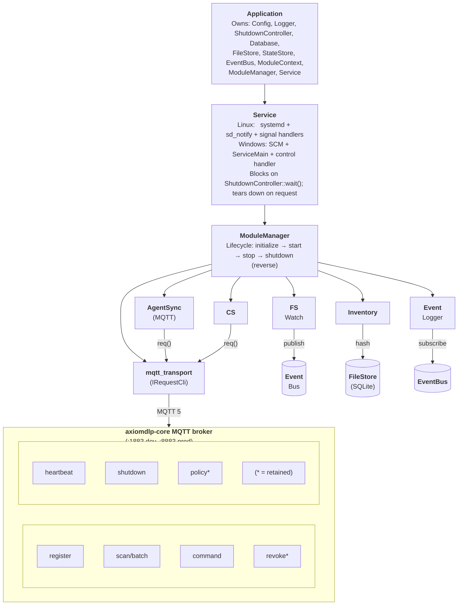

# AxiomDLP Agent — Source Bundle

- **Generated:** 2026-11-14 12:28:30 UTC
- **Root:** `/home/kali/axiomdlp-agent`

This bundle contains **only the project's own source code** —
C++ sources, the top-level CMake configuration, runtime JSON
config, packaging, scripts, and docs.

Third-party code (dependency trees under `.deps/` or `_deps/`,
vendored `third_party/`, cross-compile toolchain files under
`cmake/toolchains/`), build outputs, editor/tool caches, and
generated artifacts are **not** included. Every path that was
skipped is listed in the **Skipped Files** section at the end.
If you need any of them, ask the user — do not guess.

---

## Project Structure

```text
.
./axiomdlp-agent-bundle.md
./.clangd
./cmake
./CMakeLists.txt
./CMakePresets.json
./cmake/toolchains
./cmake/toolchains/linux-i686.cmake
./cmake/toolchains/linux-x86_64.cmake
./compile_commands.json
./config
./config/agent.default.json
./config/agent.default.json.bak
./config/agent.default_win.json
./config/agent.schema.json
./docs
./docs/architecture.md
./docs/event_schema.md
./docs/file_structure.md
./docs/ipc_protocol.md
./docs/modules.md
./docs/mqtt_protocol.md
./docs/policy_format.md
./done.md
./.github
./.github/workflows
./.github/workflows/windows-msvc.yml
./.gitignore
./LICENSE
./make-bundle.sh
./next.md
./packaging
./packaging/linux
./packaging/linux/systemd
./packaging/linux/systemd/axiomdlp-agent.service
./packaging/windows
./packaging/windows/service_install.ps1
./scripts
./scripts/linux
./scripts/linux/build-all.sh
./scripts/linux/build-openssl.sh
./scripts/linux/merge-compile-commands.sh
./scripts/win
./scripts/win/build-windows-msvc.ps1
./scripts/win/setup-windows-msvc.ps1
./src
./src/events
./src/events/event_bus.cpp
./src/events/event_bus.h
./src/events/event.cpp
./src/events/event.h
./src/features
./src/features/agent_sync
./src/features/agent_sync/agent_sync_module.cpp
./src/features/agent_sync/agent_sync_module.h
./src/features/content_scanner
./src/features/content_scanner/content_scanner_module.cpp
./src/features/content_scanner/content_scanner_module.h
./src/features/event_logger
./src/features/event_logger/event_logger_module.cpp
./src/features/event_logger/event_logger_module.h
./src/features/filesystem_watcher
./src/features/filesystem_watcher/filesystem_watcher_module.cpp
./src/features/filesystem_watcher/filesystem_watcher_module.h
./src/features/inventory
./src/features/inventory/inventory_module.cpp
./src/features/inventory/inventory_module.h
./src/features/inventory/inventory_scanner.cpp
./src/features/inventory/inventory_scanner.h
./src/features/mqtt_transport
./src/features/mqtt_transport/mqtt_transport_module.cpp
./src/features/mqtt_transport/mqtt_transport_module.h
./src/foundation
./src/foundation/application.cpp
./src/foundation/application.h
./src/foundation/config.cpp
./src/foundation/config.h
./src/foundation/logger.cpp
./src/foundation/logger.h
./src/foundation/shutdown.h
./src/main.cpp
./src/modules
./src/modules/health.h
./src/modules/i_module.h
./src/modules/module_base.h
./src/modules/module_context.h
./src/modules/module_manager.cpp
./src/modules/module_manager.h
./src/net
./src/net/i_request_client.h
./src/platform
./src/platform/file_watcher.h
./src/platform/linux
./src/platform/linux/efsw_file_watcher.cpp
./src/platform/linux/paths.cpp
./src/platform/linux/service.cpp
./src/platform/paths.h
./src/platform/service.h
./src/platform/windows
./src/platform/windows/efsw_file_watcher.cpp
./src/platform/windows/paths.cpp
./src/platform/windows/service.cpp
./src/storage
./src/storage/file_repository.cpp
./src/storage/file_repository.h
./src/storage/migrations.cpp
./src/storage/migrations.h
./src/storage/sqlite_database.cpp
./src/storage/sqlite_database.h
./src/storage/state_repository.cpp
./src/storage/state_repository.h
./src/util
./src/util/base64.cpp
./src/util/base64.h
./src/util/file_hash.cpp
./src/util/file_hash.h
./src/util/glob_match.cpp
./src/util/glob_match.h
./src/util/ulid.cpp
./src/util/ulid.h
./tests
./tests/test_phase6.py
./triplets
./triplets/x64-windows-static.cmake
./triplets/x86-windows-static.cmake
./vcpkg.json
```

---

## Project Root

  + CMakeLists.txt
### \`CMakeLists.txt\`

```cmake
cmake_minimum_required(VERSION 3.24)
project(axiomdlp-agent VERSION 0.1.0 LANGUAGES C CXX)

# ----------------------------------------------------------------
# Build options
# ----------------------------------------------------------------
option(AXIOM_USE_MQTT "Build the MQTT transport module (requires libmosquitto 2.x)" ON)

# ----------------------------------------------------------------
# Shared source cache for FetchContent dependencies
# ----------------------------------------------------------------
set(AXIOM_DEPS_DIR "${CMAKE_SOURCE_DIR}/.deps" CACHE PATH "Shared FetchContent source cache")
file(MAKE_DIRECTORY "${AXIOM_DEPS_DIR}")

if(EXISTS "${AXIOM_DEPS_DIR}/spdlog-src")
    set(FETCHCONTENT_SOURCE_DIR_SPDLOG "${AXIOM_DEPS_DIR}/spdlog-src" CACHE PATH "spdlog source cache" FORCE)
endif()
if(EXISTS "${AXIOM_DEPS_DIR}/nlohmann_json-src")
    set(FETCHCONTENT_SOURCE_DIR_NLOHMANN_JSON "${AXIOM_DEPS_DIR}/nlohmann_json-src" CACHE PATH "nlohmann/json source cache" FORCE)
endif()
if(EXISTS "${AXIOM_DEPS_DIR}/efsw-src")
    set(FETCHCONTENT_SOURCE_DIR_EFSW "${AXIOM_DEPS_DIR}/efsw-src" CACHE PATH "efsw source cache" FORCE)
endif()

# ----------------------------------------------------------------
# Language settings
# ----------------------------------------------------------------
set(CMAKE_CXX_STANDARD 20)
set(CMAKE_CXX_STANDARD_REQUIRED ON)
set(CMAKE_CXX_EXTENSIONS OFF)
set(CMAKE_EXPORT_COMPILE_COMMANDS ON)
set(CMAKE_POSITION_INDEPENDENT_CODE ON)

set(THREADS_PREFER_PTHREAD_FLAG ON)
find_package(Threads REQUIRED)

# ----------------------------------------------------------------
# Dependency acquisition strategy
# ----------------------------------------------------------------
if(MSVC)
    set(AXIOM_USE_VCPKG_DEPS ON)
    message(STATUS "Build strategy: MSVC + vcpkg (Windows native)")
    if(NOT DEFINED CMAKE_MSVC_RUNTIME_LIBRARY)
        set(CMAKE_MSVC_RUNTIME_LIBRARY "MultiThreaded$<$<CONFIG:Debug>:Debug>" CACHE STRING "Use static CRT")
    endif()
else()
    set(AXIOM_USE_VCPKG_DEPS OFF)
    message(STATUS "Build strategy: GCC native (.deps/)")
endif()

# ----------------------------------------------------------------
# Detect target triple
# ----------------------------------------------------------------
if(WIN32)
    if(CMAKE_SIZEOF_VOID_P EQUAL 8)
        set(AXIOM_TARGET "windows-x86_64")
    else()
        set(AXIOM_TARGET "windows-i686")
    endif()
elseif(UNIX AND NOT APPLE)
    if(CMAKE_SIZEOF_VOID_P EQUAL 8)
        set(AXIOM_TARGET "linux-x86_64")
    else()
        set(AXIOM_TARGET "linux-i686")
    endif()
else()
    set(AXIOM_TARGET "unknown")
endif()

message(STATUS "AxiomDLP Agent target: ${AXIOM_TARGET}")

# ----------------------------------------------------------------
# pkg-config search path for i686 cross-builds
# ----------------------------------------------------------------
if(UNIX AND NOT APPLE AND CMAKE_SIZEOF_VOID_P EQUAL 4)
    set(ENV{PKG_CONFIG_LIBDIR} "/usr/lib/i386-linux-gnu/pkgconfig:/usr/share/pkgconfig")
endif()

# ----------------------------------------------------------------
# Third-party dependencies
# ----------------------------------------------------------------
include(FetchContent)

# --- nlohmann/json ---
if(AXIOM_USE_VCPKG_DEPS)
    find_package(nlohmann_json CONFIG REQUIRED)
else()
    find_package(nlohmann_json QUIET)
    if(NOT nlohmann_json_FOUND)
        set(JSON_BuildTests OFF CACHE BOOL "" FORCE)
        set(JSON_Install    OFF CACHE BOOL "" FORCE)
        FetchContent_Declare(nlohmann_json GIT_REPOSITORY https://github.com/nlohmann/json.git GIT_TAG v3.11.3 GIT_SHALLOW TRUE)
        FetchContent_MakeAvailable(nlohmann_json)
    endif()
endif()

# --- spdlog ---
if(AXIOM_USE_VCPKG_DEPS)
    find_package(spdlog CONFIG REQUIRED)
else()
    set(SPDLOG_BUILD_SHARED   OFF CACHE BOOL "" FORCE)
    set(SPDLOG_BUILD_EXAMPLE  OFF CACHE BOOL "" FORCE)
    set(SPDLOG_BUILD_TESTS    OFF CACHE BOOL "" FORCE)
    set(SPDLOG_BUILD_BENCH    OFF CACHE BOOL "" FORCE)
    set(SPDLOG_INSTALL        OFF CACHE BOOL "" FORCE)
    FetchContent_Declare(spdlog GIT_REPOSITORY https://github.com/gabime/spdlog.git GIT_TAG v1.14.1 GIT_SHALLOW TRUE)
    FetchContent_MakeAvailable(spdlog)
endif()

# --- efsw ---
if(AXIOM_USE_VCPKG_DEPS)
    find_package(efsw CONFIG REQUIRED)
    if(TARGET efsw::efsw)
        set(AXIOM_EFSW_TARGET efsw::efsw)
    else()
        set(AXIOM_EFSW_TARGET efsw)
    endif()
else()
    set(BUILD_SHARED_LIBS OFF CACHE BOOL "" FORCE)
    set(BUILD_STATIC_LIBS ON  CACHE BOOL "" FORCE)
    set(EFSW_BUILD_TESTS   OFF CACHE BOOL "" FORCE)
    set(EFSW_BUILD_EXAMPLE OFF CACHE BOOL "" FORCE)
    FetchContent_Declare(efsw GIT_REPOSITORY https://github.com/SpartanJ/efsw.git GIT_TAG 1.7.2 GIT_SHALLOW TRUE)
    FetchContent_MakeAvailable(efsw)
    set(AXIOM_EFSW_TARGET efsw-static)
endif()

# ----------------------------------------------------------------
# OpenSSL (file hashing, base64, MQTT TLS)
# ----------------------------------------------------------------
if(AXIOM_USE_VCPKG_DEPS)
    find_package(OpenSSL REQUIRED)
else()
    if(UNIX AND NOT APPLE)
        if(CMAKE_SIZEOF_VOID_P EQUAL 8)
            set(AXIOM_OPENSSL_DIR "${AXIOM_DEPS_DIR}/openssl-linux-x86_64")
        else()
            set(AXIOM_OPENSSL_DIR "${AXIOM_DEPS_DIR}/openssl-linux-i686")
        endif()
    endif()

    if(EXISTS "${AXIOM_OPENSSL_DIR}/lib/libssl.a")
        set(AXIOM_OPENSSL_LIB_DIR "${AXIOM_OPENSSL_DIR}/lib")
    elseif(EXISTS "${AXIOM_OPENSSL_DIR}/lib64/libssl.a")
        set(AXIOM_OPENSSL_LIB_DIR "${AXIOM_OPENSSL_DIR}/lib64")
    else()
        message(FATAL_ERROR
            "OpenSSL not found at ${AXIOM_OPENSSL_DIR}. "
            "Run ./scripts/linux/build-openssl.sh first.")
    endif()

    set(OPENSSL_ROOT_DIR       "${AXIOM_OPENSSL_DIR}"                  CACHE PATH     "" FORCE)
    set(OPENSSL_INCLUDE_DIR    "${AXIOM_OPENSSL_DIR}/include"          CACHE PATH     "" FORCE)
    set(OPENSSL_SSL_LIBRARY    "${AXIOM_OPENSSL_LIB_DIR}/libssl.a"     CACHE FILEPATH "" FORCE)
    set(OPENSSL_CRYPTO_LIBRARY "${AXIOM_OPENSSL_LIB_DIR}/libcrypto.a"  CACHE FILEPATH "" FORCE)
    set(OPENSSL_USE_STATIC_LIBS ON                                     CACHE BOOL     "" FORCE)

    find_package(OpenSSL REQUIRED)

    if(NOT TARGET OpenSSL::SSL OR NOT TARGET OpenSSL::Crypto)
        message(FATAL_ERROR
            "OpenSSL imported targets missing after find_package(OpenSSL). "
            "Check ${AXIOM_OPENSSL_DIR} layout.")
    endif()
endif()

# ----------------------------------------------------------------
# libmosquitto (agent transport) — optional via AXIOM_USE_MQTT
# ----------------------------------------------------------------
if(AXIOM_USE_MQTT)
    if(AXIOM_USE_VCPKG_DEPS)
        # vcpkg exports the target as unofficial::mosquitto::mosquitto
        find_package(unofficial-mosquitto CONFIG QUIET)
        find_package(mosquitto CONFIG QUIET)

        if(TARGET unofficial::mosquitto::mosquitto)
            add_library(AXIOM_MOSQUITTO ALIAS unofficial::mosquitto::mosquitto)
            set(mosquitto_FOUND TRUE)
        elseif(mosquitto_FOUND)
            if(TARGET mosquitto::mosquitto)
                add_library(AXIOM_MOSQUITTO ALIAS mosquitto::mosquitto)
            elseif(TARGET mosquitto::libmosquitto)
                add_library(AXIOM_MOSQUITTO ALIAS mosquitto::libmosquitto)
            elseif(TARGET mosquitto::mosquitto_static)
                add_library(AXIOM_MOSQUITTO ALIAS mosquitto::mosquitto_static)
            elseif(TARGET mosquitto)
                add_library(AXIOM_MOSQUITTO ALIAS mosquitto)
            else()
                message(WARNING "mosquitto CONFIG found but no recognized target; "
                                "falling back to find_path/find_library")
                unset(mosquitto_FOUND)
            endif()
        endif()

        if(mosquitto_FOUND)
            message(STATUS "libmosquitto: vcpkg config (aliased to AXIOM_MOSQUITTO)")
        else()
            find_path(MOSQUITTO_INCLUDE_DIR
                NAMES mosquitto.h libmosquitto.h
                PATH_SUFFIXES mosquitto)
            find_library(MOSQUITTO_LIBRARY
                NAMES mosquitto libmosquitto mosquitto_static libmosquitto_static)
            if(NOT MOSQUITTO_INCLUDE_DIR OR NOT MOSQUITTO_LIBRARY)
                message(FATAL_ERROR
                    "\n"
                    "libmosquitto not found via vcpkg.\n"
                    "\n"
                    "Make sure 'mosquitto' is listed in vcpkg.json dependencies.\n")
            endif()
            add_library(AXIOM_MOSQUITTO INTERFACE)
            target_include_directories(AXIOM_MOSQUITTO INTERFACE ${MOSQUITTO_INCLUDE_DIR})
            target_link_libraries     (AXIOM_MOSQUITTO INTERFACE ${MOSQUITTO_LIBRARY})
            message(STATUS "libmosquitto: ${MOSQUITTO_LIBRARY} (manual find)")
        endif()
    else()
        find_package(PkgConfig QUIET)
        if(NOT PkgConfig_FOUND)
            message(FATAL_ERROR "pkg-config executable not found. Install: sudo apt install pkg-config")
        endif()

        pkg_check_modules(MOSQUITTO QUIET libmosquitto)
        if(NOT MOSQUITTO_FOUND)
            message(FATAL_ERROR
                "\n"
                "libmosquitto not found via pkg-config.\n"
                "\n"
                "Install it with:\n"
                "    sudo apt install libmosquitto-dev\n"
                "\n"
                "For i686: sudo apt install libmosquitto-dev:i386\n")
        endif()

        if(MOSQUITTO_VERSION VERSION_LESS "2.0")
            message(FATAL_ERROR
                "libmosquitto ${MOSQUITTO_VERSION} is too old. Requires 2.x for MQTT 5.")
        endif()

        add_library(AXIOM_MOSQUITTO INTERFACE)
        target_include_directories(AXIOM_MOSQUITTO INTERFACE ${MOSQUITTO_INCLUDE_DIRS})
        target_link_libraries     (AXIOM_MOSQUITTO INTERFACE ${MOSQUITTO_LIBRARIES})
        if(MOSQUITTO_CFLAGS_OTHER)
            target_compile_options(AXIOM_MOSQUITTO INTERFACE ${MOSQUITTO_CFLAGS_OTHER})
        endif()
        message(STATUS "libmosquitto: ${MOSQUITTO_LIBRARIES} (version ${MOSQUITTO_VERSION})")
    endif()
else()
    message(STATUS "libmosquitto: MQTT transport disabled (AXIOM_USE_MQTT=OFF)")
endif()

# ----------------------------------------------------------------
# SQLite3
# ----------------------------------------------------------------
if(AXIOM_USE_VCPKG_DEPS)
    find_package(SQLite3 REQUIRED)
    set(AXIOM_SQLITE_TARGET SQLite::SQLite3)
else()
    set(AXIOM_SQLITE_DIR "${AXIOM_DEPS_DIR}/sqlite3-src")
    set(AXIOM_SQLITE_C   "${AXIOM_SQLITE_DIR}/sqlite3.c")
    add_library(axiom_sqlite STATIC "${AXIOM_SQLITE_C}")
    target_include_directories(axiom_sqlite PUBLIC "${AXIOM_SQLITE_DIR}")
    target_compile_definitions(axiom_sqlite PRIVATE SQLITE_THREADSAFE=1 SQLITE_OMIT_LOAD_EXTENSION=1 SQLITE_DEFAULT_MEMSTATUS=0 SQLITE_DQS=0)
    if(UNIX AND NOT APPLE)
        target_link_libraries(axiom_sqlite PUBLIC dl pthread)
    endif()
    set(AXIOM_SQLITE_TARGET axiom_sqlite)
endif()

# ----------------------------------------------------------------
# Platform-specific sources
# ----------------------------------------------------------------
if(WIN32)
    set(AXIOM_PLATFORM_SOURCES 
        src/platform/windows/paths.cpp 
        src/platform/windows/service.cpp
        src/platform/windows/efsw_file_watcher.cpp
    )
elseif(UNIX AND NOT APPLE)
    set(AXIOM_PLATFORM_SOURCES 
        src/platform/linux/paths.cpp 
        src/platform/linux/service.cpp
        src/platform/linux/efsw_file_watcher.cpp
    )
endif()

# ----------------------------------------------------------------
# Agent executable
# ----------------------------------------------------------------
add_executable(axiomdlp-agent
    src/main.cpp
    src/foundation/application.cpp
    src/foundation/config.cpp
    src/foundation/logger.cpp
    src/events/event.cpp
    src/events/event_bus.cpp
    src/modules/module_manager.cpp
    src/util/glob_match.cpp
    src/util/file_hash.cpp
    src/util/base64.cpp
    src/util/ulid.cpp
    src/features/agent_sync/agent_sync_module.cpp
    src/features/content_scanner/content_scanner_module.cpp
    src/features/event_logger/event_logger_module.cpp
    src/features/filesystem_watcher/filesystem_watcher_module.cpp
    src/features/inventory/inventory_module.cpp
    src/features/inventory/inventory_scanner.cpp
    src/storage/sqlite_database.cpp
    src/storage/migrations.cpp
    src/storage/file_repository.cpp
    src/storage/state_repository.cpp
    ${AXIOM_PLATFORM_SOURCES}
)

if(AXIOM_USE_MQTT)
    target_sources(axiomdlp-agent PRIVATE
        src/features/mqtt_transport/mqtt_transport_module.cpp)
endif()

target_include_directories(axiomdlp-agent PRIVATE src)

target_compile_definitions(axiomdlp-agent PRIVATE
    SPDLOG_ACTIVE_LEVEL=SPDLOG_LEVEL_TRACE
    AXIOM_AGENT_VERSION="${PROJECT_VERSION}"
)

if(AXIOM_USE_MQTT)
    target_compile_definitions(axiomdlp-agent PRIVATE AXIOM_HAVE_MQTT=1)
    target_compile_definitions(axiomdlp-agent PRIVATE LIBMOSQUITTO_STATIC)
endif()

target_link_libraries(axiomdlp-agent PRIVATE
    spdlog::spdlog
    nlohmann_json::nlohmann_json
    ${AXIOM_EFSW_TARGET}
    ${AXIOM_SQLITE_TARGET}
    OpenSSL::SSL
    OpenSSL::Crypto
    Threads::Threads
)

if(AXIOM_USE_MQTT)
    target_link_libraries(axiomdlp-agent PRIVATE AXIOM_MOSQUITTO)
endif()

# ----------------------------------------------------------------
# Platform-specific settings
# ----------------------------------------------------------------
if(WIN32)
    target_link_libraries(axiomdlp-agent PRIVATE advapi32 shell32 ws2_32 crypt32 ole32 user32)
    target_compile_definitions(axiomdlp-agent PRIVATE WIN32_LEAN_AND_MEAN NOMINMAX _WIN32_WINNT=0x0601 _CRT_SECURE_NO_WARNINGS)
endif()

if(UNIX AND NOT APPLE)
    set(AXIOM_HAVE_SYSTEMD OFF)
    include(FindPkgConfig QUIET)
    if(PkgConfig_FOUND)
        pkg_check_modules(SYSTEMD QUIET libsystemd)
        if(SYSTEMD_FOUND)
            set(AXIOM_HAVE_SYSTEMD ON)
        endif()
    endif()
    if(AXIOM_HAVE_SYSTEMD)
        target_compile_definitions(axiomdlp-agent PRIVATE HAVE_SYSTEMD)
        target_include_directories(axiomdlp-agent PRIVATE ${SYSTEMD_INCLUDE_DIRS})
        target_link_libraries(axiomdlp-agent PRIVATE ${SYSTEMD_LIBRARIES})
    endif()
    target_compile_options(axiomdlp-agent PRIVATE -fstack-protector-strong -fPIE)
    target_link_options(axiomdlp-agent PRIVATE -pie -Wl,-z,relro,-z,now)

    if(CMAKE_SIZEOF_VOID_P EQUAL 4)
        set_target_properties(axiomdlp-agent PROPERTIES
            INSTALL_RPATH "/usr/lib/i386-linux-gnu"
            BUILD_WITH_INSTALL_RPATH TRUE)
    endif()
endif()

if(MSVC)
    target_compile_options(axiomdlp-agent PRIVATE /W4 /permissive- /Zc:__cplusplus /bigobj)
else()
    target_compile_options(axiomdlp-agent PRIVATE -Wall -Wextra -Wpedantic)
endif()
```

  + CMakePresets.json
### \`CMakePresets.json\`

```json
{
  "version": 6,
  "cmakeMinimumRequired": { "major": 3, "minor": 24, "patch": 0 },
  "configurePresets": [
    {
      "name": "base",
      "hidden": true,
      "generator": "Ninja",
      "binaryDir": "${sourceDir}/build/${presetName}"
    },
    {
      "name": "linux-x86_64-debug",
      "displayName": "Linux x86_64 — Debug",
      "inherits": "base",
      "toolchainFile": "${sourceDir}/cmake/toolchains/linux-x86_64.cmake",
      "cacheVariables": { "CMAKE_BUILD_TYPE": "Debug" }
    },
    {
      "name": "linux-x86_64-release",
      "displayName": "Linux x86_64 — Release",
      "inherits": "base",
      "toolchainFile": "${sourceDir}/cmake/toolchains/linux-x86_64.cmake",
      "cacheVariables": { "CMAKE_BUILD_TYPE": "Release" }
    },
    {
      "name": "linux-i686-debug",
      "displayName": "Linux i686 (32-bit) — Debug",
      "inherits": "base",
      "toolchainFile": "${sourceDir}/cmake/toolchains/linux-i686.cmake",
      "cacheVariables": { "CMAKE_BUILD_TYPE": "Debug" }
    },
    {
      "name": "linux-i686-release",
      "displayName": "Linux i686 (32-bit) — Release",
      "inherits": "base",
      "toolchainFile": "${sourceDir}/cmake/toolchains/linux-i686.cmake",
      "cacheVariables": { "CMAKE_BUILD_TYPE": "Release" }
    },
    {
      "name": "windows-x64-msvc-debug",
      "displayName": "Windows x64 — Debug (MSVC + vcpkg)",
      "inherits": "base",
      "binaryDir": "${sourceDir}/build/windows-x64-msvc-debug",
      "toolchainFile": "$env{VCPKG_ROOT}/scripts/buildsystems/vcpkg.cmake",
      "cacheVariables": {
        "CMAKE_BUILD_TYPE": "Debug",
        "VCPKG_TARGET_TRIPLET": "x64-windows-static",
        "CMAKE_MSVC_RUNTIME_LIBRARY": "MultiThreaded$<$<CONFIG:Debug>:Debug>",
        "CMAKE_MAKE_PROGRAM": "$env{CMAKE_MAKE_PROGRAM}"
      },
      "condition": { "type": "equals", "lhs": "${hostSystemName}", "rhs": "Windows" }
    },
    {
      "name": "windows-x64-msvc-release",
      "displayName": "Windows x64 — Release (MSVC + vcpkg)",
      "inherits": "base",
      "binaryDir": "${sourceDir}/build/windows-x64-msvc-release",
      "toolchainFile": "$env{VCPKG_ROOT}/scripts/buildsystems/vcpkg.cmake",
      "cacheVariables": {
        "CMAKE_BUILD_TYPE": "Release",
        "VCPKG_TARGET_TRIPLET": "x64-windows-static",
        "CMAKE_MSVC_RUNTIME_LIBRARY": "MultiThreaded$<$<CONFIG:Debug>:Debug>",
        "CMAKE_MAKE_PROGRAM": "$env{CMAKE_MAKE_PROGRAM}"
      },
      "condition": { "type": "equals", "lhs": "${hostSystemName}", "rhs": "Windows" }
    },
    {
      "name": "windows-x86-msvc-debug",
      "displayName": "Windows x86 — Debug (MSVC + vcpkg)",
      "inherits": "base",
      "binaryDir": "${sourceDir}/build/windows-x86-msvc-debug",
      "toolchainFile": "$env{VCPKG_ROOT}/scripts/buildsystems/vcpkg.cmake",
      "cacheVariables": {
        "CMAKE_BUILD_TYPE": "Debug",
        "VCPKG_TARGET_TRIPLET": "x86-windows-static",
        "CMAKE_MSVC_RUNTIME_LIBRARY": "MultiThreaded$<$<CONFIG:Debug>:Debug>",
        "CMAKE_MAKE_PROGRAM": "$env{CMAKE_MAKE_PROGRAM}"
      },
      "condition": { "type": "equals", "lhs": "${hostSystemName}", "rhs": "Windows" }
    },
    {
      "name": "windows-x86-msvc-release",
      "displayName": "Windows x86 — Release (MSVC + vcpkg)",
      "inherits": "base",
      "binaryDir": "${sourceDir}/build/windows-x86-msvc-release",
      "toolchainFile": "$env{VCPKG_ROOT}/scripts/buildsystems/vcpkg.cmake",
      "cacheVariables": {
        "CMAKE_BUILD_TYPE": "Release",
        "VCPKG_TARGET_TRIPLET": "x86-windows-static",
        "CMAKE_MSVC_RUNTIME_LIBRARY": "MultiThreaded$<$<CONFIG:Debug>:Debug>",
        "CMAKE_MAKE_PROGRAM": "$env{CMAKE_MAKE_PROGRAM}"
      },
      "condition": { "type": "equals", "lhs": "${hostSystemName}", "rhs": "Windows" }
    }
  ],
  "buildPresets": [
    { "name": "linux-x86_64-debug",   "configurePreset": "linux-x86_64-debug" },
    { "name": "linux-x86_64-release", "configurePreset": "linux-x86_64-release" },
    { "name": "linux-i686-debug",     "configurePreset": "linux-i686-debug" },
    { "name": "linux-i686-release",   "configurePreset": "linux-i686-release" },
    { "name": "windows-x64-msvc-debug",   "configurePreset": "windows-x64-msvc-debug",   "configuration": "Debug" },
    { "name": "windows-x64-msvc-release", "configurePreset": "windows-x64-msvc-release", "configuration": "Release" },
    { "name": "windows-x86-msvc-debug",   "configurePreset": "windows-x86-msvc-debug",   "configuration": "Debug" },
    { "name": "windows-x86-msvc-release", "configurePreset": "windows-x86-msvc-release", "configuration": "Release" }
  ]
}
```

  · skip: README.md (not present)
  · skip: LICENSE (binary file — not bundled)
  + next.md
### \`next.md\`

~~~~markdown
# AxiomDLP Endpoint Agent — Phase 2 README

**Version:** 1.0.0  
**Status:** Design Document + Implementation Roadmap  
**Scope:** Agent-side only. Server changes will be documented separately.

---

## Table of Contents

1. [Current State](#1-current-state)
2. [Phase 2 Goals](#2-phase-2-goals)
3. [Architecture Additions](#3-architecture-additions)
4. [Milestone 15 — Policy Engine](#4-milestone-15--policy-engine)
5. [Milestone 16 — User-Mode Enforcement](#5-milestone-16--user-mode-enforcement)
6. [Milestone 17 — Extended Content Extraction](#6-milestone-17--extended-content-extraction)
7. [Milestone 18 — Advanced Detection](#7-milestone-18--advanced-detection)
8. [Milestone 19 — IPC & Tray Helper](#8-milestone-19--ipc--tray-helper)
9. [Milestone 20 — Kernel Enforcement (Linux eBPF)](#9-milestone-20--kernel-enforcement-linux-ebpf)
10. [Milestone 21 — Kernel Enforcement (Windows Minifilter)](#10-milestone-21--kernel-enforcement-windows-minifilter)
11. [Milestone 22 — Remote Commands & Auto-Update](#11-milestone-22--remote-commands--auto-update)
12. [Milestone 23 — Platform Expansion](#12-milestone-23--platform-expansion)
13. [Milestone 24 — Observability & Telemetry](#13-milestone-24--observability--telemetry)
14. [Milestone 25 — Hardening & Tamper Resistance](#14-milestone-25--hardening--tamper-resistance)
15. [Testing Strategy](#15-testing-strategy)
16. [Build & Release](#16-build--release)
17. [Working Agreement](#17-working-agreement)

---

## 1. Current State

### What Works

- Cross-platform service (Linux x86_64/i686, Windows x86_64/i686)
- Real-time filesystem watching (efsw / inotify / ReadDirectoryChangesW)
- Periodic inventory + SHA-256 hashing
- WebSocket + HTTP with TLS to the Core
- Content scanner for text files (chunked upload)
- SQLite with schema versioning (v4)
- Event bus, module framework, health reporting
- Bearer token auth, jittered reconnect, close-code handling
- Graceful shutdown, auth-failure shutdown

### What Does Not Exist

- No local policy engine
- No enforcement of any kind (block/allow/quarantine)
- No PDF/DOCX/OCR extraction (text files only)
- No fingerprinting (EDM, PDM, document registry)
- No user interface (tray, notifications, IPC)
- No kernel-level hooks
- No remote command channel
- No auto-update
- No macOS, ARM64
- No metrics endpoint
- No tamper resistance

---

## 2. Phase 2 Goals

By the end of Phase 2, the agent must:

1. **Decide locally** — evaluate events against a cached policy set within 5 ms.
2. **Enforce** — block file writes/reads, clipboard copy, print jobs, USB writes.
3. **See more** — extract text from PDFs, DOCX, XLSX, PPTX, images (OCR).
4. **Match more** — exact file fingerprints, document fingerprints, structured data.
5. **Talk to the user** — tray icon, notifications, pause/resume, override prompt.
6. **Survive attack** — anti-kill, service watchdog, signed updates.
7. **Talk to the fleet** — receive remote commands, apply policy updates without restart.
8. **Report health** — Prometheus-style metrics for every subsystem.

**Non-goals for Phase 2:** macOS support, mobile, cloud/SaaS DLP, CASB, eDiscovery. Those are Phase 3+.

---

## 3. Architecture Additions

New modules and interfaces:

```
+-------------------------------------------------------------+
|                     APPLICATION                              |
|                                                              |
|  Existing:  Config, Logger, Database, EventBus, ModuleMgr    |
|  New:       PolicyStore, EnforcerRegistry, IPCServer,        |
|             UpdateManager, MetricsRegistry, Watchdog         |
+--------------------------+----------------------------------+
                           |
        +------------------+------------------+
        |                  |                  |
        v                  v                  v
+---------------+  +----------------+  +----------------+
| Policy Engine |  | Enforcement    |  | Content        |
| (local cache) |  | (user + kernel)|  | Extractors     |
+-------+-------+  +--------+-------+  +--------+-------+
        |                   |                   |
        v                   v                   v
+-------------------------------------------------------------+
|                    EVENT BUS                                 |
+-------------------------------------------------------------+
        ^                   ^                   ^
        |                   |                   |
+-------+-------+  +--------+-------+  +--------+-------+
| FS Watcher    |  | Clipboard     |  | Print Monitor  |
| (existing)    |  | Monitor       |  | (new)          |
+---------------+  +----------------+  +----------------+
```

**New top-level directories:**

```
src/
├── policy/          # Policy engine, cache, evaluator
├── enforcement/     # User-mode enforcers (files, clipboard, print)
├── extractors/      # PDF, DOCX, XLSX, PPTX, image extractors
├── fingerprint/     # EDM, PDM, document registry
├── ipc/             # Unix socket / named pipe server
├── updater/         # Auto-update with signature verification
├── telemetry/       # Metrics registry + HTTP endpoint
├── watchdog/        # Self-monitoring + restart
└── platform/
    ├── linux/
    │   ├── ebpf/    # eBPF loader + programs
    │   └── fanotify/# fanotify backend
    └── windows/
        └── minifilter/ # Kernel driver + user-mode communicator
```

**New helper binary:**

```
axiomdlp-helper/     # Tray icon + notifications
```

---

## 4. Milestone 15 — Policy Engine

**Goal:** Evaluate file events against a local policy set in under 5 ms, with no network dependency.

### 4.1 Deliverables

- `PolicyStore` — SQLite-backed cache of server-provided policies
- `PolicyEngine` — evaluates `(event, scan_result)` → `Decision`
- `Decision` struct — action, risk score, matched policy ID, reason
- Policy version tracking + atomic hot-swap on update
- Subscribes to `scan_result` events on the bus

### 4.2 Data Types

```cpp
// src/policy/policy.h

enum class PolicyAction {
    Allow,      // no action, log at debug
    Log,        // write to audit log, no user impact
    Alert,      // log + admin notification
    Coach,      // log + user educational popup
    Block,      // deny the operation
    Quarantine, // move file to encrypted vault
    Encrypt,    // encrypt file in place
    Redact,     // remove sensitive content
};

struct PolicyRule {
    std::string id;
    std::string name;
    int         priority;         // higher wins
    bool        enabled;

    // Match conditions (all must be true)
    std::vector<std::string> entity_types;   // "CREDIT_CARD", "SSN", ...
    int         min_risk_score = 0;          // 0-10
    double      min_confidence = 0.0;        // 0.0-1.0
    std::vector<std::string> file_extensions; // empty = any
    std::vector<std::string> path_patterns;   // glob, empty = any
    std::vector<std::string> event_types;     // "file_write", ...

    // Action
    PolicyAction action;
    bool         enforce_sync = true;         // block inline
    int          priority_override = 0;
};

struct Decision {
    PolicyAction action       = PolicyAction::Allow;
    int          risk_score   = 0;
    std::string  reason;
    std::string  policy_id;
    std::string  policy_name;
    bool         enforce_sync = false;
};
```

### 4.3 PolicyStore

- Backed by SQLite table `policies` (migration v5)
- `load_from_server()` — downloads signed bundle via HTTPS, verifies signature, atomically replaces
- `get_rules()` — returns an immutable snapshot (shared_ptr to vector)
- `version()` — monotonic counter for change detection
- Thread-safe; readers never block on writers

### 4.4 PolicyEngine

```cpp
class PolicyEngine {
public:
    Decision evaluate(const Event& event, const ScanResult& scan);

private:
    std::shared_ptr<const std::vector<PolicyRule>> rules_;
};
```

Algorithm:
1. Iterate rules in descending priority.
2. For each rule, check every condition against the event + scan.
3. First matching rule wins.
4. No match → `Decision{Allow}`.

### 4.5 Hot-Swap

When the server pushes a policy update via WebSocket:

1. `transport` module receives `policy_update` message with a signed bundle URL + hash.
2. `policy` module downloads the bundle in the background.
3. Verifies Ed25519 signature against an embedded public key.
4. Opens a new SQLite read transaction, writes to `policies_new`, commits.
5. Atomically swaps `rules_` shared_ptr.
6. Publishes `policy_changed` event so other modules can react.

### 4.6 Success Criteria

1. 1000 rules evaluate in < 5 ms on the target hardware.
2. A policy update takes effect within 100 ms of the push.
3. Signed bundle with wrong signature is rejected and logged at ERROR.
4. A missing bundle leaves the previous policy set in place.
5. Every decision is recorded in an audit table.

---

## 5. Milestone 16 — User-Mode Enforcement

**Goal:** Enforce `Block` decisions for files, clipboard, and print jobs without kernel support.

### 5.1 Deliverables

- `IEnforcer` interface
- `FileEnforcer` — inotify + fanotify-based, blocks file writes
- `ClipboardEnforcer` — X11 / Wayland clipboard hooks (Linux), Windows clipboard (Windows)
- `PrintEnforcer` — CUPS hook (Linux), spooler hook (Windows)
- `EnforcerRegistry` — routes decisions to the right enforcer

### 5.2 Interface

```cpp
// src/enforcement/enforcer.h

class IEnforcer {
public:
    virtual ~IEnforcer() = default;
    virtual std::string name() const = 0;
    virtual bool can_enforce(const std::string& event_type) const = 0;
    virtual bool enforce(const Decision& decision, const Event& event) = 0;
};
```

### 5.3 FileEnforcer (Linux)

Uses **fanotify** in `FAN_OPEN_PERM` mode:

1. Open a fanotify fd with `FAN_CLASS_CONTENT`.
2. Mark the mount points we care about.
3. On `FAN_OPEN_PERM` event, suspend the calling process.
4. Publish a `file_access` event, wait for a `Decision`.
5. Call `write(fd, response)` with `FAN_ALLOW` or `FAN_DENY`.

Limitation: fanotify permission events require `CAP_SYS_ADMIN`. The agent must run as a service (root on Linux).

**Fallback:** if fanotify is unavailable, use inotify + `LD_PRELOAD` shim or accept that writes complete but are then quarantined.

### 5.4 FileEnforcer (Windows)

Windows lacks a user-mode API to block file opens. Two options:

1. **Minifilter** (Milestone 21) — kernel-level, unbypassable.
2. **Read-only folder trick** — temporarily mark the target directory read-only when a block is decided. Racy and bypassable.

For Phase 2 we implement a **notification-only** FileEnforcer on Windows and defer blocking to Milestone 21.

### 5.5 ClipboardEnforcer (Linux)

- X11: own `CLIPBOARD` and `PRIMARY` selections; intercept `XConvertSelection` requests.
- Wayland: use `wlr-data-control-unstable-v1` protocol (Wayland compositor support varies).

The enforcer scans every clipboard payload:
- If `Decision::Block`, do not serve the selection.
- Otherwise serve it.

### 5.6 ClipboardEnforcer (Windows)

- Register a clipboard viewer with `AddClipboardFormatListener`.
- On `WM_CLIPBOARDUPDATE`, read the clipboard, scan it.
- If `Block`, call `EmptyClipboard()` and show a notification.

### 5.7 PrintEnforcer (Linux)

- Watch `/var/spool/cups/tmp/` for new spool files.
- On creation, open and scan.
- If `Block`, delete the spool file and send a CUPS cancel.

### 5.8 PrintEnforcer (Windows)

- Register a print monitor with `AddMonitor` API.
- Intercept `StartDocPrinter`, `WritePrinter`.
- Scan the spooled data before it reaches the device.

### 5.9 Success Criteria

1. A `Block` decision on `file_access` prevents the read on Linux.
2. A `Block` decision on `clipboard_copy` clears the clipboard within 100 ms.
3. A `Block` decision on `print_job` cancels the print before it leaves the spooler.
4. Every enforcement action is recorded in the audit log with the policy ID.
5. Enforcement failure does not crash the agent — it logs and continues.

---

## 6. Milestone 17 — Extended Content Extraction

**Goal:** Scan PDF, DOCX, XLSX, PPTX, and images with OCR.

### 6.1 Deliverables

- `IContentExtractor` interface
- `PdfExtractor` — Poppler or MuPDF
- `DocxExtractor` — libzip + XML parsing
- `XlsxExtractor` — same
- `PptxExtractor` — same
- `ImageOcrExtractor` — PaddleOCR C++ bindings (ncnn)
- `ExtractorRegistry` — routes file types to the right extractor
- Content-type detection via magic bytes (libmagic)

### 6.2 Interface

```cpp
// src/extractors/extractor.h

struct ExtractedContent {
    std::string text;
    std::vector<std::string> images_b64;   // embedded images for OCR
    std::map<std::string, std::string> metadata;
    std::string error;
    bool ok() const { return error.empty(); }
};

class IContentExtractor {
public:
    virtual ~IContentExtractor() = default;
    virtual std::string name() const = 0;
    virtual bool supports(const std::string& mime, const std::string& ext) const = 0;
    virtual ExtractedContent extract(const std::vector<uint8_t>& data,
                                     const std::string& filename) = 0;
};
```

### 6.3 Dependencies

| Extractor | Library | License | Notes |
|-----------|---------|---------|-------|
| PDF | Poppler (libpoppler-cpp) | GPL-2.0 | Add a note about GPL linkage |
| PDF (alt) | MuPDF | AGPL | Not compatible with commercial agent |
| DOCX/XLSX/PPTX | libzip + pugixml | BSD/MIT | — |
| OCR | PaddleOCR + ncnn | Apache 2.0 | Bundle as static library |
| Magic | libmagic | BSD | — |

Choose **Poppler** for PDF unless licensing forbids GPL; then fall back to a commercial SDK (PDFium via Chromium build).

### 6.4 Pipeline

```
content_scanner (existing)
    |
    v
ExtractorRegistry::extract(data, filename) 
    |
    +-- by magic bytes → PDF   → PdfExtractor
    +-- by magic bytes → ZIP   → try DOCX/XLSX/PPTX
    +-- by magic bytes → image → ImageOcrExtractor
    +-- else            → treat as text
    |
    v
ExtractedContent { text, images_b64 }
    |
    +-- text → chunk + send to server
    +-- images → OCR each → append text → chunk + send
```

### 6.5 Success Criteria

1. A 50-page PDF extracts to text in under 3 seconds.
2. A DOCX with embedded images extracts text + OCRs each image.
3. An XLSX with 10 sheets extracts all cells including formulas.
4. A PNG or JPG containing text produces the text via OCR.
5. Extraction errors do not crash the agent.

---

## 7. Milestone 18 — Advanced Detection

**Goal:** Move beyond regex — exact data match, document fingerprinting, and structured data.

### 7.1 Deliverables

- `EdmMatcher` — Exact Data Match (columns of known-sensitive values)
- `PdmMatcher` — Partial Document Match (shingled fingerprints)
- `DocumentRegistry` — a signed corpus of sensitive documents
- `StructuredDataMatcher` — CSV/JSON records against a schema
- `FingerprintStore` — SQLite-backed

### 7.2 EDM

- The server compiles a list of exact values (SSNs, card numbers, patient IDs) into a Bloom filter + HMAC.
- The filter + HMAC key are pushed to the agent via the policy bundle.
- On scan, the agent HMACs every token in the file and checks membership in the filter.
- No plaintext values on the endpoint — only HMACs of them.

```cpp
class EdmMatcher {
public:
    bool match(const std::string& text,
               std::vector<std::string>& out_matches) const;
private:
    // Bloom filter of HMAC(value, key)
    std::vector<uint8_t> filter_;
    std::array<uint8_t, 32> hmac_key_;
    // Number of hash functions, filter size
    uint32_t k_ = 7;
    uint64_t m_ = 0;
};
```

### 7.3 PDM

- The server shingles each protected document into 30-character chunks with stride 10.
- Each shingle is hashed and stored in a Bloom filter.
- The agent computes the same shingles on a candidate file and counts matching shingles.
- Above a threshold (e.g., 25% of shingles match), the file is flagged.

### 7.4 DocumentRegistry

- Signed list of document IDs with metadata (name, category, sensitivity).
- The registry is downloaded and cached.
- The matcher returns the document ID + name when a match is found.

### 7.5 Structured Data

- Policies can embed a schema (e.g., "row must contain both credit_card AND email").
- The matcher parses CSV/JSON and applies the rules row by row.

### 7.6 Success Criteria

1. A file containing one exact SSN from the EDM list is flagged.
2. A file with 25% PDM shingle match is flagged with the source document name.
3. A CSV with one row meeting a structured-data rule is flagged.
4. EDM list of 10 million values fits in under 20 MB of RAM.
5. Match time for a 1 MB file is under 50 ms.

---

## 8. Milestone 19 — IPC & Tray Helper

**Goal:** Give the user a visible agent, notifications, and pause/resume.

### 8.1 Deliverables

- `IPCServer` in the service (Unix socket on Linux, named pipe on Windows)
- `axiomdlp-helper` binary — tray icon + notifications + IPC client
- Message protocol (length-prefixed JSON)
- Auto-start of helper on user login (Linux: XDG autostart; Windows: Run key)

### 8.2 IPC Protocol

Message shape:

```json
{
  "type": "notification",
  "id":   "evt_abc123",
  "title": "Sensitive file blocked",
  "body":  "/home/user/Downloads/pii.txt contains credit card data",
  "actions": ["view_details", "dismiss"],
  "severity": "warning"
}
```

Types:
- `notification`
- `pause_dlp` / `resume_dlp`
- `query_status`
- `override_request` / `override_response`
- `user_feedback`
- `ping` / `pong`

### 8.3 Tray Icon

- **Linux:** libappindicator3 (`libayatana-appindicator3-dev`)
- **Windows:** `Shell_NotifyIcon` via Win32 API
- **States:** green (running), yellow (paused), red (error)
- **Menu:** Status, Pause for 15m, Pause until restart, View events, About, Quit

### 8.4 Notifications

- **Linux:** `notify-send` via D-Bus or `libnotify`
- **Windows:** `Shell_NotifyIcon` balloon or Windows toast (WinRT)
- Severity levels map to icon + color

### 8.5 Pause/Resume

- Helper sends `pause_dlp` with a TTL (seconds).
- Service sets a `paused_until` timestamp.
- Enforcer registry checks the timestamp before enforcing.
- Policy can disallow pause (e.g., in "strict" mode).

### 8.6 Override Request

When a user is blocked, they can click "Request override":

1. Helper opens a dialog for justification.
2. Sends `override_request` over IPC.
3. Service publishes an event; the Core receives it over WebSocket.
4. The admin approves/denies on the server.
5. The response flows back through the WebSocket → IPC → helper notification.

### 8.7 Success Criteria

1. Tray icon appears when the user logs in.
2. A blocked event shows a notification within 200 ms.
3. Pause/resume takes effect within 1 s.
4. Helper crash does not affect the service.
5. Service restart reconnects the helper automatically.

---

## 9. Milestone 20 — Kernel Enforcement (Linux eBPF)

**Goal:** Unbypassable enforcement of file operations via eBPF LSM programs.

### 9.1 Deliverables

- eBPF LSM programs: `file_open`, `file_permission`, `task_kill`
- eBPF map for kernel↔user communication
- User-space loader (libbpf)
- BPF CO-RE (Compile Once – Run Everywhere)

### 9.2 Architecture

```
+----------------------+          +---------------------+
|   User processes     |          |                     |
|   open(), exec()     | ----->   |  Kernel LSM hooks   |
+----------------------+          |    (BPF programs)   |
                                  +----------+----------+
                                             |
                                             v
                                  +---------------------+
                                  |  BPF ring buffer    |
                                  +----------+----------+
                                             |
                                             v
                                  +---------------------+
                                  |  User-space loader  |
                                  |   (agent process)   |
                                  +----------+----------+
                                             |
                                             v
                                  +---------------------+
                                  |   PolicyEngine      |
                                  +---------------------+
```

### 9.3 Program 1 — `file_open`

Triggered on `security_file_open`. Looks up the file path in a BPF hash map. If present and marked DENY, returns `-EACCES`.

The map is populated by user-space when the policy engine decides to block a specific path.

### 9.4 Program 2 — `file_permission`

Triggered on `security_file_permission` for write operations. Same as above but for writes.

### 9.5 Program 3 — `task_kill`

Triggered on `sched_process_exit`. Used for telemetry, not enforcement.

### 9.6 Communication Channel

- User-space writes decisions to a BPF hash map keyed by `(dev, inode)`.
- Kernel program looks up by `(dev, inode)`.
- Value: `u8` (0 = allow, 1 = deny) + TTL.

### 9.7 Loading

- `libbpf` (with CO-RE) + a `.bpf.o` object compiled at build time.
- Attached via `bpf_link` to the LSM hook.
- Unloaded on agent shutdown.

### 9.8 Requirements

- Linux 5.7+ (BPF LSM)
- `CONFIG_BPF_LSM=y` in the running kernel
- The agent must run as root or with `CAP_BPF` + `CAP_PERFMON`

### 9.9 Fallback

If BPF LSM is unavailable, fall back to fanotify (Milestone 16).

### 9.10 Success Criteria

1. A blocked file open returns `EACCES` to the caller.
2. `strace -f /usr/bin/cat blocked.txt` shows `EACCES`.
3. Direct syscalls (`syscall(SYS_open, ...)`) also return `EACCES`.
4. No kernel oops under load.
5. Agent unload removes all BPF programs cleanly.

---

## 10. Milestone 21 — Kernel Enforcement (Windows Minifilter)

**Goal:** Unbypassable enforcement of file operations on Windows.

### 10.1 Deliverables

- Minifilter driver (`axiomdlpflt.sys`)
- User-space communication library
- Installer / uninstaller
- Driver signing (test cert for dev, EV cert for production)

### 10.2 Architecture

```
+----------------------+          +---------------------+
|  Win32 file APIs     |          |                     |
|  CreateFile()        | ----->   |  Windows I/O Mgr    |
+----------------------+          +----------+----------+
                                             |
                                             v
                                  +---------------------+
                                  |  Filter Manager     |
                                  |   (fltmgr.sys)      |
                                  +----------+----------+
                                             |
                                             v
                                  +---------------------+
                                  |  axiomdlpflt.sys    |
                                  +----------+----------+
                                             |
                                             v
                                  +---------------------+
                                  |  Agent (user-mode)  |
                                  |  via FltSendMessage |
                                  +---------------------+
```

### 10.3 Driver Responsibilities

- Register `IRP_MJ_CREATE` pre-op callback
- On each file open, send a message to user-space
- Wait up to 5 seconds for a response
- Response: `FLT_PREOP_SUCCESS_NO_CALLBACK` (allow) or `FLT_PREOP_COMPLETE` with `STATUS_ACCESS_DENIED` (block)

### 10.4 User-Space Communicator

- Uses `FilterConnectCommunicationPort` + `FilterSendMessage` + `FilterGetMessage`
- Runs on a dedicated thread
- Calls `PolicyEngine::evaluate` and returns the decision

### 10.5 Installation

- `axiomdlpflt.inf` — the driver INF
- `sc create axiomdlpflt binPath= ... type= kernel`
- `fltmc load axiomdlpflt`
- Uninstall: `fltmc unload` + `sc delete`

### 10.6 Requirements

- Windows 10+ (driver model 1.9+)
- Driver signed with a Microsoft‑approved cert (EV or test with `bcdedit /set testsigning on` in dev)

### 10.7 Success Criteria

1. `CreateFile()` on a blocked path returns `ERROR_ACCESS_DENIED`.
2. Direct NT API calls (`NtCreateFile`) also blocked.
3. Driver unloads cleanly without a bugcheck.
4. No file system corruption under stress.
5. Signed driver loads on Windows 10 and 11 x64.

---

## 11. Milestone 22 — Remote Commands & Auto-Update

**Goal:** Control the fleet from the Core and update agents without admin intervention.

### 11.1 Deliverables

- Command dispatcher on the agent (subscribe to `command` WebSocket messages)
- Signature verification for update bundles
- Atomic binary swap on Linux and Windows
- Rollback on failed startup

### 11.2 Commands

| Command | Payload | Action |
|---------|---------|--------|
| `rescan` | `{}` | Trigger a full inventory scan |
| `pause` | `{"duration_sec": 900}` | Pause enforcement |
| `resume` | `{}` | Resume enforcement |
| `quarantine_file` | `{"path": "/..."}` | Move to vault |
| `uninstall` | `{}` | Uninstall and exit |
| `update` | `{"url": "...", "sha256": "...", "sig": "..."}` | Download, verify, install |
| `restart` | `{}` | Restart the service |
| `dump_logs` | `{"lines": 1000}` | Upload recent logs |
| `run_diagnostic` | `{}` | Run self-test, upload results |

### 11.3 Update Flow

1. Agent receives `update` command with URL, SHA-256, and Ed25519 signature.
2. Downloads to `/var/lib/axiomdlp/updates/axiomdlp-agent.new`.
3. Verifies SHA-256.
4. Verifies Ed25519 signature against the embedded public key.
5. On Linux:
   - Rename current binary to `.old`
   - Rename `.new` to current path
   - `chmod +x`
   - Restart via systemd (`systemctl restart axiomdlp-agent`)
   - On startup, if the new binary fails a self-test within 30 seconds, revert to `.old`
6. On Windows:
   - Schedule the swap via `MoveFileEx(MOVEFILE_DELAY_UNTIL_REBOOT)` OR
   - Use a helper service running outside the agent
   - Verify by re-launch and self-test

### 11.4 Embedded Public Key

```cpp
// src/updater/trusted_keys.h
constexpr const char* kUpdateSigningKeyHex =
    "9f8e7d6c5b4a39281706f5e4d3c2b1a0..."; // 32-byte Ed25519 public key
```

The key is compiled into the binary and cannot be replaced without a signed update.

### 11.5 Success Criteria

1. An unsigned update is rejected and logged at ERROR.
2. A signed update installs and the agent restarts within 10 seconds.
3. A corrupted binary fails self-test and rolls back automatically.
4. Linux update works without a restart via `systemd-run`.

---

## 12. Milestone 23 — Platform Expansion

**Goal:** macOS and ARM64 support.

### 12.1 macOS

- **Filesystem watching:** FSEvents API
- **Enforcement:** EndpointSecurity framework (requires Apple entitlements)
- **Service:** launchd plist
- **Tray:** NSStatusBar
- **Signing:** Apple Developer ID + notarization
- **Distribution:** `.pkg` signed and notarized

### 12.2 ARM64 Linux

- Add `cmake/toolchains/linux-aarch64.cmake`
- Cross-compile via `aarch64-linux-gnu-g++`
- Build OpenSSL for aarch64
- Verify eBPF works on aarch64

### 12.3 Windows ARM64

- Add `windows-aarch64.cmake` via llvm-mingw
- Build OpenSSL with `VC-WIN64-ARM`
- Verify minifilter loads on Surface Pro X

### 12.4 Success Criteria

1. All six targets build on CI: linux‑x86_64, linux‑i686, linux‑aarch64, windows‑x86_64, windows‑i686, windows‑aarch64.
2. macOS agent starts, watches files, and enforces blocks.
3. Binary sizes remain under 15 MB compressed.
4. ARM64 binaries run on Raspberry Pi 4 (Linux) and Surface Pro X (Windows).

---

## 13. Milestone 24 — Observability & Telemetry

**Goal:** Every subsystem exposes metrics for fleet-wide visibility.

### 13.1 Deliverables

- `MetricsRegistry` — process-wide metrics
- HTTP endpoint on `127.0.0.1:9101/metrics` in Prometheus text format
- Structured logs with correlation IDs
- Optional OpenTelemetry exporter

### 13.2 Metrics

| Metric | Type | Description |
|--------|------|-------------|
| `axiom_agent_uptime_seconds` | gauge | Process uptime |
| `axiom_agent_module_health` | gauge | Per-module health 0/1/2/3 |
| `axiom_events_published_total` | counter | Events on the bus |
| `axiom_events_dropped_total` | counter | Outbound queue overflows |
| `axiom_scan_files_total` | counter | Files scanned |
| `axiom_scan_bytes_total` | counter | Bytes scanned |
| `axiom_scan_duration_seconds` | histogram | Scan latency |
| `axiom_decisions_total{action}` | counter | Decisions by action |
| `axiom_enforcement_total{result}` | counter | Enforcement by outcome |
| `axiom_policy_version` | gauge | Current policy version |
| `axiom_ws_reconnects_total` | counter | WebSocket reconnect attempts |
| `axiom_ws_connected` | gauge | 1 if connected |
| `axiom_ipc_connections` | gauge | Active helper connections |

### 13.3 Log Correlation

Every event carries a `trace_id` (ULID). Logs include `trace_id` in the structured prefix so a single event can be followed from filesystem watcher to server decision to enforcement action.

### 13.4 OpenTelemetry (optional)

If `OTEL_EXPORTER_OTLP_ENDPOINT` is set, spans are exported:
- `content_scan` (span per file)
- `policy_evaluate` (span per decision)
- `enforce` (span per enforcement action)
- `ws_publish` (span per outbound message)

### 13.5 Success Criteria

1. `/metrics` returns valid Prometheus text.
2. Grafana scrapes and shows a full dashboard.
3. A single event can be traced end-to-end across the bus.
4. Metrics add < 1% CPU overhead.

---

## 14. Milestone 25 — Hardening & Tamper Resistance

**Goal:** The agent cannot be disabled, killed, or bypassed by a non-admin user.

### 14.1 Deliverables

- Service watchdog (a second process that restarts the agent if it dies)
- Anti-kill (kernel-level process protection via eBPF / minifilter)
- Configuration integrity check (HMAC over config file)
- Binary integrity check (self-hash compared to a compiled-in value)
- Signed configuration and policy bundles (already covered)
- Protected directories: `logs/`, `data/`, `updates/` are chmod 0700 and owned by root

### 14.2 Watchdog

Two processes:
- `axiomdlp-agent` — main
- `axiomdlp-watchdog` — small, monitors the main via a heartbeat file

If the heartbeat file is not touched within 30 seconds, the watchdog restarts the agent via systemd / SCM.

The watchdog itself is protected by:
- `ProtectSystem=strict` in the systemd unit
- Runs as a separate systemd unit that the main cannot stop (no `systemctl stop` permission)

### 14.3 Anti-Kill (Linux)

eBPF LSM `task_kill` program: if the target is the agent's process, deny the kill with `-EPERM`. Requires `CAP_BPF` and a kernel with BPF LSM.

### 14.4 Anti-Kill (Windows)

Minifilter pre-op on `IRP_MJ_SET_INFORMATION` with `FileDispositionInformation` for the agent's own binary and data files. Returns `STATUS_ACCESS_DENIED` if a non-system process tries to delete them.

A more robust approach uses an ObRegisterCallbacks hook to strip `PROCESS_TERMINATE` from handles opened against the agent's PID.

### 14.5 Configuration Integrity

On startup:
1. Read `config/agent.json`.
2. Compute HMAC-SHA256 with a key derived from a machine-specific secret (TPM or file ACL).
3. Compare against `config/agent.json.hmac`.
4. If mismatch, log ERROR and load defaults.

### 14.6 Binary Integrity

Embed a SHA-256 of the running binary at build time. On startup:
1. Reopen `/proc/self/exe` (Linux) or the module path (Windows).
2. Compute SHA-256.
3. Compare against the embedded value.
4. If mismatch, log ERROR and continue in "degraded" mode with limited enforcement.

### 14.7 Success Criteria

1. `kill -9` on the agent as a non-root user fails with `EPERM`.
2. Deleting the agent binary as a non-root user fails.
3. Modifying the config file is detected at next startup.
4. Watchdog restarts the agent within 30 seconds of a crash.
5. None of the above prevents legitimate admin operations.

---

## 15. Testing Strategy

### 15.1 Unit Tests

- **C++:** Catch2 + doctest + GoogleTest
- Target: 80% coverage on `src/policy`, `src/enforcement`, `src/extractors`, `src/fingerprint`
- Run on every commit via CI

### 15.2 Integration Tests

- **Agent ↔ Server:** spin up the Go server on a test port, run the agent in a container, assert end-to-end behavior
- Use a dedicated test database
- Cover: enrollment, heartbeat, WebSocket connect, policy update, scan batch, remote command

### 15.3 Load Tests

- 10,000 simulated agents connect to the server
- Sustained 100 req/s per agent for 10 minutes
- Assert no server-side leaks, no dropped messages

### 15.4 Chaos Tests

- Kill the server mid-scan → agent must not lose data
- Network partition → agent must queue and recover
- Corrupt policy file → agent must reject and continue with old policy
- Fill the disk → agent must not crash

### 15.5 Fuzz Tests

- **PDF extractor:** libFuzzer with a seed corpus
- **DOCX extractor:** same
- **WebSocket parser:** AFL
- **IPC protocol:** libFuzzer

### 15.6 Penetration Tests

Every release:
- Attempt to bypass enforcement
- Attempt to forge a policy update
- Attempt to kill the agent
- Attempt to read agent's private state

### 15.7 Certification

- SOC 2 Type II
- ISO 27001
- Common Criteria (EAL2+)
- FIPS 140-2 for crypto modules

---

## 16. Build & Release

### 16.1 CI Pipeline

Triggered on every push:

1. Lint (clang-tidy, clang-format, cppcheck)
2. Unit tests on linux‑x86_64
3. Cross-compile for linux‑i686, windows‑x86_64, windows‑i686
4. Integration tests against a mock server
5. SBOM generation (CycloneDX)
6. Upload artifacts

Triggered on every tag:

1. All of the above
2. Sign binaries with the release key
3. Build `.deb`, `.rpm`, `.msi`
4. Sign packages
5. Publish to the release page
6. Publish SBOM

### 16.2 Versioning

- Semantic versioning: `MAJOR.MINOR.PATCH`
- Every binary embeds the git commit SHA
- Every update bundle includes a `min_version` field

### 16.3 Distribution

- **Linux:** `.deb` + `.rpm` + a static tarball
- **Windows:** `.msi` + a static `.exe`
- **macOS:** signed `.pkg`
- **Docker:** `axiomdlp/agent:<tag>` for testing

---

## 17. Working Agreement

### 17.1 Per Milestone

1. Design doc in this README
2. Interface in header files
3. Reference implementation
4. Unit tests
5. Integration tests
6. All four targets build clean
7. Commit with a descriptive message
8. Update this README to reflect the new state

### 17.2 Every New Module Must

- Implement `IModule`
- Receive `ModuleContext`
- Publish or subscribe to events via the bus
- Report health
- Have a metrics section
- Be fail-safe (errors logged, not fatal)
- Be documented in this README

### 17.3 Every New Subsystem Must

- Follow the three-file pattern: header, implementation, CMake wiring
- Have platform-specific implementations in `platform/<os>/` if it touches the OS
- Have a debug flag to disable it at runtime
- Have a self-test that runs at startup

### 17.4 Every Release Must

- Pass all unit + integration tests
- Have a signed SBOM
- Have a changelog entry
- Be backward compatible with the previous MINOR version's config

### 17.5 Definition of Done

- [ ] Code committed
- [ ] Tests pass
- [ ] Docs updated
- [ ] This README updated
- [ ] All six targets build (once Phase 2 is complete)
- [ ] Metrics exported
- [ ] Logs structured
- [ ] Error paths exercised

---

## Summary

**Phase 2 deliverables in order:**

| # | Milestone | Depends On |
|---|-----------|------------|
| 15 | Policy Engine | — |
| 16 | User-Mode Enforcement | 15 |
| 17 | Extended Extraction | — |
| 18 | Advanced Detection | 17 |
| 19 | IPC & Tray Helper | 16 |
| 20 | Kernel Enforcement (Linux) | 16 |
| 21 | Kernel Enforcement (Windows) | 16 |
| 22 | Remote Commands & Auto-Update | 19 |
| 23 | Platform Expansion | 22 |
| 24 | Observability | 15 |
| 25 | Hardening | 20, 21, 22 |

**Estimated effort:** 6–9 months for one experienced systems engineer, 3–4 months for a small team of 3.

**After Phase 2, the agent will be a production-grade enterprise DLP endpoint** on par with endpoint DLP features found in Forcepoint, Symantec, and Microsoft Defender for Endpoint.
~~~~

  + done.md
### \`done.md\`

~~~~markdown
# AxiomDLP Endpoint Agent

Cross-platform endpoint data-loss-prevention agent written in C++20. Watches
the filesystem, inventories files, hashes content, stores metadata in SQLite,
scans text files for PII over a persistent **MQTT 5** session with the
AxiomDLP Core, and shuts down atomically with a typed reason.

**Current status:** MQTT migration complete (Phases 0–11 of the migration
roadmap). Agent transport is MQTT 5 exclusively; no gRPC, no HTTP client, no
protobuf anywhere in the dependency tree. Windows MSVC build pipeline and
the automated test suite (Phase 12) remain.

---

## Table of Contents

1. [Overview](#1-overview)
2. [Current Status](#2-current-status)
3. [Key Features](#3-key-features)
4. [Architecture](#4-architecture)
5. [Supported Platforms](#5-supported-platforms)
6. [Dependencies](#6-dependencies)
7. [Prerequisites](#7-prerequisites)
8. [Building on Linux](#8-building-on-linux)
9. [Building on Windows](#9-building-on-windows)
10. [Configuration](#10-configuration)
11. [Running the Agent](#11-running-the-agent)
12. [Project Structure](#12-project-structure)
13. [Modules Reference](#13-modules-reference)
14. [Data Flow](#14-data-flow)
15. [TLS and Security](#15-tls-and-security)
16. [Shutdown Model](#16-shutdown-model)
17. [Testing](#17-testing)
18. [Roadmap](#18-roadmap)
19. [Known Issues and Limitations](#19-known-issues-and-limitations)
20. [Contributing](#20-contributing)
21. [Related Documents](#21-related-documents)

---

## 1. Overview

AxiomDLP Endpoint Agent is the client-side component of the AxiomDLP
data-loss-prevention platform. It runs as a system service on Linux
(systemd) and Windows (Service Control Manager) and is responsible for:

- Observing file-system activity in real time
- Building and maintaining a local inventory of files with content hashes
- Sending file content chunks to the Core server for PII detection over
  MQTT 5
- Receiving server-pushed policy updates, commands, and revocation notices
  on per-agent MQTT topics
- Reporting agent identity and liveness via periodic heartbeats
- Shutting down cleanly when instructed by the server, the user, or an
  internal failure

The agent is designed as an extensible foundation. The current release
covers the "observe and report" layer. Enforcement (blocking, quarantining,
redacting), rich-document extraction, kernel-level hooks, and a user-facing
tray helper are planned for the next product phase (see `next.md`).

The codebase is organized around a strict separation between:

- **Framework** — `foundation/`, `events/`, `modules/`
- **Feature modules** — `features/<name>/`
- **Platform bindings** — `platform/<os>/`
- **Transport contract** — `net/i_request_client.h` (interface) plus the
  concrete implementation in `features/mqtt_transport/`
- **Wire protocol** — `docs/mqtt_protocol.md` (byte-identical with the
  matching file in the Core repository)

Every capability the agent offers is implemented as a module. Adding a new
capability means adding a folder under `src/features/` and registering it in
`application.cpp`. The framework itself does not change.

---

## 2. Current Status

### 2.1 What is complete

- Cross-platform service life cycle (systemd on Linux, SCM on Windows,
  foreground mode for both)
- Four build targets from two independent toolchains
- Real-time filesystem watching via efsw (inotify on Linux,
  ReadDirectoryChangesW on Windows)
- Periodic full-filesystem inventory with SHA-256 hashing
- SQLite storage with automatic schema migrations (version 4)
- **MQTT 5 transport** via libmosquitto 2.x — persistent session, jittered
  reconnect, MQTT 5 request/response correlation, Last Will & Testament,
  TLS with verified peer certificate and hostname
- **Enrollment and heartbeat over MQTT** — `agent_sync` publishes to
  `axiomdlp/register` and `axiomdlp/agents/{id}/heartbeat`, with
  `Response-Topic` / `Correlation-Data` correlation and typed error handling
- **Content scanning over MQTT** — `content_scanner` publishes overlapping
  text chunks to `axiomdlp/agents/{id}/scan/batch`, merges per-chunk
  verdicts, and skips unscored files (never commits a partial verdict)
- **Server-pushed control frames** — `command`, `policy` (retained), and
  `revoke` (retained) are subscribed on `axiomdlp/agents/{id}/...` and
  delivered to the shutdown controller or feature-module callbacks
- Content scanner for text files: overlapping chunking, per-chunk verdicts,
  hash-based deduplication, local persistence of results
- Atomic shutdown with typed reasons preserved end to end
- Fully static Windows binaries with static CRT (`/MT`) — no runtime
  redistributable required

### 2.2 What is pending (Phase 12–13)

The following items from the migration roadmap are still open:

- **Phase 12 — automated tests.** Unit, integration, load, chaos, TLS, and
  wire-format regression tests on all four targets. Currently the manual
  smoke test in §17 is the only verification.
- **Phase 13 — documentation polish.** `done.md` still says "Phase 5 of the
  gRPC migration" — needs a full rewrite. `docs/file_structure.md` is stale
  (predates even the gRPC era). `docs/architecture.md` describes the old
  gRPC pipeline. See §19.

### 2.3 What does not exist yet (Phase 2 product roadmap)

- Local policy engine and decision evaluation
- User-mode enforcement (file, clipboard, print)
- Kernel-mode enforcement (Linux eBPF, Windows Minifilter)
- Rich-document extraction (PDF, DOCX, XLSX, OCR)
- Advanced detection (EDM, PDM, document registry)
- IPC channel and user-session tray helper
- Remote command handling and auto-update
- Code signing and packaging (`.deb`, `.rpm`, MSI)
- macOS and ARM64 support
- Observability (Prometheus metrics) and hardening

---

## 3. Key Features

### 3.1 Filesystem awareness

- Real-time watcher with 300 ms trailing-edge debounce
- Event coalescing by priority: `modified > created > moved > deleted`
- Two-tier exclusion (glob patterns plus directory prefixes)
- Self-exclusion of the agent's own log and data directories
- Periodic full inventory for completeness (catches events the watcher
  missed, including events that occurred while the agent was stopped)

### 3.2 Content fingerprinting

- SHA-256 hashing streamed from disk in 1 MB chunks — constant memory
  regardless of file size
- Hash stored in the local `files` table and used for verdict deduplication
  (a copy or move of an already-scanned file is skipped)
- Content itself is never persisted; it is read into memory, transmitted,
  and discarded

### 3.3 Server connectivity (MQTT 5)

- **Persistent MQTT 5 session** — the sole server-facing transport. All
  server-pushed frames, all enrollment/heartbeat, and all content scans
  travel over a single TCP/TLS connection to the broker.
- **Request/response correlation** — every request carries a fresh ULID in
  both the JSON `correlation_id` field and the MQTT 5 `Correlation-Data`
  PUBLISH property. The response arrives on the topic named in
  `Response-Topic`, and the client routes it by correlation ID.
- **MQTT 5 CONNECT properties** — `Session Expiry Interval=3600`,
  `Receive Maximum=100`, `Maximum Packet Size=128 MB`, `Topic Alias
  Maximum=0`. Clean Start is false, so the broker retains subscriptions
  across brief TCP blips.
- **Last Will & Testament** — the agent sets a Will on
  `axiomdlp/sessions/{instance_uuid}/status` with payload
  `{"status":"offline"}` and a 5-second Will Delay Interval. A crashed
  agent is detected in seconds.
- **Jittered exponential backoff** — base 10 s, cap 300 s, ±20 % jitter.
  Reconnects do not thundering-herd the broker.
- **Typed shutdown frame** — on graceful stop, the agent publishes a
  `shutdown` message with its typed `ShutdownReason` before disconnecting
  cleanly. The broker does not fire the Will in this case.

### 3.4 Reliability

- Exponential backoff with 20 % jitter for reconnect — prevents
  thundering-herd behavior across a large fleet
- Interruptible sleep that wakes on shutdown request
- Per-module health status aggregated by `ModuleManager`
- Fail-safe configuration: bad config never prevents startup
- Async structured logging with non-blocking delivery and rotation
- Cross-thread `mosq_` access protected by `mosq_mu_` in the transport
  module — `set_agent_id()` (called from `agent_sync`'s thread) cannot race
  the manager thread's connect/teardown
- Subscriptions issued from the manager thread (after CONNACK), not from
  inside the loop callback — avoids a deadlock against
  `mosquitto_loop_stop` in the teardown path

### 3.5 Deployment

- Four build targets from two toolchains
- Fully static on both platforms — no shared library dependencies at
  runtime beyond OS system DLLs on Windows
- Windows binaries use static CRT — no `vcruntime140.dll` required
- Same source tree, same `find_package(...)` API, same imported targets
  on both paths

---

## 4. Architecture

### 4.1 High-level diagram



### 4.2 Layered source tree

- `foundation/` — application orchestration, config, logging, shutdown
- `events/` — event model and in-process publish/subscribe bus
- `modules/` — module framework (interface, base, context, manager, health)
- `features/` — one folder per capability
- `platform/` — OS-specific implementations behind interfaces
- `net/` — the `IRequestClient` interface (transport-agnostic)
- `util/` — hashing, glob matching, base64
- `storage/` — SQLite wrapper, migrations, repositories

Higher layers depend on lower layers. Lower layers never depend on higher
layers. Business logic never includes OS-specific headers.

### 4.3 Design invariants

1. **Every capability is a module.** Adding a feature is adding a folder
   under `src/features/<name>/` and one registration line in
   `application.cpp`.
2. **Modules communicate through the event bus.** No direct calls between
   feature modules — except through interfaces exposed on
   `ModuleContext` (such as `IRequestClient`).
3. **One shutdown authority.** `ShutdownController` is the only place a
   shutdown is requested. Every module reads the same reason.
4. **Fail-safe.** Bad config, missing paths, and failed modules never
   crash the agent.
5. **RAII everywhere.** No manual resource management.
6. **Platform isolation.** Only files under `src/platform/<os>/` include
   OS-specific headers.

---

## 5. Supported Platforms

Four build targets:

| Platform       | Toolchain             | Triplet / Toolchain File             |
| -------------- | --------------------- | ------------------------------------ |
| Linux x86_64   | GCC + `.deps/` cache  | `cmake/toolchains/linux-x86_64.cmake` |
| Linux i686     | GCC `-m32` + `.deps/` | `cmake/toolchains/linux-i686.cmake`   |
| Windows x86_64 | MSVC 2022 + vcpkg     | `x64-windows-static`                  |
| Windows x86    | MSVC 2022 + vcpkg     | `x86-windows-static`                  |

**Linux x86_64 and i686** are verified to build, link, and connect to a
live Core broker end-to-end.

**Windows x64 and x86** build cleanly via the CMake/vcpkg toolchain
workflow, but the MQTT connect path has not yet been exercised against a
live broker from a Windows host — that verification is part of Phase 12
(automated tests).

All four targets support TLS, the MQTT 5 transport, filesystem watching,
hashing, SQLite storage, and graceful shutdown.

---

## 6. Dependencies

### 6.1 Per-component dependency table

| Component        | Linux                                          | Windows                              |
| ---------------- | ---------------------------------------------- | ------------------------------------ |
| MQTT 5 client    | `libmosquitto-dev` 2.x via pkg-config          | vcpkg `mosquitto` 2.x                |
| TLS / crypto     | `.deps/openssl-linux-*` (built locally)        | vcpkg `openssl`                      |
| SQLite           | amalgamation from `.deps/sqlite3-src`          | vcpkg `sqlite3`                      |
| JSON             | system package or FetchContent                 | vcpkg `nlohmann-json`                |
| Logging          | FetchContent spdlog 1.14.1                     | vcpkg `spdlog` + `fmt`               |
| File watching    | FetchContent efsw 1.7.2                        | vcpkg `efsw`                         |
| Service manager  | libsystemd (via pkg-config, optional)          | SCM (part of `advapi32`)             |

### 6.2 Removed dependencies

The following were dependencies in earlier revisions and have been
removed:

- **gRPC** — replaced by libmosquitto. gRPC's `protoc` codegen,
  i686 target path pollution, and static Brotli/OpenSSL linking
  requirements made 32-bit cross-compilation fragile.
- **Protobuf** — removed with gRPC. Wire format is JSON over MQTT 5.
- **cpp-httplib** — was the HTTP client for `agent_sync` and
  `content_scanner`. Both modules now use `IRequestClient` backed by
  `MqttTransportModule`.
- **Boost 1.90 / 1.92** — removed several revisions ago.
- **Boost.Asio / Boost.Beast** — replaced by cpp-httplib (later gRPC,
  later MQTT).

### 6.3 Why MQTT 5

`docs/mqtt_protocol.md` is the authoritative wire contract and is kept
byte-identical with the matching file in the Core repository. The choice
of MQTT 5 over WebSocket or gRPC is documented there in §1 — short
version: broker-managed session state, retained messages for
policy/revoke, native LWT for crash detection, per-message QoS, and
broker-level ACL for cross-agent isolation. These are all properties
gRPC and WebSocket do not provide without application-level
reimplementation.

---

## 7. Prerequisites

### 7.1 Linux

Tested on Debian, Ubuntu, and Kali Linux. Install with:

```bash
sudo dpkg --add-architecture i386
sudo apt update
sudo apt install -y \
    build-essential \
    gcc-multilib g++-multilib \
    ninja-build git file clangd \
    libsystemd-dev libsystemd-dev:i386 \
    libmosquitto-dev libmosquitto-dev:i386 \
    pkg-config curl make
```

Notes:

- `gcc-multilib` and `g++-multilib` are required only for the i686 target
- `libsystemd-dev:i386` is required for the i686 target's `sd_notify`
  integration
- `libmosquitto-dev:i386` is required for the i686 target — without it,
  CMake fails at configure time with a clear message pointing at the
  missing package
- `curl` is used by `scripts/linux/build-openssl.sh` for the source
  download

### 7.2 Windows

Required:

- **Visual Studio 2022** with the "Desktop development with C++"
  workload (Build Tools also works)
- **CMake 3.24 or newer** on `PATH`
- **Ninja** on `PATH`
- **vcpkg** cloned to `C:\Users\<user>\vcpkg` with the `VCPKG_ROOT`
  environment variable set — the setup script handles this automatically
- **Long paths enabled** — set
  `HKLM\SYSTEM\CurrentControlSet\Control\FileSystem\LongPathsEnabled`
  to `1`

Optional but recommended:

- PowerShell 7 (the setup scripts work with PowerShell 5.1 but assume
  ASCII-only file content)

---

## 8. Building on Linux

### 8.1 One-shot build

```bash
./scripts/linux/build-all.sh release
```

On first run this script:

1. Clones the nlohmann/json source into `.deps/nlohmann_json-src`
   if missing
2. Runs `scripts/linux/build-openssl.sh` if either OpenSSL tree is
   incomplete — downloads and builds OpenSSL 3.3.2 for both
   `linux-x86_64` and `linux-i686` (takes 15–25 minutes)
3. Configures and builds the agent for both targets

On subsequent runs, everything is incremental and completes in around
30 seconds.

**libmosquitto is not built by the script.** It is expected to be
installed as a system package (`libmosquitto-dev` and, for i686,
`libmosquitto-dev:i386`). CMake finds it via pkg-config and fails with a
clear message if the package is missing.

### 8.2 Manual build

```bash
cmake --preset linux-x86_64-release
cmake --build --preset linux-x86_64-release

cmake --preset linux-i686-release
cmake --build --preset linux-i686-release
```

### 8.3 Available presets

| Preset                         | Build type | Output                                        |
| ------------------------------ | ---------- | --------------------------------------------- |
| `linux-x86_64-debug`           | Debug      | `build/linux-x86_64-debug/axiomdlp-agent`     |
| `linux-x86_64-release`         | Release    | `build/linux-x86_64-release/axiomdlp-agent`   |
| `linux-i686-debug`             | Debug      | `build/linux-i686-debug/axiomdlp-agent`       |
| `linux-i686-release`           | Release      | `build/linux-i686-release/axiomdlp-agent`     |

### 8.4 Verifying the build

```bash
file build/linux-x86_64-release/axiomdlp-agent
# ELF 64-bit LSB pie executable, x86-64

file build/linux-i686-release/axiomdlp-agent
# ELF 32-bit LSB pie executable, Intel 80386

ldd build/linux-x86_64-release/axiomdlp-agent | grep -E 'ssl|mosquitto|grpc|protobuf'
# libmosquitto.so.1 (system lib — the only external dependency)
# libssl/libcrypto are static; no gRPC, no protobuf
```

The one runtime dependency outside libc is `libmosquitto.so.1`. This is
the only shared library the agent requires — everything else (OpenSSL,
SQLite, spdlog, efsw, nlohmann/json) is statically linked into the
binary.

---

## 9. Building on Windows

### 9.1 One-time setup

```powershell
.\scripts\win\setup-windows-msvc.ps1
```

This script:

1. Verifies that Visual Studio 2022 with the C++ workload is present
2. Downloads vcpkg as a ZIP from `codeload.github.com` (about 25 MB) —
   avoids a slow `git clone`
3. Downloads a prebuilt `vcpkg.exe` from `vcpkg-tool/releases` (about
   3 MB) — avoids a bootstrap compile
4. Sets `VCPKG_ROOT` persistently for the current user

Total runtime is approximately 3 minutes on a normal connection.

### 9.2 Build

```powershell
# x64 Release
.\scripts\win\build-windows-msvc.ps1 -Arch x64

# x86 Release
.\scripts\win\build-windows-msvc.ps1 -Arch x86

# Debug
.\scripts\win\build-windows-msvc.ps1 -Arch x64 -Configuration Debug
```

The build script:

- Automatically initializes the Visual Studio environment via
  `vcvarsall.bat`, so it works from any PowerShell window (a Developer
  PowerShell prompt is not required)
- Preserves `VCPKG_ROOT` across Visual Studio environment initialization
  (otherwise `vcvarsall.bat` would overwrite it with the VS-bundled
  vcpkg, which requires `builtin-baseline` and lacks the required ports)
- Sets `CC=cl.exe` and `CXX=cl.exe` to override any GCC found on `PATH`
- Detects and cleans stale `CMakeCache.txt` files that reference a
  non-MSVC compiler
- Cleans the build directory when `-Clean` is passed

First Windows build takes ~20–30 minutes per architecture while vcpkg
compiles the dependency tree (OpenSSL, spdlog, fmt, nlohmann-json,
efsw, SQLite, mosquitto). Subsequent builds restore from vcpkg's binary
cache in 5–10 seconds. **The gRPC + protobuf dependency is gone**, which
is where most of the previous 40–60 min first-build time was spent.

### 9.3 Available presets

| Preset                            | Build type | Output                                           |
| --------------------------------- | ---------- | ------------------------------------------------ |
| `windows-x64-msvc-debug`          | Debug      | `build/windows-x64-msvc-debug/axiomdlp-agent.exe` |
| `windows-x64-msvc-release`        | Release    | `build/windows-x64-msvc-release/axiomdlp-agent.exe` |
| `windows-x86-msvc-debug`          | Debug      | `build/windows-x86-msvc-debug/axiomdlp-agent.exe` |
| `windows-x86-msvc-release`        | Release    | `build/windows-x86-msvc-release/axiomdlp-agent.exe` |

### 9.4 Verifying the build

```powershell
# Confirm architecture
dumpbin /headers build\windows-x64-msvc-release\axiomdlp-agent.exe |
    Select-String "machine"

# Confirm no external DLL dependencies
dumpbin /dependents build\windows-x64-msvc-release\axiomdlp-agent.exe
# Expected: KERNEL32, ADVAPI32, WS2_32, SHELL32, ole32, USER32, CRYPT32
```

On Windows, vcpkg's `mosquitto` port is linked statically by the
`x64-windows-static` and `x86-windows-static` triplets, so
`libmosquitto.dll` does **not** appear in the dependency list. The
resulting binary is fully self-contained.

### 9.5 Troubleshooting vcpkg downloads

If a vcpkg source download stalls (a known issue on slow links to the
GitHub CDN), the fallback is to download the file manually in WSL using
a parallel downloader, then copy it into the vcpkg downloads directory:

```bash
# In WSL
aria2c -x16 -s16 -d /tmp -o <filename> <url>
```

```powershell
# In PowerShell
copy \\wsl$\<distro>\tmp\<filename> $env:USERPROFILE\vcpkg\downloads\
```

vcpkg will pick up the pre-cached file silently. This workaround is
documented in `done.md` under Bugs W18–W20.

---

## 10. Configuration

### 10.1 Location

The agent looks for its configuration in the following order:

1. Path passed via `--config <path>` on the command line
2. `config/agent.default.json` relative to the current working directory
3. Platform default:
   - Linux: `/etc/axiomdlp/agent.json`
   - Windows: `%ProgramData%\AxiomDLP\agent.json`

If no configuration file is found, the agent starts with built-in
defaults and logs a warning. It never fails to start because of a
missing or invalid configuration file.

### 10.2 Structure

Configuration is a single JSON object with four top-level sections:

```json
{
  "logging": { ... },
  "storage": { ... },
  "server":  { ... },
  "modules": { ... }
}
```

### 10.3 The `server` section

All server-facing configuration lives in one place. Every module that
talks to the Core reads from this section.

```json
"server": {
  "base_url": "http://127.0.0.1:3000",
  "api_token": "axdlp_user_...",
  "heartbeat_interval_seconds": 60,
  "reconnect_backoff_seconds": 10,
  "reconnect_backoff_max_seconds": 300,
  "mqtt_port": 1883,
  "mqtt_tls": false,
  "mqtt_ca_path": "",
  "mqtt_keepalive_seconds": 60
}
```

| Field                          | Type    | Default                 | Purpose                                                |
| ------------------------------ | ------- | ----------------------- | ------------------------------------------------------ |
| `base_url`                     | string  | `http://127.0.0.1:3000` | Core base URL; the host is reused as the MQTT target   |
| `api_token`                    | string  | `""`                    | Bearer token (`axdlp_user_...`); sent as MQTT username |
| `heartbeat_interval_seconds`   | integer | `60`                    | Heartbeat period for `agent_sync`                      |
| `reconnect_backoff_seconds`    | integer | `10`                    | Initial backoff for reconnect                          |
| `reconnect_backoff_max_seconds`| integer | `300`                   | Maximum backoff cap                                    |
| `mqtt_port`                    | integer | `8883` (TLS default)    | TCP port for the MQTT broker. `1883` for plaintext.    |
| `mqtt_tls`                     | boolean | `true`                  | Enable TLS on the MQTT connection                      |
| `mqtt_ca_path`                 | string  | `""`                    | Optional PEM CA bundle; empty means system roots       |
| `mqtt_keepalive_seconds`       | integer | `60`                    | MQTT CONNECT keep-alive interval (seconds)             |

**`mqtt_tls` must be `true` in production.** The dev configs
(`agent.default.json`, `agent.default_win.json`) ship with it set to
`false` because the local dev broker is plaintext on `1883`. Before
deploying anywhere, set:

```json
"mqtt_port": 8883,
"mqtt_tls": true,
"mqtt_ca_path": "/path/to/ca.pem"
```

**`mqtt_ca_path` is ignored when `mqtt_tls` is false.** The config loader
logs a warning if you set it while TLS is off, so the mismatch is
visible at startup.

### 10.4 Module sections

Each module reads its own subsection under `modules`:

- `modules.filesystem_watcher` — watch paths, exclude patterns, debounce
  window
- `modules.inventory` — scan interval, hash policy, size limits,
  scannable categories
- `modules.agent_sync` — `enabled` only; all other fields come from
  `server`
- `modules.content_scanner` — batch size, chunk size, overlap, retry
  limits, text-extension allowlist

See `config/agent.schema.json` for the full schema.

### 10.5 Environment variable expansion

String values in the configuration can reference environment variables:

- Windows: `%VAR%`
- POSIX: `${VAR}`

Example:

```json
"watch_paths": [ "%USERPROFILE%" ]
```

Expansion happens at load time. Unresolved variables are passed through
unchanged.

### 10.6 Fail-safe behavior

The following are handled without aborting startup:

- Missing configuration file
- Malformed JSON
- Wrong-typed fields
- Out-of-range integer values
- Invalid enum values

Every problem produces a warning in the log and a fall-back to the safe
default for that field. The agent always starts.

### 10.7 Deprecated fields

`grpc_port`, `grpc_tls`, and `grpc_ca_path` — removed in Phase 10. If
they appear in a config file they are silently ignored; replace them
with the `mqtt_*` equivalents.

`verify_tls` at any level produces a warning that the field is ignored.
The agent always verifies TLS certificates and hostnames on `mqtts://`
and `https://`.

---

## 11. Running the Agent

### 11.1 Foreground mode (development)

Linux:

```bash
./build/linux-x86_64-release/axiomdlp-agent \
    --foreground \
    --config config/agent.default.json
```

Windows:

```powershell
.\build\windows-x64-msvc-release\axiomdlp-agent.exe `
    --foreground `
    --config config\agent.default_win.json
```

Console output is colored and always available. File output goes to
`logs/agent.log` with rotation.

### 11.2 Service mode (production)

Linux:

```bash
sudo ./build/linux-x86_64-release/axiomdlp-agent --install
```

This writes a systemd unit file to
`/etc/systemd/system/axiomdlp-agent.service`, runs `systemctl
daemon-reload`, and enables the service.

Windows:

```powershell
.\build\windows-x64-msvc-release\axiomdlp-agent.exe --install
```

This registers the service with the Service Control Manager, sets it to
auto-start, and starts it immediately.

### 11.3 Uninstalling

Linux:

```bash
sudo ./build/linux-x86_64-release/axiomdlp-agent --uninstall
```

Windows:

```powershell
.\build\windows-x64-msvc-release\axiomdlp-agent.exe --uninstall
```

### 11.4 Command line arguments

| Argument        | Meaning                                                |
| --------------- | ------------------------------------------------------ |
| `--install`     | Install as a system service and exit                   |
| `--uninstall`   | Remove the service and exit                            |
| `--foreground`  | Run in foreground mode (blocks; logs to console)       |
| `--config PATH` | Use this configuration file instead of the default     |

Any unrecognized argument produces a warning and is ignored.

### 11.5 Logs

Logs are written in the format:

```
[YYYY-MM-DD HH:MM:SS.mmm] [level] [t:thread-id] message
```

Levels follow standard severity: `trace`, `debug`, `info`, `warn`,
`error`, `critical`. The default level is `info`. Rotation is configured
for 5 MB per file and 3 historical files (approximately 20 MB total).

### 11.6 Getting a token

Before the first run, obtain an `axdlp_user_...` token from the Core:

```bash
# Register a new org + admin user; the response contains the API token
curl -s -X POST http://127.0.0.1:3000/api/v1/register \
  -H 'Content-Type: application/json' \
  -d '{"organization_name":"MyOrg","admin_username":"admin",
       "admin_email":"admin@myorg.local","admin_password":"TestPass123x"}' \
  | jq -r '.api_token'
```

Paste the resulting `axdlp_user_...` into `config/agent.default.json`
at `server.api_token`. The token is shown only once by the server — if
you lose it, generate a fresh one via `POST /api/v1/me/tokens` (from an
authenticated session) or `POST /api/v1/users/:id/tokens` (as an
`org_admin`).

### 11.7 Expected startup log

```
[info] AxiomDLP Agent v0.1.0
[info] Config loaded from: config/agent.default.json
[info] Database: opened 'data/agent.db'
[info] Migrations: schema version 4 -> 4
[info] ModuleManager: registering module 'filesystem_watcher' v1.0.0
[info] ModuleManager: registering module 'inventory' v1.0.0
[info] ModuleManager: registering module 'event_logger' v1.0.0
[info] ModuleManager: registering module 'mqtt_transport' v1.0.0
[info] ModuleManager: registering module 'agent_sync' v1.0.0
[info] ModuleManager: registering module 'content_scanner' v1.0.0
[info] mqtt_transport: initialized (host=127.0.0.1, port=1883, tls=false, keepalive=60s, instance=<hex>, agent_id=0)
[info] agent_sync module: initialized (heartbeat=60s)
[info] mqtt_transport: connected to 127.0.0.1:1883
[info] [event] type=mqtt_state path=-
[info] mqtt_transport: subscribed 'axiomdlp/replies/<hex>' (qos=1)
[info] agent_sync: registering over MQTT (hostname=<hostname>)
[info] mqtt_transport: agent_id set to N (was 0)
[info] mqtt_transport: subscribed 'axiomdlp/agents/N/command' (qos=2)
[info] mqtt_transport: subscribed 'axiomdlp/agents/N/policy' (qos=2)
[info] mqtt_transport: subscribed 'axiomdlp/agents/N/revoke' (qos=2)
[info] agent_sync: enrolled (agent_id=N, user_id=U, org_id=O)
```

Press Ctrl+C. Expected shutdown output:

```
[info] axiomdlp-agent received stop request (reason=user_requested)
[info] ModuleManager: stopping 6 module(s)
[info] mqtt_transport: published shutdown message
[info] mqtt_transport: disconnected (reason=0x00 The normal disconnection)
[info] mqtt_transport: stopped
[info] Service returned rc=0 (reason=user_requested)
[info] Application shutting down
```

---

## 12. Project Structure

```
axiomdlp-agent/
├── CMakeLists.txt                       Top-level build definition
├── CMakePresets.json                    Preset definitions for all targets
├── vcpkg.json                           Windows dependency manifest
├── README.md                            This document
├── done.md                              Implementation log and bug history (stale — see §19)
├── next.md                              Phase 2 product roadmap
├── LICENSE
├── .clangd
├── .gitignore
│
├── .deps/                               Linux dependency cache (gitignored)
│   ├── spdlog-src/
│   ├── nlohmann_json-src/
│   ├── efsw-src/
│   ├── sqlite3-src/
│   ├── openssl-src/
│   ├── openssl-linux-x86_64/
│   └── openssl-linux-i686/
│
├── vcpkg_installed/                     Windows dependency cache (gitignored)
│   ├── x64-windows-static/
│   └── x86-windows-static/
│
├── cmake/
│   └── toolchains/
│       ├── linux-x86_64.cmake
│       └── linux-i686.cmake
│
├── config/
│   ├── agent.default.json
│   ├── agent.default_win.json
│   └── agent.schema.json
│
├── data/                                Runtime SQLite database (gitignored)
├── logs/                                Runtime logs (gitignored)
│
├── scripts/
│   ├── linux/
│   │   ├── build-all.sh
│   │   ├── build-openssl.sh
│   │   └── merge-compile-commands.sh
│   └── win/
│       ├── setup-windows-msvc.ps1
│       └── build-windows-msvc.ps1
│
├── packaging/
│   ├── linux/systemd/axiomdlp-agent.service
│   └── windows/service_install.ps1
│
├── docs/
│   ├── mqtt_protocol.md                 AUTHORITATIVE MQTT wire contract (byte-identical with Core repo)
│   ├── architecture.md                  (stale — describes the old gRPC pipeline; see §19)
│   └── file_structure.md                (stale — predates the gRPC era; see §19)
│
└── src/
    ├── main.cpp
    │
    ├── foundation/
    │   ├── application.{h,cpp}
    │   ├── config.{h,cpp}
    │   ├── logger.{h,cpp}
    │   └── shutdown.h
    │
    ├── events/
    │   ├── event.{h,cpp}
    │   └── event_bus.{h,cpp}
    │
    ├── modules/
    │   ├── i_module.h
    │   ├── module_base.h
    │   ├── module_context.h
    │   ├── module_manager.{h,cpp}
    │   └── health.h
    │
    ├── platform/
    │   ├── paths.h
    │   ├── service.h
    │   ├── file_watcher.h
    │   ├── common/
    │   │   └── efsw_file_watcher.cpp
    │   ├── linux/
    │   │   ├── paths.cpp
    │   │   └── service.cpp
    │   └── windows/
    │       ├── paths.cpp
    │       └── service.cpp
    │
    ├── net/
    │   └── i_request_client.h           Transport-agnostic request/response interface
    │                                    (is_connected, set_agent_id, request, subscribe)
    │
    ├── util/
    │   ├── glob_match.{h,cpp}
    │   ├── file_hash.{h,cpp}
    │   ├── base64.{h,cpp}
    │   └── ulid.{h,cpp}
    │
    ├── storage/
    │   ├── sqlite_database.{h,cpp}
    │   ├── migrations.{h,cpp}
    │   ├── file_repository.{h,cpp}
    │   └── state_repository.{h,cpp}
    │
    └── features/
        ├── filesystem_watcher/
        │   └── filesystem_watcher_module.{h,cpp}
        ├── inventory/
        │   ├── inventory_module.{h,cpp}
        │   └── inventory_scanner.{h,cpp}
        ├── event_logger/
        │   └── event_logger_module.{h,cpp}
        ├── mqtt_transport/
        │   ├── mqtt_transport_module.{h,cpp}    IRequestClient implementation, libmosquitto client
        │   └── (see docs/mqtt_protocol.md)
        ├── agent_sync/
        │   └── agent_sync_module.{h,cpp}        register + heartbeat over MQTT
        └── content_scanner/
            └── content_scanner_module.{h,cpp}   scan/batch over MQTT
```

---

## 13. Modules Reference

### 13.1 `filesystem_watcher`

**Purpose:** Observe real-time filesystem changes.

**Implementation:** `efsw` library (inotify on Linux,
ReadDirectoryChangesW on Windows).

**Behavior:**

- 300 ms trailing-edge debounce (configurable)
- Coalesces multiple events on the same path within the debounce window
- Priority merge: `modified` (4) > `created` (3) > `moved` (2) >
  `deleted` (1)
- Self-excludes the agent's own log and data directories to prevent a
  feedback loop
- Two-tier exclusion: glob patterns plus explicit directory prefixes
- Watcher initialization runs asynchronously so slow recursive watches
  don't block service startup

**Events published:** `file_write`, `file_delete`, `file_access`
(depending on the underlying event type)

### 13.2 `inventory`

**Purpose:** Periodic full-filesystem scan to keep the `files` table
complete.

**Behavior:**

- Runs on a configurable interval (default 900 s)
- Captures rich metadata: path decomposition, nanosecond timestamps,
  POSIX mode, uid/gid, nlink, file type, category
- Computes SHA-256 for files that pass the scanner's eligibility filter
- Assigns explicit `scan_status`:
  - `pending` — file is eligible for scanning, has a hash, waiting for
    the content scanner
  - `not_applicable` — file is not a regular text file (directory,
    symlink, binary format)
  - `skipped_too_large` — exceeds the configured size limit
  - `scan_error` — hashing failed
- Batches inserts in groups of 5,000 rows inside a single transaction
- Graceful stop within about 20 ms of a shutdown request; partial
  progress is committed

**Events published:** none directly (writes to the `files` table)

### 13.3 `event_logger`

**Purpose:** Observability.

**Behavior:** Subscribes to all events on the bus and logs them at INFO
level. Includes `mqtt_state` events (connect / disconnect) published by
the transport module. No business logic.

**Events published:** none

### 13.4 `mqtt_transport`

**Purpose:** The sole server-facing transport. Implements `IRequestClient`
so feature modules can reach the Core without knowing the transport is
MQTT-specific.

**Implementation:** libmosquitto 2.x with MQTT 5 protocol mode, plus a
manager thread, a bounded request/response correlation map, and
per-topic subscriber dispatch.

**Lifecycle:**

1. `initialize` reads `server.base_url` (host), `mqtt_port`, `mqtt_tls`,
   `mqtt_ca_path`, `mqtt_keepalive_seconds`, `api_token`, and the two
   backoff bounds from config. Registers `mosquitto_lib_init()`.
   Loads or generates `instance_uuid` from the state table.
2. `start` spawns the manager thread.
3. Manager thread calls `connect_and_setup`:
   - `mosquitto_new(client_id="axiomdlp-{instance_uuid}", clean_start=false, this)`
   - `mosquitto_int_option(MOSQ_OPT_PROTOCOL_VERSION, MQTT_PROTOCOL_V5)`
   - `mosquitto_username_pw_set(username=token, password=nullptr)`
     — the `nullptr` is important: `""` sets the MQTT 5 password flag to
     an empty value, which mochi-mqtt rejects with CONNACK `0x82`
   - `mosquitto_tls_set` / `mosquitto_tls_opts_set` if `mqtt_tls`
   - register v5 callbacks (connect, disconnect, message) + log callback
   - `mosquitto_will_set_v5` for the LWT (5-second Will Delay)
   - `mosquitto_connect_bind_v5` with CONNECT properties
     (`Session Expiry=3600`, `Receive Max=100`, `Max Packet Size=128 MB`,
     `Topic Alias Max=0`)
   - `mosquitto_loop_start`
   - Wait up to 5 s for CONNACK (`connect_attempt_done_`)
   - Subscribe to `axiomdlp/replies/{instance_uuid}` and, if `agent_id`
     is already known, to `axiomdlp/agents/{id}/{command,policy,revoke}`
4. Manager thread parks on `connect_cv_` until `connected_` flips to
   false (disconnect) or shutdown is requested.
5. On reconnect, applies jittered backoff, tears down the client, and
   repeats.

**Server-to-agent messages** (delivered via `subscribe()` handlers or
internal dispatch):

| Topic | Delivered to |
| --- | --- |
| `axiomdlp/agents/{id}/command` | `subscribe("axiomdlp/agents/{id}/command", handler)` — currently no handler installed (Phase 2 milestone 22) |
| `axiomdlp/agents/{id}/policy` (retained) | `subscribe(...)` — currently no handler installed (Phase 2) |
| `axiomdlp/agents/{id}/revoke` (retained) | Handled internally — maps `token_revoked` → `AuthRevoked`, `agent_revoked` → `AgentRevoked` |

**Correlation-ID handling:** every PUBLISH response is matched against
the in-flight `pending_` map by `Correlation-Data` (MQTT 5 property)
or, as a fallback, by the JSON `correlation_id` field. On match, the
`PendingRequest` is woken and its response returned to the caller.

**Error mapping** (from CONNACK reason codes and response bodies):

| Condition | Action |
| --- | --- |
| CONNACK `0x87` (Not authorized) | `ShutdownController::request(AuthRevoked)` — permanent, no retry |
| Network failure (any `errno`) | Reconnect with jittered backoff |
| Response `{"error":"agent_revoked"}` | `ShutdownController::request(AgentRevoked)` |
| Response `{"error":"not_found"}` on heartbeat | Clear local `agent_id`, re-enroll |
| Server `ServerRevoke{token_revoked}` | `ShutdownController::request(AuthRevoked)` |
| Server `ServerRevoke{agent_revoked}` | `ShutdownController::request(AgentRevoked)` |

**Thread safety:** `mosq_` is guarded by `mosq_mu_` for cross-thread
access (request, publish, subscribe, teardown). The manager thread owns
the connect/teardown lifecycle; the loop thread handles callbacks;
`set_agent_id()` is safe to call from `agent_sync`'s thread. All three
synchronize through `mosq_mu_`.

**Health:** returns `ok("connected")` when the MQTT session is live,
`degraded("disconnected")` when the module is running but the session
is down, `failed` when the module isn't running.

### 13.5 `agent_sync`

**Purpose:** Agent identity management and liveness over MQTT.

**Behavior:**

- Calls `req_->request("axiomdlp/register", ...)` on first run when
  `agent_id` is not present in the local `state` table
- Persists the returned `agent_id` to `state` and calls
  `req_->set_agent_id(id)` so the transport subscribes to the
  agent-scoped `command`/`policy`/`revoke` topics
- Sends a heartbeat to `axiomdlp/agents/{id}/heartbeat` every
  `server.heartbeat_interval_seconds` (default 60 s)
- Sends an immediate validation heartbeat at startup when a saved
  `agent_id` exists — a revoked token or unknown agent is detected within
  milliseconds
- Interruptible sleep — wakes immediately on shutdown request
- Waits up to 30 s for the transport to report `is_connected()` before
  the first register attempt, so a slow broker connect doesn't trigger
  a spurious retry

**Error handling:**

| Response | Action |
| --- | --- |
| `{"ok":true, "agent_id":N, ...}` | Persist `agent_id`, call `set_agent_id(N)`, enter heartbeat loop |
| `{"ok":false, "error":"agent_revoked"}` | `ShutdownController::request(AgentRevoked)` |
| `{"ok":false, "error":"not_found"}` (heartbeat) | Clear `agent_id` from `state`, call `set_agent_id(0)`, re-enroll after 5 s |
| Timeout or transport not connected | Retry next interval (60 s) |
| CONNACK rejection (broker → transport) | Handled by the transport — triggers shutdown via `AuthRevoked` |

### 13.6 `content_scanner`

**Purpose:** Detect PII in text files by sending content chunks to the
Core over MQTT and merging the verdicts.

**Behavior:**

- Waits for `agent_id` to appear in the local `state` table (populated
  by `agent_sync`), then enters its scan loop
- Queries `fetch_pending_for_scan` on the local `files` table
- Filters by extension (against `text_extensions`), size, existence
- Computes SHA-256 of the current content; if an identical hash was
  previously scanned, reuses the cached verdict without an MQTT call
- Splits content into overlapping chunks:
  - Default 1 MB chunk size, 256-byte overlap
  - Overlap prevents PII from straddling a chunk boundary
- Batches chunks to respect `batch_size` (max chunks per request) and
  `batch_max_bytes` (max estimated payload per request)
- Publishes to `axiomdlp/agents/{id}/scan/batch` with `content_b64` fields
  (base64 — matches the server's `ScanChunk.ContentB64`)
- Merges per-chunk verdicts by `file_hash + chunk_index`
- Writes results back to the `files` table via
  `update_scan_result_by_path`
- **Never commits a partial verdict** — if any chunk in a file is missing
  a score (chunk error, timeout, or rejected batch), the whole file stays
  `pending` and is retried next cycle
- Content is never persisted on disk; read into memory, transmitted,
  and discarded

**Error handling:**

| Condition | Action |
| --- | --- |
| Transport not connected | Skip this cycle, retry next interval |
| `agent_id` not yet known | Skip this cycle, retry next interval |
| Request timeout | Leave chunks buffered, retry next cycle |
| `{"ok":false, "error":"agent_revoked"}` | `ShutdownController::request(AgentRevoked)` |
| `{"ok":false, "error":"not_found"}` | Clear `agent_id` from `state`, wait for `agent_sync` to re-enroll |
| Chunk-level `error` in `results[]` | Skip that chunk; file stays `pending` |
| Batch-level `{"ok":false, "error":"invalid_request"}` | Log, retry next cycle |

### 13.7 Agent-to-server message summary

Every frame the agent sends is defined in `docs/mqtt_protocol.md`.
Summarised:

| Message | Topic | QoS | Retain | Response |
| --- | --- | --- | --- | --- |
| Register | `axiomdlp/register` | 1 | no | via `Response-Topic` |
| Heartbeat | `axiomdlp/agents/{id}/heartbeat` | 1 | no | via `Response-Topic` |
| ScanBatch | `axiomdlp/agents/{id}/scan/batch` | 1 | no | via `Response-Topic` |
| Shutdown | `axiomdlp/agents/{id}/shutdown` | 1 | no | none |

Every request carries `{"v":1, "correlation_id":"<ulid>", ...}` and the
MQTT 5 `Response-Topic` + `Correlation-Data` PUBLISH properties. The
server echoes both on the response.

---

## 14. Data Flow

### 14.1 Inventory to verdict

```
1. Inventory walks the filesystem
   └── Writes metadata + hash, scan_status = 'pending'
       (only for files that pass eligibility: regular file,
        whitelisted extension, size below limit)

2. Content scanner queries pending files
   └── Reads content from disk, computes SHA-256
       └── If hash was previously scanned: reuse cached verdict,
           no MQTT call
       └── Otherwise:
           ├── Splits into overlapping chunks
           ├── Batches chunks up to batch_size / batch_max_bytes
           ├── Publishes to axiomdlp/agents/{id}/scan/batch (QoS 1)
           └── Merges per-chunk verdicts from the response

3. Verdict written back to `files` table
   └── is_sensitive, sensitivity, scan_status = 'scanned'

4. Enforcement (future) queries is_sensitive = 1 files
```

### 14.2 Enrollment to heartbeat

```
1. mqtt_transport starts
   └── Connects to the broker
       └── Subscribes axiomdlp/replies/{instance_uuid}

2. agent_sync starts
   └── Waits for transport.is_connected() (30 s budget)
       └── Reads agent_id from `state` table
           ├── If present:
           │   ├── req_->set_agent_id(id) → transport subscribes to
           │   │   agents/{id}/{command,policy,revoke}
           │   └── Sends validation heartbeat
           │       └── error:"agent_revoked" → Shutdown(AgentRevoked)
           │       └── error:"not_found"     → clear state, re-enroll
           │       └── ok → enter heartbeat loop
           └── If absent:
               ├── Publishes register request
               │   └── error:"agent_revoked" → Shutdown(AgentRevoked)
               │   └── ok: persists agent_id, set_agent_id(id)
               └── Enters heartbeat loop

3. content_scanner starts
   └── Polls `state` for agent_id (1 s ticks)
       └── Once present: enters scan loop (30 s interval default)
```

### 14.3 Shutdown

```
Any source:
  - SIGTERM / Ctrl+C → ShutdownController::request(UserRequested)
  - Service control stop → ShutdownController::request(UserRequested)
  - CONNACK 0x87 → ShutdownController::request(AuthRevoked)
  - Response {"error":"agent_revoked"} → ShutdownController::request(AgentRevoked)
  - ServerRevoke{token_revoked} → ShutdownController::request(AuthRevoked)
  - ServerRevoke{agent_revoked} → ShutdownController::request(AgentRevoked)
  - Any module fatal error → ShutdownController::request(FatalError)

ShutdownController:
  - First request wins; subsequent requests are no-ops
  - Wakes all waiters

Service main loop:
  - Unblocks from ShutdownController::wait()
  - Calls ModuleManager::stop_all() in reverse order
  - Calls ModuleManager::shutdown_all() in reverse order
  - Returns rc=0

During stop_all():
  - content_scanner joins its thread
  - agent_sync joins its thread
  - mqtt_transport:
      - publishes axiomdlp/agents/{id}/shutdown with the typed reason
      - calls mosquitto_disconnect_v5(reason=0x00)
      - calls mosquitto_loop_stop(force=false) — drains any pending publishes
      - calls mosquitto_destroy
  - event_logger unsubscribes
  - inventory joins its thread
  - filesystem_watcher stops efsw

Application:
  - Logs "Service returned rc=0 (reason=<reason>)"
  - Destroys members in reverse dependency order
  - Shuts down the logger last
```

The `mosquitto_loop_stop(force=false)` call is important — it drains
the loop's outbound queue, which is what guarantees the `shutdown`
message is actually sent before the transport is torn down.

---

## 15. TLS and Security

### 15.1 Threat model

Every MQTT CONNECT carries the `axdlp_user_...` API token as the
`Username` field. If this token is intercepted, an attacker can
impersonate the agent, receiving policy updates, commands, and
revocations that were intended for the legitimate agent, and can also
publish scan batches under the agent's identity. For this reason, TLS is
mandatory and never optional in production.

### 15.2 Transport security

- **MQTT (TLS enabled)** — `mosquitto_tls_set` with either the system
  trust store or a custom PEM bundle (`server.mqtt_ca_path`).
  `mosquitto_tls_opts_set(SSL_VERIFY_PEER, ...)` forces peer
  verification. Chain and hostname are both verified.
- **MQTT (TLS disabled)** — plaintext. **Development only.** A startup
  log line at WARN level makes this obvious.

### 15.3 No verification opt-out

The `verify_tls` field has been removed from every layer:

- Not parsed in `Config`
- Not passed to `MqttTransportModule`
- Not present in `agent.schema.json`

Legacy config files that contain `verify_tls` produce a warning that the
field is ignored. Verification still happens when TLS is on.

### 15.4 Certificate and hostname verification details

- SNI is set automatically by libmosquitto when the broker is
  identified by hostname (which it is — `host_` is parsed from
  `base_url`).
- Hostname verification uses libmosquitto's built-in TLS validation
  (OpenSSL's `X509_VERIFY_PARAM_set1_host` under the hood).
- `mqtt_ca_path` overrides the system trust store. When it is empty,
  the OpenSSL default trust paths are used.

### 15.5 Static linking

On Linux, the agent links OpenSSL statically but uses the system
`libmosquitto.so.1`. On Windows, vcpkg's `x64-windows-static` and
`x86-windows-static` triplets statically link everything, so the
resulting binary has no non-system DLL dependencies.

Verification:

```bash
ldd build/linux-x86_64-release/axiomdlp-agent | grep -E 'ssl|crypto|mosquitto'
# libmosquitto.so.1 => /usr/lib/x86_64-linux-gnu/libmosquitto.so.1
# (ssl and crypto are static — no dynamic libssl / libcrypto)
```

```powershell
dumpbin /dependents build\windows-x64-msvc-release\axiomdlp-agent.exe
# No libssl-*.dll, no libcrypto-*.dll, no libmosquitto.dll
```

### 15.6 Token handling

- The token is read from `server.api_token` at startup.
- If it is empty, `mqtt_transport`, `agent_sync`, and `content_scanner`
  all fail initialization with a clear error message.
- The token is never written to disk by the agent; it lives only in the
  config file, which the operator is responsible for protecting.
- The token is never logged in full. The only place it can leak is
  libmosquitto's own debug log output (which is routed to `debug` level
  and prefixed `[mqtt/*]`); at `info` level and above, the token never
  appears in the log.
- The `AuthHook` on the server side **does** log the first 20 characters
  of the token prefix on authentication failure so operators can
  distinguish "unknown token" from "revoked token". The remainder of the
  token never leaves the client.

### 15.7 Last Will & Testament

Every agent sets an LWT at CONNECT time:

- Topic: `axiomdlp/sessions/{instance_uuid}/status`
- Payload: `{"status":"offline"}`
- QoS: 1
- Retain: false
- Will Delay Interval: 5 s

If the agent disconnects ungracefully (network drop, crash, kill -9),
the broker publishes the LWT payload after 5 seconds. The server uses
`SessionHooks.OnDisconnect` as the authoritative disconnect signal; the
LWT is a secondary presence notification that only distinguishes
"network lost" from "graceful shutdown" in the SSE `EventAgent` event's
`reason` field.

A graceful shutdown suppresses the LWT via a clean MQTT disconnect
(`mosquitto_disconnect_v5(reason=0x00)`).

---

## 16. Shutdown Model

### 16.1 The single authority

`ShutdownController` (in `src/foundation/shutdown.h`) is the only
component that can initiate a shutdown. It exposes:

- `request(ShutdownReason)` — first caller wins, subsequent calls are
  no-ops
- `wait()` — blocks until a request arrives
- `wait_for(duration)` — bounded wait
- `is_requested()` — non-blocking check
- `reason()` — current reason (or `None`)

### 16.2 Shutdown reasons

| Reason | Cause |
| --- | --- |
| `None` | Initial state — not shutting down |
| `UserRequested` | Ctrl+C, SIGTERM, systemctl stop, SCM stop |
| `AuthRevoked` | CONNACK 0x87 or `ServerRevoke{token_revoked}` |
| `AgentRevoked` | `ServerRevoke{agent_revoked}` or heartbeat `{"error":"agent_revoked"}` |
| `ConfigError` | Fatal configuration error at startup |
| `FatalError` | Unrecoverable module failure |
| `ServerShutdown` | Server-side shutdown notice (reserved; not currently used) |

### 16.3 Propagation

Once requested, every module sees the reason via
`ModuleContext::shutdown.reason()` and can act accordingly. The final
log line always reports the reason:

```
Service returned rc=0 (reason=user_requested)
```

The MQTT transport publishes a `shutdown` message to
`axiomdlp/agents/{id}/shutdown` with the same reason before closing the
session, so the Core server also sees the reason in its logs (`mqtt
shutdown: agent disconnecting` on the server side).

---

## 17. Testing

### 17.1 Manual smoke test

Prerequisites: a running AxiomDLP Core server on
`http://127.0.0.1:3000` (HTTP) and `mqtt://127.0.0.1:1883` (MQTT), with a
valid `axdlp_user_...` token already written to `config/agent.default.json`
at `server.api_token`.

Linux:

```bash
# Terminal 1: start the Core
cd ~/axiomdlp-core && air
# Wait for:
#   {"msg":"MQTT broker listening","port":1883,"tls":false}
#   {"msg":"Microservice pipeline listening online",...,"mqtt_enabled":true,...}

# Terminal 2: start the agent
cd ~/axiomdlp-agent
./build/linux-x86_64-release/axiomdlp-agent \
    --foreground \
    --config config/agent.default.json
```

Expected log output on the agent:

```
[info] AxiomDLP Agent v0.1.0
[info] Config loaded from: config/agent.default.json
[info] Database: opened 'data/agent.db'
[info] Migrations: schema version 4 -> 4
[info] ModuleManager: registering module 'filesystem_watcher' v1.0.0
[info] ModuleManager: registering module 'inventory' v1.0.0
[info] ModuleManager: registering module 'event_logger' v1.0.0
[info] ModuleManager: registering module 'mqtt_transport' v1.0.0
[info] ModuleManager: registering module 'agent_sync' v1.0.0
[info] ModuleManager: registering module 'content_scanner' v1.0.0
[info] mqtt_transport: initialized (host=127.0.0.1, port=1883, tls=false, keepalive=60s, instance=<hex>, agent_id=0)
[info] mqtt_transport: connected to 127.0.0.1:1883
[info] [event] type=mqtt_state path=-
[info] mqtt_transport: subscribed 'axiomdlp/replies/<hex>' (qos=1)
[info] agent_sync: registering over MQTT (hostname=<host>)
[info] mqtt_transport: agent_id set to N (was 0)
[info] mqtt_transport: subscribed 'axiomdlp/agents/N/command' (qos=2)
[info] mqtt_transport: subscribed 'axiomdlp/agents/N/policy' (qos=2)
[info] mqtt_transport: subscribed 'axiomdlp/agents/N/revoke' (qos=2)
[info] agent_sync: enrolled (agent_id=N, user_id=U, org_id=O)
```

Expected log output on the Core server (same second):

```
{"msg":"mqtt auth: authenticated","client_id":"axiomdlp-<hex>","user_id":U,"org_id":O,"token_id":K,...}
{"msg":"mqtt session: established","client_id":"axiomdlp-<hex>","user_id":U,"org_id":O,...}
{"msg":"agent hub: registered","agent_id":N,"user_id":U,"org_id":O,"kind":"mqtt","total":1}
{"msg":"mqtt register: success","agent_id":N,...,"hostname":"<host>","os":"linux","agent_version":"0.1.0"}
```

Press Ctrl+C on the agent. Expected shutdown output on the agent:

```
[info] axiomdlp-agent received stop request (reason=user_requested)
[info] ModuleManager: stopping 6 module(s)
[info] mqtt_transport: published shutdown message
[info] mqtt_transport: disconnected (reason=0x00 The normal disconnection)
[info] mqtt_transport: stopped
[info] Service returned rc=0 (reason=user_requested)
[info] Application shutting down
```

And on the server:

```
{"msg":"mqtt session: terminated","client_id":"axiomdlp-<hex>","agent_id":N,"had_session":true,...}
```

### 17.2 What the smoke test proves

- **Transport layer** — libmosquitto connects, MQTT 5 CONNECT properties
  are accepted by the broker, MQTT 5 message callbacks fire.
- **Authentication** — the API token hashes to a `user_api_tokens` row,
  the broker's `AuthHook` accepts the CONNECT, `{user_id, org_id,
  token_id}` are populated.
- **Correlation** — request/response round-trips over `Response-Topic` +
  `Correlation-Data` return the correct payload to the correct caller.
- **Subscriptions** — the reply topic is subscribed, and after register
  the per-agent `command`/`policy`/`revoke` topics are subscribed.
- **Graceful shutdown** — the `shutdown` frame is delivered before the
  client disconnects, the broker fires `OnDisconnect`, the hub
  unregisters the session.

### 17.3 What the smoke test does NOT prove

- **PII verdicts** — unless the Core's PII service on port 8000 is
  running, every scan batch returns per-chunk errors and no files
  commit. Start the PII service before running the smoke test if you
  want to see `content_scanner: cycle done (committed=N, ...)`.
- **Windows build** — the MQTT connect path from a Windows host has not
  been verified end-to-end yet (Phase 12).
- **Reconnect behaviour** — the agent reconnects automatically if the
  broker restarts, but exercising that is a Phase 12 chaos test.
- **LWT firing** — a `kill -9` on the agent leaves the broker to
  publish the LWT after 5 s. Verifying this requires killing the agent
  ungracefully and watching `axiomdlp/sessions/{instance}/status` from a
  third MQTT client. See the protocol doc §8.3.

### 17.4 Verifying the MQTT protocol doc

The wire contract is kept byte-identical between the two repositories:

```bash
diff -q ~/axiomdlp-core/docs/mqtt_protocol.md \
        ~/axiomdlp-agent/docs/mqtt_protocol.md
# Expected: no output
```

Any difference is a contract drift — a coordinated commit is required
in both repositories. This diff is planned as a CI gate in Phase 12.

### 17.5 Test roadmap (Phase 12)

The full automated test suite is planned for Phase 12 of the migration
roadmap. It will include:

- **Unit tests** — C++ test binaries for:
  - `IRequestClient` request/response correlation (mock transport)
  - `agent_sync` state machine (register, heartbeat, re-enroll, revoked)
  - `content_scanner` chunking, deduplication, verdict merging
  - `shutdown` typed-reason propagation
  - `config` env-var expansion and fail-safe defaults
- **Integration tests** — end-to-end against a live Core broker, using
  a real agent process
- **Load tests** — 10,000 simulated agents against one Core instance,
  verifying broker stability and dispatcher behaviour under
  `maxInflight=256`
- **Chaos tests** — kill the broker mid-scan, corrupt MQTT frames, fill
  the send buffer, SIGKILL the agent and observe LWT
- **TLS tests** — wrong CA, wrong hostname, expired cert, plaintext
  attempt on a TLS port
- **Wire format tests** — confirm `content_b64` is the only chunk field,
  `correlation_id` is echoed correctly, MQTT 5 properties round-trip

### 17.6 Build verification (regression check)

After every change to a feature module, the four-target build is the
fastest regression check:

```bash
rm -rf build/
./scripts/linux/build-all.sh
```

Both Linux binaries should link cleanly. The only warnings expected are
from the vendored `sqlite3.c` amalgamation (upstream, unrelated to the
agent's code).

---

## 18. Roadmap

### 18.1 Migration phases 0–11 — complete

- **Phase 0** — wire protocol design (locked, in `docs/mqtt_protocol.md`)
- **Phase 7** — MQTT client foundation (`mqtt_transport` module,
  `IRequestClient` interface, config, EventBus `mqtt_state` events)
- **Phase 8** — `agent_sync` on MQTT (`register`, `heartbeat`)
- **Phase 9** — `content_scanner` on MQTT (`scan/batch`)
- **Phase 10** — removal of gRPC artifacts (deleted `grpc_transport/`,
  `agent.proto`, `build-grpc.sh`, `http_client.{h,cpp}`,
  `outbound_queue.{h,cpp}`; removed gRPC/protobuf from `vcpkg.json`
  and CMakeLists; removed transitional `grpc_*` config fields)
- **Phase 11** — config cleanup (JSON schema, defaults, `.bak` removal)

### 18.2 Phase 12 — automated tests (in progress next)

Unit, integration, load, chaos, TLS, and wire-format regression tests on
all four targets. Full specification is in §17.5.

### 18.3 Phase 13 — documentation polish

- Rewrite `done.md` as a snapshot of the current MQTT-native state
- Rewrite `docs/architecture.md` for the MQTT pipeline
- Delete or rewrite `docs/file_structure.md`
- Publish `docs/mqtt_client.md` describing the libmosquitto integration,
  reconnect strategy, LWT, and config keys on the agent side

### 18.4 Phase 2 (product) — see `next.md`

Milestones 15 through 25:

- Policy engine (local evaluation of `ServerPolicyUpdate` bundles)
- User-mode enforcement (file, clipboard, print)
- Extended content extraction (PDF, DOCX, XLSX, OCR)
- Advanced detection (EDM, PDM, document registry)
- IPC and tray helper
- Kernel enforcement (Linux eBPF, Windows Minifilter)
- Remote command handling (wired to the `command` topic)
- Platform expansion (macOS, ARM64)
- Observability and telemetry
- Hardening and tamper resistance

---

## 19. Known Issues and Limitations

### 19.1 `docs/file_structure.md` is stale

The file describes an architecture that does not exist in the current
source tree (`src/core/`, `src/interfaces/`, `kernel/`, `helper/`,
`external/`, `tests/unit/`, `tests/integration/`). It predates even the
gRPC era. Must be rewritten against the actual tree or deleted —
tracked as Phase 13.

### 19.2 `docs/architecture.md` is stale

Describes the old gRPC pipeline. Needs a full rewrite for the MQTT
transport — tracked as Phase 13.

### 19.3 `done.md` says "Phase 5 of the gRPC migration"

The file was last updated before the MQTT migration started. It needs a
full rewrite to reflect the current MQTT-native state — tracked as
Phase 13.

### 19.4 Windows MQTT connect path not yet smoke-tested

The Windows build (x64 and x86) produces a working binary per the
CMake/vcpkg toolchain, but the agent has not been started against a
live Core broker from a Windows host. The most likely gap is TLS
certificate path handling on Windows (`%ProgramData%` layout), which
uses the same OpenSSL code path as Linux but has not been exercised.
Tracked as Phase 12.

### 19.5 Windows path case sensitivity

The glob matcher used for exclusions is case-sensitive. NTFS is
case-insensitive. This can cause exclusions to miss when the OS reports
a path in a different case than the pattern. The workaround is to match
what the OS reports, but this is fragile. Tracked for future
improvement.

### 19.6 Windows Ctrl+C not handled in foreground mode

No `SetConsoleCtrlHandler` is registered on the Windows side.
`taskkill /PID` terminates the process without graceful shutdown. The
SCM path handles stop correctly; only the foreground path lacks graceful
handling. This means the shutdown frame is not published on Windows
foreground-mode `taskkill`, and the LWT is what eventually notifies the
broker.

### 19.7 `ModuleManager` does not skip failed modules

A module that returns `false` from `initialize()` still has `start()`
called on it. This has not caused problems because failures are rare
and the affected modules are fail-safe, but it should be fixed for
correctness.

### 19.8 `dev` and `inode` are placeholders

`dev` is always 0 and `inode` is a hash of the file path. This is
sufficient for uniqueness in the current schema, but it is not a real
inode reference. A future revision may need to read the actual device
and inode numbers from `stat()`.

### 19.9 `walks` table is unused

The schema exists (for scan history) but nothing populates it. Reserved
for future use.

### 19.10 Content scanner only handles text files

PDF, DOCX, XLSX, and images are marked `not_applicable`. Rich-document
extraction is a Phase 2 milestone.

### 19.11 No process or user attribution

Events carry a path but not the process or user that caused the
operation. This requires fanotify on Linux and a Minifilter on Windows,
both of which are Phase 2 milestones.

### 19.12 Base64 overhead in scan batches

Scan batches send file content base64-encoded in `content_b64` (to
match the server's `ScanChunk.ContentB64`), which costs ~33 % bandwidth
vs a binary payload. For the current workload (hundreds of KB to a few
MB per batch) this is fine. A future protocol revision could add a
CBOR binary mode negotiated via a message-level field. See
`docs/mqtt_protocol.md` §12 for the deferred CBOR option.

### 19.13 Command and policy frames are not yet consumed

`mqtt_transport` subscribes to `axiomdlp/agents/{id}/command` and
`/policy` (retained), but no subscriber handler is installed yet — the
frames are received and logged at DEBUG level then dropped. This is
intentional for Phase 0–11. Phase 2 milestone 15 (local policy engine)
will install a policy handler, and Phase 2 milestone 22 (remote
commands) will install a command handler.

### 19.14 No automated MQTT protocol doc identity check

The `diff -q` between the two `docs/mqtt_protocol.md` files is currently
a manual pre-merge check. It should be scripted as a CI gate in
Phase 12.

### 19.15 Linux OpenSSL build times

Building OpenSSL 3.3.2 for both Linux targets takes 15–25 minutes on
first run. This is a one-time cost per version bump. Cached trees under
`.deps/` are reused across subsequent builds. (libmosquitto is not built
locally — it is expected to be a system package.)

---

## 20. Contributing

### 20.1 General principles

- Ship small. Every change must build on all four targets before the
  next change begins.
- Verify on Linux x86_64, Linux i686, Windows x64, and Windows x86
  before merging.
- Update `done.md` when a milestone or bug fix is complete.
- Update `next.md` when a roadmap item changes.
- Keep `docs/` accurate — if the source tree changes, the docs must
  change too. Stale documentation is treated as a bug.
- **Changes to `docs/mqtt_protocol.md` require a coordinated commit in
  both the Core and agent repositories.** The file is the wire contract;
  a unilateral change is a bug even if it compiles.

### 20.2 Code style

- `clang-format` with the repository `.clang-format` file
- `clang-tidy` with the repository `.clang-tidy` file
- C++20 as the target standard
- RAII for all resources
- Exceptions are caught at module boundaries, not used for control flow

### 20.3 Testing requirements

- New module: at least a smoke test in the manual smoke-test document
- Bug fix: reproduce the bug first, then fix, then verify the fix
  resolves the reproduction
- New dependency: verify it builds on all four targets and does not
  introduce shared library dependencies beyond the OS + libmosquitto

### 20.4 Documentation requirements

- New module: add a subsection under section 13 of this README
- New config field: update section 10 and `config/agent.schema.json`
- New dependency: update section 6 and the appropriate platform section
- New MQTT message type: update `docs/mqtt_protocol.md` (in **both**
  repos) and bump the `"v"` field if the change is breaking
- Bug fix that required non-trivial debugging: add an entry under the
  appropriate section in `done.md`

### 20.5 Commit messages

Descriptive commit messages that explain what changed and why. Reference
specific bug identifiers (for example `W22`, `G4`) when applicable.

---

## 21. Related Documents

- **`docs/mqtt_protocol.md`** — Authoritative MQTT wire contract.
  **Byte-identical** with the matching file in the Core repository.
  Sections 4 (topics), 5 (QoS), 6 (correlation), 9 (message schemas),
  and 11 (gRPC→MQTT mapping) are the ones implementation code must match
  exactly.
- **`done.md`** — Implementation log, bug history, and lessons learned.
  Currently stale (still describes the pre-MQTT state); needs a rewrite
  in Phase 13.
- **`next.md`** — Phase 2 product roadmap with milestones 15 through 25
  covering the policy engine, enforcement, extraction, IPC, kernel
  hooks, remote commands, platform expansion, observability, and
  hardening.
- **`docs/architecture.md`** — Currently describes the old gRPC pipeline.
  Needs a rewrite in Phase 13.
- **`docs/file_structure.md`** — Stale since before the gRPC era. Do not
  rely on it. Deletion or rewrite tracked in Phase 13.
- **`config/agent.schema.json`** — Machine-readable JSON schema for the
  configuration file. Authoritative for field types, defaults, and
  allowed values.

---

**AxiomDLP Endpoint Agent** is designed to be a long-lived, extendable
foundation. Every capability added from here on slots into the module
framework without touching the core, and every wire change goes through
`docs/mqtt_protocol.md` so both sides stay in sync. The current release
is a working observe-and-report layer over a persistent MQTT 5 session;
the enforcement layer on top of it is the next product milestone.
~~~~

  + .gitignore
### \`.gitignore\`

```
# Build outputs
build/
build-*/

# Shared dependency source cache
.deps/

# vcpkg manifest mode artifacts
vcpkg_installed/
vcpkg-cache/
*.vcpkg-lock.json

# MSVC / Visual Studio
.vs/
*.vcxproj.user

# Generated compile database (root merged file)
compile_commands.json

# IDE / OS
.vscode/*
!.vscode/settings.json
.idea/
*.swp
*.swo
.DS_Store
Thumbs.db

# Compiled artifacts
*.o
*.obj
*.exe
*.dll
*.so
*.a
*.lib

# Logs and runtime data
*.log
logs/
data/

# CMake-generated
CMakeCache.txt
CMakeFiles/
cmake_install.cmake

# clangd cache
.clangd.cache/
.cache/
axiomdlp-agent-bundle.md
```

  + make-bundle.sh
### \`make-bundle.sh\`

```bash
#!/usr/bin/env bash
#
# make-bundle.sh — bundle the AxiomDLP agent's OWN source into one markdown
# file for an LLM/agent. Third-party toolchains, build outputs, and
# dependency trees are skipped; every skip is recorded in a footer so the
# agent can ask for anything it needs by name.
#
set -euo pipefail

ROOT="${ROOT:-$(pwd)}"
OUT="${OUT:-$ROOT/axiomdlp-agent-bundle.md}"
QUIET="${QUIET:-0}"
MAX_FILE_SIZE="${MAX_FILE_SIZE:-524288}"   # 512 KiB per-file guard (env-overridable)

[[ -f "$ROOT/CMakeLists.txt" ]] || {
    echo "error: $ROOT has no CMakeLists.txt — run from the project root" >&2
    exit 1
}

log() { [[ "$QUIET" == 1 ]] || printf '%s\n' "$*" ; }

# ─── Directories we never descend into ────────────────────────────────
# Build outputs, dependency trees, VCS metadata, editor/tool caches,
# runtime data/logs, and any vendored trees inside src/. These are never
# bundled, never listed in the tree, and always reported in the footer.
THIRD_PARTY_DIRS=(
    .deps _deps deps
    .git .hg .svn
    .cache .venv
    .vscode .idea
    build cmake-build-*
    CMakeFiles node_modules
    data logs
    third_party external vendor
)

# Precompute `-name X -o -name Y -o ...` as a bash array for find(1).
PRUNE_NAMES=()
for p in "${THIRD_PARTY_DIRS[@]}"; do
    if [[ ${#PRUNE_NAMES[@]} -gt 0 ]]; then
        PRUNE_NAMES+=(-o)
    fi
    PRUNE_NAMES+=(-name "$p")
done

is_third_party_dir() {
    local name="$1" p
    for p in "${THIRD_PARTY_DIRS[@]}"; do
        # shellcheck disable=SC2053
        [[ "$name" == $p ]] && return 0
    done
    return 1
}

# ─── Tracked state ────────────────────────────────────────────────────
SKIPPED_LINES=""
included=0
skipped=0

record_skip() {
    SKIPPED_LINES+="- \`$1\` — $2"$'\n'
    skipped=$((skipped + 1))
    log "  · skip: $1 ($2)"
}

# ─── Code fence + language helpers ────────────────────────────────────
fence_for() { case "$1" in *.md|*.markdown) echo '~~~~' ;; *) echo '```' ;; esac; }

lang_for() {
    case "$1" in
        *.c)                                     echo 'c'          ;;
        *.cc|*.cpp|*.cxx)                        echo 'cpp'        ;;
        *.h|*.hh|*.hpp|*.hxx|*.inl|*.ipp|*.tpp)  echo 'cpp'        ;;
        CMakeLists.txt|*.cmake)                  echo 'cmake'      ;;
        *.json|*.jsonc)                          echo 'json'       ;;
        *.yaml|*.yml)                            echo 'yaml'       ;;
        *.toml)                                  echo 'toml'       ;;
        *.sh|*.bash)                             echo 'bash'       ;;
        *.py)                                    echo 'python'     ;;
        *.ps1)                                   echo 'powershell' ;;
        *.bat|*.cmd)                             echo 'batch'      ;;
        *.html|*.htm)                            echo 'html'       ;;
        *.md|*.markdown)                         echo 'markdown'   ;;
        *.ini|*.cfg|*.conf|*.service)            echo 'ini'        ;;
        *.txt)                                   echo 'text'       ;;
        *)                                       echo ''           ;;
    esac
}

is_binary() {
    local enc
    enc="$(file --mime-encoding -b "$1" 2>/dev/null || echo binary)"
    [[ "$enc" == "binary" ]]
}

# Emit a single file, guarding against binaries and huge blobs.
emit_file() {
    local f="$1" rel size pretty
    rel="${f#"$ROOT"/}"

    if is_binary "$f"; then
        record_skip "$rel" "binary file — not bundled"
        return
    fi

    size=$(stat -c%s "$f" 2>/dev/null || echo 0)
    if (( size > MAX_FILE_SIZE )); then
        pretty="$(numfmt --to=iec "$size" 2>/dev/null || echo "$size B")"
        record_skip "$rel" "large file ($pretty) — not bundled"
        return
    fi

    included=$((included + 1))
    log "  + $rel"
    {
        printf '### \`%s\`\n\n' "$rel"
        printf '%s%s\n' "$(fence_for "$rel")" "$(lang_for "$rel")"
        cat "$f"
        [[ -s "$f" && "$(tail -c1 "$f" | od -An -t x1 | tr -d ' \n')" != "0a" ]] && printf '\n'
        printf '%s\n\n' "$(fence_for "$rel")"
    } >> "$OUT"
}

# Emit one specific file if it exists.
want_file() {
    local f="$ROOT/$1"
    [[ -f "$f" ]] || { record_skip "$1" "not present"; return; }
    emit_file "$f"
}

# Walk a directory, emitting every non-third-party file.
want_dir() {
    local dir="$1" label="$2" f rel
    [[ -d "$dir" ]] || { record_skip "$label" "directory absent"; return; }
    while IFS= read -r -d '' f; do
        rel="${f#"$ROOT"/}"
        emit_file "$f"
    done < <(
        find "$dir" \
            -type d \( "${PRUNE_NAMES[@]}" \) -prune \
            -o -type f -print0 \
        | sort -z
    )
}

# ─── Header ───────────────────────────────────────────────────────────
{
    printf '# AxiomDLP Agent — Source Bundle\n\n'
    printf -- '- **Generated:** %s\n' "$(date -u '+%Y-%m-%d %H:%M:%S UTC')"
    printf -- '- **Root:** `%s`\n\n' "$ROOT"
    printf 'This bundle contains **only the project'"'"'s own source code** —\n'
    printf 'C++ sources, the top-level CMake configuration, runtime JSON\n'
    printf 'config, packaging, scripts, and docs.\n\n'
    printf 'Third-party code (dependency trees under `.deps/` or `_deps/`,\n'
    printf 'vendored `third_party/`, cross-compile toolchain files under\n'
    printf '`cmake/toolchains/`), build outputs, editor/tool caches, and\n'
    printf 'generated artifacts are **not** included. Every path that was\n'
    printf 'skipped is listed in the **Skipped Files** section at the end.\n'
    printf 'If you need any of them, ask the user — do not guess.\n\n'
    printf -- '---\n\n'
} > "$OUT"

# ─── Tree (source only) ───────────────────────────────────────────────
{
    printf '## Project Structure\n\n```text\n'
    ( cd "$ROOT"
      find . -type d \( "${PRUNE_NAMES[@]}" \) -prune -o -print | sort
    )
    printf '```\n\n---\n\n'
} >> "$OUT"

# ─── Root files ───────────────────────────────────────────────────────
{
    printf '## Project Root\n\n'
    want_file "CMakeLists.txt"
    want_file "CMakePresets.json"
    want_file "README.md"
    want_file "LICENSE"
    want_file "next.md"
    want_file "done.md"
    want_file ".gitignore"
    want_file "make-bundle.sh"
    printf -- '---\n\n'
} >> "$OUT"

# ─── Runtime configuration ────────────────────────────────────────────
printf '## Configuration\n\n' >> "$OUT"
want_dir "$ROOT/config" "config/"
printf -- '---\n\n' >> "$OUT"

# ─── Source ───────────────────────────────────────────────────────────
printf '## Source\n\n' >> "$OUT"
want_dir "$ROOT/src" "src/"
printf -- '---\n\n' >> "$OUT"

# ─── Packaging ────────────────────────────────────────────────────────
printf '## Packaging\n\n' >> "$OUT"
want_dir "$ROOT/packaging" "packaging/"
printf -- '---\n\n' >> "$OUT"

# ─── Scripts ──────────────────────────────────────────────────────────
printf '## Scripts\n\n' >> "$OUT"
want_dir "$ROOT/scripts" "scripts/"
printf -- '---\n\n' >> "$OUT"

# ─── Docs ─────────────────────────────────────────────────────────────
printf '## Docs\n\n' >> "$OUT"
want_dir "$ROOT/docs" "docs/"
printf -- '---\n\n' >> "$OUT"

# ─── Enumerate top-level entries we deliberately did not bundle ───────
{
    # Top-level directories (find so dot-dirs are included).
    while IFS= read -r -d '' d; do
        name="$(basename "$d")"
        case "$name" in
            config|src|packaging|scripts|docs)  continue ;;
        esac
        if is_third_party_dir "$name"; then
            case "$name" in
                .deps|_deps|deps)     record_skip "$name/" "third-party dependency tree — not bundled" ;;
                .git|.hg|.svn)        record_skip "$name/" "version-control metadata — not bundled" ;;
                .cache|.venv)         record_skip "$name/" "tool/venv cache — not bundled" ;;
                .vscode|.idea)        record_skip "$name/" "editor config — not bundled" ;;
                build|cmake-build-*)  record_skip "$name/" "build output — not bundled" ;;
                CMakeFiles)           record_skip "$name/" "build metadata — not bundled" ;;
                node_modules)         record_skip "$name/" "third-party node deps — not bundled" ;;
                data)                 record_skip "$name/" "runtime data — not bundled (ask if needed)" ;;
                logs)                 record_skip "$name/" "runtime logs — not bundled (ask if needed)" ;;
                third_party|external|vendor) record_skip "$name/" "vendored third-party code — not bundled" ;;
                *)                    record_skip "$name/" "not bundled (ask if needed)" ;;
            esac
        else
            record_skip "$name/" "not bundled (ask if needed)"
        fi
    done < <(find "$ROOT" -mindepth 1 -maxdepth 1 -type d -print0 | sort -z)

    # Top-level files (same, via find so dot-files are visible).
    while IFS= read -r -d '' f; do
        base="$(basename "$f")"
        case "$base" in
            CMakeLists.txt|CMakePresets.json|README.md|LICENSE|next.md|done.md|.gitignore|make-bundle.sh) continue ;;
            compile_commands.json)    record_skip "$base" "generated — not bundled" ;;
            .clangd)                  record_skip "$base" "editor config — not bundled" ;;
            axiomdlp-agent-bundle.md) record_skip "$base" "generated bundle — not bundled" ;;
            *)                        record_skip "$base" "not bundled (ask if needed)" ;;
        esac
    done < <(find "$ROOT" -mindepth 1 -maxdepth 1 -type f -print0 | sort -z)
} 2>/dev/null || true

# ─── Skipped Files appendix ───────────────────────────────────────────
{
    printf '## Skipped Files\n\n'
    printf 'These paths exist in the project but were deliberately left out\n'
    printf 'of this bundle because they contain third-party code, build\n'
    printf 'output, or generated artifacts. **If you need any of them, ask\n'
    printf 'the user** — do not assume their contents.\n\n'
    if [[ -z "$SKIPPED_LINES" ]]; then
        printf '_Nothing was skipped._\n'
    else
        printf '%s\n' "$SKIPPED_LINES"
    fi
    printf '\n---\n\n'
} >> "$OUT"

# ─── Summary ──────────────────────────────────────────────────────────
{
    printf '## Summary\n\n'
    printf -- '- Files included: **%s**\n' "$included"
    printf -- '- Files skipped:  **%s**\n' "$skipped"
    printf -- '- Bundle size:    %s\n' "$(du -h "$OUT" | cut -f1)"
} >> "$OUT"

log
log "✓ bundle written"
log "  path:     $OUT"
log "  size:     $(du -h "$OUT" | cut -f1)"
log "  included: $included"
log "  skipped:  $skipped"
```

---

## Configuration

### \`config/agent.default.json\`

```json
{
  "logging": {
    "dir": "logs",
    "file": "agent.log",
    "level": "info"
  },
  "storage": {
    "db_path": "data/agent.db"
  },
  "server": {
    "base_url": "http://127.0.0.1:3000",
    "api_token": "axadlp_placeholder_will_not_be_used",
    "heartbeat_interval_seconds": 60,
    "reconnect_backoff_seconds": 10,
    "reconnect_backoff_max_seconds": 300,
    "mqtt_port": 1883,
    "mqtt_tls": false,
    "mqtt_ca_path": "",
    "mqtt_keepalive_seconds": 60
  },
  "modules": {
    "filesystem_watcher": {
      "enabled": false,
      "watch_paths": ["/home/kali/Documents"],
      "exclude_paths": [],
      "debounce_ms": 300
    },
    "inventory": {
      "enabled": true,
      "watch_paths": ["/home/kali/Documents"],
      "exclude_paths": ["*/logs/*"],
      "interval_seconds": 10,
      "compute_hashes": true,
      "max_file_size_bytes": 104857600,
      "scannable_categories": ["document", "code", "data", "config"]
    },
    "agent_sync": {
      "enabled": false
    },
    "content_scanner": {
      "enabled": false,
      "batch_size": 50,
      "batch_max_bytes": 52428800,
      "scan_interval_seconds": 30,
      "chunk_size_bytes": 1048576,
      "chunk_overlap_bytes": 256,
      "max_file_bytes": 104857600,
      "max_retries": 3,
      "request_timeout_seconds": 300,
      "text_extensions": ["txt","md","log","csv","tsv","json","yaml","yml","toml","xml","c","cpp","cc","cxx","h","hpp","hxx","py","js","ts","jsx","tsx","go","rs","java","kt","scala","cs","swift","rb","php","pl","lua","sql","sh","bash","zsh","ps1","html","css","scss","less","conf","cfg","ini","env","properties"]
    }
  }
}
```

### \`config/agent.default.json.bak\`

```
{
  "logging": {
    "dir": "logs",
    "file": "agent.log",
    "level": "info"
  },
  "storage": {
    "db_path": "data/agent.db"
  },
  "server": {
    "base_url": "http://127.0.0.1:3000",
    "api_token": "axdlp_user_lRXU1mczF0aHzzOx80M9leIDNcbprFfVcKPcA0tF",
    "heartbeat_interval_seconds": 60,
    "reconnect_backoff_seconds": 10,
    "reconnect_backoff_max_seconds": 300,
    "mqtt_port": 1883,
    "mqtt_tls": false,
    "mqtt_ca_path": "",
    "mqtt_keepalive_seconds": 60
  },
  "modules": {
    "filesystem_watcher": {
      "enabled": true,
      "watch_paths": [
        "/home/kali/Documents"
      ],
      "exclude_paths": [
        "*/logs/*",
        "*/.cache/*"
      ],
      "debounce_ms": 300
    },
    "inventory": {
      "enabled": true,
      "watch_paths": [
        "/home/kali/Documents"
      ],
      "exclude_paths": [
        "*/logs/*"
      ],
      "interval_seconds": 60,
      "compute_hashes": true,
      "max_file_size_bytes": 104857600,
      "scannable_categories": [
        "document",
        "code",
        "data",
        "config"
      ]
    },
    "agent_sync": {
      "enabled": true
    },
    "content_scanner": {
      "enabled": true,
      "batch_size": 50,
      "batch_max_bytes": 52428800,
      "scan_interval_seconds": 30,
      "chunk_size_bytes": 1048576,
      "chunk_overlap_bytes": 256,
      "max_file_bytes": 104857600,
      "max_retries": 3,
      "request_timeout_seconds": 300,
      "text_extensions": [
        "txt",
        "md",
        "log",
        "csv",
        "tsv",
        "json",
        "yaml",
        "yml",
        "toml",
        "xml",
        "c",
        "cpp",
        "cc",
        "cxx",
        "h",
        "hpp",
        "hxx",
        "py",
        "js",
        "ts",
        "jsx",
        "tsx",
        "go",
        "rs",
        "java",
        "kt",
        "scala",
        "cs",
        "swift",
        "rb",
        "php",
        "pl",
        "lua",
        "sql",
        "sh",
        "bash",
        "zsh",
        "ps1",
        "html",
        "css",
        "scss",
        "less",
        "conf",
        "cfg",
        "ini",
        "env",
        "properties"
      ]
    }
  }
}
```

### \`config/agent.default_win.json\`

```json
{
  "logging": {
    "dir": "logs",
    "file": "agent.log",
    "level": "info"
  },
  "storage": {
    "db_path": "data/agent.db"
  },
  "server": {
    "base_url": "http://192.168.1.42:3000",
    "api_token": "",
    "heartbeat_interval_seconds": 60,
    "reconnect_backoff_seconds": 10,
    "reconnect_backoff_max_seconds": 300,
    "mqtt_port": 1883,
    "mqtt_tls": false,
    "mqtt_ca_path": "",
    "mqtt_keepalive_seconds": 60
  },
  "modules": {
    "filesystem_watcher": {
      "enabled": true,
      "watch_paths": [
        "%USERPROFILE%"
      ],
      "exclude_paths": [
        "*/node_modules/*",
        "*/.git/*",
        "*/AppData/Local/Temp/*",
        "*/AppData/Local/Microsoft/Windows/INetCache/*",
        "*/AppData/Local/Packages/*/LocalCache/*",
        "*/AppData/Local/Microsoft/Windows/Explorer/*",
        "*/AppData/Roaming/Microsoft/Windows/Recent/*"
      ],
      "debounce_ms": 300
    },
    "inventory": {
      "enabled": true,
      "watch_paths": [
        "%USERPROFILE%",
        "%PUBLIC%",
        "%ProgramData%",
        "%ProgramFiles%",
        "%SystemRoot%"
      ],
      "exclude_paths": [
        "*/node_modules/*",
        "*/.git/*",
        "*/AppData/Local/Temp/*",
        "*/AppData/Local/Microsoft/Windows/INetCache/*",
        "*/AppData/Local/Packages/*/LocalCache/*",
        "*/AppData/Local/Microsoft/Windows/Explorer/*",
        "*/AppData/Roaming/Microsoft/Windows/Recent/*",
        "*/AppData/Local/CrashDumps/*",
        "*/Windows/WinSxS/*",
        "*/Windows/assembly/*",
        "*/Windows/System32/*",
        "*/Windows/SysWOW64/*",
        "*/Windows/Installer/*",
        "*/Windows/Logs/*",
        "*/ProgramData/Microsoft/Windows Defender/*",
        "*/ProgramData/Microsoft/Windows/Caches/*",
        "*/ProgramData/Package Cache/*",
        "*/$Recycle.Bin/*",
        "*/System Volume Information/*"
      ],
      "interval_seconds": 900,
      "compute_hashes": true,
      "max_file_size_bytes": 104857600,
      "scannable_categories": [
        "document",
        "code",
        "data",
        "config"
      ]
    },
    "agent_sync": {
      "enabled": true
    },
    "content_scanner": {
      "enabled": true,
      "batch_size": 50,
      "batch_max_bytes": 52428800,
      "scan_interval_seconds": 30,
      "chunk_size_bytes": 1048576,
      "chunk_overlap_bytes": 256,
      "max_file_bytes": 104857600,
      "max_retries": 3,
      "request_timeout_seconds": 300,
      "text_extensions": [
        "txt", "md", "log", "csv", "tsv", "json", "yaml", "yml", "toml", "xml",
        "c", "cpp", "cc", "cxx", "h", "hpp", "hxx", "py", "js", "ts", "jsx", "tsx",
        "go", "rs", "java", "kt", "scala", "cs", "swift", "rb", "php", "pl", "lua",
        "sql", "sh", "bash", "zsh", "ps1", "html", "css", "scss", "less", "conf",
        "cfg", "ini", "env", "properties"
      ]
    }
  }
}
```

### \`config/agent.schema.json\`

```json
{
  "$schema": "http://json-schema.org/draft-07/schema#",
  "$id": "https://axiomdlp.example.com/schemas/agent.schema.json",
  "title": "AxiomDLP Agent Configuration",
  "description": "Configuration file for the AxiomDLP endpoint agent. Uses MQTT 5 for agent transport.",
  "type": "object",

  "properties": {
    "logging": {
      "type": "object",
      "description": "Logging subsystem configuration.",
      "properties": {
        "dir":   { "type": "string", "default": "logs" },
        "file":  { "type": "string", "default": "agent.log" },
        "level": {
          "type": "string",
          "enum": ["trace", "debug", "info", "warn", "error", "critical", "off"],
          "default": "info"
        }
      },
      "additionalProperties": false
    },

    "storage": {
      "type": "object",
      "description": "Local persistence configuration.",
      "properties": {
        "db_path": { "type": "string", "default": "data/agent.db" }
      },
      "additionalProperties": false
    },

    "server": {
      "type": "object",
      "description": "Identity and connection information for the Core server. Shared by agent_sync, content_scanner, and mqtt_transport.",
      "properties": {
        "base_url": {
          "type": "string",
          "default": "http://127.0.0.1:3000",
          "description": "Base URL of the Core; the host is reused for the MQTT target."
        },
        "api_token": {
          "type": "string",
          "default": "",
          "description": "Bearer token issued at registration: axdlp_user_... Required for all server-facing modules."
        },
        "heartbeat_interval_seconds": {
          "type": "integer",
          "minimum": 5,
          "default": 60,
          "description": "Heartbeat period used by agent_sync."
        },
        "reconnect_backoff_seconds": {
          "type": "integer",
          "minimum": 1,
          "default": 10,
          "description": "Initial reconnect delay used by mqtt_transport."
        },
        "reconnect_backoff_max_seconds": {
          "type": "integer",
          "minimum": 1,
          "default": 300,
          "description": "Maximum reconnect delay used by mqtt_transport."
        },
        "mqtt_port": {
          "type": "integer",
          "minimum": 1,
          "maximum": 65535,
          "default": 8883,
          "description": "TCP port the embedded MQTT broker is listening on. 8883 for TLS, 1883 for plaintext (dev only)."
        },
        "mqtt_tls": {
          "type": "boolean",
          "default": true,
          "description": "Enable TLS on the MQTT connection. Must be true in production."
        },
        "mqtt_ca_path": {
          "type": "string",
          "default": "",
          "description": "Optional path to a PEM CA certificate file. If empty, the system default root CAs are used."
        },
        "mqtt_keepalive_seconds": {
          "type": "integer",
          "minimum": 10,
          "default": 60,
          "description": "MQTT CONNECT keep-alive interval in seconds."
        }
      },
      "additionalProperties": false
    },

    "modules": {
      "type": "object",
      "description": "Per-module configuration.",
      "properties": {
        "filesystem_watcher": {
          "type": "object",
          "description": "Real-time filesystem event watcher.",
          "properties": {
            "enabled": {
              "type": "boolean",
              "default": false
            },
            "watch_paths": {
              "type": "array",
              "items": { "type": "string" },
              "default": []
            },
            "exclude_paths": {
              "type": "array",
              "items": { "type": "string" },
              "default": []
            },
            "debounce_ms": {
              "type": "integer",
              "minimum": 0,
              "default": 300
            }
          },
          "additionalProperties": false
        },

        "inventory": {
          "type": "object",
          "description": "Periodic filesystem metadata scan.",
          "properties": {
            "enabled": {
              "type": "boolean",
              "default": true
            },
            "watch_paths": {
              "type": "array",
              "items": { "type": "string" },
              "default": []
            },
            "exclude_paths": {
              "type": "array",
              "items": { "type": "string" },
              "default": []
            },
            "interval_seconds": {
              "type": "integer",
              "minimum": 10,
              "default": 900
            },
            "compute_hashes": {
              "type": "boolean",
              "default": true
            },
            "max_file_size_bytes": {
              "type": "integer",
              "minimum": 0,
              "default": 104857600
            },
            "scannable_categories": {
              "type": "array",
              "items": { "type": "string" },
              "default": ["document", "code", "data", "config"]
            }
          },
          "additionalProperties": false
        },

        "agent_sync": {
          "type": "object",
          "description": "Agent enrollment and heartbeat over MQTT. URL, token, and interval come from the top-level 'server' section.",
          "properties": {
            "enabled": {
              "type": "boolean",
              "default": true
            }
          },
          "additionalProperties": false
        },

        "content_scanner": {
          "type": "object",
          "description": "Reads text files, splits into overlapping chunks, sends them to the server for PII detection over MQTT, and writes the merged verdict back to the local files table.",
          "properties": {
            "enabled": {
              "type": "boolean",
              "default": true
            },
            "batch_size": {
              "type": "integer",
              "minimum": 1,
              "default": 50,
              "description": "Maximum number of chunks per scan-batch request."
            },
            "batch_max_bytes": {
              "type": "integer",
              "minimum": 1024,
              "default": 52428800,
              "description": "Maximum estimated payload size per request."
            },
            "scan_interval_seconds": {
              "type": "integer",
              "minimum": 5,
              "default": 30,
              "description": "Sleep between scan cycles when there is nothing to do."
            },
            "chunk_size_bytes": {
              "type": "integer",
              "minimum": 4096,
              "default": 1048576,
              "description": "Size of each chunk sent to the server."
            },
            "chunk_overlap_bytes": {
              "type": "integer",
              "minimum": 1,
              "default": 256,
              "description": "Bytes of overlap between consecutive chunks. Must be less than chunk_size_bytes."
            },
            "max_file_bytes": {
              "type": "integer",
              "minimum": 1024,
              "default": 104857600,
              "description": "Largest file the scanner will read. Should match inventory.max_file_size_bytes."
            },
            "max_retries": {
              "type": "integer",
              "minimum": 1,
              "default": 3,
              "description": "Stop retrying a file after this many failed scan attempts."
            },
            "request_timeout_seconds": {
              "type": "integer",
              "minimum": 10,
              "default": 300,
              "description": "Timeout for one scan-batch request."
            },
            "text_extensions": {
              "type": "array",
              "items": { "type": "string" },
              "default": [
                "txt", "md", "log", "csv", "tsv",
                "json", "yaml", "yml", "toml", "xml",
                "c", "cpp", "cc", "cxx", "h", "hpp", "hxx",
                "py", "js", "ts", "jsx", "tsx",
                "go", "rs", "java", "kt", "scala", "cs", "swift",
                "rb", "php", "pl", "lua", "sql", "sh", "bash", "zsh", "ps1",
                "html", "css", "scss", "less",
                "conf", "cfg", "ini", "env", "properties"
              ],
              "description": "Only files with one of these extensions are scanned. Everything else is marked not_applicable."
            }
          },
          "additionalProperties": false
        }
      },
      "additionalProperties": false
    }
  },

  "additionalProperties": false
}
```

---

## Source

### \`src/events/event_bus.cpp\`

```cpp
// src/core/event_bus.cpp

#include "events/event_bus.h"

#include <spdlog/spdlog.h>

#include <exception>

namespace axiom::core {

SubscriptionId EventBus::subscribe(const std::string& type, EventHandler handler) {
    std::lock_guard<std::mutex> lock(mutex_);
    const SubscriptionId id = next_id_++;
    subscriptions_.push_back({id, type, std::move(handler)});
    return id;
}

SubscriptionId EventBus::subscribe_all(EventHandler handler) {
    return subscribe("", std::move(handler));
}

void EventBus::unsubscribe(SubscriptionId id) {
    std::lock_guard<std::mutex> lock(mutex_);
    for (auto it = subscriptions_.begin(); it != subscriptions_.end(); ++it) {
        if (it->id == id) {
            subscriptions_.erase(it);
            return;
        }
    }
}

void EventBus::publish(EventPtr event) {
    if (!event) {
        return;
    }

    // Copy the matching handlers to a local vector while holding the
    // lock. Then invoke them without the lock. This avoids a deadlock
    // if a handler subscribes or unsubscribes during its call.
    std::vector<EventHandler> to_call;
    {
        std::lock_guard<std::mutex> lock(mutex_);
        for (const auto& sub : subscriptions_) {
            if (sub.type.empty() || sub.type == event->type) {
                to_call.push_back(sub.handler);
            }
        }
    }

    for (const auto& handler : to_call) {
        try {
            handler(event);
        } catch (const std::exception& e) {
            SPDLOG_ERROR("EventBus: subscriber threw: {}", e.what());
        } catch (...) {
            SPDLOG_ERROR("EventBus: subscriber threw an unknown exception");
        }
    }
}

std::size_t EventBus::subscriber_count() const {
    std::lock_guard<std::mutex> lock(mutex_);
    return subscriptions_.size();
}

} // namespace axiom::core
```

### \`src/events/event_bus.h\`

```cpp
// src/core/event_bus.h
//
// EventBus is a synchronous publish/subscribe system.
//
// Modules publish events onto the bus. Other modules subscribe to
// event types (or to all events) and receive callbacks when a matching
// event is published.
//
// Publishers and subscribers never know about each other. This is
// what decouples modules from each other.
//
// Thread safety:
//   subscribe / unsubscribe / publish may be called from any thread.
//   Callbacks run on the publishing thread. A slow subscriber can
//   delay other subscribers of the same event.

#pragma once

#include "events/event.h"

#include <cstdint>
#include <functional>
#include <memory>
#include <mutex>
#include <string>
#include <vector>

namespace axiom::core {

using EventPtr     = std::shared_ptr<Event>;
using EventHandler = std::function<void(const EventPtr&)>;
using SubscriptionId = std::uint64_t;

class EventBus {
public:
    EventBus() = default;
    ~EventBus() = default;

    // Non-copyable, non-movable.
    EventBus(const EventBus&) = delete;
    EventBus& operator=(const EventBus&) = delete;
    EventBus(EventBus&&) = delete;
    EventBus& operator=(EventBus&&) = delete;

    // Subscribe to a specific event type.
    // Returns a subscription ID that can be used to unsubscribe.
    SubscriptionId subscribe(const std::string& type, EventHandler handler);

    // Subscribe to every event, regardless of type.
    SubscriptionId subscribe_all(EventHandler handler);

    // Remove a subscription. Safe to call with an unknown ID (no-op).
    void unsubscribe(SubscriptionId id);

    // Publish an event to all matching subscribers.
    // Subscribers are called synchronously, on the caller's thread.
    // Exceptions thrown by subscribers are caught and logged.
    void publish(EventPtr event);

    // Number of active subscriptions (useful for diagnostics).
    std::size_t subscriber_count() const;

private:
    struct Subscription {
        SubscriptionId id;
        std::string    type;      // empty string = all events
        EventHandler   handler;
    };

    mutable std::mutex            mutex_;
    std::vector<Subscription>     subscriptions_;
    SubscriptionId                next_id_ = 1;
};

} // namespace axiom::core
```

### \`src/events/event.cpp\`

```cpp
// src/core/event.cpp

#include "events/event.h"

#include <atomic>

namespace axiom::core {

namespace {

// Monotonic counter so two events created in the same nanosecond still
// have distinct IDs.
std::atomic<std::uint64_t> g_counter{0};

std::string generate_id() {
    const auto now = std::chrono::system_clock::now();
    const auto ns = std::chrono::duration_cast<std::chrono::nanoseconds>(
        now.time_since_epoch()).count();
    const auto c = g_counter.fetch_add(1, std::memory_order_relaxed);
    return std::to_string(ns) + "-" + std::to_string(c);
}

} // namespace

Event Event::create(const std::string& type) {
    Event e;
    e.id        = generate_id();
    e.type      = type;
    e.timestamp = std::chrono::system_clock::now();
    return e;
}

} // namespace axiom::core
```

### \`src/events/event.h\`

```cpp
// src/core/event.h
//
// The Event struct. Every interesting thing that happens in the agent
// becomes an Event that is published on the event bus.
//
// Events are passed by shared_ptr so multiple subscribers can receive
// the same event without copying it.

#pragma once

#include <chrono>
#include <map>
#include <optional>
#include <string>

namespace axiom::core {

struct Event {
    // Unique identifier (generated at creation).
    std::string id;

    // Type of the event, e.g. "file_access", "usb_insert".
    // Subscribers filter by this string.
    std::string type;

    // When the event occurred.
    std::chrono::system_clock::time_point timestamp;

    // Optional attribution.
    std::string user_id;
    std::string process_name;
    int         pid = 0;

    // Arbitrary key/value metadata (path, size, action, etc.).
    std::map<std::string, std::string> metadata;

    // Optional payload (text extracted from a file, clipboard, etc.).
    std::optional<std::string> content;

    // Create a new event of the given type with a fresh ID and
    // the current timestamp.
    static Event create(const std::string& type);
};

// Canonical event type strings. Using these avoids typos and gives
// the compiler something to check against.
namespace event_types {

inline constexpr const char* kFileAccess    = "file_access";
inline constexpr const char* kFileWrite     = "file_write";
inline constexpr const char* kFileDelete    = "file_delete";
inline constexpr const char* kUsbInsert     = "usb_insert";
inline constexpr const char* kUsbRemove     = "usb_remove";
inline constexpr const char* kClipboardCopy = "clipboard_copy";
inline constexpr const char* kPrintJob      = "print_job";
inline constexpr const char* kProcessSpawn  = "process_spawn";
inline constexpr const char* kScanResult    = "scan_result";
inline constexpr const char* kDecision      = "decision";

// Transport lifecycle. Published by the transport module on every
// connect / disconnect. `metadata["state"]` is "connected" or
// "disconnected"; `metadata["source"]` is the transport kind
// ("mqtt_transport").
inline constexpr const char* kMqttState     = "mqtt_state";

} // namespace event_types

} // namespace axiom::core
```

### \`src/features/agent_sync/agent_sync_module.cpp\`

```cpp
// src/features/agent_sync/agent_sync_module.cpp
//
// Phase 8: enrollment and heartbeat run over MQTT (IRequestClient::request)
// against the topics defined in docs/mqtt_protocol.md §9.1 and §9.2.
//
// The response envelope is {"ok": bool, "error"?: string, ...payload}.
// On successful register we persist agent_id and call set_agent_id() on
// the transport so it subscribes to the per-agent topics.

#include "features/agent_sync/agent_sync_module.h"
#include "storage/state_repository.h"

#include <nlohmann/json.hpp>
#include <spdlog/spdlog.h>

#include <chrono>
#include <string>
#include <thread>

#if defined(_WIN32)
#  include <windows.h>
#elif defined(__linux__)
#  include <unistd.h>
#endif

namespace axiom::core {

using json = nlohmann::json;
using namespace std::chrono_literals;

namespace {

constexpr const char* kAgentVersion   = "0.1.0";
constexpr const char* kStateKeyAgentId = "agent_id";

void interruptible_sleep(std::atomic<bool>& stop_flag,
                         ShutdownController& shutdown,
                         std::chrono::seconds total) {
    constexpr auto tick = 100ms;
    auto elapsed = 0ms;
    const auto target = std::chrono::duration_cast<std::chrono::milliseconds>(total);
    while (elapsed < target) {
        if (stop_flag.load(std::memory_order_relaxed)) return;
        if (shutdown.is_requested()) return;
        std::this_thread::sleep_for(tick);
        elapsed += tick;
    }
}

} // namespace

AgentSyncModule::AgentSyncModule()  = default;
AgentSyncModule::~AgentSyncModule() = default;

std::string AgentSyncModule::detect_hostname() {
#if defined(_WIN32)
    char buf[MAX_COMPUTERNAME_LENGTH + 1];
    DWORD size = sizeof(buf);
    if (GetComputerNameA(buf, &size)) return std::string(buf, size);
#elif defined(__linux__)
    char buf[256];
    if (gethostname(buf, sizeof(buf)) == 0) return std::string(buf);
#endif
    return "unknown";
}

std::string AgentSyncModule::detect_os() {
#if defined(_WIN32)
    return "windows";
#elif defined(__linux__)
    return "linux";
#elif defined(__APPLE__)
    return "darwin";
#else
    return "unknown";
#endif
}

std::string AgentSyncModule::detect_arch() {
#if defined(__x86_64__) || defined(_M_X64)
    return "x86_64";
#elif defined(__i386__) || defined(_M_IX86)
    return "i686";
#elif defined(__aarch64__)
    return "aarch64";
#else
    return "unknown";
#endif
}

bool AgentSyncModule::initialize(ModuleContext& context) {
    ModuleBase::initialize(context);

    const auto& mcfg = ctx_->config.modules.agent_sync;

    enabled_ = mcfg.enabled;
    heartbeat_interval_sec_ = ctx_->config.server.heartbeat_interval_seconds;
    if (heartbeat_interval_sec_ < 5) heartbeat_interval_sec_ = 60;

    if (!enabled_) return true;

    // The request client is provided by the transport module through
    // ModuleContext. If MQTT is disabled at build time it is null; the
    // module then stays idle instead of failing the whole app.
    if (ctx_->request_client == nullptr) {
        SPDLOG_ERROR("agent_sync module: no request client available "
                     "(MQTT disabled?); module will remain idle");
        enabled_ = false;
        return true;
    }
    req_ = ctx_->request_client;

    SPDLOG_INFO("agent_sync module: initialized (heartbeat={}s)", heartbeat_interval_sec_);
    return true;
}

bool AgentSyncModule::start() {
    if (!enabled_) return true;
    stop_requested_.store(false, std::memory_order_relaxed);
    needs_re_enroll_.store(false, std::memory_order_relaxed);
    sync_thread_ = std::thread([this] { sync_loop(); });
    running_.store(true, std::memory_order_relaxed);
    SPDLOG_INFO("agent_sync module: started");
    return true;
}

void AgentSyncModule::stop() {
    if (!running_.load(std::memory_order_relaxed)) return;
    stop_requested_.store(true, std::memory_order_relaxed);
    if (sync_thread_.joinable()) sync_thread_.join();
    running_.store(false, std::memory_order_relaxed);
    SPDLOG_INFO("agent_sync module: stopped");
}

void AgentSyncModule::shutdown() {
    SPDLOG_INFO("agent_sync module: shutting down");
}

HealthStatus AgentSyncModule::health() const {
    if (ctx_ == nullptr) return HealthStatus::unknown("not initialized");
    if (!enabled_)       return HealthStatus::ok("disabled");
    if (!running_.load(std::memory_order_relaxed)) return HealthStatus::failed("sync thread not running");
    if (agent_id_ == 0)  return HealthStatus::degraded("not yet enrolled");
    return HealthStatus::ok("enrolled (agent_id=" + std::to_string(agent_id_) + ")");
}

void AgentSyncModule::wait_for_transport_ready() {
    // The transport starts before us in registration order, but its
    // connect is asynchronous. Give it a bounded window to come up so
    // the very first register attempt has a chance to succeed.
    constexpr int kReadyTimeoutSec = 30;
    const auto deadline = std::chrono::steady_clock::now() + std::chrono::seconds(kReadyTimeoutSec);

    while (std::chrono::steady_clock::now() < deadline) {
        if (stop_requested_.load(std::memory_order_relaxed)) return;
        if (ctx_->shutdown.is_requested()) return;
        if (req_->is_connected()) return;
        std::this_thread::sleep_for(200ms);
    }
    SPDLOG_WARN("agent_sync: transport not connected after {}s; "
                "registration will be retried", kReadyTimeoutSec);
}

void AgentSyncModule::sync_loop() {
    wait_for_transport_ready();
    if (stop_requested_.load(std::memory_order_relaxed) || ctx_->shutdown.is_requested()) return;

    // Load agent_id from local state; if present, tell the transport
    // immediately so its subscriptions include the per-agent topics.
    if (auto saved = ctx_->state_store.get(kStateKeyAgentId)) {
        try {
            agent_id_ = std::stoi(*saved);
            SPDLOG_INFO("agent_sync: loaded agent_id={} from local state", agent_id_);
            req_->set_agent_id(agent_id_);
        } catch (const std::exception&) {
            ctx_->state_store.remove(kStateKeyAgentId);
            agent_id_ = 0;
        }
    }

    if (agent_id_ == 0) {
        if (!enroll()) {
            if (stop_requested_.load(std::memory_order_relaxed) || ctx_->shutdown.is_requested()) return;
            needs_re_enroll_.store(true, std::memory_order_relaxed);
        }
    } else {
        SPDLOG_INFO("agent_sync: validating saved agent_id={}", agent_id_);
        if (!heartbeat()) {
            if (stop_requested_.load(std::memory_order_relaxed) || ctx_->shutdown.is_requested()) return;
        }
    }

    while (!stop_requested_.load(std::memory_order_relaxed)) {
        if (ctx_->shutdown.is_requested()) return;

        // Pending re-enrolls retry sooner than the steady-state interval.
        const auto wait_secs = needs_re_enroll_.load(std::memory_order_relaxed)
            ? std::chrono::seconds(5)
            : std::chrono::seconds(heartbeat_interval_sec_);
        interruptible_sleep(stop_requested_, ctx_->shutdown, wait_secs);

        if (stop_requested_.load(std::memory_order_relaxed) || ctx_->shutdown.is_requested()) break;

        if (needs_re_enroll_.exchange(false, std::memory_order_relaxed)) {
            agent_id_ = 0;
            req_->set_agent_id(0);
            if (!enroll()) {
                if (stop_requested_.load(std::memory_order_relaxed) || ctx_->shutdown.is_requested()) return;
                needs_re_enroll_.store(true, std::memory_order_relaxed);
                continue;
            }
        }

        if (!heartbeat()) {
            if (stop_requested_.load(std::memory_order_relaxed) || ctx_->shutdown.is_requested()) return;
        }
    }
}

bool AgentSyncModule::enroll() {
    json body = {
        {"hostname",      detect_hostname()},
        {"os",            detect_os()},
        {"architecture",  detect_arch()},
        {"agent_version", kAgentVersion},
    };

    SPDLOG_INFO("agent_sync: registering over MQTT (hostname={})",
                body["hostname"].get<std::string>());

    const auto resp = req_->request("axiomdlp/register", body,
                                    /*qos=*/1, /*timeout_sec=*/15);

    if (!resp) {
        SPDLOG_WARN("agent_sync: register request failed or timed out");
        return false;
    }

    if (!resp->value("ok", false)) {
        const std::string err = resp->value("error", "");
        SPDLOG_WARN("agent_sync: register rejected: error='{}'", err);

        if (err == "agent_revoked") {
            ctx_->shutdown.request(ShutdownReason::AgentRevoked);
        }
        return false;
    }

    const int agent_id = resp->value("agent_id", 0);
    if (agent_id <= 0) {
        SPDLOG_WARN("agent_sync: register response missing agent_id");
        return false;
    }

    agent_id_ = agent_id;
    ctx_->state_store.set(kStateKeyAgentId, std::to_string(agent_id_));

    // Tell the transport so it subscribes to the per-agent topics.
    req_->set_agent_id(agent_id_);

    SPDLOG_INFO("agent_sync: enrolled (agent_id={}, user_id={}, org_id={})",
                agent_id_,
                resp->value("user_id", 0),
                resp->value("organization_id", 0));
    return true;
}

bool AgentSyncModule::heartbeat() {
    if (agent_id_ == 0) {
        needs_re_enroll_.store(true, std::memory_order_relaxed);
        return false;
    }

    json body = {
        {"agent_id",      agent_id_},
        {"agent_version", kAgentVersion},
    };

    const std::string topic =
        "axiomdlp/agents/" + std::to_string(agent_id_) + "/heartbeat";

    const auto resp = req_->request(topic, body, /*qos=*/1, /*timeout_sec=*/10);

    if (!resp) {
        SPDLOG_DEBUG("agent_sync: heartbeat request failed or timed out");
        return false;
    }

    if (resp->value("ok", false)) {
        SPDLOG_DEBUG("agent_sync: heartbeat ok (agent_id={})", agent_id_);
        return true;
    }

    const std::string err = resp->value("error", "");
    if (err == "agent_revoked") {
        SPDLOG_WARN("agent_sync: agent revoked by server");
        ctx_->shutdown.request(ShutdownReason::AgentRevoked);
        return false;
    }
    if (err == "not_found") {
        SPDLOG_WARN("agent_sync: agent no longer known to server; will re-enroll");
        ctx_->state_store.remove(kStateKeyAgentId);
        agent_id_ = 0;
        req_->set_agent_id(0);
        needs_re_enroll_.store(true, std::memory_order_relaxed);
        return false;
    }

    SPDLOG_WARN("agent_sync: heartbeat error: '{}'", err);
    return false;
}

} // namespace axiom::core
```

### \`src/features/agent_sync/agent_sync_module.h\`

```cpp
// src/features/agent_sync/agent_sync_module.h
#pragma once

#include "modules/module_base.h"
#include "net/i_request_client.h"

#include <atomic>
#include <string>
#include <thread>

namespace axiom::core {

class AgentSyncModule final : public ModuleBase {
public:
    AgentSyncModule();
    ~AgentSyncModule() override;

    std::string name() const override { return "agent_sync"; }

    bool initialize(ModuleContext& context) override;
    bool start() override;
    void stop() override;
    void shutdown() override;
    HealthStatus health() const override;

private:
    void sync_loop();
    bool enroll();
    bool heartbeat();
    void wait_for_transport_ready();

    static std::string detect_hostname();
    static std::string detect_os();
    static std::string detect_arch();

    IRequestClient* req_ = nullptr;   // borrowed from ModuleContext; not owned

    int  heartbeat_interval_sec_ = 60;
    bool enabled_ = true;

    std::thread       sync_thread_;
    std::atomic<bool> stop_requested_{false};
    std::atomic<bool> running_{false};
    std::atomic<bool> needs_re_enroll_{false};

    int agent_id_ = 0;
};

} // namespace axiom::core
```

### \`src/features/content_scanner/content_scanner_module.cpp\`

```cpp
// src/features/content_scanner/content_scanner_module.cpp
//
// Phase 9: PII scan batches now travel over MQTT.
//
// Wire shape (docs/mqtt_protocol.md §9.3):
//   Request  → axiomdlp/agents/{id}/scan/batch  (QoS 1)
//     {
//       "v": 1,
//       "correlation_id": "<ulid>",
//       "agent_id": <int>,
//       "chunks": [
//         { "file_hash": "...", "path": "...",
//           "chunk_index": N, "chunk_count": M,
//           "content_b64": "<base64>" },
//         ...
//       ]
//     }
//   Response → axiomdlp/replies/{instance_uuid}
//     {
//       "v": 1, "correlation_id": "<ulid>",
//       "ok": true,
//       "results": [
//         { "file_hash": "...", "chunk_index": N,
//           "sensitive": bool, "entity_type": "...",
//           "risk_score": int, "action": "block|alert|allow",
//           "error": "..." }
//       ]
//     }
//   Failure:
//     { "v": 1, "ok": false, "error": "not_found" | "agent_revoked" |
//                                       "invalid_request" | "internal" }
//
// Per-chunk errors are reported as `results[].error` with the batch `ok`
// still true. Files with any chunk error stay 'pending' so they retry
// next cycle; we do NOT commit a partial verdict.

#include "features/content_scanner/content_scanner_module.h"
#include "storage/file_repository.h"
#include "storage/state_repository.h"
#include "util/base64.h"
#include "util/file_hash.h"

#include <nlohmann/json.hpp>
#include <spdlog/spdlog.h>

#include <algorithm>
#include <chrono>
#include <cstdio>
#include <filesystem>
#include <string>
#include <thread>
#include <vector>

namespace axiom::core {

using json = nlohmann::json;
using namespace std::chrono_literals;

namespace {

constexpr const char* kStateKeyAgentId = "agent_id";

void interruptible_sleep(std::atomic<bool>& stop_flag,
                         std::chrono::seconds total) {
    constexpr auto tick = 100ms;
    auto elapsed = 0ms;
    const auto target = std::chrono::duration_cast<std::chrono::milliseconds>(total);
    while (elapsed < target) {
        if (stop_flag.load(std::memory_order_relaxed)) return;
        std::this_thread::sleep_for(tick);
        elapsed += tick;
    }
}

bool file_exists(const std::string& path) {
    std::error_code ec;
    return std::filesystem::exists(std::filesystem::path(path), ec);
}

bool ext_in_list(const std::string& ext, const std::vector<std::string>& list) {
    return std::find(list.begin(), list.end(), ext) != list.end();
}

struct ReadResult {
    std::vector<char> data;
    std::string       error;
    bool ok() const { return error.empty(); }
};

ReadResult read_file_bounded(const std::string& path, std::size_t max_bytes) {
    ReadResult r;
    std::FILE* f = std::fopen(path.c_str(), "rb");
    if (!f) { r.error = "cannot open file"; return r; }
    struct Closer { std::FILE* p; ~Closer() { if (p) std::fclose(p); } } closer{f};

    if (std::fseek(f, 0, SEEK_END) != 0) { r.error = "seek failed"; return r; }
    long file_size = std::ftell(f);
    if (file_size < 0) { r.error = "cannot determine file size"; return r; }
    std::rewind(f);

    std::size_t to_read = std::min<std::size_t>(static_cast<std::size_t>(file_size), max_bytes);
    r.data.resize(to_read);
    std::size_t got = std::fread(r.data.data(), 1, to_read, f);
    if (got < to_read) {
        if (std::ferror(f)) { r.error = "read error"; return r; }
        r.data.resize(got);
    }
    return r;
}

std::vector<std::pair<std::size_t, std::size_t>>
compute_chunk_ranges(std::size_t size, std::size_t chunk_size, std::size_t overlap) {
    std::vector<std::pair<std::size_t, std::size_t>> ranges;
    if (size == 0) return ranges;
    std::size_t stride = (chunk_size > overlap) ? (chunk_size - overlap) : chunk_size;
    std::size_t start = 0;
    while (start < size) {
        std::size_t end = std::min(start + chunk_size, size);
        ranges.push_back({start, end});
        if (end >= size) break;
        start += stride;
    }
    return ranges;
}

} // namespace

ContentScannerModule::ContentScannerModule()  = default;
ContentScannerModule::~ContentScannerModule() = default;

bool ContentScannerModule::initialize(ModuleContext& context) {
    ModuleBase::initialize(context);

    const auto& scan_cfg = ctx_->config.modules.content_scanner;

    enabled_             = scan_cfg.enabled;
    batch_size_          = scan_cfg.batch_size;
    batch_max_bytes_     = scan_cfg.batch_max_bytes;
    scan_interval_sec_   = scan_cfg.scan_interval_seconds;
    chunk_size_          = scan_cfg.chunk_size_bytes;
    chunk_overlap_       = scan_cfg.chunk_overlap_bytes;
    max_file_bytes_      = scan_cfg.max_file_bytes;
    max_retries_         = scan_cfg.max_retries;
    request_timeout_sec_ = scan_cfg.request_timeout_seconds;
    text_extensions_     = scan_cfg.text_extensions;

    if (!enabled_) return true;

    if (ctx_->request_client == nullptr) {
        SPDLOG_ERROR("content_scanner: no request client (MQTT disabled at build time); "
                     "module disabled");
        enabled_ = false;
        return true;
    }
    req_ = ctx_->request_client;

    SPDLOG_INFO("content_scanner module: initialized (batch_size={}, interval={}s)",
                batch_size_, scan_interval_sec_);
    return true;
}

bool ContentScannerModule::start() {
    if (!enabled_) return true;
    stop_requested_.store(false, std::memory_order_relaxed);
    sync_thread_ = std::thread([this] { sync_loop(); });
    running_.store(true, std::memory_order_relaxed);
    SPDLOG_INFO("content_scanner module: started");
    return true;
}

void ContentScannerModule::stop() {
    if (!running_.load(std::memory_order_relaxed)) return;

    stop_requested_.store(true, std::memory_order_relaxed);
    if (sync_thread_.joinable()) sync_thread_.join();

    running_.store(false, std::memory_order_relaxed);

    SPDLOG_INFO("content_scanner module: stopped (scanned={}, sensitive={}, skipped={})",
                total_scanned_, total_sensitive_, total_skipped_);
}

void ContentScannerModule::shutdown() {
    SPDLOG_INFO("content_scanner module: shutting down");
}

HealthStatus ContentScannerModule::health() const {
    if (ctx_ == nullptr) return HealthStatus::unknown("not initialized");
    if (!enabled_)       return HealthStatus::ok("disabled");
    if (!running_.load(std::memory_order_relaxed)) return HealthStatus::failed("scanner thread not running");
    return HealthStatus::ok("scanned=" + std::to_string(total_scanned_));
}

void ContentScannerModule::sync_loop() {
    // Wait until agent_sync has persisted agent_id. Content scanner has
    // no way to make useful requests without it.
    while (!stop_requested_.load(std::memory_order_relaxed)) {
        if (ctx_->shutdown.is_requested()) return;
        if (auto saved = ctx_->state_store.get(kStateKeyAgentId)) {
            try {
                const int id = std::stoi(*saved);
                if (id > 0) {
                    agent_id_ = id;
                    SPDLOG_DEBUG("content_scanner: using agent_id={}", agent_id_);
                    break;
                }
            } catch (const std::exception&) { /* ignore */ }
        }
        std::this_thread::sleep_for(1s);
    }

    if (stop_requested_.load(std::memory_order_relaxed) || ctx_->shutdown.is_requested()) return;

    // Small grace period so agent_sync's initial register/heartbeat has
    // settled before we hammer the scan/batch topic.
    interruptible_sleep(stop_requested_, std::chrono::seconds(5));

    while (!stop_requested_.load(std::memory_order_relaxed)) {
        if (ctx_->shutdown.is_requested()) return;
        process_one_cycle();
        if (stop_requested_.load(std::memory_order_relaxed)) break;
        interruptible_sleep(stop_requested_, std::chrono::seconds(scan_interval_sec_));
    }
}

void ContentScannerModule::process_one_cycle() {
    // Re-check agent_id: it can go stale if the server says not_found
    // or if a prior cycle's re-enroll cleared it.
    if (agent_id_ <= 0) {
        if (auto saved = ctx_->state_store.get(kStateKeyAgentId)) {
            try { agent_id_ = std::stoi(*saved); } catch (const std::exception&) { /* ignore */ }
        }
    }
    if (agent_id_ <= 0) {
        SPDLOG_DEBUG("content_scanner: no agent_id yet — deferring cycle");
        return;
    }
    if (!req_->is_connected()) {
        SPDLOG_DEBUG("content_scanner: transport not connected — deferring cycle");
        return;
    }

    auto pending = ctx_->file_store.fetch_pending_for_scan(
        static_cast<std::size_t>(batch_size_), max_retries_);
    if (pending.empty()) return;

    SPDLOG_INFO("content_scanner: {} pending files", pending.size());

    std::vector<Chunk> chunks;
    std::map<std::string, FileProgress> progress;

    for (auto& row : pending) {
        if (stop_requested_.load(std::memory_order_relaxed)) break;
        prepare_file(row, chunks, progress);
        if (chunks.size() >= static_cast<std::size_t>(batch_size_)) {
            send_chunks_in_batches(chunks, progress);
            chunks.clear();
        }
    }

    if (!chunks.empty()) send_chunks_in_batches(chunks, progress);
    commit_completed_files(progress);
}

bool ContentScannerModule::prepare_file(
        const FileRow& row,
        std::vector<Chunk>& out_chunks,
        std::map<std::string, FileProgress>& progress) {

    if (!ext_in_list(row.extension, text_extensions_)) {
        ctx_->file_store.mark_not_applicable(row.path);
        ++total_skipped_;
        return false;
    }
    if (row.size > max_file_bytes_) {
        ctx_->file_store.mark_skipped_too_large(row.path);
        ++total_skipped_;
        return false;
    }
    if (!file_exists(row.path)) {
        ctx_->file_store.mark_file_missing(row.path);
        ++total_skipped_;
        return false;
    }

    auto read = read_file_bounded(row.path, max_file_bytes_);
    if (!read.ok()) {
        ctx_->file_store.record_scan_error_by_path(row.path, read.error);
        return false;
    }

    std::string new_hash = util::sha256_hex(read.data.data(), read.data.size());

    if (auto cached = ctx_->file_store.find_scan_verdict_by_hash(new_hash)) {
        ctx_->file_store.update_scan_result_by_path(
            row.path, new_hash, cached->sensitive, cached->sensitivity);
        ++total_scanned_;
        if (cached->sensitive) ++total_sensitive_;
        return false;
    }

    auto ranges = compute_chunk_ranges(read.data.size(), chunk_size_, chunk_overlap_);
    if (ranges.empty()) {
        ctx_->file_store.update_scan_result_by_path(row.path, new_hash, false, "");
        ++total_scanned_;
        return false;
    }

    FileProgress fp;
    fp.path            = row.path;
    fp.chunks_expected = static_cast<std::uint32_t>(ranges.size());
    progress[new_hash] = fp;

    for (std::size_t i = 0; i < ranges.size(); ++i) {
        const auto [start, end] = ranges[i];
        Chunk c;
        c.file_hash   = new_hash;
        c.path        = row.path;
        c.chunk_index = static_cast<std::uint32_t>(i);
        c.chunk_count = static_cast<std::uint32_t>(ranges.size());
        c.content.assign(read.data.begin() + start, read.data.begin() + end);
        out_chunks.push_back(std::move(c));
    }
    return true;
}

void ContentScannerModule::send_chunks_in_batches(
        std::vector<Chunk>& chunks,
        std::map<std::string, FileProgress>& progress) {

    std::size_t i = 0;
    while (i < chunks.size()) {
        if (stop_requested_.load(std::memory_order_relaxed)) return;
        if (ctx_->shutdown.is_requested()) return;

        // Re-check agent_id inside the loop — a prior batch may have
        // received not_found and cleared it.
        if (agent_id_ <= 0) {
            if (auto saved = ctx_->state_store.get(kStateKeyAgentId)) {
                try { agent_id_ = std::stoi(*saved); } catch (const std::exception&) { /* ignore */ }
            }
        }
        if (agent_id_ <= 0) {
            SPDLOG_DEBUG("content_scanner: agent_id lost mid-cycle — aborting send loop");
            return;
        }

        std::size_t batch_bytes = 0;
        std::size_t j = i;
        while (j < chunks.size() && (j - i) < static_cast<std::size_t>(batch_size_)) {
            const std::size_t estimate = chunks[j].content.size() + 256;
            if (j > i && batch_bytes + estimate > batch_max_bytes_) break;
            batch_bytes += estimate;
            ++j;
        }
        if (j == i) break;

        // Build the chunk array — content_b64, matching messages.go ScanChunk.
        json batch_chunks = json::array();
        for (std::size_t k = i; k < j; ++k) {
            batch_chunks.push_back({
                {"file_hash",   chunks[k].file_hash},
                {"path",        chunks[k].path},
                {"chunk_index", chunks[k].chunk_index},
                {"chunk_count", chunks[k].chunk_count},
                {"content_b64", util::base64_encode(chunks[k].content.data(),
                                                    chunks[k].content.size())}
            });
        }

        json payload;
        payload["agent_id"] = agent_id_;
        payload["chunks"]   = std::move(batch_chunks);

        const std::string topic =
            "axiomdlp/agents/" + std::to_string(agent_id_) + "/scan/batch";

        SPDLOG_INFO("content_scanner: request '{}' ({} chunks, ~{} KB)",
                    topic, j - i, batch_bytes / 1024);

        const auto resp = req_->request(topic, payload,
                                        /*qos=*/1, request_timeout_sec_);

        if (!resp) {
            SPDLOG_DEBUG("content_scanner: scan batch timed out or transport down");
            // Do not advance i — leave chunks in the buffer so next
            // cycle can retry them. Return now; caller commits nothing.
            return;
        }

        if (!resp->value("ok", false)) {
            const std::string err = resp->value("error", "");
            SPDLOG_WARN("content_scanner: scan batch rejected: error='{}'", err);

            if (err == "agent_revoked") {
                ctx_->shutdown.request(ShutdownReason::AgentRevoked);
                return;
            }
            if (err == "not_found") {
                SPDLOG_WARN("content_scanner: server does not know agent_id={}; "
                            "clearing state, waiting for re-enroll", agent_id_);
                ctx_->state_store.remove(kStateKeyAgentId);
                agent_id_ = 0;
                return;
            }
            // invalid_request / internal — log already done; leave chunks
            // buffered so next cycle retries. Do not advance i.
            return;
        }

        merge_batch_response(*resp, progress);

        // Wipe chunk content from memory (security + memory hygiene).
        for (std::size_t k = i; k < j; ++k) {
            std::fill(chunks[k].content.begin(), chunks[k].content.end(), 0);
            chunks[k].content.clear();
            chunks[k].content.shrink_to_fit();
        }
        i = j;
    }
}

void ContentScannerModule::merge_batch_response(
        const nlohmann::json& parsed,
        std::map<std::string, FileProgress>& progress) {

    if (!parsed.contains("results") || !parsed["results"].is_array()) return;

    for (const auto& r : parsed["results"]) {
        if (!r.is_object()) continue;
        const std::string file_hash = r.value("file_hash", "");
        if (file_hash.empty()) continue;

        auto it = progress.find(file_hash);
        if (it == progress.end()) continue;

        // Per-chunk error means we could not score this chunk (PII service
        // down, etc). Skip it — the file stays incomplete and retries.
        if (r.contains("error") && !r["error"].get<std::string>().empty()) {
            SPDLOG_DEBUG("content_scanner: chunk error ({}): {}",
                         file_hash.substr(0, 12),
                         r["error"].get<std::string>());
            continue;
        }

        it->second.chunks_returned += 1;
        if (r.value("sensitive", false)) {
            it->second.sensitive = true;
            if (it->second.sensitivity.empty()) {
                it->second.sensitivity = r.value("entity_type", "");
            }
        }
    }
}

void ContentScannerModule::commit_completed_files(
        std::map<std::string, FileProgress>& progress) {

    std::size_t complete = 0;
    std::size_t incomplete = 0;

    for (auto& [hash, fp] : progress) {
        if (fp.chunks_returned < fp.chunks_expected) { ++incomplete; continue; }
        ctx_->file_store.update_scan_result_by_path(
            fp.path, hash, fp.sensitive, fp.sensitivity);
        ++total_scanned_;
        if (fp.sensitive) ++total_sensitive_;
        ++complete;
    }

    if (complete > 0 || incomplete > 0) {
        SPDLOG_INFO("content_scanner: cycle done (committed={}, incomplete={})",
                    complete, incomplete);
    }
}

} // namespace axiom::core
```

### \`src/features/content_scanner/content_scanner_module.h\`

```cpp
// src/features/content_scanner/content_scanner_module.h
//
// Phase 9: content scanner now talks to the Core over MQTT via
// IRequestClient::request("axiomdlp/agents/{id}/scan/batch", ...).
// See docs/mqtt_protocol.md §9.3 for the wire schema.

#pragma once

#include "modules/module_base.h"
#include "net/i_request_client.h"

#include <atomic>
#include <cstddef>
#include <cstdint>
#include <map>
#include <string>
#include <thread>
#include <vector>

#include <nlohmann/json.hpp>

namespace axiom::core {

struct FileRow;

class ContentScannerModule final : public ModuleBase {
public:
    ContentScannerModule();
    ~ContentScannerModule() override;

    std::string name() const override { return "content_scanner"; }

    bool initialize(ModuleContext& context) override;
    bool start() override;
    void stop() override;
    void shutdown() override;
    HealthStatus health() const override;

private:
    struct Chunk {
        std::string       file_hash;
        std::string       path;
        std::uint32_t     chunk_index;
        std::uint32_t     chunk_count;
        std::vector<char> content;
    };

    struct FileProgress {
        std::string   path;
        std::uint32_t chunks_expected = 0;
        std::uint32_t chunks_returned = 0;
        bool          sensitive       = false;
        std::string   sensitivity;
    };

    void sync_loop();
    void process_one_cycle();

    bool prepare_file(const FileRow& row,
                      std::vector<Chunk>& out_chunks,
                      std::map<std::string, FileProgress>& progress);

    void send_chunks_in_batches(std::vector<Chunk>& chunks,
                                std::map<std::string, FileProgress>& progress);

    void merge_batch_response(const nlohmann::json& parsed,
                              std::map<std::string, FileProgress>& progress);

    void commit_completed_files(std::map<std::string, FileProgress>& progress);

    bool        enabled_             = true;
    IRequestClient* req_             = nullptr;    // borrowed from ModuleContext
    int         agent_id_            = 0;

    int         batch_size_          = 50;
    std::size_t batch_max_bytes_     = 50 * 1024 * 1024;
    int         scan_interval_sec_   = 30;
    std::size_t chunk_size_          = 1024 * 1024;
    std::size_t chunk_overlap_       = 256;
    std::size_t max_file_bytes_      = 100 * 1024 * 1024;
    int         max_retries_         = 3;
    int         request_timeout_sec_ = 300;

    std::vector<std::string> text_extensions_;

    std::thread       sync_thread_;
    std::atomic<bool> stop_requested_{false};
    std::atomic<bool> running_{false};

    std::size_t total_scanned_   = 0;
    std::size_t total_sensitive_ = 0;
    std::size_t total_skipped_   = 0;
};

} // namespace axiom::core
```

### \`src/features/event_logger/event_logger_module.cpp\`

```cpp
// src/features/event_logger/event_logger_module.cpp

#include "features/event_logger/event_logger_module.h"

#include <spdlog/spdlog.h>

namespace axiom::core {

bool EventLoggerModule::start() {
    if (ctx_ == nullptr) {
        SPDLOG_ERROR("event_logger: no module context");
        return false;
    }

    subscription_id_ = ctx_->event_bus.subscribe_all(
        [](const EventPtr& e) {
            // INFO, not DEBUG: the event stream is the agent's primary
            // output during development and is expected to be visible
            // by default. The filesystem module excludes the agent's
            // own log directory, so writing these lines does NOT feed
            // back into the pipeline as new file events.
            //
            // Look up "path" once and hold a const char* rather than
            // building a temporary std::string via the ternary. This
            // keeps the per-event cost minimal even at high rates.
            const char* path = "-";
            const auto it = e->metadata.find("path");
            if (it != e->metadata.end()) {
                path = it->second.c_str();
            }

            SPDLOG_INFO("[event] type={} path={}", e->type, path);
        });

    SPDLOG_INFO("event_logger: subscribed to all events (id={})", subscription_id_);
    return true;
}

void EventLoggerModule::stop() {
    if (ctx_ != nullptr && subscription_id_ != 0) {
        ctx_->event_bus.unsubscribe(subscription_id_);
        subscription_id_ = 0;
    }
    SPDLOG_INFO("event_logger: unsubscribed");
}

} // namespace axiom::core
```

### \`src/features/event_logger/event_logger_module.h\`

```cpp
// src/modules/event_logger/event_logger_module.h
//
// EventLoggerModule subscribes to every event on the bus and logs it.
// Its only purpose is observability: it proves the pipeline works and
// gives a visible trace of everything flowing through the bus.
//
// It is a pure consumer: it never publishes events.

#pragma once

#include "events/event_bus.h"
#include "modules/module_base.h"

#include <string>

namespace axiom::core {

class EventLoggerModule final : public ModuleBase {
public:
    std::string name() const override { return "event_logger"; }

    bool start() override;
    void stop() override;

private:
    SubscriptionId subscription_id_ = 0;
};

} // namespace axiom::core
```

### \`src/features/filesystem_watcher/filesystem_watcher_module.cpp\`

```cpp
// src/features/filesystem_watcher/filesystem_watcher_module.cpp

#include "features/filesystem_watcher/filesystem_watcher_module.h"

#include "events/event.h"
#include "util/glob_match.h"

#include <spdlog/spdlog.h>

#include <filesystem>
#include <system_error>
#include <vector>

namespace axiom::core {

namespace {

std::string to_bus_event_type(const std::string& file_event_type) {
    if (file_event_type == file_event_types::kCreated)  return event_types::kFileWrite;
    if (file_event_type == file_event_types::kModified) return event_types::kFileWrite;
    if (file_event_type == file_event_types::kDeleted)  return event_types::kFileDelete;
    if (file_event_type == file_event_types::kMoved)    return event_types::kFileAccess;
    return "file_event";
}

int event_priority(const std::string& file_event_type) {
    if (file_event_type == file_event_types::kModified) return 4;
    if (file_event_type == file_event_types::kCreated)  return 3;
    if (file_event_type == file_event_types::kMoved)    return 2;
    if (file_event_type == file_event_types::kDeleted)  return 1;
    return 0;
}

std::string absolute_lexical(const std::string& p) {
    std::error_code ec;
    auto abs = std::filesystem::absolute(p, ec);
    if (ec) return p;
    return abs.lexically_normal().string();
}

} // namespace

// ----------------------------------------------------------------
// Lifecycle
// ----------------------------------------------------------------

bool FilesystemWatcherModule::initialize(ModuleContext& context) {
    ModuleBase::initialize(context);

    if (!ctx_->config.modules.filesystem_watcher.enabled) {
        SPDLOG_INFO("filesystem_watcher module: disabled in config");
        return true;
    }

    if (ctx_->config.modules.filesystem_watcher.watch_paths.empty()) {
        SPDLOG_WARN("filesystem_watcher module: enabled but no watch_paths configured");
    }

    debounce_window_ = std::chrono::milliseconds(
        ctx_->config.modules.filesystem_watcher.debounce_ms);

    build_excludes();

    SPDLOG_INFO("filesystem_watcher module: initialized with {} watch path(s), "
                "{} exclude pattern(s), debounce {} ms",
                ctx_->config.modules.filesystem_watcher.watch_paths.size(),
                exclude_paths_.size(),
                ctx_->config.modules.filesystem_watcher.debounce_ms);
    return true;
}

bool FilesystemWatcherModule::start() {
    if (!ctx_->config.modules.filesystem_watcher.enabled) {
        return true;
    }

    flush_stop_.store(false, std::memory_order_relaxed);
    flush_thread_ = std::thread([this] { flush_loop(); });

    setup_done_.store(false, std::memory_order_relaxed);
    setup_thread_ = std::thread([this] { setup_watcher_async(); });

    running_ = true;
    SPDLOG_INFO("filesystem_watcher module: started (watcher initializing)");
    return true;
}

void FilesystemWatcherModule::setup_watcher_async() {
    auto w = make_file_watcher();
    if (!w) {
        SPDLOG_ERROR("filesystem_watcher module: failed to create file watcher");
        setup_done_.store(true, std::memory_order_relaxed);
        return;
    }

    const auto& paths = ctx_->config.modules.filesystem_watcher.watch_paths;

    SPDLOG_INFO("filesystem_watcher module: initializing watcher over {} path(s)",
                paths.size());

    const bool ok = w->start(
        paths,
        [this](const FileEvent& fe) { on_file_event(fe); });

    if (!ok) {
        SPDLOG_ERROR("filesystem_watcher module: watcher failed to start");
        setup_done_.store(true, std::memory_order_relaxed);
        return;
    }

    if (flush_stop_.load(std::memory_order_relaxed)) {
        w->stop();
        setup_done_.store(true, std::memory_order_relaxed);
        SPDLOG_INFO("filesystem_watcher module: watcher setup cancelled");
        return;
    }

    {
        std::lock_guard<std::mutex> lock(watcher_mutex_);
        watcher_ = std::move(w);
    }
    setup_done_.store(true, std::memory_order_relaxed);
    SPDLOG_INFO("filesystem_watcher module: watcher ready");
}

void FilesystemWatcherModule::stop() {
    flush_stop_.store(true, std::memory_order_relaxed);

    if (setup_thread_.joinable()) {
        if (!setup_done_.load(std::memory_order_relaxed)) {
            SPDLOG_INFO("filesystem_watcher module: waiting for watcher setup to complete...");
        }
        setup_thread_.join();
    }

    {
        std::lock_guard<std::mutex> lock(watcher_mutex_);
        if (watcher_) {
            watcher_->stop();
            watcher_.reset();
        }
    }

    if (flush_thread_.joinable()) {
        flush_thread_.join();
    }

    {
        std::lock_guard<std::mutex> lock(pending_mutex_);
        for (auto& [path, pending] : pending_) {
            publish_event(pending.event);
        }
        pending_.clear();
    }

    running_ = false;
    SPDLOG_INFO("filesystem_watcher module: stopped");
}

void FilesystemWatcherModule::shutdown() {
    SPDLOG_INFO("filesystem_watcher module: shutting down");
}

HealthStatus FilesystemWatcherModule::health() const {
    if (ctx_ == nullptr) {
        return HealthStatus::unknown("not initialized");
    }
    if (!ctx_->config.modules.filesystem_watcher.enabled) {
        return HealthStatus::ok("disabled");
    }
    if (!running_) {
        return HealthStatus::failed("watcher not running");
    }
    if (!setup_done_.load(std::memory_order_relaxed)) {
        return HealthStatus::degraded("watcher initializing");
    }
    return HealthStatus::ok();
}

// ----------------------------------------------------------------
// Exclusions
// ----------------------------------------------------------------

void FilesystemWatcherModule::build_excludes() {
    exclude_paths_.clear();

    for (const auto& p : ctx_->config.modules.filesystem_watcher.exclude_paths) {
        exclude_paths_.push_back(p);
    }

    if (!ctx_->config.logging.dir.empty()) {
        const std::string log_dir_abs = absolute_lexical(ctx_->config.logging.dir);
        exclude_paths_.push_back(log_dir_abs + "/*");
        SPDLOG_INFO("filesystem_watcher module: excluding own log directory '{}'",
                    log_dir_abs);
    }

    if (!ctx_->config.storage.db_path.empty()) {
        const auto db_dir = std::filesystem::path(ctx_->config.storage.db_path)
                                .parent_path().string();
        if (!db_dir.empty()) {
            const std::string db_dir_abs = absolute_lexical(db_dir);
            exclude_paths_.push_back(db_dir_abs + "/*");
            SPDLOG_INFO("filesystem_watcher module: excluding own data directory '{}'",
                        db_dir_abs);
        }
    }
}

bool FilesystemWatcherModule::is_excluded(const std::string& path) const {
    for (const auto& pattern : exclude_paths_) {
        if (util::path_matches_pattern(pattern, path)) {
            return true;
        }
    }
    return false;
}

// ----------------------------------------------------------------
// Debounce: watcher callback
// ----------------------------------------------------------------

void FilesystemWatcherModule::on_file_event(const FileEvent& fe) {
    if (fe.is_directory) {
        return;
    }

    if (is_excluded(fe.path)) {
        return;
    }

    const int  new_priority = event_priority(fe.event_type);
    const auto now          = std::chrono::steady_clock::now();
    const auto deadline     = now + debounce_window_;

    std::lock_guard<std::mutex> lock(pending_mutex_);

    auto it = pending_.find(fe.path);
    if (it == pending_.end()) {
        pending_.emplace(fe.path, PendingEvent{fe, deadline, new_priority});
        return;
    }

    if (new_priority >= it->second.priority) {
        it->second.event    = fe;
        it->second.deadline = deadline;
        it->second.priority = new_priority;
    } else {
        it->second.deadline = deadline;
    }
}

// ----------------------------------------------------------------
// Flusher thread
// ----------------------------------------------------------------

void FilesystemWatcherModule::flush_loop() {
    constexpr auto tick = std::chrono::milliseconds(50);

    while (!flush_stop_.load(std::memory_order_relaxed)) {
        std::this_thread::sleep_for(tick);

        std::vector<FileEvent> to_publish;

        {
            std::lock_guard<std::mutex> lock(pending_mutex_);
            const auto now = std::chrono::steady_clock::now();

            for (auto it = pending_.begin(); it != pending_.end(); ) {
                if (it->second.deadline <= now) {
                    to_publish.push_back(it->second.event);
                    it = pending_.erase(it);
                } else {
                    ++it;
                }
            }
        }

        for (const auto& fe : to_publish) {
            publish_event(fe);
        }
    }
}

// ----------------------------------------------------------------
// Publish one FileEvent to the bus
// ----------------------------------------------------------------

void FilesystemWatcherModule::publish_event(const FileEvent& fe) {
    auto e = std::make_shared<Event>(Event::create(to_bus_event_type(fe.event_type)));

    e->metadata["path"]      = fe.path;
    e->metadata["source"]    = "filesystem_watcher";
    e->metadata["fs_action"] = fe.event_type;
    if (!fe.old_path.empty()) {
        e->metadata["old_path"] = fe.old_path;
    }

    ctx_->event_bus.publish(e);
}

} // namespace axiom::core
```

### \`src/features/filesystem_watcher/filesystem_watcher_module.h\`

```cpp
// src/features/filesystem_watcher/filesystem_watcher_module.h
//
// FilesystemWatcherModule watches configured directories in real time
// and publishes file events onto the event bus.
//
// Watcher setup is asynchronous. efsw's recursive watch enumeration
// can take tens of seconds on large trees; blocking the service
// startup on it would make the agent unresponsive to signals during
// that window. Instead, the setup runs on a dedicated thread and the
// module reports "initializing" until it is ready.

#pragma once

#include "platform/file_watcher.h"
#include "modules/module_base.h"

#include <atomic>
#include <chrono>
#include <memory>
#include <mutex>
#include <string>
#include <thread>
#include <unordered_map>
#include <vector>

namespace axiom::core {

class FilesystemWatcherModule final : public ModuleBase {
public:
    std::string name() const override { return "filesystem_watcher"; }

    bool initialize(ModuleContext& context) override;
    bool start() override;
    void stop() override;
    void shutdown() override;
    HealthStatus health() const override;

private:
    struct PendingEvent {
        FileEvent                             event;
        std::chrono::steady_clock::time_point deadline;
        int                                   priority = 0;
    };

    void on_file_event(const FileEvent& fe);
    void flush_loop();
    void setup_watcher_async();
    void publish_event(const FileEvent& fe);
    void build_excludes();
    bool is_excluded(const std::string& path) const;

    // The watcher is only touched after setup completes, and is
    // protected because setup and stop may run concurrently.
    std::unique_ptr<IFileWatcher> watcher_;
    mutable std::mutex            watcher_mutex_;

    std::vector<std::string> exclude_paths_;

    std::unordered_map<std::string, PendingEvent> pending_;
    mutable std::mutex                            pending_mutex_;
    std::chrono::milliseconds                     debounce_window_{300};

    // Two worker threads: one initializes the watcher, one drains
    // expired events. They run independently of the main service thread.
    std::thread       setup_thread_;
    std::thread       flush_thread_;
    std::atomic<bool> flush_stop_{false};
    std::atomic<bool> setup_done_{false};

    bool running_ = false;
};

} // namespace axiom::core
```

### \`src/features/inventory/inventory_module.cpp\`

```cpp
// src/features/inventory/inventory_module.cpp

#include "features/inventory/inventory_module.h"
#include "features/inventory/inventory_scanner.h"

#include <spdlog/spdlog.h>

namespace axiom::core {

bool InventoryModule::initialize(ModuleContext& context) {
    ModuleBase::initialize(context);

    if (!ctx_->config.modules.inventory.enabled) {
        SPDLOG_INFO("inventory module: disabled in config");
        return true;
    }

    interval_ = std::chrono::seconds(ctx_->config.modules.inventory.interval_seconds);
    SPDLOG_INFO("inventory module: initialized (scan every {} s)",
                interval_.count());
    return true;
}

bool InventoryModule::start() {
    if (!ctx_->config.modules.inventory.enabled) {
        return true;
    }

    stop_.store(false, std::memory_order_relaxed);
    scan_thread_ = std::thread([this] { scan_loop(); });
    running_ = true;

    SPDLOG_INFO("inventory module: started");
    return true;
}

void InventoryModule::stop() {
    stop_.store(true, std::memory_order_relaxed);
    if (scan_thread_.joinable()) {
        scan_thread_.join();
    }
    running_ = false;
    SPDLOG_INFO("inventory module: stopped");
}

void InventoryModule::shutdown() {
    SPDLOG_INFO("inventory module: shutting down");
}

HealthStatus InventoryModule::health() const {
    if (ctx_ == nullptr) return HealthStatus::unknown("not initialized");
    if (!ctx_->config.modules.inventory.enabled) return HealthStatus::ok("disabled");
    if (!running_) return HealthStatus::failed("scanner thread not running");
    return HealthStatus::ok();
}

void InventoryModule::scan_loop() {
    run_one_scan();

    constexpr auto tick = std::chrono::milliseconds(500);
    auto slept          = std::chrono::milliseconds(0);
    const auto target   = std::chrono::duration_cast<std::chrono::milliseconds>(interval_);

    while (!stop_.load(std::memory_order_relaxed)) {
        std::this_thread::sleep_for(tick);
        slept += tick;
        if (slept >= target) {
            if (stop_.load(std::memory_order_relaxed)) break;
            run_one_scan();
            slept = std::chrono::milliseconds(0);
        }
    }
}

void InventoryModule::run_one_scan() {
    InventoryScanner scanner(*ctx_);
    const auto r = scanner.scan_all(stop_);

    last_file_count_ = r.files_seen;

    if (r.was_cancelled) {
        SPDLOG_INFO("inventory scan: cancelled ({} files seen, {} ms)",
                    r.files_seen, r.duration_ms);
    } else {
        SPDLOG_INFO("inventory scan: {} files seen, {} changed, {} deleted, {} ms",
                    r.files_seen, r.files_changed, r.files_deleted, r.duration_ms);
    }
}

} // namespace axiom::core
```

### \`src/features/inventory/inventory_module.h\`

```cpp
// src/modules/inventory/inventory_module.h
//
// InventoryModule schedules periodic filesystem scans. It owns a
// background thread that calls the InventoryScanner on an interval,
// and reports scan statistics through the log.

#pragma once

#include "modules/module_base.h"

#include <atomic>
#include <chrono>
#include <cstddef>
#include <string>
#include <thread>

namespace axiom::core {

class InventoryModule final : public ModuleBase {
public:
    std::string name() const override { return "inventory"; }

    bool initialize(ModuleContext& context) override;
    bool start() override;
    void stop() override;
    void shutdown() override;
    HealthStatus health() const override;

private:
    void scan_loop();
    void run_one_scan();

    std::thread       scan_thread_;
    std::atomic<bool> stop_{false};

    std::chrono::seconds interval_{900};
    std::size_t          last_file_count_ = 0;
    bool                 running_ = false;
};

} // namespace axiom::core
```

### \`src/features/inventory/inventory_scanner.cpp\`

```cpp
// src/features/inventory/inventory_scanner.cpp

#include "features/inventory/inventory_scanner.h"
#include "storage/file_repository.h"
#include "util/file_hash.h"
#include "util/glob_match.h"

#include <spdlog/spdlog.h>

#include <algorithm>
#include <atomic>
#include <cctype>
#include <chrono>
#include <filesystem>
#include <functional>
#include <optional>
#include <string>
#include <unordered_map>
#include <vector>

#ifndef _WIN32
#  include <sys/stat.h>
#endif

namespace axiom::core {

namespace {

constexpr std::size_t kBatchSize         = 5000;
constexpr std::size_t kStopCheckInterval = 256;

std::string to_lower(std::string s) {
    std::transform(s.begin(), s.end(), s.begin(),
                   [](unsigned char c) { return static_cast<char>(std::tolower(c)); });
    return s;
}

std::string extract_extension(const std::filesystem::path& p) {
    const auto ext = p.extension().string();
    if (ext.empty() || ext[0] != '.') return {};
    return to_lower(ext.substr(1));
}

std::string extract_basename(const std::filesystem::path& p) {
    return p.filename().string();
}

std::string extract_dirname(const std::filesystem::path& p) {
    return p.parent_path().string();
}

std::string categorize(const std::string& ext, bool is_executable) {
    static const std::unordered_map<std::string, std::string> table = {
        {"jpg","image"},{"jpeg","image"},{"png","image"},{"gif","image"},
        {"bmp","image"},{"svg","image"},{"webp","image"},{"ico","image"},
        {"tiff","image"},{"tif","image"},{"heic","image"},{"heif","image"},
        {"mp4","video"},{"mkv","video"},{"avi","video"},{"mov","video"},
        {"wmv","video"},{"flv","video"},{"webm","video"},{"m4v","video"},
        {"mpg","video"},{"mpeg","video"},
        {"mp3","audio"},{"wav","audio"},{"flac","audio"},{"ogg","audio"},
        {"m4a","audio"},{"aac","audio"},{"wma","audio"},{"opus","audio"},
        {"pdf","document"},{"doc","document"},{"docx","document"},
        {"xls","document"},{"xlsx","document"},{"ppt","document"},
        {"pptx","document"},{"odt","document"},{"ods","document"},
        {"odp","document"},{"txt","document"},{"md","document"},
        {"rtf","document"},{"tex","document"},
        {"zip","archive"},{"tar","archive"},{"gz","archive"},
        {"bz2","archive"},{"xz","archive"},{"7z","archive"},
        {"rar","archive"},{"zst","archive"},{"tgz","archive"},
        {"c","code"},{"cpp","code"},{"cc","code"},{"cxx","code"},
        {"h","code"},{"hpp","code"},{"hxx","code"},{"py","code"},
        {"js","code"},{"ts","code"},{"jsx","code"},{"tsx","code"},
        {"java","code"},{"go","code"},{"rs","code"},{"rb","code"},
        {"php","code"},{"sh","code"},{"bash","code"},{"zsh","code"},
        {"ps1","code"},{"html","code"},{"css","code"},{"scss","code"},
        {"json","code"},{"xml","code"},{"yaml","code"},{"yml","code"},
        {"toml","code"},{"lua","code"},{"pl","code"},{"swift","code"},
        {"kt","code"},{"scala","code"},{"cs","code"},{"sql","code"},
        {"csv","data"},{"tsv","data"},{"db","data"},
        {"sqlite","data"},{"sqlite3","data"},{"parquet","data"},
        {"arrow","data"},{"feather","data"},
        {"conf","config"},{"cfg","config"},{"ini","config"},
        {"env","config"},{"properties","config"},
        {"exe","executable"},{"bin","executable"},{"so","executable"},
        {"dll","executable"},{"dylib","executable"},{"app","executable"},
        {"deb","package"},{"rpm","package"},{"msi","package"},
        {"apk","package"},{"pkg","package"},{"dmg","package"},
        {"iso","other"},
    };

    auto it = table.find(ext);
    if (it != table.end()) return it->second;
    if (is_executable) return "executable";
    return "other";
}

std::uint64_t path_identity(const std::string& path) {
    std::hash<std::string> hasher;
    return static_cast<std::uint64_t>(hasher(path));
}

bool is_scannable_category(const std::string& category,
                           const std::vector<std::string>& scannable) {
    return std::find(scannable.begin(), scannable.end(), category) != scannable.end();
}

bool is_text_extension(const std::string& ext,
                       const std::vector<std::string>& text_extensions) {
    return std::find(text_extensions.begin(),
                     text_extensions.end(), ext) != text_extensions.end();
}

} // namespace

// ----------------------------------------------------------------
// InventoryScanner
// ----------------------------------------------------------------

bool InventoryScanner::is_excluded(const std::string& path) const {
    for (const auto& pattern : ctx_.config.modules.inventory.exclude_paths) {
        if (util::path_matches_pattern(pattern, path)) return true;
    }
    return false;
}

void InventoryScanner::scan_one_root(const std::string& root,
                                     std::uint64_t walk_id,
                                     const std::atomic<bool>& stop_flag,
                                     InventoryResult& result) {
    namespace fs = std::filesystem;
    std::error_code ec;

    if (!fs::exists(root, ec) || !fs::is_directory(root, ec)) {
        SPDLOG_WARN("InventoryScanner: skipping '{}' (not a directory)", root);
        return;
    }

    const auto& inv_cfg  = ctx_.config.modules.inventory;
    const auto& scan_cfg = ctx_.config.modules.content_scanner;

    auto options = fs::directory_options::skip_permission_denied;
    std::size_t since_commit   = 0;
    std::size_t since_stop_chk = 0;

    for (auto it = fs::recursive_directory_iterator(root, options, ec);
         it != fs::recursive_directory_iterator();
         it.increment(ec)) {

        if (ec) { ec.clear(); continue; }

        if (++since_stop_chk >= kStopCheckInterval) {
            since_stop_chk = 0;
            if (stop_flag.load(std::memory_order_relaxed)) {
                SPDLOG_INFO("InventoryScanner: stop requested, aborting scan early");
                result.was_cancelled = true;
                return;
            }
        }

        const auto& entry   = *it;
        const auto path_str = entry.path().string();

        if (is_excluded(path_str)) {
            if (entry.is_directory(ec)) it.disable_recursion_pending();
            continue;
        }

        if (entry.is_symlink(ec)) continue;

        FileRow row;

        row.path      = path_str;
        row.basename  = extract_basename(entry.path());
        row.dirname   = extract_dirname(entry.path());
        row.extension = extract_extension(entry.path());

        row.dev   = 0;
        row.inode = path_identity(path_str);

        row.is_directory = entry.is_directory(ec);
        row.file_type    = row.is_directory ? "dir" : "file";

        row.is_hidden = (!row.basename.empty() &&
                         row.basename[0] == '.' &&
                         row.basename != "." &&
                         row.basename != "..");

#ifndef _WIN32
        struct ::stat st{};
        if (::stat(path_str.c_str(), &st) == 0) {
            row.size     = static_cast<std::uint64_t>(st.st_size);
            row.mode     = static_cast<std::uint32_t>(st.st_mode);
            row.uid      = static_cast<std::uint32_t>(st.st_uid);
            row.gid      = static_cast<std::uint32_t>(st.st_gid);
            row.nlink    = static_cast<std::uint32_t>(st.st_nlink);

            row.mtime_ns = static_cast<std::int64_t>(st.st_mtim.tv_sec) * 1000000000LL
                         + static_cast<std::int64_t>(st.st_mtim.tv_nsec);
            row.ctime_ns = static_cast<std::int64_t>(st.st_ctim.tv_sec) * 1000000000LL
                         + static_cast<std::int64_t>(st.st_ctim.tv_nsec);
            row.atime_ns = static_cast<std::int64_t>(st.st_atim.tv_sec) * 1000000000LL
                         + static_cast<std::int64_t>(st.st_atim.tv_nsec);

            if (S_ISDIR(st.st_mode))       row.file_type = "dir";
            else if (S_ISREG(st.st_mode))  row.file_type = "file";
            else if (S_ISLNK(st.st_mode))  row.file_type = "symlink";
            else if (S_ISCHR(st.st_mode))  row.file_type = "char_device";
            else if (S_ISBLK(st.st_mode))  row.file_type = "block_device";
            else if (S_ISFIFO(st.st_mode)) row.file_type = "fifo";
            else if (S_ISSOCK(st.st_mode)) row.file_type = "socket";
            else                           row.file_type = "other";

            row.is_executable = (st.st_mode & (S_IXUSR | S_IXGRP | S_IXOTH)) != 0;
        } else {
            SPDLOG_DEBUG("InventoryScanner: stat failed for '{}'", path_str);
            if (!row.is_directory) {
                const auto sz = entry.file_size(ec);
                row.size = ec ? 0 : static_cast<std::uint64_t>(sz);
                ec.clear();
            }
            const auto ftime = entry.last_write_time(ec);
            if (!ec) {
                row.mtime_ns = std::chrono::duration_cast<std::chrono::nanoseconds>(
                    ftime.time_since_epoch()).count();
            }
            ec.clear();
            row.is_executable = false;
        }
#else
        if (!row.is_directory) {
            const auto sz = entry.file_size(ec);
            row.size = ec ? 0 : static_cast<std::uint64_t>(sz);
            ec.clear();
        }
        const auto ftime = entry.last_write_time(ec);
        if (!ec) {
            row.mtime_ns = std::chrono::duration_cast<std::chrono::nanoseconds>(
                ftime.time_since_epoch()).count();
        }
        ec.clear();

        static const std::vector<std::string> exec_exts = {
            "exe", "bat", "cmd", "com", "ps1", "msi",
        };
        row.is_executable =
            std::find(exec_exts.begin(), exec_exts.end(), row.extension)
                != exec_exts.end();
#endif

        row.category = categorize(row.extension, row.is_executable);

        // ------------------------------------------------------------
        // Decide whether to hash and queue this file for scanning.
        //
        // A file is eligible for the content scanner only if:
        //   - it's a regular file (not a directory, not a symlink)
        //   - its category is in the inventory's scannable list
        //   - its extension is in the content scanner's text allowlist
        //   - its size is at or below the configured limit
        //
        // Files that fail any check are marked not_applicable or
        // skipped_too_large right now, so they never enter the scanner
        // queue and no hashing work is wasted on them.
        // ------------------------------------------------------------
        const bool is_regular    = !row.is_directory && !row.is_symlink;
        const bool category_ok   = is_scannable_category(row.category,
                                                         inv_cfg.scannable_categories);
        const bool extension_ok  = is_text_extension(row.extension,
                                                     scan_cfg.text_extensions);
        const bool size_ok       = row.size <= inv_cfg.max_file_size_bytes;

        if (!is_regular) {
            row.scan_status = "not_applicable";
        } else if (!category_ok) {
            row.scan_status = "not_applicable";
        } else if (!extension_ok) {
            // Right category but the scanner can't handle this file
            // type (e.g. PDF, DOCX). Mark it so it doesn't sit in the
            // pending queue waiting for a scan that will never run.
            row.scan_status = "not_applicable";
        } else if (!size_ok) {
            row.scan_status = "skipped_too_large";
            SPDLOG_WARN("InventoryScanner: skipping '{}' "
                        "({} bytes > {} byte limit)",
                        path_str, row.size, inv_cfg.max_file_size_bytes);
        } else if (inv_cfg.compute_hashes) {
            const auto hash_result = util::compute_sha256(path_str);
            if (hash_result.ok()) {
                row.content_hash = hash_result.hex_digest;
                row.scan_status  = "pending";
            } else {
                row.scan_status = "scan_error";
                row.scan_error  = "hash: " + hash_result.error;
                SPDLOG_WARN("InventoryScanner: hash failed for '{}': {}",
                            path_str, hash_result.error);
            }
        } else {
            row.scan_status = "pending";
        }

        if (ctx_.file_store.upsert_file(row, walk_id)) {
            ++result.files_seen;
            ++since_commit;

            if (since_commit >= kBatchSize) {
                ctx_.file_store.commit();
                ctx_.file_store.begin_transaction();
                since_commit = 0;
            }
        }
    }
}

// scan_all runs one full inventory pass.
//
// B4/B5 fix:
//
// Before this change, scan_all hard-coded walk_id=1 on every pass, so
// upsert_file stamped every row with the same walk_id. The prune_stale
// function existed but was never called — deleted files stayed in the
// `files` table forever, including sensitive ones. The walks table was
// empty, so operators had no record of when the last scan ran.
//
// Now:
//   1. begin_walk() inserts a fresh row into `walks` and returns its id.
//      Every file upserted this pass carries that walk_id.
//   2. A file deleted from disk since the previous scan still carries
//      the older walk_id (upsert only touches files that still exist).
//   3. prune_stale(walk_id) removes every row with walk_id < current —
//      i.e., files that were not seen this pass.
//   4. finish_walk() records the completed pass (files_seen, files_deleted,
//      duration_ms) in the walks table.
//
// Pruning only runs on a *complete* scan. A cancelled scan has not
// visited every directory, so pruning would delete rows for files that
// still exist. Cancelled scans still call finish_walk so operators can
// see the abort in the walks table.
InventoryResult InventoryScanner::scan_all(const std::atomic<bool>& stop_flag) {
    InventoryResult r;

    const auto start       = std::chrono::steady_clock::now();
    const auto start_epoch = std::chrono::system_clock::now();
    const std::int64_t started_at_epoch =
        std::chrono::duration_cast<std::chrono::seconds>(
            start_epoch.time_since_epoch()).count();

    if (!ctx_.file_store.initialize_schema()) {
        SPDLOG_ERROR("InventoryScanner: file store not initialized");
        return r;
    }

    const auto& roots = ctx_.config.modules.inventory.watch_paths;
    if (roots.empty()) {
        SPDLOG_WARN("InventoryScanner: no watch paths configured");
        return r;
    }

    // Begin a new walk. If begin_walk fails (walks table missing, disk
    // full during insert), fall back to walk_id=1 with pruning disabled
    // — the scan still runs and files are still upserted; stale rows
    // from deleted files survive this pass and will be caught by the
    // next successful scan.
    std::uint64_t walk_id = ctx_.file_store.begin_walk(started_at_epoch);
    bool prune_enabled    = true;
    if (walk_id == 0) {
        SPDLOG_WARN("InventoryScanner: begin_walk failed — stale-row pruning "
                    "disabled for this pass");
        walk_id      = 1;
        prune_enabled = false;
    }
    r.walk_id = walk_id;

    SPDLOG_INFO("InventoryScanner: starting scan over {} root(s) (walk_id={})",
                roots.size(), walk_id);

    ctx_.file_store.begin_transaction();

    for (const auto& root : roots) {
        if (stop_flag.load(std::memory_order_relaxed)) {
            SPDLOG_INFO("InventoryScanner: stop requested before '{}', aborting",
                        root);
            r.was_cancelled = true;
            break;
        }
        scan_one_root(root, walk_id, stop_flag, r);
        if (r.was_cancelled) break;
    }

    ctx_.file_store.commit();

    r.duration_ms = std::chrono::duration_cast<std::chrono::milliseconds>(
        std::chrono::steady_clock::now() - start).count();

    // Prune rows left over from earlier walks, but only when the scan
    // completed. Then record the walk (successful or cancelled) in the
    // walks table so operators can see scan history.
    std::optional<std::size_t> pruned;
    if (prune_enabled) {
        if (!r.was_cancelled) {
            pruned = ctx_.file_store.prune_stale(walk_id);
            if (!pruned) {
                SPDLOG_WARN("InventoryScanner: prune_stale failed for walk_id={}",
                            walk_id);
            }
        }

        const std::int64_t finished_at_epoch =
            std::chrono::duration_cast<std::chrono::seconds>(
                std::chrono::system_clock::now().time_since_epoch()).count();

        const std::size_t files_deleted = pruned.value_or(0);
        if (!ctx_.file_store.finish_walk(walk_id,
                                         started_at_epoch,
                                         finished_at_epoch,
                                         r.files_seen,
                                         0,               // files_new (not tracked yet)
                                         0,               // files_changed (not tracked yet)
                                         files_deleted,
                                         r.duration_ms)) {
            SPDLOG_WARN("InventoryScanner: finish_walk failed for walk_id={}",
                        walk_id);
        }
    }

    if (r.was_cancelled) {
        SPDLOG_INFO("InventoryScanner: cancelled after {} files ({} ms, walk_id={})",
                    r.files_seen, r.duration_ms, walk_id);
    } else {
        const std::size_t deleted = pruned.value_or(0);
        if (deleted > 0) {
            SPDLOG_INFO("InventoryScanner: finished ({} files seen, {} pruned, "
                        "{} ms, walk_id={})",
                        r.files_seen, deleted, r.duration_ms, walk_id);
        } else {
            SPDLOG_INFO("InventoryScanner: finished ({} files, {} ms, walk_id={})",
                        r.files_seen, r.duration_ms, walk_id);
        }
    }

    return r;
}

} // namespace axiom::core
```

### \`src/features/inventory/inventory_scanner.h\`

```cpp
// src/modules/inventory/inventory_scanner.h
//
// InventoryScanner walks the configured watch paths, gathers file
// metadata, and writes each record to the shared FileStore. Streams
// records one at a time so memory usage stays constant regardless of
// file count.

#pragma once

#include "modules/module_context.h"

#include <atomic>
#include <cstdint>
#include <string>

namespace axiom::core {

struct InventoryResult {
    std::uint64_t walk_id       = 0;
    std::size_t   files_seen    = 0;
    std::size_t   files_changed = 0;
    std::size_t   files_deleted = 0;
    std::int64_t  duration_ms   = 0;
    bool          was_cancelled = false;
};

class InventoryScanner {
public:
    explicit InventoryScanner(ModuleContext& ctx) : ctx_(ctx) {}

    // Run one full inventory pass. If `stop_flag` becomes true at any
    // point, the scan aborts gracefully and returns with
    // was_cancelled = true. Partial progress is committed.
    InventoryResult scan_all(const std::atomic<bool>& stop_flag);

private:
    ModuleContext& ctx_;

    bool is_excluded(const std::string& path) const;
    void scan_one_root(const std::string& root,
                       std::uint64_t walk_id,
                       const std::atomic<bool>& stop_flag,
                       InventoryResult& result);
};

} // namespace axiom::core
```

### \`src/features/mqtt_transport/mqtt_transport_module.cpp\`

```cpp
// src/features/mqtt_transport/mqtt_transport_module.cpp
//
// Implements docs/mqtt_protocol.md on the agent side.
//
// Threading model:
//   * Manager thread   — owns mosq_ lifecycle, retries with backoff,
//                        publishes the shutdown frame on graceful exit.
//   * libmosquitto     — the network loop runs on its own internal
//                        thread (created by mosquitto_loop_start()).
//                        All four callbacks fire from that thread.
//   * Caller threads   — call request() / subscribe() / set_agent_id()
//                        from anywhere; the module synchronises access
//                        to mosq_ via mosq_mu_.

#include "features/mqtt_transport/mqtt_transport_module.h"
#include "events/event.h"
#include "storage/state_repository.h"

#include <mosquitto.h>
#include <mqtt_protocol.h>  // <-- MQTT v5 property macros on Windows
#include <openssl/rand.h>
#include <openssl/ssl.h>
#include <spdlog/spdlog.h>

#include <cerrno>
#include <chrono>
#include <cstdint>
#include <cstdlib>
#include <memory>
#include <optional>
#include <random>
#include <string>
#include <utility>

namespace axiom::core {

using namespace std::chrono_literals;

namespace {

constexpr const char* kStateKeyAgentId        = "agent_id";
constexpr const char* kStateKeyMqttInstanceId = "mqtt_instance_uuid";

constexpr int kBaseBackoffSeconds   = 10;
constexpr int kMaxBackoffSeconds    = 300;
constexpr int kConnackAuthFailure   = 0x87;
constexpr int kWillDelaySeconds     = 5;

constexpr int kSessionExpirySeconds = 3600;
constexpr int kReceiveMaximum       = 100;
constexpr int kMaximumPacketSize    = 134217728;
constexpr int kKeepaliveSeconds     = 60;

// BUG-B12: random_hex_32 now returns std::optional<std::string> and
// returns std::nullopt on RAND_bytes failure instead of falling back to
// a deterministic value. The previous fallback produced duplicate
// correlation IDs (breaking request/response routing) and a stable
// instance_uuid that could cause two agents to share an MQTT client ID.
// Aborting is the correct behavior on entropy failure.
std::optional<std::string> random_hex_32() {
    unsigned char raw[16];
    if (RAND_bytes(raw, sizeof(raw)) != 1) {
        return std::nullopt;
    }
    static constexpr char kHex[] = "0123456789abcdef";
    std::string out(32, '\0');
    for (std::size_t i = 0; i < sizeof(raw); ++i) {
        out[i * 2]     = kHex[(raw[i] >> 4) & 0xF];
        out[i * 2 + 1] = kHex[raw[i] & 0xF];
    }
    return out;
}

int compute_backoff(int attempt, int base, int max_s) {
    int64_t raw = base;
    for (int i = 0; i < attempt && raw < max_s; ++i) raw *= 2;
    if (raw > max_s) raw = max_s;
    if (raw < 1)     raw = 1;

    thread_local std::mt19937 rng{std::random_device{}()};
    std::uniform_real_distribution<double> dist(0.8, 1.2);
    int jittered = static_cast<int>(static_cast<double>(raw) * dist(rng));
    return jittered < 1 ? 1 : jittered;
}

} // namespace

MqttTransportModule::MqttTransportModule()  = default;
MqttTransportModule::~MqttTransportModule() { stop(); }

bool MqttTransportModule::initialize(ModuleContext& context) {
    ModuleBase::initialize(context);
    mosquitto_lib_init();

    const auto& srv = ctx_->config.server;
    host_          = srv.base_url;
    api_token_     = srv.api_token;
    port_          = srv.mqtt_port;
    tls_           = srv.mqtt_tls;
    ca_path_       = srv.mqtt_ca_path;
    keepalive_sec_ = srv.mqtt_keepalive_seconds > 0 ? srv.mqtt_keepalive_seconds : kKeepaliveSeconds;
    backoff_base_  = srv.reconnect_backoff_seconds     > 0 ? srv.reconnect_backoff_seconds     : kBaseBackoffSeconds;
    backoff_max_   = srv.reconnect_backoff_max_seconds > 0 ? srv.reconnect_backoff_max_seconds : kMaxBackoffSeconds;

    if (auto p = host_.find("://"); p != std::string::npos) host_ = host_.substr(p + 3);
    if (auto p = host_.find('/');   p != std::string::npos) host_ = host_.substr(0, p);
    if (auto p = host_.find(':');   p != std::string::npos) host_ = host_.substr(0, p);

    if (host_.empty() || api_token_.empty()) {
        SPDLOG_ERROR("mqtt_transport: host or api_token empty — module disabled");
        return false;
    }

    load_or_generate_instance_uuid();
    if (instance_uuid_.empty()) {
        SPDLOG_ERROR("mqtt_transport: cannot initialize without instance_uuid "
                     "(OS entropy source failed)");
        return false;
    }
    reply_topic_ = "axiomdlp/replies/" + instance_uuid_;
    agent_id_.store(load_agent_id_from_state(), std::memory_order_relaxed);

    SPDLOG_INFO("mqtt_transport: initialized (host={}, port={}, tls={}, "
                "keepalive={}s, instance={}, agent_id={})",
                host_, port_, tls_ ? "true" : "false", keepalive_sec_,
                instance_uuid_, agent_id_.load());
    return true;
}

bool MqttTransportModule::start() {
    if (!ctx_) return false;
    stop_.store(false, std::memory_order_relaxed);
    manager_thread_ = std::thread([this] { manager_loop(); });
    running_.store(true, std::memory_order_relaxed);
    SPDLOG_INFO("mqtt_transport: started");
    return true;
}

void MqttTransportModule::stop() {
    if (!running_.exchange(false)) return;
    stop_.store(true, std::memory_order_relaxed);
    connect_cv_.notify_all();
    if (manager_thread_.joinable()) manager_thread_.join();
    SPDLOG_INFO("mqtt_transport: stopped");
}

void MqttTransportModule::shutdown() {
    mosquitto_lib_cleanup();
    SPDLOG_INFO("mqtt_transport: shutting down");
}

HealthStatus MqttTransportModule::health() const {
    if (!ctx_)              return HealthStatus::unknown("not initialized");
    if (!running_.load())   return HealthStatus::failed("not running");
    if (!connected_.load()) return HealthStatus::degraded("disconnected");
    return HealthStatus::ok("connected");
}

bool MqttTransportModule::is_connected() const {
    return connected_.load(std::memory_order_relaxed);
}

void MqttTransportModule::manager_loop() {
    int attempt = 0;

    while (!stop_.load() && !ctx_->shutdown.is_requested()) {
        if (!connect_and_setup()) {
            if (stop_.load() || ctx_->shutdown.is_requested()) return;
            int wait = compute_backoff(attempt++, backoff_base_, backoff_max_);
            SPDLOG_WARN("mqtt_transport: connect failed, retrying in {}s", wait);
            if (interruptible_sleep(wait)) return;
            continue;
        }

        attempt = 0;

        {
            std::unique_lock lock(connect_mu_);
            connect_cv_.wait(lock, [this] {
                return !connected_.load()
                    || stop_.load()
                    || ctx_->shutdown.is_requested();
            });
        }

        const bool shutting_down = stop_.load() || ctx_->shutdown.is_requested();
        if (shutting_down) publish_graceful_shutdown();
        teardown_connection();
        if (shutting_down) return;

        int wait = compute_backoff(attempt++, backoff_base_, backoff_max_);
        SPDLOG_INFO("mqtt_transport: reconnecting in {}s", wait);
        if (interruptible_sleep(wait)) return;
    }
}

bool MqttTransportModule::connect_and_setup() {
    if (stop_.load() || ctx_->shutdown.is_requested()) return false;

    connect_attempt_done_.store(false, std::memory_order_relaxed);

    const std::string client_id = "axiomdlp-" + instance_uuid_;
    mosq_ = mosquitto_new(client_id.c_str(), /*clean_start=*/false, this);
    if (!mosq_) {
        SPDLOG_ERROR("mqtt_transport: mosquitto_new failed");
        return false;
    }

    if (mosquitto_int_option(mosq_, MOSQ_OPT_PROTOCOL_VERSION, MQTT_PROTOCOL_V5)
            != MOSQ_ERR_SUCCESS) {
        SPDLOG_ERROR("mqtt_transport: failed to enable MQTT v5");
        teardown_connection();
        return false;
    }

    // Password MUST be nullptr, not "". libmosquitto treats a non-NULL
    // empty string as "password is set but empty," emitting the password
    // flag with zero length. mochi-mqtt 2.7.9 rejects that as a protocol
    // violation (CONNACK 0x82). Passing nullptr omits the password field.
    if (mosquitto_username_pw_set(mosq_, api_token_.c_str(), /*password=*/nullptr)
            != MOSQ_ERR_SUCCESS) {
        SPDLOG_ERROR("mqtt_transport: username/pw set failed");
        teardown_connection();
        return false;
    }

    if (tls_) {
        const char* ca = ca_path_.empty() ? nullptr : ca_path_.c_str();
        if (mosquitto_tls_set(mosq_, ca, nullptr, nullptr, nullptr, nullptr)
                != MOSQ_ERR_SUCCESS) {
            SPDLOG_ERROR("mqtt_transport: tls_set failed");
            teardown_connection();
            return false;
        }
        mosquitto_tls_opts_set(mosq_, SSL_VERIFY_PEER, nullptr, nullptr);
    }

    mosquitto_connect_v5_callback_set   (mosq_, &MqttTransportModule::on_connect_cb);
    mosquitto_disconnect_v5_callback_set(mosq_, &MqttTransportModule::on_disconnect_cb);
    mosquitto_message_v5_callback_set   (mosq_, &MqttTransportModule::on_message_cb);
    mosquitto_log_callback_set          (mosq_, &MqttTransportModule::on_log_cb);

    // LWT — mosquitto_will_set_v5 TAKES OWNERSHIP of will_props on success.
    {
        mosquitto_property* will_props = nullptr;
        mosquitto_property_add_int32(&will_props, MQTT_PROP_WILL_DELAY_INTERVAL,
                                     kWillDelaySeconds);

        const std::string lwt_topic   = "axiomdlp/sessions/" + instance_uuid_ + "/status";
        const std::string lwt_payload = R"({"status":"offline"})";

        const int rc = mosquitto_will_set_v5(mosq_,
                                             lwt_topic.c_str(),
                                             static_cast<int>(lwt_payload.size()),
                                             lwt_payload.data(),
                                             /*qos=*/1,
                                             /*retain=*/false,
                                             will_props);
        if (rc != MOSQ_ERR_SUCCESS) {
            mosquitto_property_free_all(&will_props);
            SPDLOG_ERROR("mqtt_transport: will_set failed: {}", mosquitto_strerror(rc));
            teardown_connection();
            return false;
        }
    }

    mosquitto_property* connect_props = nullptr;
    mosquitto_property_add_int32(&connect_props, MQTT_PROP_SESSION_EXPIRY_INTERVAL,
                                 kSessionExpirySeconds);
    mosquitto_property_add_int16(&connect_props, MQTT_PROP_RECEIVE_MAXIMUM,
                                 kReceiveMaximum);
    mosquitto_property_add_int32(&connect_props, MQTT_PROP_MAXIMUM_PACKET_SIZE,
                                 kMaximumPacketSize);
    mosquitto_property_add_int16(&connect_props, MQTT_PROP_TOPIC_ALIAS_MAXIMUM,
                                 0);

    errno = 0;
    int rc = mosquitto_connect_bind_v5(mosq_,
                                       host_.c_str(),
                                       port_,
                                       keepalive_sec_,
                                       /*bind_address=*/nullptr,
                                       connect_props);
    const int saved_errno = errno;

    mosquitto_property_free_all(&connect_props);

    if (rc != MOSQ_ERR_SUCCESS) {
        if (!ctx_->shutdown.is_requested()) {
            errno = saved_errno;
            SPDLOG_ERROR("mqtt_transport: connect_bind_v5 failed: {} "
                         "(host={} port={} errno={})",
                         mosquitto_strerror(rc), host_, port_, saved_errno);
        }
        teardown_connection();
        return false;
    }

    rc = mosquitto_loop_start(mosq_);
    if (rc != MOSQ_ERR_SUCCESS) {
        SPDLOG_ERROR("mqtt_transport: loop_start failed: {}", mosquitto_strerror(rc));
        teardown_connection();
        return false;
    }

    if (!connected_.load()) {
        std::unique_lock lock(connect_mu_);
        connect_cv_.wait_for(lock, 5s,
                             [this] { return connect_attempt_done_.load(); });
    }

    if (!connected_.load()) {
        SPDLOG_WARN("mqtt_transport: connect callback did not fire");
        teardown_connection();
        return false;
    }

    // Subscribe from the manager thread (not from handle_connect on the
    // loop thread) — this is what prevents a deadlock against
    // mosquitto_loop_stop in teardown_connection, which waits for the
    // loop thread to exit before destroying the client.
    subscribe_connected_topics();

    return true;
}

void MqttTransportModule::teardown_connection() {
    std::lock_guard<std::mutex> lock(mosq_mu_);
    if (!mosq_) {
        connected_.store(false, std::memory_order_relaxed);
        return;
    }
    mosquitto_disconnect_v5(mosq_, 0, nullptr);
    mosquitto_loop_stop(mosq_, /*force=*/false);
    mosquitto_destroy(mosq_);
    mosq_ = nullptr;
    connected_.store(false, std::memory_order_relaxed);
    connect_attempt_done_.store(false, std::memory_order_relaxed);
}

void MqttTransportModule::publish_graceful_shutdown() {
    const int aid = agent_id_.load(std::memory_order_relaxed);
    if (aid <= 0) return;

    const nlohmann::json msg = {
        {"v",        1},
        {"agent_id", aid},
        {"reason",   axiom::core::to_string(ctx_->shutdown.reason())},
    };
    const std::string body  = msg.dump();
    const std::string topic = "axiomdlp/agents/" + std::to_string(aid) + "/shutdown";

    std::lock_guard<std::mutex> lock(mosq_mu_);
    if (!mosq_ || !connected_.load()) return;

    int mid = 0;
    const int rc = mosquitto_publish_v5(mosq_, &mid,
                                        topic.c_str(),
                                        static_cast<int>(body.size()), body.data(),
                                        /*qos=*/1, /*retain=*/false,
                                        /*props=*/nullptr);
    if (rc != MOSQ_ERR_SUCCESS) {
        SPDLOG_WARN("mqtt_transport: shutdown publish failed: {}", mosquitto_strerror(rc));
    } else {
        SPDLOG_INFO("mqtt_transport: published shutdown message");
    }
}

bool MqttTransportModule::interruptible_sleep(int seconds) {
    const auto deadline = std::chrono::steady_clock::now() + std::chrono::seconds(seconds);
    constexpr auto tick = 100ms;
    while (std::chrono::steady_clock::now() < deadline) {
        if (stop_.load() || ctx_->shutdown.is_requested()) return true;
        std::this_thread::sleep_for(tick);
    }
    return stop_.load() || ctx_->shutdown.is_requested();
}

// ── Callbacks (fire on the mosquitto loop thread) ─────────────────

void MqttTransportModule::on_connect_cb(struct mosquitto* /*mosq*/,
                                        void* obj, int rc, int flags,
                                        const mosquitto_property* props) {
    static_cast<MqttTransportModule*>(obj)->handle_connect(rc, flags, props);
}

void MqttTransportModule::on_disconnect_cb(struct mosquitto* /*mosq*/,
                                           void* obj, int rc,
                                           const mosquitto_property* /*props*/) {
    static_cast<MqttTransportModule*>(obj)->handle_disconnect(rc);
}

void MqttTransportModule::on_message_cb(struct mosquitto* /*mosq*/,
                                        void* obj,
                                        const struct mosquitto_message* msg,
                                        const mosquitto_property* props) {
    static_cast<MqttTransportModule*>(obj)->handle_message(msg, props);
}

void MqttTransportModule::on_log_cb(struct mosquitto* /*mosq*/,
                                    void* /*obj*/, int level, const char* str) {
    if (str) SPDLOG_DEBUG("[mqtt/{}] {}", level, str);
}

void MqttTransportModule::handle_connect(int rc, int flags,
                                         const mosquitto_property* /*props*/) {
    (void)flags;

    if (rc != 0) {
        SPDLOG_ERROR("mqtt_transport: CONNACK rejected (reason=0x{:02x} {})",
                     rc, mosquitto_connack_string(rc));
        if (rc == kConnackAuthFailure) {
            ctx_->shutdown.request(ShutdownReason::AuthRevoked);
        }
        connect_attempt_done_.store(true, std::memory_order_relaxed);
        connect_cv_.notify_all();
        return;
    }

    connected_.store(true, std::memory_order_relaxed);
    connect_attempt_done_.store(true, std::memory_order_relaxed);
    SPDLOG_INFO("mqtt_transport: connected to {}:{}", host_, port_);

    {
        auto e = std::make_shared<Event>(Event::create(event_types::kMqttState));
        e->metadata["state"]  = "connected";
        e->metadata["host"]   = host_;
        e->metadata["source"] = "mqtt_transport";
        ctx_->event_bus.publish(e);
    }

    // Subscribe happens in connect_and_setup() after the CV wait —
    // do NOT subscribe from this callback (see that function's comment).
    connect_cv_.notify_all();
}

void MqttTransportModule::handle_disconnect(int rc) {
    const bool was_connected = connected_.exchange(false, std::memory_order_relaxed);

    if (was_connected) {
        SPDLOG_WARN("mqtt_transport: disconnected (reason=0x{:02x} {})",
                    rc, mosquitto_connack_string(rc));
    } else {
        connect_attempt_done_.store(true, std::memory_order_relaxed);
    }

    {
        auto e = std::make_shared<Event>(Event::create(event_types::kMqttState));
        e->metadata["state"]  = "disconnected";
        e->metadata["reason"] = mosquitto_connack_string(rc);
        e->metadata["source"] = "mqtt_transport";
        ctx_->event_bus.publish(e);
    }

    connect_cv_.notify_all();
}

void MqttTransportModule::handle_message(const struct mosquitto_message* msg,
                                         const mosquitto_property* props) {
    if (!msg || !msg->topic) return;

    std::string correlation_id;
    if (props) {
        void*    data = nullptr;
        uint16_t len  = 0;
        if (mosquitto_property_read_binary(
                props, MQTT_PROP_CORRELATION_DATA,
                &data, &len, /*skip_first=*/false) != nullptr
            && data != nullptr && len > 0) {
            correlation_id.assign(static_cast<const char*>(data),
                                  static_cast<std::size_t>(len));
            std::free(data);
        }
    }

    nlohmann::json body;
    try {
        if (msg->payloadlen > 0) {
            const char* begin = static_cast<const char*>(msg->payload);
            const char* end   = begin + msg->payloadlen;
            body = nlohmann::json::parse(begin, end);
        }
    } catch (const std::exception& e) {
        SPDLOG_WARN("mqtt_transport: bad JSON on '{}': {}", msg->topic, e.what());
        return;
    }

    if (correlation_id.empty()
        && body.is_object()
        && body.contains("correlation_id")
        && body["correlation_id"].is_string()) {
        correlation_id = body["correlation_id"].get<std::string>();
    }

    if (!correlation_id.empty()) {
        std::shared_ptr<PendingRequest> pending;
        {
            std::lock_guard lock(pending_mu_);
            auto it = pending_.find(correlation_id);
            if (it != pending_.end()) pending = it->second;
        }
        if (pending) {
            {
                std::lock_guard lk(pending->mu);
                pending->response = std::move(body);
                pending->done     = true;
            }
            pending->cv.notify_all();
            return;
        }
    }

    if (msg->topic && std::string(msg->topic).find("/revoke") != std::string::npos) {
        handle_server_revoke(body);
        return;
    }

    std::vector<MessageHandler> handlers;
    {
        std::lock_guard lock(subs_mu_);
        auto it = subs_.find(msg->topic);
        if (it != subs_.end()) handlers = it->second;
    }

    if (handlers.empty()) {
        SPDLOG_DEBUG("mqtt_transport: no handler for topic '{}'", msg->topic);
        return;
    }

    for (const auto& h : handlers) {
        try { h(body); }
        catch (const std::exception& e) {
            SPDLOG_ERROR("mqtt_transport: handler threw on '{}': {}",
                         msg->topic, e.what());
        }
    }
}

void MqttTransportModule::handle_server_revoke(const nlohmann::json& body) {
    const std::string reason =
        body.is_object() && body.contains("reason") && body["reason"].is_string()
            ? body["reason"].get<std::string>()
            : "";
    SPDLOG_WARN("mqtt_transport: server REVOKE (reason='{}')", reason);

    if (reason == "token_revoked")      ctx_->shutdown.request(ShutdownReason::AuthRevoked);
    else if (reason == "agent_revoked") ctx_->shutdown.request(ShutdownReason::AgentRevoked);
    else                                ctx_->shutdown.request(ShutdownReason::AuthRevoked);
}

// subscribe_connected_topics brings the broker's view of our
// subscriptions in line with the current agent_id.
//
// BUG-B1: two things can drift:
//
//   1. agent_id changed while connected (agent re-enrolled). The broker
//      still has subscriptions for the old id. If a retained
//      ServerRevoke fires on {old_id}/revoke, this healthy connection
//      would incorrectly shut itself down. So we unsubscribe from the
//      old topics first.
//
//   2. agent_id changed while disconnected. Clean Start is false, so
//      the broker may retain the old subscriptions across the blip.
//      last_subscribed_agent_id_ persists across teardown so the diff
//      check here catches this case too.
void MqttTransportModule::subscribe_connected_topics() {
    std::lock_guard<std::mutex> lock(mosq_mu_);
    if (!mosq_ || !connected_.load(std::memory_order_relaxed)) return;

    const int current_aid = agent_id_.load(std::memory_order_relaxed);
    const int prev_aid    = last_subscribed_agent_id_.load(std::memory_order_relaxed);

    auto do_sub = [this](const std::string& topic, int qos) {
        int mid = 0;
        const int rc = mosquitto_subscribe(mosq_, &mid, topic.c_str(), qos);
        if (rc != MOSQ_ERR_SUCCESS) {
            SPDLOG_WARN("mqtt_transport: subscribe '{}' failed: {}",
                        topic, mosquitto_strerror(rc));
        } else {
            SPDLOG_INFO("mqtt_transport: subscribed '{}' (qos={})", topic, qos);
        }
    };

    auto do_unsub = [this](const std::string& topic) {
        int mid = 0;
        const int rc = mosquitto_unsubscribe(mosq_, &mid, topic.c_str());
        if (rc != MOSQ_ERR_SUCCESS) {
            SPDLOG_WARN("mqtt_transport: unsubscribe '{}' failed: {}",
                        topic, mosquitto_strerror(rc));
        } else {
            SPDLOG_INFO("mqtt_transport: unsubscribed '{}'", topic);
        }
    };

    if (prev_aid > 0 && prev_aid != current_aid) {
        const std::string prefix =
            "axiomdlp/agents/" + std::to_string(prev_aid) + "/";
        do_unsub(prefix + "command");
        do_unsub(prefix + "policy");
        do_unsub(prefix + "revoke");
    }

    do_sub(reply_topic_, 1);

    if (current_aid > 0) {
        const std::string prefix =
            "axiomdlp/agents/" + std::to_string(current_aid) + "/";
        do_sub(prefix + "command", 2);
        do_sub(prefix + "policy",  2);
        do_sub(prefix + "revoke",  2);
    }

    last_subscribed_agent_id_.store(current_aid, std::memory_order_relaxed);
}

void MqttTransportModule::set_agent_id(int agent_id) {
    if (agent_id < 0) return;   // negative invalid; 0 = clear (valid)

    const int prev = agent_id_.exchange(agent_id, std::memory_order_relaxed);
    if (prev == agent_id) return;

    SPDLOG_INFO("mqtt_transport: agent_id set to {} (was {})", agent_id, prev);

    if (connected_.load(std::memory_order_relaxed)) {
        subscribe_connected_topics();
    }
}

// ── IRequestClient ────────────────────────────────────────────────

std::optional<nlohmann::json>
MqttTransportModule::request(const std::string&    topic,
                             const nlohmann::json& payload,
                             int                   qos,
                             int                   timeout_seconds) {
    if (!connected_.load(std::memory_order_relaxed)) {
        SPDLOG_DEBUG("mqtt_transport: request on disconnected client (topic={})", topic);
        return std::nullopt;
    }

    auto cid_opt = random_hex_32();
    if (!cid_opt) {
        SPDLOG_ERROR("mqtt_transport: RAND_bytes failed — cannot create correlation ID");
        return std::nullopt;
    }
    const std::string cid = *cid_opt;

    nlohmann::json body   = payload;
    body["v"]              = 1;
    body["correlation_id"] = cid;
    const std::string body_str = body.dump();

    auto pending = std::make_shared<PendingRequest>();
    {
        std::lock_guard lock(pending_mu_);
        pending_[cid] = pending;
    }

    mosquitto_property* props = nullptr;
    mosquitto_property_add_string(&props, MQTT_PROP_RESPONSE_TOPIC,
                                  reply_topic_.c_str());
    mosquitto_property_add_binary(&props, MQTT_PROP_CORRELATION_DATA,
                                  cid.data(),
                                  static_cast<uint16_t>(cid.size()));

    int mid = 0;
    int rc  = MOSQ_ERR_SUCCESS;
    {
        std::lock_guard<std::mutex> lock(mosq_mu_);
        if (!mosq_) {
            mosquitto_property_free_all(&props);
            std::lock_guard plk(pending_mu_);
            pending_.erase(cid);
            return std::nullopt;
        }
        rc = mosquitto_publish_v5(mosq_, &mid,
                                  topic.c_str(),
                                  static_cast<int>(body_str.size()),
                                  body_str.data(),
                                  qos, /*retain=*/false, props);
    }
    mosquitto_property_free_all(&props);

    if (rc != MOSQ_ERR_SUCCESS) {
        {
            std::lock_guard lock(pending_mu_);
            pending_.erase(cid);
        }
        SPDLOG_WARN("mqtt_transport: publish '{}' failed: {}",
                    topic, mosquitto_strerror(rc));
        return std::nullopt;
    }

    std::unique_lock lock(pending->mu);
    const bool done = pending->cv.wait_for(
        lock, std::chrono::seconds(timeout_seconds),
        [&] { return pending->done; });

    {
        std::lock_guard lk(pending_mu_);
        pending_.erase(cid);
    }

    if (!done) {
        SPDLOG_DEBUG("mqtt_transport: request '{}' timed out after {}s",
                     topic, timeout_seconds);
        return std::nullopt;
    }
    return pending->response;
}

void MqttTransportModule::subscribe(
        const std::string& topic,
        std::function<void(const nlohmann::json&)> handler) {
    std::lock_guard lock(subs_mu_);
    subs_[topic].push_back(std::move(handler));
}

// BUG-B19: remove every handler registered for `topic`. Idempotent.
void MqttTransportModule::unsubscribe(const std::string& topic) {
    std::lock_guard lock(subs_mu_);
    subs_.erase(topic);
}

bool MqttTransportModule::publish(const std::string&    topic,
                                  const nlohmann::json& payload,
                                  int                   qos,
                                  bool                  retain) {
    if (!connected_.load(std::memory_order_relaxed)) return false;

    nlohmann::json body = payload;
    if (!body.is_object()) return false;
    if (!body.contains("v")) body["v"] = 1;
    const std::string s = body.dump();

    std::lock_guard<std::mutex> lock(mosq_mu_);
    if (!mosq_) return false;

    int mid = 0;
    const int rc = mosquitto_publish_v5(mosq_, &mid,
                                        topic.c_str(),
                                        static_cast<int>(s.size()), s.data(),
                                        qos, retain, /*props=*/nullptr);
    return rc == MOSQ_ERR_SUCCESS;
}

// ── State helpers ─────────────────────────────────────────────────

void MqttTransportModule::load_or_generate_instance_uuid() {
    if (auto existing = ctx_->state_store.get(kStateKeyMqttInstanceId)) {
        if (existing->size() == 32) {
            instance_uuid_ = *existing;
            return;
        }
        SPDLOG_WARN("mqtt_transport: stored mqtt_instance_uuid has unexpected "
                    "length {} — regenerating", existing->size());
    }
    auto generated = random_hex_32();
    if (!generated) {
        SPDLOG_ERROR("mqtt_transport: RAND_bytes failed — cannot generate instance_uuid");
        instance_uuid_.clear();
        return;
    }
    instance_uuid_ = *generated;
    ctx_->state_store.set(kStateKeyMqttInstanceId, instance_uuid_);
    SPDLOG_INFO("mqtt_transport: generated new instance_uuid={}", instance_uuid_);
}

int MqttTransportModule::load_agent_id_from_state() const {
    if (auto v = ctx_->state_store.get(kStateKeyAgentId)) {
        try {
            const int id = std::stoi(*v);
            if (id > 0) return id;
        } catch (const std::exception&) { /* ignore */ }
    }
    return 0;
}

} // namespace axiom::core
```

### \`src/features/mqtt_transport/mqtt_transport_module.h\`

```cpp
// src/features/mqtt_transport/mqtt_transport_module.h
//
// MqttTransportModule is the sole server-facing transport for the agent.
// It owns one libmosquitto client, one manager thread, and the correlated
// request/response machinery described in docs/mqtt_protocol.md.
//
// Forward declarations of libmosquitto types MUST match libmosquitto's own
// header exactly.

#pragma once

#include "modules/module_base.h"
#include "net/i_request_client.h"

#include <atomic>
#include <condition_variable>
#include <functional>
#include <map>
#include <memory>
#include <mutex>
#include <optional>
#include <string>
#include <thread>
#include <vector>

#include <nlohmann/json.hpp>

// ----------------------------------------------------------------
// Forward declarations — must match libmosquitto's own headers EXACTLY.
// ----------------------------------------------------------------
struct mosquitto;
struct mosquitto_message;
struct mqtt5__property;
typedef struct mqtt5__property mosquitto_property;

namespace axiom::core {

class MqttTransportModule final : public ModuleBase,
                                  public IRequestClient {
public:
    using MessageHandler = std::function<void(const nlohmann::json&)>;

    MqttTransportModule();
    ~MqttTransportModule() override;

    std::string name() const override { return "mqtt_transport"; }

    // ── Module lifecycle ───────────────────────────────────────────
    bool         initialize(ModuleContext& context) override;
    bool         start() override;
    void         stop() override;
    void         shutdown() override;
    HealthStatus health() const override;

    // ── IRequestClient ─────────────────────────────────────────────
    std::optional<nlohmann::json> request(
        const std::string&    topic,
        const nlohmann::json& payload,
        int                   qos,
        int                   timeout_seconds) override;

    void subscribe(const std::string& topic,
                   std::function<void(const nlohmann::json&)> handler) override;

    void unsubscribe(const std::string& topic) override;

    bool is_connected() const override;

    void set_agent_id(int agent_id) override;

    // ── MQTT-specific extension ────────────────────────────────────
    IRequestClient* as_request_client() { return this; }

    bool publish(const std::string&    topic,
                 const nlohmann::json& payload,
                 int                   qos,
                 bool                  retain);

private:
    struct PendingRequest {
        std::mutex              mu;
        std::condition_variable cv;
        nlohmann::json          response;
        bool                    done = false;
    };

    void manager_loop();
    bool connect_and_setup();
    void teardown_connection();
    void subscribe_connected_topics();
    bool interruptible_sleep(int seconds);
    void publish_graceful_shutdown();

    static void on_connect_cb(struct mosquitto* mosq, void* obj,
                              int rc, int flags,
                              const mosquitto_property* props);
    static void on_disconnect_cb(struct mosquitto* mosq, void* obj,
                                 int rc, const mosquitto_property* props);
    static void on_message_cb(struct mosquitto* mosq, void* obj,
                              const struct mosquitto_message* msg,
                              const mosquitto_property* props);
    static void on_log_cb(struct mosquitto* mosq, void* obj,
                          int level, const char* str);

    void handle_connect(int rc, int flags, const mosquitto_property* props);
    void handle_disconnect(int rc);
    void handle_message(const struct mosquitto_message* msg,
                        const mosquitto_property* props);
    void handle_server_revoke(const nlohmann::json& body);

    void load_or_generate_instance_uuid();
    int  load_agent_id_from_state() const;

    std::string host_;
    int         port_          = 8883;
    bool        tls_           = true;
    std::string ca_path_;
    int         keepalive_sec_ = 60;
    int         backoff_base_  = 10;
    int         backoff_max_   = 300;
    std::string api_token_;

    std::string      instance_uuid_;
    std::string      reply_topic_;
    std::atomic<int> agent_id_{0};

    // BUG-B1: track which agent_id's per-agent topics the broker
    // believes we are subscribed to. Persists across connection teardown
    // so the diff check in subscribe_connected_topics can drop stale
    // {prev_id}/{command,policy,revoke} subscriptions even when the
    // agent_id changed while we were disconnected (Clean Start is false
    // so the broker may retain them across the blip).
    std::atomic<int> last_subscribed_agent_id_{0};

    struct mosquitto* mosq_ = nullptr;
    mutable std::mutex mosq_mu_;    // guards mosq_ against cross-thread use

    std::atomic<bool>       stop_{false};
    std::atomic<bool>       running_{false};
    std::atomic<bool>       connected_{false};
    std::atomic<bool>       connect_attempt_done_{false};
    std::thread             manager_thread_;
    mutable std::mutex      connect_mu_;
    std::condition_variable connect_cv_;

    mutable std::mutex                                subs_mu_;
    std::map<std::string, std::vector<MessageHandler>> subs_;

    mutable std::mutex                                     pending_mu_;
    std::map<std::string, std::shared_ptr<PendingRequest>> pending_;
};

} // namespace axiom::core
```

### \`src/foundation/application.cpp\`

```cpp
// src/foundation/application.cpp

#include "foundation/application.h"
#include "foundation/logger.h"
#include "platform/paths.h"

#include "features/agent_sync/agent_sync_module.h"
#include "features/content_scanner/content_scanner_module.h"
#include "features/event_logger/event_logger_module.h"
#include "features/filesystem_watcher/filesystem_watcher_module.h"
#include "features/inventory/inventory_module.h"
#ifdef AXIOM_HAVE_MQTT
#  include "features/mqtt_transport/mqtt_transport_module.h"
#endif
#include "storage/migrations.h"
#include "storage/state_repository.h"

#include <spdlog/spdlog.h>

#include <cstring>
#include <filesystem>
#include <iostream>

namespace axiom::core {

Application::Options Application::parse_args(int argc, char** argv) {
    Options o;
    for (int i = 1; i < argc; ++i) {
        const char* a = argv[i];
        if (std::strcmp(a, "--install") == 0)          { o.install    = true; }
        else if (std::strcmp(a, "--uninstall") == 0)   { o.uninstall  = true; }
        else if (std::strcmp(a, "--foreground") == 0)  { o.foreground = true; }
        else if (std::strcmp(a, "--config") == 0 && i + 1 < argc) {
            o.config_path = argv[++i];
        } else {
            std::cerr << "unknown argument: " << a << "\n";
        }
    }
    return o;
}

Application::Application(Options opts) : opts_(std::move(opts)) {}
Application::~Application() { shutdown(); }

namespace {
std::string resolve_config_path(const std::string& explicit_path) {
    namespace fs = std::filesystem;
    std::error_code ec;
    if (!explicit_path.empty()) return explicit_path;
    const std::string dev_path = "config/agent.default.json";
    if (fs::exists(fs::path(dev_path), ec)) return dev_path;
    return paths::default_config_path();
}
} // namespace

bool Application::init() {
    shutdown_controller_ = std::make_unique<ShutdownController>();
    const std::string config_path = resolve_config_path(opts_.config_path);
    config_ = Config::load(config_path);
    opts_.config_path = config_path;

    Logger::init(config_.logging.dir, config_.logging.file, config_.logging.level);
    initialized_ = true;

    SPDLOG_INFO("AxiomDLP Agent v0.1.0");
    SPDLOG_INFO("Config loaded from: {}", opts_.config_path);
    for (const auto& w : config_.load_warnings) {
        SPDLOG_WARN("Config: {}", w);
    }

    database_ = std::make_unique<Database>();
    if (!database_->open(config_.storage.db_path)) {
        shutdown_controller_->request(ShutdownReason::FatalError);
        return false;
    }
    if (!Migrations::apply(*database_)) {
        shutdown_controller_->request(ShutdownReason::FatalError);
        return false;
    }
    file_store_ = std::make_unique<FileStore>(*database_);
    if (!file_store_->initialize_schema()) {
        shutdown_controller_->request(ShutdownReason::FatalError);
        return false;
    }
    state_store_ = std::make_unique<StateStore>(*database_);
    if (!state_store_->initialize_schema()) {
        shutdown_controller_->request(ShutdownReason::FatalError);
        return false;
    }

    event_bus_ = std::make_unique<EventBus>();

#ifdef AXIOM_HAVE_MQTT
    // MQTT transport module is constructed first so its IRequestClient
    // interface is available via ModuleContext before feature modules
    // are instantiated.
    auto mqtt_module = std::make_unique<MqttTransportModule>();
    IRequestClient* mqtt_client = mqtt_module->as_request_client();

    module_context_ = std::make_unique<ModuleContext>(
        config_, *event_bus_, *file_store_, *state_store_,
        *database_, *shutdown_controller_, mqtt_client);
    module_manager_ = std::make_unique<ModuleManager>();

    module_manager_->register_module(std::make_unique<FilesystemWatcherModule>());
    module_manager_->register_module(std::make_unique<InventoryModule>());
    module_manager_->register_module(std::make_unique<EventLoggerModule>());
    module_manager_->register_module(std::move(mqtt_module));
    module_manager_->register_module(std::make_unique<AgentSyncModule>());
    module_manager_->register_module(std::make_unique<ContentScannerModule>());
#else
    SPDLOG_WARN("MQTT transport disabled at build time (AXIOM_HAVE_MQTT=OFF); "
                "server-push and MQTT request paths are unavailable");
    module_context_ = std::make_unique<ModuleContext>(
        config_, *event_bus_, *file_store_, *state_store_,
        *database_, *shutdown_controller_, nullptr);
    module_manager_ = std::make_unique<ModuleManager>();

    module_manager_->register_module(std::make_unique<FilesystemWatcherModule>());
    module_manager_->register_module(std::make_unique<InventoryModule>());
    module_manager_->register_module(std::make_unique<EventLoggerModule>());
    module_manager_->register_module(std::make_unique<AgentSyncModule>());
    module_manager_->register_module(std::make_unique<ContentScannerModule>());
#endif

    if (!module_manager_->initialize_all(*module_context_)) {
        SPDLOG_ERROR("Some modules failed to initialize; continuing anyway");
    }
    return true;
}

void Application::shutdown() {
    if (!initialized_) return;
    SPDLOG_INFO("Application shutting down");
    service_.reset();
    module_manager_.reset();
    module_context_.reset();
    event_bus_.reset();
    state_store_.reset();
    file_store_.reset();
    database_.reset();
    shutdown_controller_.reset();
    Logger::shutdown();
    initialized_ = false;
}

int Application::execute() {
    if (opts_.install || opts_.uninstall) {
        Logger::init("logs", "install.log", "info");
        initialized_ = true;
        int rc = 0;
        if (opts_.install) rc = install_service(paths::executable_path(), default_service_name());
        else rc = uninstall_service(default_service_name());
        Logger::shutdown();
        initialized_ = false;
        return rc;
    }
    if (!init()) return 1;

    service_ = make_service(default_service_name());
    service_->set_module_manager(module_manager_.get());
    service_->set_shutdown_controller(shutdown_controller_.get());

    const int rc = service_->run();
    SPDLOG_INFO("Service returned rc={} (reason={})", rc, to_string(shutdown_controller_->reason()));
    return rc;
}

} // namespace axiom::core
```

### \`src/foundation/application.h\`

```cpp
// src/foundation/application.h

#pragma once

#include "foundation/config.h"
#include "foundation/shutdown.h"
#include "events/event_bus.h"
#include "modules/module_context.h"
#include "modules/module_manager.h"
#include "platform/service.h"
#include "storage/sqlite_database.h"
#include "storage/file_repository.h"
#include "storage/state_repository.h"

#include <memory>
#include <string>

namespace axiom::core {

class Application {
public:
    struct Options {
        bool install    = false;
        bool uninstall  = false;
        bool foreground = false;
        std::string config_path;
    };

    static Options parse_args(int argc, char** argv);

    explicit Application(Options opts);
    ~Application();

    int execute();

private:
    bool init();
    void shutdown();

    Options opts_;
    Config  config_;

    // Created before any module so everyone can see and request a
    // shutdown. Lifetime is the entire Application lifetime.
    std::unique_ptr<ShutdownController> shutdown_controller_;

    std::unique_ptr<Database>   database_;
    std::unique_ptr<FileStore>  file_store_;
    std::unique_ptr<StateStore> state_store_;
    std::unique_ptr<EventBus>   event_bus_;

    std::unique_ptr<ModuleContext> module_context_;
    std::unique_ptr<ModuleManager> module_manager_;
    std::unique_ptr<IService>      service_;

    bool initialized_ = false;
};

} // namespace axiom::core
```

### \`src/foundation/config.cpp\`

```cpp
// src/foundation/config.cpp

#include "foundation/config.h"
#include <nlohmann/json.hpp>
#include <cstdint>
#include <cstdlib>
#include <fstream>

using json = nlohmann::json;

namespace axiom::core {

namespace {

std::string expand_env(const std::string& s) {
    std::string out;
    out.reserve(s.size());
    std::size_t i = 0;
    while (i < s.size()) {
        if (s[i] == '%') {
            const auto end = s.find('%', i + 1);
            if (end != std::string::npos && end > i + 1) {
                const std::string var = s.substr(i + 1, end - i - 1);
                const char* val = std::getenv(var.c_str());
                if (val) out += val;
                else     out += s.substr(i, end - i + 1);
                i = end + 1;
                continue;
            }
        }
        if (s[i] == '$' && i + 1 < s.size() && s[i + 1] == '{') {
            const auto end = s.find('}', i + 2);
            if (end != std::string::npos) {
                const std::string var = s.substr(i + 2, end - i - 2);
                const char* val = std::getenv(var.c_str());
                if (val) out += val;
                else     out += s.substr(i, end - i + 1);
                i = end + 1;
                continue;
            }
        }
        out += s[i++];
    }
    return out;
}

void read_string(const json& obj, const char* key, std::string& out, std::vector<std::string>& warnings, const std::string& section) {
    if (!obj.contains(key)) return;
    if (!obj[key].is_string()) {
        warnings.push_back(section + "." + key + " must be a string; using default");
        return;
    }
    out = expand_env(obj[key].get<std::string>());
}

void read_bool(const json& obj, const char* key, bool& out, std::vector<std::string>& warnings, const std::string& section) {
    if (!obj.contains(key)) return;
    if (!obj[key].is_boolean()) {
        warnings.push_back(section + "." + key + " must be a boolean; using default");
        return;
    }
    out = obj[key].get<bool>();
}

void read_int(const json& obj, const char* key, int& out, std::vector<std::string>& warnings, const std::string& section) {
    if (!obj.contains(key)) return;
    if (!obj[key].is_number_integer()) {
        warnings.push_back(section + "." + key + " must be an integer; using default");
        return;
    }
    out = obj[key].get<int>();
}

void read_uint64(const json& obj, const char* key, std::uint64_t& out, std::vector<std::string>& warnings, const std::string& section) {
    if (!obj.contains(key)) return;
    if (!obj[key].is_number_unsigned() && !obj[key].is_number_integer()) {
        warnings.push_back(section + "." + key + " must be a non-negative integer; using default");
        return;
    }
    const auto v = obj[key].get<std::int64_t>();
    if (v < 0) {
        warnings.push_back(section + "." + key + " must be non-negative; using default");
        return;
    }
    out = static_cast<std::uint64_t>(v);
}

void read_string_array(const json& obj, const char* key, std::vector<std::string>& out, std::vector<std::string>& warnings, const std::string& section) {
    if (!obj.contains(key)) return;
    if (!obj[key].is_array()) {
        warnings.push_back(section + "." + key + " must be an array; using default");
        return;
    }
    std::vector<std::string> values;
    for (const auto& item : obj[key]) {
        if (!item.is_string()) {
            warnings.push_back(section + "." + key + " must contain only strings; using default");
            return;
        }
        values.push_back(expand_env(item.get<std::string>()));
    }
    out = std::move(values);
}

bool is_valid_level(const std::string& level) {
    return level == "trace" || level == "debug" || level == "info" || level == "warn" ||
           level == "error" || level == "critical" || level == "off";
}

std::string strip_trailing_slashes(std::string s) {
    while (!s.empty() && s.back() == '/') s.pop_back();
    return s;
}

void parse_logging(const json& root, Config& cfg) {
    if (!root.contains("logging")) return;
    const json& log = root["logging"];
    if (!log.is_object()) return;
    read_string(log, "dir",   cfg.logging.dir,   cfg.load_warnings, "logging");
    read_string(log, "file",  cfg.logging.file,  cfg.load_warnings, "logging");
    read_string(log, "level", cfg.logging.level, cfg.load_warnings, "logging");
    if (!is_valid_level(cfg.logging.level)) {
        cfg.load_warnings.push_back("logging.level '" + cfg.logging.level + "' is not valid; using 'info'");
        cfg.logging.level = "info";
    }
}

void parse_storage(const json& root, Config& cfg) {
    if (!root.contains("storage")) return;
    const json& st = root["storage"];
    if (!st.is_object()) return;
    read_string(st, "db_path", cfg.storage.db_path, cfg.load_warnings, "storage");
}

void parse_server(const json& root, Config& cfg) {
    const std::string section = "server";
    if (root.contains("server") && root["server"].is_object()) {
        const json& s = root["server"];
        read_string(s, "base_url",                    cfg.server.base_url,                    cfg.load_warnings, section);
        read_string(s, "api_token",                   cfg.server.api_token,                   cfg.load_warnings, section);
        read_int   (s, "heartbeat_interval_seconds",  cfg.server.heartbeat_interval_seconds,  cfg.load_warnings, section);
        read_int   (s, "reconnect_backoff_seconds",   cfg.server.reconnect_backoff_seconds,   cfg.load_warnings, section);
        read_int   (s, "reconnect_backoff_max_seconds", cfg.server.reconnect_backoff_max_seconds, cfg.load_warnings, section);

        // ── MQTT ───────────────────────────────────────────────────
        read_int   (s, "mqtt_port",              cfg.server.mqtt_port,              cfg.load_warnings, section);
        read_bool  (s, "mqtt_tls",               cfg.server.mqtt_tls,               cfg.load_warnings, section);
        read_string(s, "mqtt_ca_path",           cfg.server.mqtt_ca_path,           cfg.load_warnings, section);
        read_int   (s, "mqtt_keepalive_seconds", cfg.server.mqtt_keepalive_seconds, cfg.load_warnings, section);
    }

    if (cfg.server.mqtt_port < 1 || cfg.server.mqtt_port > 65535) {
        cfg.load_warnings.push_back(section + ".mqtt_port must be between 1 and 65535; using 8883");
        cfg.server.mqtt_port = 8883;
    }
    if (cfg.server.mqtt_keepalive_seconds < 10) {
        cfg.load_warnings.push_back(section + ".mqtt_keepalive_seconds must be >= 10; using 60");
        cfg.server.mqtt_keepalive_seconds = 60;
    }
    if (!cfg.server.mqtt_tls && !cfg.server.mqtt_ca_path.empty()) {
        cfg.load_warnings.push_back(section + ".mqtt_ca_path is set but mqtt_tls is false; "
                                    "the CA path will be ignored");
    }

    cfg.server.base_url = strip_trailing_slashes(cfg.server.base_url);
    if (cfg.server.base_url.empty()) {
        cfg.load_warnings.push_back("server.base_url is empty; using default");
        cfg.server.base_url = "http://127.0.0.1:3000";
    }
    if (cfg.server.heartbeat_interval_seconds < 5) {
        cfg.load_warnings.push_back("server.heartbeat_interval_seconds must be >= 5; using 60");
        cfg.server.heartbeat_interval_seconds = 60;
    }
    if (cfg.server.reconnect_backoff_seconds < 1) {
        cfg.load_warnings.push_back("server.reconnect_backoff_seconds must be >= 1; using 10");
        cfg.server.reconnect_backoff_seconds = 10;
    }
    if (cfg.server.reconnect_backoff_max_seconds < cfg.server.reconnect_backoff_seconds) {
        cfg.load_warnings.push_back("server.reconnect_backoff_max_seconds must be >= reconnect_backoff_seconds; using 300");
        cfg.server.reconnect_backoff_max_seconds = 300;
    }
}

void parse_filesystem_watcher(const json& mods, Config& cfg) {
    if (!mods.contains("filesystem_watcher")) return;
    const json& fw = mods["filesystem_watcher"];
    if (!fw.is_object()) return;
    auto& m = cfg.modules.filesystem_watcher;
    const std::string section = "modules.filesystem_watcher";
    read_bool         (fw, "enabled",       m.enabled,       cfg.load_warnings, section);
    read_string_array (fw, "watch_paths",   m.watch_paths,   cfg.load_warnings, section);
    read_string_array (fw, "exclude_paths", m.exclude_paths, cfg.load_warnings, section);
    read_int          (fw, "debounce_ms",   m.debounce_ms,   cfg.load_warnings, section);
    if (m.debounce_ms < 0) m.debounce_ms = 300;
}

void parse_inventory(const json& mods, Config& cfg) {
    if (!mods.contains("inventory")) return;
    const json& inv = mods["inventory"];
    if (!inv.is_object()) return;
    auto& m = cfg.modules.inventory;
    const std::string section = "modules.inventory";
    read_bool         (inv, "enabled",              m.enabled,              cfg.load_warnings, section);
    read_string_array (inv, "watch_paths",          m.watch_paths,          cfg.load_warnings, section);
    read_string_array (inv, "exclude_paths",        m.exclude_paths,        cfg.load_warnings, section);
    read_int          (inv, "interval_seconds",     m.interval_seconds,     cfg.load_warnings, section);
    read_bool         (inv, "compute_hashes",       m.compute_hashes,       cfg.load_warnings, section);
    read_uint64       (inv, "max_file_size_bytes",  m.max_file_size_bytes,  cfg.load_warnings, section);
    read_string_array (inv, "scannable_categories", m.scannable_categories, cfg.load_warnings, section);
    if (m.interval_seconds < 10) m.interval_seconds = 900;
}

void parse_agent_sync(const json& mods, Config& cfg) {
    if (!mods.contains("agent_sync")) return;
    const json& a = mods["agent_sync"];
    if (!a.is_object()) return;
    auto& m = cfg.modules.agent_sync;
    read_bool(a, "enabled", m.enabled, cfg.load_warnings, "modules.agent_sync");
}

void parse_content_scanner(const json& mods, Config& cfg) {
    if (!mods.contains("content_scanner")) return;
    const json& c = mods["content_scanner"];
    if (!c.is_object()) return;
    auto& m = cfg.modules.content_scanner;
    const std::string section = "modules.content_scanner";
    read_bool   (c, "enabled",                 m.enabled,                 cfg.load_warnings, section);
    read_int    (c, "batch_size",              m.batch_size,              cfg.load_warnings, section);
    read_int    (c, "scan_interval_seconds",   m.scan_interval_seconds,   cfg.load_warnings, section);
    read_int    (c, "max_retries",             m.max_retries,             cfg.load_warnings, section);
    read_int    (c, "request_timeout_seconds", m.request_timeout_seconds, cfg.load_warnings, section);
    std::uint64_t tmp = m.batch_max_bytes;
    read_uint64 (c, "batch_max_bytes", tmp, cfg.load_warnings, section);
    m.batch_max_bytes = static_cast<std::size_t>(tmp);
    tmp = m.chunk_size_bytes;
    read_uint64 (c, "chunk_size_bytes", tmp, cfg.load_warnings, section);
    m.chunk_size_bytes = static_cast<std::size_t>(tmp);
    tmp = m.chunk_overlap_bytes;
    read_uint64 (c, "chunk_overlap_bytes", tmp, cfg.load_warnings, section);
    m.chunk_overlap_bytes = static_cast<std::size_t>(tmp);
    tmp = m.max_file_bytes;
    read_uint64 (c, "max_file_bytes", tmp, cfg.load_warnings, section);
    m.max_file_bytes = static_cast<std::size_t>(tmp);
    read_string_array (c, "text_extensions", m.text_extensions, cfg.load_warnings, section);
    if (m.batch_size < 1)            m.batch_size = 50;
    if (m.max_retries < 1)           m.max_retries = 3;
    if (m.scan_interval_seconds < 5) m.scan_interval_seconds = 30;
    if (m.chunk_size_bytes < 4096)   m.chunk_size_bytes = 1024 * 1024;
    if (m.chunk_overlap_bytes == 0)  m.chunk_overlap_bytes = 256;
    if (m.chunk_overlap_bytes >= m.chunk_size_bytes) m.chunk_overlap_bytes = 256;
}

} // namespace

Config Config::load(const std::string& path) {
    Config cfg;
    std::ifstream file(path);
    if (!file.is_open()) {
        cfg.load_warnings.push_back("config file not found at '" + path + "'; using built-in defaults");
        return cfg;
    }
    json root;
    try {
        file >> root;
    } catch (const json::parse_error& e) {
        cfg.load_warnings.push_back(std::string("failed to parse config: ") + e.what() + "; using built-in defaults");
        return cfg;
    }
    if (!root.is_object()) {
        cfg.load_warnings.push_back("config root must be a JSON object; using built-in defaults");
        return cfg;
    }
    parse_logging(root, cfg);
    parse_storage(root, cfg);
    parse_server(root, cfg);
    if (root.contains("modules")) {
        const json& mods = root["modules"];
        if (mods.is_object()) {
            parse_filesystem_watcher(mods, cfg);
            parse_inventory(mods, cfg);
            parse_agent_sync(mods, cfg);
            parse_content_scanner(mods, cfg);
        }
    }
    return cfg;
}

} // namespace axiom::core
```

### \`src/foundation/config.h\`

```cpp
// src/foundation/config.h
#pragma once

#include <cstddef>
#include <cstdint>
#include <string>
#include <vector>

namespace axiom::core {

struct LoggingConfig {
    std::string dir   = "logs";
    std::string file  = "agent.log";
    std::string level = "info";
};

struct StorageConfig {
    std::string db_path = "data/agent.db";
};

struct ServerConfig {
    std::string base_url = "http://127.0.0.1:3000";
    std::string api_token;
    int heartbeat_interval_seconds = 60;
    int reconnect_backoff_seconds     = 10;
    int reconnect_backoff_max_seconds = 300;

    // MQTT (agent transport — Phase 7+)
    int         mqtt_port               = 8883;
    bool        mqtt_tls                = true;
    std::string mqtt_ca_path;            // empty = use system trust store
    int         mqtt_keepalive_seconds  = 60;
};

struct FilesystemWatcherModuleConfig {
    bool                     enabled = false;
    std::vector<std::string> watch_paths;
    std::vector<std::string> exclude_paths;
    int                      debounce_ms = 300;
};

struct InventoryModuleConfig {
    bool                     enabled = true;
    std::vector<std::string> watch_paths;
    std::vector<std::string> exclude_paths;
    int                      interval_seconds = 900;
    bool          compute_hashes      = true;
    std::uint64_t max_file_size_bytes = 104857600ull;
    std::vector<std::string> scannable_categories = {"document", "code", "data", "config"};
};

struct AgentSyncModuleConfig {
    bool enabled = true;
};

struct ContentScannerModuleConfig {
    bool enabled = true;
    int         batch_size            = 50;
    std::size_t batch_max_bytes       = 50 * 1024 * 1024;
    int         scan_interval_seconds = 30;
    std::size_t chunk_size_bytes    = 1024 * 1024;
    std::size_t chunk_overlap_bytes = 256;
    std::size_t max_file_bytes          = 100 * 1024 * 1024;
    int         max_retries             = 3;
    int         request_timeout_seconds = 300;
    std::vector<std::string> text_extensions = {
        "txt", "md", "log", "csv", "tsv", "json", "yaml", "yml", "toml", "xml",
        "c", "cpp", "cc", "cxx", "h", "hpp", "hxx", "py", "js", "ts", "jsx", "tsx",
        "go", "rs", "java", "kt", "scala", "cs", "swift", "rb", "php", "pl", "lua",
        "sql", "sh", "bash", "zsh", "ps1", "html", "css", "scss", "less", "conf",
        "cfg", "ini", "env", "properties"
    };
};

struct ModulesConfig {
    FilesystemWatcherModuleConfig filesystem_watcher;
    InventoryModuleConfig         inventory;
    AgentSyncModuleConfig         agent_sync;
    ContentScannerModuleConfig    content_scanner;
};

struct Config {
    LoggingConfig logging;
    StorageConfig storage;
    ServerConfig  server;
    ModulesConfig modules;
    std::vector<std::string> load_warnings;
    static Config load(const std::string& path);
};

} // namespace axiom::core
```

### \`src/foundation/logger.cpp\`

```cpp
// src/core/logger.cpp

#include "foundation/logger.h"

#include <spdlog/spdlog.h>
#include <spdlog/async.h>
#include <spdlog/sinks/stdout_color_sinks.h>
#include <spdlog/sinks/rotating_file_sink.h>

#include <filesystem>
#include <array>

namespace axiom::core {

void Logger::init(const std::string& log_dir,
                  const std::string& log_file,
                  const std::string& level) {

    // Ensure the log directory exists.
    std::error_code ec;
    std::filesystem::create_directories(log_dir, ec);
    const std::string log_path = log_dir + "/" + log_file;

    // Async thread pool: 8192-slot queue, 1 background worker thread.
    spdlog::init_thread_pool(8192, 1);

    // Console sink (colored output for terminals).
    auto console_sink = std::make_shared<spdlog::sinks::stdout_color_sink_mt>();
    console_sink->set_level(spdlog::level::trace);

    // Rotating file sink: 5 MB per file, keep 3 rotated files (total ~20 MB cap).
    auto file_sink = std::make_shared<spdlog::sinks::rotating_file_sink_mt>(
        log_path, 1024 * 1024 * 5, 3);
    file_sink->set_level(spdlog::level::trace);

    // Zero-overhead stack allocation using std::array instead of std::vector
    std::array<spdlog::sink_ptr, 2> sinks{console_sink, file_sink};

    // Async logger — never blocks the caller.
    // overrun_oldest: if the queue is full, drop the oldest message rather than block.
    auto logger = std::make_shared<spdlog::async_logger>(
        "axiom",
        sinks.begin(), sinks.end(),
        spdlog::thread_pool(),
        spdlog::async_overflow_policy::overrun_oldest);

    // Format: [timestamp] [level] [thread-id] message
    logger->set_pattern("[%Y-%m-%d %H:%M:%S.%e] [%^%l%$] [t:%t] %v");

    // Set level from config string.
    logger->set_level(spdlog::level::from_str(level));

    // Flush immediately on warn and above (so important events survive crashes).
    logger->flush_on(spdlog::level::warn);

    // Register as the global default logger.
    spdlog::set_default_logger(std::move(logger));
}

void Logger::shutdown() {
    spdlog::shutdown();
}

} // namespace axiom::core
```

### \`src/foundation/logger.h\`

```cpp
// src/core/logger.h
//
// Centralized logging setup for AxiomDLP Agent.
// Wraps spdlog with a console sink and a rotating file sink,
// running in asynchronous mode so logging never blocks the caller.

#pragma once

#include <string>

namespace axiom::core {

class Logger {
public:
    // Initialize the global logger.
    // - log_dir:  directory where log files are written (created if missing)
    // - log_file: filename inside log_dir
    // - level:    "trace", "debug", "info", "warn", "error", "critical", "off"
    static void init(const std::string& log_dir  = "logs",
                     const std::string& log_file = "agent.log",
                     const std::string& level    = "info");

    // Flush all pending messages and release resources.
    // Call this before the process exits.
    static void shutdown();
};

} // namespace axiom::core
```

### \`src/foundation/shutdown.h\`

```cpp
// src/foundation/shutdown.h
//
// ShutdownController is the single, thread-safe authority on whether
// the agent is shutting down and why.
//
// Any module can call request(reason). The first call wins; later
// calls are no-ops. The service main loop blocks on wait() and tears
// down the whole agent as soon as a request arrives. The reason is
// readable everywhere via reason() so modules can act accordingly —
// for example, the transport module sends a "goodbye" message to the
// server only on graceful shutdowns.

#pragma once

#include <chrono>
#include <condition_variable>
#include <mutex>

namespace axiom::core {

enum class ShutdownReason {
    None,              // not shutting down (initial state)
    UserRequested,     // Ctrl+C, SIGTERM, or service stop
    AuthRevoked,       // 401 from server: token invalid or revoked
    AgentRevoked,      // 403 from server: this specific agent revoked
    ConfigError,       // bad config at startup
    FatalError,        // unrecoverable error in a module
    ServerShutdown     // server sent 1001 Going Away
};

inline const char* to_string(ShutdownReason r) {
    switch (r) {
        case ShutdownReason::None:           return "none";
        case ShutdownReason::UserRequested:  return "user_requested";
        case ShutdownReason::AuthRevoked:    return "auth_revoked";
        case ShutdownReason::AgentRevoked:   return "agent_revoked";
        case ShutdownReason::ConfigError:    return "config_error";
        case ShutdownReason::FatalError:     return "fatal_error";
        case ShutdownReason::ServerShutdown: return "server_shutdown";
    }
    return "unknown";
}

class ShutdownController {
public:
    ShutdownController() = default;

    ShutdownController(const ShutdownController&) = delete;
    ShutdownController& operator=(const ShutdownController&) = delete;
    ShutdownController(ShutdownController&&) = delete;
    ShutdownController& operator=(ShutdownController&&) = delete;

    // Request a shutdown. The first caller wins; later calls are no-ops.
    // Returns true if this call triggered the shutdown.
    bool request(ShutdownReason reason) {
        {
            std::lock_guard<std::mutex> lock(mutex_);
            if (requested_) return false;
            reason_    = reason;
            requested_ = true;
        }
        cv_.notify_all();
        return true;
    }

    // Block until a shutdown has been requested.
    void wait() {
        std::unique_lock<std::mutex> lock(mutex_);
        cv_.wait(lock, [this] { return requested_; });
    }

    // Block until a shutdown has been requested, or until the timeout
    // expires. Returns true if shutdown was requested.
    template <typename Rep, typename Period>
    bool wait_for(const std::chrono::duration<Rep, Period>& timeout) {
        std::unique_lock<std::mutex> lock(mutex_);
        return cv_.wait_for(lock, timeout, [this] { return requested_; });
    }

    bool is_requested() const {
        std::lock_guard<std::mutex> lock(mutex_);
        return requested_;
    }

    ShutdownReason reason() const {
        std::lock_guard<std::mutex> lock(mutex_);
        return reason_;
    }

private:
    mutable std::mutex      mutex_;
    std::condition_variable cv_;
    bool                    requested_ = false;
    ShutdownReason          reason_    = ShutdownReason::None;
};

} // namespace axiom::core
```

### \`src/main.cpp\`

```cpp
// src/main.cpp

#include "foundation/application.h"

int main(int argc, char** argv) {
    axiom::core::Application::Options opts = axiom::core::Application::parse_args(argc, argv);
    axiom::core::Application app(std::move(opts));
    return app.execute();
}
```

### \`src/modules/health.h\`

```cpp
// src/modules/health.h
//
// Health status types used by modules and the module manager.
//
// Every module reports a HealthStatus. The manager aggregates them
// into a single view for the whole agent.

#pragma once

#include <string>

namespace axiom::core {

// The four levels of health a component can report.
enum class HealthLevel {
    Unknown,   // Not yet checked, or unable to determine
    OK,        // Fully working
    Degraded,  // Working but with issues
    Failed,    // Not working
};

// A snapshot of a component's health.
struct HealthStatus {
    HealthLevel level = HealthLevel::Unknown;
    std::string message;

    static HealthStatus ok(const std::string& msg = "") {
        return {HealthLevel::OK, msg};
    }
    static HealthStatus degraded(const std::string& msg) {
        return {HealthLevel::Degraded, msg};
    }
    static HealthStatus failed(const std::string& msg) {
        return {HealthLevel::Failed, msg};
    }
    static HealthStatus unknown(const std::string& msg = "") {
        return {HealthLevel::Unknown, msg};
    }
};

} // namespace axiom::core
```

### \`src/modules/i_module.h\`

```cpp
// src/interfaces/i_module.h
//
// The module interface. Every feature in the agent implements this
// contract. The ModuleManager drives the lifecycle uniformly.
//
// Lifecycle:
//   1. initialize(context)  — called once, before start
//   2. start()              — called once after all modules initialized
//   3. stop()               — called on shutdown
//   4. shutdown()           — called once, after stop, to release resources
//
// Modules must be self-contained. They cannot call each other directly.
// Communication between modules happens through the event bus.

#pragma once

#include "modules/health.h"
#include "modules/module_context.h"

#include <string>

namespace axiom::core {

class IModule {
public:
    virtual ~IModule() = default;

    // Identity ------------------------------------------------------

    // A short, unique identifier. Lowercase, no spaces.
    virtual std::string name() const = 0;

    // A semantic version string (e.g., "1.0.0").
    virtual std::string version() const = 0;

    // Lifecycle -----------------------------------------------------

    // Called once at agent startup, before start().
    // The module receives the shared ModuleContext here.
    // Returns true on success, false on failure.
    virtual bool initialize(ModuleContext& context) = 0;

    // Called after all modules have been initialized.
    // The module should begin its work here.
    // Returns true on success, false on failure.
    virtual bool start() = 0;

    // Called during agent shutdown. The module should stop its work.
    // Stop must be idempotent — safe to call multiple times.
    virtual void stop() = 0;

    // Called once after stop(), to release resources.
    virtual void shutdown() = 0;

    // Reporting -----------------------------------------------------

    // Report the module's current health.
    virtual HealthStatus health() const = 0;
};

} // namespace axiom::core
```

### \`src/modules/module_base.h\`

```cpp
// src/modules/module_base.h
//
// ModuleBase provides default implementations for the trivial methods
// of the IModule interface. Real modules inherit from ModuleBase and
// override only the methods they need.

#pragma once

#include "modules/i_module.h"

#include <string>

namespace axiom::core {

class ModuleBase : public IModule {
public:
    ModuleBase() = default;
    ~ModuleBase() override = default;

    std::string version() const override {
        return "1.0.0";
    }

    bool initialize(ModuleContext& context) override {
        ctx_ = &context;
        return true;
    }

    bool start() override {
        return true;
    }

    void stop() override {
    }

    void shutdown() override {
    }

    HealthStatus health() const override {
        return HealthStatus::ok();
    }

protected:
    ModuleContext* ctx_ = nullptr;
};

} // namespace axiom::core
```

### \`src/modules/module_context.h\`

```cpp
// src/modules/module_context.h
//
// ModuleContext is the shared dependency container passed to every module
// at initialize() time. Holds references to config, event bus, storage,
// shutdown controller, and the request client that reaches the Core.

#pragma once

#include "foundation/config.h"
#include "foundation/shutdown.h"
#include "events/event_bus.h"
#include "net/i_request_client.h"

namespace axiom::core {

class Database;
class FileStore;
class StateStore;

struct ModuleContext {
    const Config&       config;
    EventBus&           event_bus;
    FileStore&          file_store;
    StateStore&         state_store;
    Database&           database;
    ShutdownController& shutdown;

    // Nullable until Application wires the transport in. Modules that
    // talk to the Core (agent_sync, content_scanner) must null-check
    // before use. The #else branch of Application::init() — when MQTT
    // is not built — passes nullptr here.
    IRequestClient*     request_client = nullptr;

    ModuleContext(const Config&         c,
                  EventBus&             bus,
                  FileStore&            store,
                  StateStore&           state,
                  Database&             db,
                  ShutdownController&   sd,
                  IRequestClient*       rc = nullptr)
        : config(c),
          event_bus(bus),
          file_store(store),
          state_store(state),
          database(db),
          shutdown(sd),
          request_client(rc) {}
};

} // namespace axiom::core
```

### \`src/modules/module_manager.cpp\`

```cpp
// src/core/module_manager.cpp

#include "modules/module_manager.h"

#include <spdlog/spdlog.h>

namespace axiom::core {

// ----------------------------------------------------------------
// Registration
// ----------------------------------------------------------------

void ModuleManager::register_module(std::unique_ptr<IModule> module) {
    if (!module) {
        SPDLOG_WARN("ModuleManager: attempting to register a null module");
        return;
    }

    SPDLOG_INFO("ModuleManager: registering module '{}' v{}",
                module->name(), module->version());

    modules_.push_back(std::move(module));
}

// ----------------------------------------------------------------
// Lifecycle — initialization
// ----------------------------------------------------------------

bool ModuleManager::initialize_all(ModuleContext& context) {
    if (modules_.empty()) {
        SPDLOG_WARN("ModuleManager: no modules registered");
        return true;
    }

    SPDLOG_INFO("ModuleManager: initializing {} module(s)", modules_.size());

    bool all_ok = true;
    for (auto& m : modules_) {
        SPDLOG_INFO("ModuleManager: initializing '{}'", m->name());

        if (!m->initialize(context)) {
            SPDLOG_ERROR("ModuleManager: module '{}' failed to initialize",
                         m->name());
            all_ok = false;
        }
    }

    return all_ok;
}

// ----------------------------------------------------------------
// Lifecycle — start
// ----------------------------------------------------------------

bool ModuleManager::start_all() {
    if (modules_.empty()) {
        SPDLOG_WARN("ModuleManager: no modules to start");
        return true;
    }

    SPDLOG_INFO("ModuleManager: starting {} module(s)", modules_.size());

    bool all_ok = true;
    for (auto& m : modules_) {
        SPDLOG_INFO("ModuleManager: starting '{}'", m->name());

        if (!m->start()) {
            SPDLOG_ERROR("ModuleManager: module '{}' failed to start",
                         m->name());
            all_ok = false;
        }
    }

    return all_ok;
}

// ----------------------------------------------------------------
// Lifecycle — stop (reverse order)
// ----------------------------------------------------------------

void ModuleManager::stop_all() {
    if (modules_.empty()) {
        return;
    }

    SPDLOG_INFO("ModuleManager: stopping {} module(s)", modules_.size());

    for (auto it = modules_.rbegin(); it != modules_.rend(); ++it) {
        auto& m = *it;
        SPDLOG_INFO("ModuleManager: stopping '{}'", m->name());
        m->stop();
    }
}

// ----------------------------------------------------------------
// Lifecycle — shutdown (reverse order)
// ----------------------------------------------------------------

void ModuleManager::shutdown_all() {
    if (modules_.empty()) {
        return;
    }

    SPDLOG_INFO("ModuleManager: shutting down {} module(s)", modules_.size());

    for (auto it = modules_.rbegin(); it != modules_.rend(); ++it) {
        auto& m = *it;
        SPDLOG_INFO("ModuleManager: shutting down '{}'", m->name());
        m->shutdown();
    }

    modules_.clear();
}

// ----------------------------------------------------------------
// Queries
// ----------------------------------------------------------------

std::size_t ModuleManager::count() const {
    return modules_.size();
}

HealthStatus ModuleManager::health() const {
    if (modules_.empty()) {
        return HealthStatus::ok("no modules registered");
    }

    std::size_t ok = 0;
    std::size_t degraded = 0;
    std::size_t failed = 0;
    std::size_t unknown = 0;

    for (const auto& m : modules_) {
        const HealthStatus h = m->health();
        switch (h.level) {
            case HealthLevel::OK:       ++ok;       break;
            case HealthLevel::Degraded: ++degraded; break;
            case HealthLevel::Failed:   ++failed;   break;
            case HealthLevel::Unknown:  ++unknown;  break;
        }
    }

    const std::string summary =
        std::to_string(ok)       + " OK, " +
        std::to_string(degraded) + " degraded, " +
        std::to_string(failed)   + " failed, " +
        std::to_string(unknown)  + " unknown";

    if (failed > 0)   return {HealthLevel::Failed,   summary};
    if (degraded > 0) return {HealthLevel::Degraded, summary};
    if (unknown > 0)  return {HealthLevel::Unknown,  summary};
    return {HealthLevel::OK, summary};
}

} // namespace axiom::core
```

### \`src/modules/module_manager.h\`

```cpp
// src/core/module_manager.h
//
// ModuleManager owns the collection of modules and drives their lifecycle.
//
// It handles:
//   - Registration (application wires modules in at startup)
//   - Initialization (passes ModuleContext to each module)
//   - Start / stop (in correct order)
//   - Shutdown (releases resources)
//   - Aggregate health reporting
//
// The manager does NOT know what any module does. It only knows the
// IModule interface. That is what makes the plugin architecture work.

#pragma once

#include "modules/health.h"
#include "modules/module_context.h"
#include "modules/i_module.h"

#include <cstddef>
#include <memory>
#include <vector>

namespace axiom::core {

class ModuleManager {
public:
    ModuleManager() = default;
    ~ModuleManager() = default;

    // Non-copyable, non-movable: owns unique_ptr resources.
    ModuleManager(const ModuleManager&) = delete;
    ModuleManager& operator=(const ModuleManager&) = delete;
    ModuleManager(ModuleManager&&) = delete;
    ModuleManager& operator=(ModuleManager&&) = delete;

    // Register a module. Ownership transfers to the manager.
    void register_module(std::unique_ptr<IModule> module);

    // Lifecycle — called in this order by the service.
    bool initialize_all(ModuleContext& context);
    bool start_all();
    void stop_all();
    void shutdown_all();

    // Queries
    std::size_t count() const;
    HealthStatus health() const;

private:
    std::vector<std::unique_ptr<IModule>> modules_;
};

} // namespace axiom::core
```

### \`src/net/i_request_client.h\`

```cpp
// src/net/i_request_client.h
//
// IRequestClient is the transport-agnostic request/response interface used
// by feature modules (agent_sync, content_scanner) to reach the Core.
//
// The concrete implementation today is MqttTransportModule. Adding a new
// transport (or swapping to a mock in tests) does not require touching the
// feature modules.

#pragma once

#include <functional>
#include <optional>
#include <string>

#include <nlohmann/json.hpp>

namespace axiom::core {

class IRequestClient {
public:
    virtual ~IRequestClient() = default;

    // Send `payload` to `topic` and block until the response arrives.
    // Returns std::nullopt on timeout, publish failure, or when the
    // transport is not connected.
    //
    // The implementation is responsible for adding "v" and
    // "correlation_id" to the payload and for correlating the response.
    virtual std::optional<nlohmann::json> request(
        const std::string&    topic,
        const nlohmann::json& payload,
        int                   qos,
        int                   timeout_seconds) = 0;

    // Register a handler for server-initiated frames on a specific topic.
    // Multiple handlers per topic are allowed.
    virtual void subscribe(
        const std::string&                        topic,
        std::function<void(const nlohmann::json&)> handler) = 0;

    // BUG-B19: remove every handler registered for `topic`. Idempotent —
    // safe to call when the topic has no handlers. Introduced so callers
    // can drop handlers when the resource they serve (e.g. a previous
    // agent_id) is no longer valid.
    virtual void unsubscribe(const std::string& topic) = 0;

    // Whether the transport is connected and can send requests. The
    // feature modules use this to avoid hammering request() during the
    // first few seconds of startup while the transport is still dialing
    // the broker.
    virtual bool is_connected() const = 0;

    // The enrollment flow learns the agent_id from the server's register
    // response. The transport uses it to subscribe to the agent-scoped
    // topics (command, policy, revoke). Passing 0 clears the identity
    // (used when the server reports not_found on a heartbeat and the
    // agent needs to re-register).
    virtual void set_agent_id(int agent_id) = 0;
};

} // namespace axiom::core
```

### \`src/platform/file_watcher.h\`

```cpp
// src/core/file_watcher.h
//
// IFileWatcher — platform-agnostic file system watching interface.
//
// Two responsibilities:
//   1. Watch a list of directories for filesystem changes.
//   2. Call a user-provided callback for every change event.
//
// The concrete implementation lives elsewhere (currently
// platform/common/efsw_file_watcher.cpp, using the efsw library).
//
// Design notes:
//   - The watcher runs on its own background thread.
//   - The callback is invoked on that thread.
//   - stop() joins the thread.
//   - One watcher may watch multiple directories at once.

#pragma once

#include <chrono>
#include <functional>
#include <memory>
#include <string>
#include <vector>

namespace axiom::core {

// ----------------------------------------------------------------
// FileEvent — a single filesystem change
// ----------------------------------------------------------------

// What kind of change occurred.
// We use strings (not an enum) so that the vocabulary is open and
// matches the stringly-typed event bus.
namespace file_event_types {
inline constexpr const char* kCreated  = "created";
inline constexpr const char* kModified = "modified";
inline constexpr const char* kDeleted  = "deleted";
inline constexpr const char* kMoved    = "moved";
}

struct FileEvent {
    // Full path of the affected file (or directory).
    std::string path;

    // One of the file_event_types:: constants above.
    std::string event_type;

    // For "moved" events, the previous path. Empty otherwise.
    std::string old_path;

    // True if the affected entity is a directory.
    bool is_directory = false;

    // When the event was observed by the watcher.
    std::chrono::system_clock::time_point timestamp;
};

// ----------------------------------------------------------------
// IFileWatcher — the interface
// ----------------------------------------------------------------

class IFileWatcher {
public:
    using Callback = std::function<void(const FileEvent&)>;

    virtual ~IFileWatcher() = default;

    // Non-copyable, non-movable — owns a background thread.
    IFileWatcher(const IFileWatcher&) = delete;
    IFileWatcher& operator=(const IFileWatcher&) = delete;
    IFileWatcher(IFileWatcher&&) = delete;
    IFileWatcher& operator=(IFileWatcher&&) = delete;

    // Begin watching the given directories recursively.
    // Spawns a background thread. Returns true on success.
    // The callback is invoked (on the watcher thread) for every event.
    virtual bool start(const std::vector<std::string>& paths,
                       Callback callback) = 0;

    // Stop watching and join the background thread.
    // Safe to call multiple times. After stop(), the watcher can be
    // start()ed again, but most implementations will prefer to be
    // destroyed and recreated.
    virtual void stop() = 0;

protected:
    // Protected constructor so only derived classes can be created.
    IFileWatcher() = default;
};

// ----------------------------------------------------------------
// Factory
// ----------------------------------------------------------------

// Create the platform-appropriate file watcher implementation.
// Currently returns an efsw-backed watcher that works on both Linux
// and Windows. Later milestones may add platform-specific backends.
std::unique_ptr<IFileWatcher> make_file_watcher();

} // namespace axiom::core
```

### \`src/platform/linux/efsw_file_watcher.cpp\`

```cpp
// src/platform/linux/efsw_file_watcher.cpp

#ifdef __linux__

#include "platform/file_watcher.h"
#include <efsw/efsw.hpp>
#include <spdlog/spdlog.h>
#include <filesystem>
#include <memory>
#include <system_error>

namespace axiom::core {

namespace {
const char* action_to_string(efsw::Action action) {
    switch (action) {
        case efsw::Actions::Add:      return file_event_types::kCreated;
        case efsw::Actions::Delete:   return file_event_types::kDeleted;
        case efsw::Actions::Modified: return file_event_types::kModified;
        case efsw::Actions::Moved:    return file_event_types::kMoved;
    }
    return "unknown";
}

class EfswFileWatcher final : public IFileWatcher,
                              private efsw::FileWatchListener {
public:
    EfswFileWatcher() = default;
    ~EfswFileWatcher() override { stop(); }

    bool start(const std::vector<std::string>& paths, Callback callback) override {
        if (running_) { SPDLOG_WARN("EfswFileWatcher: already running"); return false; }
        if (paths.empty()) { SPDLOG_WARN("EfswFileWatcher: no paths to watch"); return false; }

        callback_ = std::move(callback);
        watcher_  = std::make_unique<efsw::FileWatcher>();

        std::size_t added = 0;
        for (const auto& path : paths) {
            std::error_code ec;
            if (!std::filesystem::exists(path, ec)) {
                SPDLOG_WARN("EfswFileWatcher: skipping '{}' (does not exist)", path);
                continue;
            }
            if (!std::filesystem::is_directory(path, ec)) {
                SPDLOG_WARN("EfswFileWatcher: skipping '{}' (not a directory)", path);
                continue;
            }
            const efsw::WatchID id = watcher_->addWatch(path, this, /*recursive=*/true);
            if (id < 0) {
                SPDLOG_WARN("EfswFileWatcher: skipping '{}' (permission denied)", path);
                continue;
            }
            SPDLOG_INFO("EfswFileWatcher: watching '{}' (id={})", path, id);
            ++added;
        }

        if (added == 0) {
            SPDLOG_ERROR("EfswFileWatcher: no paths could be watched");
            watcher_.reset();
            callback_ = nullptr;
            return false;
        }

        watcher_->watch();
        running_ = true;
        return true;
    }

    void stop() override {
        if (!running_) return;
        watcher_.reset();
        callback_ = nullptr;
        running_  = false;
    }

private:
    // Linux efsw 1.7.2 uses const std::string&
    void handleFileAction(efsw::WatchID,
                          const std::string& dir,
                          const std::string& filename,
                          efsw::Action action,
                          const std::string& old_filename) override {
        FileEvent fe;
        fe.path = (!dir.empty() && dir.back() == '/') ? dir + filename : dir + "/" + filename;
        fe.event_type = action_to_string(action);
        fe.old_path   = old_filename;
        fe.timestamp  = std::chrono::system_clock::now();

        if (action != efsw::Actions::Delete) {
            std::error_code ec;
            fe.is_directory = std::filesystem::is_directory(fe.path, ec);
        }

        if (callback_) {
            try { callback_(fe); }
            catch (const std::exception& e) { SPDLOG_ERROR("EfswFileWatcher: callback threw: {}", e.what()); }
            catch (...) { SPDLOG_ERROR("EfswFileWatcher: callback threw unknown exception"); }
        }
    }

    std::unique_ptr<efsw::FileWatcher> watcher_;
    Callback                           callback_;
    bool                               running_ = false;
};

} // namespace

std::unique_ptr<IFileWatcher> make_file_watcher() {
    return std::make_unique<EfswFileWatcher>();
}

} // namespace axiom::core

#endif // __linux__
```

### \`src/platform/linux/paths.cpp\`

```cpp
// src/platform/linux/paths_linux.cpp

#if !defined(__linux__)
#  error "src/platform/linux/paths.cpp is Linux-only and must not be compiled on other hosts."
#endif

#include "platform/paths.h"

#include <limits.h>
#include <unistd.h>

#include <filesystem>

namespace axiom::core::paths {

std::string executable_path() {
    char buf[PATH_MAX + 1] = {0};
    ssize_t n = ::readlink("/proc/self/exe", buf, PATH_MAX);
    if (n <= 0) {
        return {};
    }
    return std::string(buf, static_cast<size_t>(n));
}

std::string executable_dir() {
    const std::string p = executable_path();
    if (p.empty()) {
        return {};
    }
    return std::filesystem::path(p).parent_path().string();
}

std::string default_config_path() {
    return "/etc/axiomdlp/agent.json";
}

std::string default_log_dir() {
    return "/var/log/axiomdlp";
}

std::string default_data_dir() {
    return "/var/lib/axiomdlp";
}

} // namespace axiom::core::paths
```

### \`src/platform/linux/service.cpp\`

```cpp
// src/platform/linux/service_linux.cpp

#if !defined(__linux__)
#  error "src/platform/linux/service.cpp is Linux-only and must not be compiled on other hosts."
#endif

#include "platform/service.h"
#include "modules/module_manager.h"

#include <spdlog/spdlog.h>

#include <atomic>
#include <cerrno>
#include <chrono>
#include <csignal>
#include <cstdio>
#include <cstdlib>
#include <cstring>
#include <fstream>
#include <string>
#include <vector>

#include <fcntl.h>
#include <sys/types.h>
#include <sys/wait.h>
#include <unistd.h>

#ifdef HAVE_SYSTEMD
#include <systemd/sd-daemon.h>
#endif

namespace axiom::core {

namespace {

// Signal handlers may only touch async-signal-safe state. We keep a
// simple atomic flag and let the main loop translate it into a
// ShutdownController::request().
std::atomic<bool> g_signal_received{false};

extern "C" void on_signal(int /*sig*/) {
    g_signal_received.store(true, std::memory_order_relaxed);
}

// ----- install / uninstall helpers ---------------------------------

bool is_safe_service_name(const std::string& name) {
    if (name.empty()) return false;
    if (name.find("..") != std::string::npos) return false;
    if (name.front() == '.' || name.back() == '.') return false;
    for (char c : name) {
        const bool ok =
            (c >= 'a' && c <= 'z') ||
            (c >= 'A' && c <= 'Z') ||
            (c >= '0' && c <= '9') ||
            c == '.' || c == '_' || c == '-';
        if (!ok) return false;
    }
    return true;
}

std::string find_systemctl() {
    const char* candidates[] = {
        "/usr/bin/systemctl",
        "/bin/systemctl",
        "/usr/local/bin/systemctl",
    };
    for (const char* p : candidates) {
        if (::access(p, X_OK) == 0) {
            return p;
        }
    }
    return "systemctl";
}

bool run_program(const std::string& program,
                 const std::vector<std::string>& args) {
    std::vector<char*> argv;
    argv.reserve(args.size() + 2);
    argv.push_back(const_cast<char*>(program.c_str()));
    for (const auto& a : args) {
        argv.push_back(const_cast<char*>(a.c_str()));
    }
    argv.push_back(nullptr);

    const pid_t pid = ::fork();
    if (pid < 0) {
        SPDLOG_WARN("fork failed for {}", program);
        return false;
    }

    if (pid == 0) {
        const int devnull = ::open("/dev/null", O_WRONLY);
        if (devnull >= 0) {
            ::dup2(devnull, STDOUT_FILENO);
            ::dup2(devnull, STDERR_FILENO);
            ::close(devnull);
        }
        ::execvp(program.c_str(), argv.data());
        ::_exit(127);
    }

    int status = 0;
    if (::waitpid(pid, &status, 0) < 0) {
        SPDLOG_WARN("waitpid failed for {}", program);
        return false;
    }
    return WIFEXITED(status) && WEXITSTATUS(status) == 0;
}

} // namespace

class LinuxService final : public IService {
public:
    explicit LinuxService(std::string name) : name_(std::move(name)) {}

    void set_module_manager(ModuleManager* mgr) override {
        module_manager_ = mgr;
    }

    void set_shutdown_controller(ShutdownController* sc) override {
        shutdown_ = sc;
    }

    int run() override {
        // 1. Signal handlers.
        struct sigaction sa{};
        sa.sa_handler = on_signal;
        sigemptyset(&sa.sa_mask);
        sa.sa_flags = 0;
        ::sigaction(SIGTERM, &sa, nullptr);
        ::sigaction(SIGINT,  &sa, nullptr);
        std::signal(SIGHUP, SIG_IGN);

        const bool under_systemd = (::getenv("INVOCATION_ID") != nullptr);

        SPDLOG_INFO("{} starting ({})",
                    name_,
                    under_systemd ? "systemd service mode"
                                  : "foreground mode");

        // 2. Start modules.
        if (module_manager_) {
            module_manager_->start_all();
        }

#ifdef HAVE_SYSTEMD
        if (under_systemd) {
            sd_notify(0, "READY=1");
            SPDLOG_INFO("sd_notify READY sent");
        } else {
            SPDLOG_DEBUG("not running under systemd; skipping sd_notify");
        }
#endif

        // 3. Wait for shutdown. Either a signal or a module's
        //    ShutdownController::request() will unblock this loop.
        while (!shutdown_->is_requested()) {
            if (g_signal_received.load(std::memory_order_relaxed)) {
                shutdown_->request(ShutdownReason::UserRequested);
                break;
            }
            // Wake up every 200ms to check the signal flag. The
            // controller also wakes the loop immediately when a module
            // requests shutdown.
            (void)shutdown_->wait_for(std::chrono::milliseconds(200));
        }

        SPDLOG_INFO("{} received stop request (reason={})",
                    name_, to_string(shutdown_->reason()));

        // 4. Stop modules in reverse order.
        if (module_manager_) {
            module_manager_->stop_all();
            module_manager_->shutdown_all();
        }

#ifdef HAVE_SYSTEMD
        if (under_systemd) {
            sd_notify(0, "STOPPING=1");
        }
#endif

        return 0;
    }

    void request_stop(ShutdownReason reason) override {
        if (shutdown_) {
            shutdown_->request(reason);
        }
    }

private:
    std::string         name_;
    ModuleManager*      module_manager_ = nullptr;
    ShutdownController* shutdown_       = nullptr;
};

std::unique_ptr<IService> make_service(const std::string& service_name) {
    return std::make_unique<LinuxService>(service_name);
}

std::string default_service_name() {
    return "axiomdlp-agent";
}

int install_service(const std::string& binary_path,
                    const std::string& service_name) {
    if (!is_safe_service_name(service_name)) {
        SPDLOG_ERROR("unsafe service name: '{}'", service_name);
        return 1;
    }

    const std::string unit_path =
        "/etc/systemd/system/" + service_name + ".service";

    {
        std::ofstream f(unit_path);
        if (!f.is_open()) {
            SPDLOG_ERROR("cannot write unit file to {} (need root?)", unit_path);
            return 1;
        }

        f << "[Unit]\n"
          << "Description=AxiomDLP Endpoint Agent\n"
          << "After=network.target\n\n"
          << "[Service]\n"
          << "Type=notify\n"
          << "ExecStart=" << binary_path << "\n"
          << "Restart=on-failure\n"
          << "RestartSec=5\n"
          << "StandardOutput=journal\n"
          << "StandardError=journal\n\n"
          << "[Install]\n"
          << "WantedBy=multi-user.target\n";
        f.close();

        SPDLOG_INFO("installed unit file: {}", unit_path);
    }

    const std::string systemctl = find_systemctl();
    SPDLOG_INFO("using systemctl at: {}", systemctl);

    if (run_program(systemctl, {"daemon-reload"})) {
        SPDLOG_INFO("reloaded systemd configuration");
    } else {
        SPDLOG_WARN("systemctl daemon-reload failed");
    }

    if (run_program(systemctl, {"enable", "--now", service_name})) {
        SPDLOG_INFO("enabled and started service {}", service_name);
    } else {
        SPDLOG_WARN("systemctl enable --now failed for {}; "
                    "run manually: {} enable --now {}",
                    service_name, systemctl, service_name);
    }

    return 0;
}

int uninstall_service(const std::string& service_name) {
    if (!is_safe_service_name(service_name)) {
        SPDLOG_ERROR("unsafe service name: '{}'", service_name);
        return 1;
    }

    const std::string systemctl = find_systemctl();

    SPDLOG_INFO("stopping service {}", service_name);
    if (run_program(systemctl, {"stop", service_name})) {
        SPDLOG_INFO("  stop: ok");
    } else {
        SPDLOG_INFO("  stop: failed or service was not running");
    }

    SPDLOG_INFO("disabling service {}", service_name);
    if (run_program(systemctl, {"disable", service_name})) {
        SPDLOG_INFO("  disable: ok");
    } else {
        SPDLOG_INFO("  disable: failed or service was not enabled");
    }

    const std::string unit_path =
        "/etc/systemd/system/" + service_name + ".service";

    errno = 0;
    if (std::remove(unit_path.c_str()) != 0) {
        if (errno != ENOENT) {
            SPDLOG_ERROR("failed to remove {}: {}",
                         unit_path, std::strerror(errno));
            return 1;
        }
        SPDLOG_INFO("unit file already absent: {}", unit_path);
    } else {
        SPDLOG_INFO("removed unit file: {}", unit_path);
    }

    if (run_program(systemctl, {"daemon-reload"})) {
        SPDLOG_INFO("reloaded systemd configuration");
    } else {
        SPDLOG_WARN("systemctl daemon-reload failed");
    }

    SPDLOG_INFO("uninstalled service {}", service_name);
    return 0;
}

} // namespace axiom::core
```

### \`src/platform/paths.h\`

```cpp
// src/core/paths.h
//
// Platform-specific filesystem paths the agent needs.
// Each function has one implementation per platform, selected at build time.

#pragma once

#include <string>

namespace axiom::core::paths {

// Full path to the running executable (e.g., /usr/local/bin/axiomdlp-agent).
std::string executable_path();

// Directory containing the running executable.
std::string executable_dir();

// Default config file path for this platform.
std::string default_config_path();

// Default log directory for this platform.
std::string default_log_dir();

// Default data directory (SQLite DB, cached policies, etc.).
std::string default_data_dir();

} // namespace axiom::core::paths
```

### \`src/platform/service.h\`

```cpp
// src/platform/service.h
//
// Platform-agnostic service lifecycle interface.
//
// Linux:  systemd conventions
// Windows: Service Control Manager
//
// The service drives the module lifecycle. It does NOT own the
// ShutdownController — that lives in Application and is shared with
// every module through ModuleContext.

#pragma once

#include "foundation/shutdown.h"

#include <memory>
#include <string>

namespace axiom::core {

class ModuleManager;

class IService {
public:
    virtual ~IService() = default;

    // Run the service's main loop. Blocks until a shutdown is
    // requested via ShutdownController. Returns 0 on clean shutdown.
    virtual int run() = 0;

    // Request a graceful shutdown with a reason. Idempotent: only the
    // first call has any effect.
    virtual void request_stop(ShutdownReason reason) = 0;

    // Wire in the module manager and the shared shutdown controller
    // before run() is called.
    virtual void set_module_manager(ModuleManager* mgr) = 0;
    virtual void set_shutdown_controller(ShutdownController* sc) = 0;
};

// Platform-specific factory.
std::unique_ptr<IService> make_service(const std::string& service_name);

// Platform-specific install / uninstall.
int install_service(const std::string& binary_path,
                    const std::string& service_name);
int uninstall_service(const std::string& service_name);

std::string default_service_name();

} // namespace axiom::core
```

### \`src/platform/windows/efsw_file_watcher.cpp\`

```cpp
// src/platform/windows/efsw_file_watcher.cpp

#ifdef _WIN32

#include "platform/file_watcher.h"
#include <efsw/efsw.hpp>
#include <spdlog/spdlog.h>
#include <filesystem>
#include <memory>
#include <system_error>

namespace axiom::core {

namespace {
const char* action_to_string(efsw::Action action) {
    switch (action) {
        case efsw::Actions::Add:      return file_event_types::kCreated;
        case efsw::Actions::Delete:   return file_event_types::kDeleted;
        case efsw::Actions::Modified: return file_event_types::kModified;
        case efsw::Actions::Moved:    return file_event_types::kMoved;
    }
    return "unknown";
}

class EfswFileWatcher final : public IFileWatcher,
                              private efsw::FileWatchListener {
public:
    EfswFileWatcher() = default;
    ~EfswFileWatcher() override { stop(); }

    bool start(const std::vector<std::string>& paths, Callback callback) override {
        if (running_) { SPDLOG_WARN("EfswFileWatcher: already running"); return false; }
        if (paths.empty()) { SPDLOG_WARN("EfswFileWatcher: no paths to watch"); return false; }

        callback_ = std::move(callback);
        watcher_  = std::make_unique<efsw::FileWatcher>();

        std::size_t added = 0;
        for (const auto& path : paths) {
            std::error_code ec;
            if (!std::filesystem::exists(path, ec)) {
                SPDLOG_WARN("EfswFileWatcher: skipping '{}' (does not exist)", path);
                continue;
            }
            if (!std::filesystem::is_directory(path, ec)) {
                SPDLOG_WARN("EfswFileWatcher: skipping '{}' (not a directory)", path);
                continue;
            }
            const efsw::WatchID id = watcher_->addWatch(path, this, /*recursive=*/true);
            if (id < 0) {
                SPDLOG_WARN("EfswFileWatcher: skipping '{}' (permission denied)", path);
                continue;
            }
            SPDLOG_INFO("EfswFileWatcher: watching '{}' (id={})", path, id);
            ++added;
        }

        if (added == 0) {
            SPDLOG_ERROR("EfswFileWatcher: no paths could be watched");
            watcher_.reset();
            callback_ = nullptr;
            return false;
        }

        watcher_->watch();
        running_ = true;
        return true;
    }

    void stop() override {
        if (!running_) return;
        watcher_.reset();
        callback_ = nullptr;
        running_  = false;
    }

private:
    // Windows efsw 1.5.0 uses std::string by value
    void handleFileAction(efsw::WatchID,
                          const std::string& dir,
                          const std::string& filename,
                          efsw::Action action,
                          std::string old_filename) override {
        FileEvent fe;
        fe.path = (!dir.empty() && dir.back() == '/') ? dir + filename : dir + "/" + filename;
        fe.event_type = action_to_string(action);
        fe.old_path   = old_filename;
        fe.timestamp  = std::chrono::system_clock::now();

        if (action != efsw::Actions::Delete) {
            std::error_code ec;
            fe.is_directory = std::filesystem::is_directory(fe.path, ec);
        }

        if (callback_) {
            try { callback_(fe); }
            catch (const std::exception& e) { SPDLOG_ERROR("EfswFileWatcher: callback threw: {}", e.what()); }
            catch (...) { SPDLOG_ERROR("EfswFileWatcher: callback threw unknown exception"); }
        }
    }

    std::unique_ptr<efsw::FileWatcher> watcher_;
    Callback                           callback_;
    bool                               running_ = false;
};

} // namespace

std::unique_ptr<IFileWatcher> make_file_watcher() {
    return std::make_unique<EfswFileWatcher>();
}

} // namespace axiom::core

#endif // _WIN32
```

### \`src/platform/windows/paths.cpp\`

```cpp
// src/platform/windows/paths_windows.cpp

#if !defined(_WIN32)
#  error "src/platform/windows/paths.cpp is Windows-only and must not be compiled on other hosts."
#endif

#include "platform/paths.h"

#include <windows.h>
#include <shlobj.h>
#include <objbase.h>   // CoTaskMemFree

#include <filesystem>
#include <string>

namespace axiom::core::paths {

std::string executable_path() {
    char buf[MAX_PATH] = {0};
    DWORD n = GetModuleFileNameA(nullptr, buf, MAX_PATH);
    if (n == 0 || n == MAX_PATH) {
        return {};
    }
    return std::string(buf, n);
}

std::string executable_dir() {
    const std::string p = executable_path();
    if (p.empty()) {
        return {};
    }
    return std::filesystem::path(p).parent_path().string();
}

namespace {

// Convert a wide (UTF-16) string to UTF-8.
// Returns an empty string on failure or if input is null.
std::string wide_to_utf8(const wchar_t* wstr) {
    if (wstr == nullptr) return {};

    // -1 means "the string is null-terminated; find the length yourself"
    const int len = WideCharToMultiByte(
        CP_UTF8, 0, wstr, -1, nullptr, 0, nullptr, nullptr);
    if (len <= 0) return {};

    // len includes the null terminator. Reserve len-1 chars.
    std::string result(static_cast<size_t>(len - 1), '\0');

    WideCharToMultiByte(
        CP_UTF8, 0, wstr, -1, result.data(), len, nullptr, nullptr);

    return result;
}

// Returns C:\ProgramData.
// Uses the modern SHGetKnownFolderPath API (non-deprecated).
std::string program_data() {
    PWSTR path = nullptr;
    const HRESULT hr = SHGetKnownFolderPath(
        FOLDERID_ProgramData, 0, nullptr, &path);

    if (FAILED(hr) || path == nullptr) {
        return "C:\\ProgramData";
    }

    std::string result = wide_to_utf8(path);
    CoTaskMemFree(path);

    if (result.empty()) {
        return "C:\\ProgramData";
    }
    return result;
}

} // namespace

std::string default_config_path() {
    return program_data() + "\\AxiomDLP\\agent.json";
}

std::string default_log_dir() {
    return program_data() + "\\AxiomDLP\\logs";
}

std::string default_data_dir() {
    return program_data() + "\\AxiomDLP";
}

} // namespace axiom::core::paths
```

### \`src/platform/windows/service.cpp\`

```cpp
// src/platform/windows/service_win.cpp

#if !defined(_WIN32)
#  error "src/platform/windows/service.cpp is Windows-only and must not be compiled on other hosts."
#endif

#include "platform/service.h"
#include "modules/module_manager.h"

#include <spdlog/spdlog.h>

#include <atomic>
#include <chrono>
#include <thread>

#include <windows.h>

namespace axiom::core {

namespace {

std::atomic<bool>     g_stop{false};
SERVICE_STATUS_HANDLE g_status_handle = nullptr;
SERVICE_STATUS        g_status{};
std::string           g_name;

ModuleManager*      g_module_manager = nullptr;
ShutdownController* g_shutdown       = nullptr;

void report(DWORD state, DWORD exit_code = 0, DWORD wait_hint = 0) {
    g_status.dwCurrentState  = state;
    g_status.dwWin32ExitCode = exit_code;
    g_status.dwWaitHint      = wait_hint;
    if (g_status_handle) {
        SetServiceStatus(g_status_handle, &g_status);
    }
}

DWORD WINAPI ctrl_handler(DWORD control, DWORD, LPVOID, LPVOID) {
    switch (control) {
    case SERVICE_CONTROL_STOP:
    case SERVICE_CONTROL_SHUTDOWN:
        report(SERVICE_STOP_PENDING, 0, 3000);
        if (g_shutdown) {
            g_shutdown->request(ShutdownReason::UserRequested);
        } else {
            g_stop.store(true, std::memory_order_relaxed);
        }
        return NO_ERROR;
    case SERVICE_CONTROL_INTERROGATE:
        return NO_ERROR;
    default:
        return ERROR_CALL_NOT_IMPLEMENTED;
    }
}

void WINAPI service_main(DWORD, LPSTR*) {
    g_status_handle = RegisterServiceCtrlHandlerExA(
        g_name.c_str(), ctrl_handler, nullptr);
    if (!g_status_handle) return;

    g_status.dwServiceType      = SERVICE_WIN32_OWN_PROCESS;
    g_status.dwControlsAccepted = SERVICE_ACCEPT_STOP | SERVICE_ACCEPT_SHUTDOWN;

    report(SERVICE_START_PENDING, 0, 3000);

    if (g_module_manager) {
        g_module_manager->start_all();
    }

    report(SERVICE_RUNNING);
    SPDLOG_INFO("{} running (Windows service mode)", g_name);

    if (g_shutdown) {
        g_shutdown->wait();
    } else {
        while (!g_stop.load(std::memory_order_relaxed)) {
            std::this_thread::sleep_for(std::chrono::milliseconds(200));
        }
    }

    SPDLOG_INFO("{} stopping (Windows service mode)", g_name);

    if (g_module_manager) {
        g_module_manager->stop_all();
        g_module_manager->shutdown_all();
    }

    report(SERVICE_STOPPED);
}

} // namespace

class WindowsService final : public IService {
public:
    explicit WindowsService(std::string name) : name_(std::move(name)) {}

    void set_module_manager(ModuleManager* mgr) override {
        g_module_manager = mgr;
    }

    void set_shutdown_controller(ShutdownController* sc) override {
        shutdown_  = sc;
        g_shutdown = sc;
    }

    int run() override {
        g_name = name_;
        g_stop.store(false, std::memory_order_relaxed);

        SERVICE_TABLE_ENTRYA table[] = {
            { const_cast<LPSTR>(g_name.c_str()), service_main },
            { nullptr, nullptr }
        };

        if (!StartServiceCtrlDispatcherA(table)) {
            DWORD err = GetLastError();
            if (err == ERROR_FAILED_SERVICE_CONTROLLER_CONNECT) {
                SPDLOG_INFO("not launched by SCM; running in foreground");
                return run_foreground();
            }
            SPDLOG_ERROR("StartServiceCtrlDispatcher failed: {}", err);
            return 1;
        }
        return 0;
    }

    void request_stop(ShutdownReason reason) override {
        if (shutdown_) {
            shutdown_->request(reason);
        } else {
            g_stop.store(true, std::memory_order_relaxed);
        }
    }

private:
    int run_foreground() {
        if (g_module_manager) {
            g_module_manager->start_all();
        }

        SPDLOG_INFO("{} running (Windows foreground mode)", name_);

        if (shutdown_) {
            shutdown_->wait();
        } else {
            while (!g_stop.load(std::memory_order_relaxed)) {
                std::this_thread::sleep_for(std::chrono::milliseconds(200));
            }
        }

        if (g_module_manager) {
            g_module_manager->stop_all();
            g_module_manager->shutdown_all();
        }

        SPDLOG_INFO("{} stopping (foreground)", name_);
        return 0;
    }

    std::string         name_;
    ShutdownController* shutdown_ = nullptr;
};

std::unique_ptr<IService> make_service(const std::string& service_name) {
    return std::make_unique<WindowsService>(service_name);
}

std::string default_service_name() {
    return "AxiomDLPAgent";
}

int install_service(const std::string& binary_path,
                    const std::string& service_name) {
    SC_HANDLE scm = OpenSCManagerA(nullptr, nullptr, SC_MANAGER_CREATE_SERVICE);
    if (!scm) {
        SPDLOG_ERROR("OpenSCManager failed: {}", GetLastError());
        return 1;
    }

    const std::string quoted = "\"" + binary_path + "\"";

    SC_HANDLE svc = CreateServiceA(
        scm, service_name.c_str(), service_name.c_str(),
        SERVICE_ALL_ACCESS, SERVICE_WIN32_OWN_PROCESS,
        SERVICE_AUTO_START, SERVICE_ERROR_NORMAL,
        quoted.c_str(), nullptr, nullptr, nullptr, nullptr, nullptr);

    if (!svc) {
        const DWORD err = GetLastError();
        if (err == ERROR_SERVICE_EXISTS) {
            SPDLOG_WARN("service {} already installed", service_name);
            svc = OpenServiceA(scm, service_name.c_str(),
                               SERVICE_START | SERVICE_QUERY_STATUS);
            if (!svc) {
                CloseServiceHandle(scm);
                return 1;
            }
        } else {
            SPDLOG_ERROR("CreateService failed: {}", err);
            CloseServiceHandle(scm);
            return 1;
        }
    } else {
        SPDLOG_INFO("service {} installed", service_name);
    }

    SERVICE_STATUS status{};
    if (!QueryServiceStatus(svc, &status)) {
        SPDLOG_WARN("QueryServiceStatus failed: {}", GetLastError());
    } else if (status.dwCurrentState == SERVICE_RUNNING) {
        SPDLOG_INFO("service {} already running", service_name);
    } else {
        if (StartServiceA(svc, 0, nullptr)) {
            SPDLOG_INFO("started service {}", service_name);
        } else {
            const DWORD err = GetLastError();
            if (err == ERROR_SERVICE_ALREADY_RUNNING) {
                SPDLOG_INFO("service {} already running", service_name);
            } else {
                SPDLOG_WARN("StartService failed (err={}); "
                            "start manually with: sc start {}",
                            err, service_name);
            }
        }
    }

    CloseServiceHandle(svc);
    CloseServiceHandle(scm);
    return 0;
}

int uninstall_service(const std::string& service_name) {
    SC_HANDLE scm = OpenSCManagerA(nullptr, nullptr, SC_MANAGER_CONNECT);
    if (!scm) {
        SPDLOG_ERROR("OpenSCManager failed: {}", GetLastError());
        return 1;
    }

    SC_HANDLE svc = OpenServiceA(
        scm, service_name.c_str(),
        SERVICE_STOP | SERVICE_QUERY_STATUS | DELETE);

    if (!svc) {
        const DWORD err = GetLastError();
        if (err == ERROR_SERVICE_DOES_NOT_EXIST) {
            SPDLOG_INFO("service {} not installed; nothing to do", service_name);
            CloseServiceHandle(scm);
            return 0;
        }
        SPDLOG_ERROR("OpenService failed: {}", err);
        CloseServiceHandle(scm);
        return 1;
    }

    SERVICE_STATUS status{};
    if (ControlService(svc, SERVICE_CONTROL_STOP, &status)) {
        SPDLOG_INFO("stop requested for {}", service_name);
        for (int i = 0; i < 100; ++i) {
            if (!QueryServiceStatus(svc, &status)) break;
            if (status.dwCurrentState == SERVICE_STOPPED) {
                SPDLOG_INFO("service {} stopped", service_name);
                break;
            }
            std::this_thread::sleep_for(std::chrono::milliseconds(100));
        }
    } else {
        const DWORD err = GetLastError();
        if (err == ERROR_SERVICE_NOT_ACTIVE) {
            SPDLOG_INFO("service {} was not running", service_name);
        } else {
            SPDLOG_WARN("ControlService failed (err={}); continuing with delete", err);
        }
    }

    if (!DeleteService(svc)) {
        const DWORD err = GetLastError();
        if (err == ERROR_SERVICE_MARKED_FOR_DELETE) {
            SPDLOG_INFO("service {} already marked for deletion", service_name);
        } else {
            SPDLOG_ERROR("DeleteService failed: {}", err);
            CloseServiceHandle(svc);
            CloseServiceHandle(scm);
            return 1;
        }
    } else {
        SPDLOG_INFO("service {} uninstalled", service_name);
    }

    CloseServiceHandle(svc);
    CloseServiceHandle(scm);
    return 0;
}

} // namespace axiom::core
```

### \`src/storage/file_repository.cpp\`

```cpp
// src/storage/file_repository.cpp

#include "storage/file_repository.h"

#include <spdlog/spdlog.h>

#include <sqlite3.h>

#include <chrono>
#include <optional>
#include <string>

namespace axiom::core {

namespace {

// RAII wrapper for a prepared statement.
class Stmt {
public:
    Stmt(sqlite3* db, const char* sql) {
        if (sqlite3_prepare_v2(db, sql, -1, &stmt_, nullptr) != SQLITE_OK) {
            SPDLOG_ERROR("FileStore: prepare failed: {}", sqlite3_errmsg(db));
            stmt_ = nullptr;
        }
    }
    ~Stmt() { if (stmt_) sqlite3_finalize(stmt_); }

    Stmt(const Stmt&) = delete;
    Stmt& operator=(const Stmt&) = delete;

    sqlite3_stmt* get() const { return stmt_; }
    bool ok() const { return stmt_ != nullptr; }

private:
    sqlite3_stmt* stmt_ = nullptr;
};

std::int64_t now_seconds() {
    return static_cast<std::int64_t>(
        std::chrono::duration_cast<std::chrono::seconds>(
            std::chrono::system_clock::now().time_since_epoch()).count());
}

std::string text_col(sqlite3_stmt* s, int idx) {
    const unsigned char* p = sqlite3_column_text(s, idx);
    return p ? reinterpret_cast<const char*>(p) : "";
}

// Column list for every SELECT that returns a full FileRow. Keeping
// it in one place means adding a column only requires one edit.
constexpr const char* kFileRowColumns =
    "id, dev, inode, path, basename, dirname, extension, "
    "size, mtime_ns, ctime_ns, atime_ns, mode, file_type, "
    "is_directory, is_symlink, is_hidden, is_executable, "
    "uid, gid, nlink, category, "
    "is_sensitive, sensitivity, scan_status, "
    "content_hash, last_scanned_at, scan_attempts, scan_error";

// Read a full FileRow from the current row of `s`, starting at column
// index `c`. `c` is advanced past every column read.
FileRow read_file_row(sqlite3_stmt* s, int& c) {
    FileRow r;
    (void)sqlite3_column_int64(s, c++);  // id (skipped)
    r.dev             = static_cast<std::uint64_t>(sqlite3_column_int64(s, c++));
    r.inode           = static_cast<std::uint64_t>(sqlite3_column_int64(s, c++));
    r.path            = text_col(s, c++);
    r.basename        = text_col(s, c++);
    r.dirname         = text_col(s, c++);
    r.extension       = text_col(s, c++);
    r.size            = static_cast<std::uint64_t>(sqlite3_column_int64(s, c++));
    r.mtime_ns        = sqlite3_column_int64(s, c++);
    r.ctime_ns        = sqlite3_column_int64(s, c++);
    r.atime_ns        = sqlite3_column_int64(s, c++);
    r.mode            = static_cast<std::uint32_t>(sqlite3_column_int64(s, c++));
    r.file_type       = text_col(s, c++);
    r.is_directory    = sqlite3_column_int(s, c++) != 0;
    r.is_symlink      = sqlite3_column_int(s, c++) != 0;
    r.is_hidden       = sqlite3_column_int(s, c++) != 0;
    r.is_executable   = sqlite3_column_int(s, c++) != 0;
    r.uid             = static_cast<std::uint32_t>(sqlite3_column_int64(s, c++));
    r.gid             = static_cast<std::uint32_t>(sqlite3_column_int64(s, c++));
    r.nlink           = static_cast<std::uint32_t>(sqlite3_column_int64(s, c++));
    r.category        = text_col(s, c++);
    r.is_sensitive    = sqlite3_column_int(s, c++) != 0;
    r.sensitivity     = text_col(s, c++);
    r.scan_status     = text_col(s, c++);
    r.content_hash    = text_col(s, c++);
    r.last_scanned_at = sqlite3_column_int64(s, c++);
    r.scan_attempts   = sqlite3_column_int(s, c++);
    r.scan_error      = text_col(s, c++);
    return r;
}

} // namespace

// ----------------------------------------------------------------
// Schema
// ----------------------------------------------------------------

bool FileStore::initialize_schema() {
    if (!db_.is_open()) {
        SPDLOG_ERROR("FileStore: database not open");
        return false;
    }
    return db_.exec("SELECT 1 FROM files LIMIT 0;");
}

// ----------------------------------------------------------------
// Transactions
// ----------------------------------------------------------------

bool FileStore::begin_transaction() { return db_.begin_transaction(); }
bool FileStore::commit()            { return db_.commit(); }
bool FileStore::rollback()          { return db_.rollback(); }

// ----------------------------------------------------------------
// Upsert
// ----------------------------------------------------------------

bool FileStore::upsert_file(const FileRow& row, std::uint64_t walk_id) {
    const char* sql = R"SQL(
        INSERT INTO files
            (dev, inode, path, basename, dirname, extension,
             size, mtime_ns, ctime_ns, atime_ns,
             mode, file_type,
             is_directory, is_symlink, is_hidden, is_executable,
             uid, gid, nlink, category,
             is_sensitive, sensitivity, scan_status,
             content_hash, last_scanned_at, scan_attempts, scan_error,
             first_seen, last_seen, walk_id)
        VALUES
            (?, ?, ?, ?, ?, ?,
             ?, ?, ?, ?,
             ?, ?,
             ?, ?, ?, ?,
             ?, ?, ?, ?,
             ?, ?, ?,
             ?, ?, ?, ?,
             ?, ?, ?)
        ON CONFLICT(dev, inode) DO UPDATE SET
            path           = excluded.path,
            basename       = excluded.basename,
            dirname        = excluded.dirname,
            extension      = excluded.extension,
            size           = excluded.size,
            mtime_ns       = excluded.mtime_ns,
            ctime_ns       = excluded.ctime_ns,
            atime_ns       = excluded.atime_ns,
            mode           = excluded.mode,
            file_type      = excluded.file_type,
            is_directory   = excluded.is_directory,
            is_symlink     = excluded.is_symlink,
            is_hidden      = excluded.is_hidden,
            is_executable  = excluded.is_executable,
            uid            = excluded.uid,
            gid            = excluded.gid,
            nlink          = excluded.nlink,
            category       = excluded.category,
            content_hash   = excluded.content_hash,
            scan_status    = CASE
                WHEN files.content_hash = excluded.content_hash
                    THEN files.scan_status
                ELSE excluded.scan_status
            END,
            last_seen      = excluded.last_seen,
            walk_id        = excluded.walk_id
    )SQL";

    Stmt stmt(db_.handle(), sql);
    if (!stmt.ok()) return false;

    const std::int64_t now = now_seconds();

    sqlite3_bind_int64(stmt.get(),  1, static_cast<sqlite3_int64>(row.dev));
    sqlite3_bind_int64(stmt.get(),  2, static_cast<sqlite3_int64>(row.inode));
    sqlite3_bind_text (stmt.get(),  3, row.path.c_str(),        -1, SQLITE_TRANSIENT);
    sqlite3_bind_text (stmt.get(),  4, row.basename.c_str(),    -1, SQLITE_TRANSIENT);
    sqlite3_bind_text (stmt.get(),  5, row.dirname.c_str(),     -1, SQLITE_TRANSIENT);
    sqlite3_bind_text (stmt.get(),  6, row.extension.c_str(),   -1, SQLITE_TRANSIENT);

    sqlite3_bind_int64(stmt.get(),  7, static_cast<sqlite3_int64>(row.size));
    sqlite3_bind_int64(stmt.get(),  8, row.mtime_ns);
    sqlite3_bind_int64(stmt.get(),  9, row.ctime_ns);
    sqlite3_bind_int64(stmt.get(), 10, row.atime_ns);

    sqlite3_bind_int64(stmt.get(), 11, static_cast<sqlite3_int64>(row.mode));
    sqlite3_bind_text (stmt.get(), 12, row.file_type.c_str(),   -1, SQLITE_TRANSIENT);

    sqlite3_bind_int  (stmt.get(), 13, row.is_directory  ? 1 : 0);
    sqlite3_bind_int  (stmt.get(), 14, row.is_symlink    ? 1 : 0);
    sqlite3_bind_int  (stmt.get(), 15, row.is_hidden     ? 1 : 0);
    sqlite3_bind_int  (stmt.get(), 16, row.is_executable ? 1 : 0);

    sqlite3_bind_int64(stmt.get(), 17, static_cast<sqlite3_int64>(row.uid));
    sqlite3_bind_int64(stmt.get(), 18, static_cast<sqlite3_int64>(row.gid));
    sqlite3_bind_int64(stmt.get(), 19, static_cast<sqlite3_int64>(row.nlink));
    sqlite3_bind_text (stmt.get(), 20, row.category.c_str(),    -1, SQLITE_TRANSIENT);

    sqlite3_bind_int  (stmt.get(), 21, row.is_sensitive ? 1 : 0);
    sqlite3_bind_text (stmt.get(), 22, row.sensitivity.c_str(), -1, SQLITE_TRANSIENT);
    sqlite3_bind_text (stmt.get(), 23, row.scan_status.c_str(), -1, SQLITE_TRANSIENT);

    sqlite3_bind_text (stmt.get(), 24, row.content_hash.c_str(), -1, SQLITE_TRANSIENT);
    sqlite3_bind_int64(stmt.get(), 25, row.last_scanned_at);
    sqlite3_bind_int  (stmt.get(), 26, row.scan_attempts);
    sqlite3_bind_text (stmt.get(), 27, row.scan_error.c_str(),   -1, SQLITE_TRANSIENT);

    sqlite3_bind_int64(stmt.get(), 28, now);
    sqlite3_bind_int64(stmt.get(), 29, now);
    sqlite3_bind_int64(stmt.get(), 30, static_cast<sqlite3_int64>(walk_id));

    return sqlite3_step(stmt.get()) == SQLITE_DONE;
}

// ----------------------------------------------------------------
// Pruning
// ----------------------------------------------------------------

// prune_stale removes every file row whose walk_id predates the current
// pass. Called by InventoryScanner::scan_all after a successful
// non-cancelled scan, with the walk_id of that scan.
//
// Returns the number of rows deleted on success, or std::nullopt on a
// SQL error (prepare failure, step failure). The caller logs the count
// and — on error — skips the finish_walk stats update rather than
// recording a bogus files_deleted=0.
//
// Before this change, prune_stale existed but was never called and the
// inventory scanner hard-coded walk_id=1 on every pass, so deleted
// files stayed in the `files` table forever, including sensitive ones.
std::optional<std::size_t> FileStore::prune_stale(std::uint64_t current_walk_id) {
    const char* sql = "DELETE FROM files WHERE walk_id < ?;";
    Stmt stmt(db_.handle(), sql);
    if (!stmt.ok()) return std::nullopt;

    sqlite3_bind_int64(stmt.get(), 1,
                       static_cast<sqlite3_int64>(current_walk_id));

    if (sqlite3_step(stmt.get()) != SQLITE_DONE) return std::nullopt;

    return static_cast<std::size_t>(sqlite3_changes(db_.handle()));
}

// ----------------------------------------------------------------
// Walk bookkeeping
// ----------------------------------------------------------------

std::uint64_t FileStore::begin_walk(std::int64_t started_at) {
    const char* sql = R"SQL(
        INSERT INTO walks
            (started_at, finished_at, files_seen, files_new,
             files_changed, files_deleted, duration_ms)
        VALUES (?, 0, 0, 0, 0, 0, 0)
    )SQL";

    Stmt stmt(db_.handle(), sql);
    if (!stmt.ok()) return 0;

    sqlite3_bind_int64(stmt.get(), 1, started_at);
    if (sqlite3_step(stmt.get()) != SQLITE_DONE) return 0;
    return static_cast<std::uint64_t>(sqlite3_last_insert_rowid(db_.handle()));
}

bool FileStore::finish_walk(std::uint64_t walk_id,
                            std::int64_t started_at,
                            std::int64_t finished_at,
                            std::size_t files_seen,
                            std::size_t files_new,
                            std::size_t files_changed,
                            std::size_t files_deleted,
                            std::int64_t duration_ms) {
    const char* sql = R"SQL(
        UPDATE walks SET
            started_at = ?, finished_at = ?,
            files_seen = ?, files_new = ?,
            files_changed = ?, files_deleted = ?,
            duration_ms = ?
        WHERE id = ?
    )SQL";

    Stmt stmt(db_.handle(), sql);
    if (!stmt.ok()) return false;

    sqlite3_bind_int64(stmt.get(), 1, started_at);
    sqlite3_bind_int64(stmt.get(), 2, finished_at);
    sqlite3_bind_int64(stmt.get(), 3, static_cast<sqlite3_int64>(files_seen));
    sqlite3_bind_int64(stmt.get(), 4, static_cast<sqlite3_int64>(files_new));
    sqlite3_bind_int64(stmt.get(), 5, static_cast<sqlite3_int64>(files_changed));
    sqlite3_bind_int64(stmt.get(), 6, static_cast<sqlite3_int64>(files_deleted));
    sqlite3_bind_int64(stmt.get(), 7, duration_ms);
    sqlite3_bind_int64(stmt.get(), 8, static_cast<sqlite3_int64>(walk_id));

    return sqlite3_step(stmt.get()) == SQLITE_DONE;
}

// ----------------------------------------------------------------
// Queries
// ----------------------------------------------------------------

std::vector<FileRow> FileStore::query(const FileQuery& q) const {
    std::vector<FileRow> out;

    std::string sql = std::string("SELECT ") + kFileRowColumns + " FROM files WHERE 1=1";

    if (!q.path_prefix.empty()) sql += " AND path LIKE ?";
    if (!q.category.empty())    sql += " AND category = ?";
    if (!q.extension.empty())   sql += " AND extension = ?";
    if (!q.dirname.empty())     sql += " AND dirname = ?";
    if (q.only_files)           sql += " AND is_directory = 0";
    if (q.only_sensitive)       sql += " AND is_sensitive = 1";

    std::string order_col = "path";
    if (q.order_by == "size")     order_col = "size";
    if (q.order_by == "mtime")    order_col = "mtime_ns";
    if (q.order_by == "ctime")    order_col = "ctime_ns";
    if (q.order_by == "category") order_col = "category";
    if (q.order_by == "extension")order_col = "extension";
    if (q.order_by == "dirname")  order_col = "dirname";

    sql += " ORDER BY " + order_col + (q.descending ? " DESC" : " ASC");
    sql += " LIMIT ? OFFSET ?";

    Stmt stmt(db_.handle(), sql.c_str());
    if (!stmt.ok()) return out;

    int idx = 1;
    std::string prefix_like;
    if (!q.path_prefix.empty()) {
        prefix_like = q.path_prefix + "%";
        sqlite3_bind_text(stmt.get(), idx++, prefix_like.c_str(), -1, SQLITE_TRANSIENT);
    }
    if (!q.category.empty())  sqlite3_bind_text(stmt.get(), idx++, q.category.c_str(),  -1, SQLITE_TRANSIENT);
    if (!q.extension.empty()) sqlite3_bind_text(stmt.get(), idx++, q.extension.c_str(), -1, SQLITE_TRANSIENT);
    if (!q.dirname.empty())   sqlite3_bind_text(stmt.get(), idx++, q.dirname.c_str(),   -1, SQLITE_TRANSIENT);

    sqlite3_bind_int64(stmt.get(), idx++, static_cast<sqlite3_int64>(q.limit));
    sqlite3_bind_int64(stmt.get(), idx,   static_cast<sqlite3_int64>(q.offset));

    while (sqlite3_step(stmt.get()) == SQLITE_ROW) {
        int c = 0;
        out.push_back(read_file_row(stmt.get(), c));
    }
    return out;
}

// ----------------------------------------------------------------
// Scanner support
// ----------------------------------------------------------------

std::vector<FileRow> FileStore::fetch_pending_for_scan(std::size_t limit,
                                                       int max_attempts) const {
    std::vector<FileRow> out;

    const std::string sql = std::string("SELECT ") + kFileRowColumns +
        " FROM files "
        "WHERE (scan_status = 'pending' OR scan_status = 'scan_error') "
        "  AND content_hash != '' "
        "  AND is_directory = 0 "
        "  AND scan_attempts < ? "
        "ORDER BY last_seen DESC "
        "LIMIT ?";

    Stmt stmt(db_.handle(), sql.c_str());
    if (!stmt.ok()) return out;

    sqlite3_bind_int  (stmt.get(), 1, max_attempts);
    sqlite3_bind_int64(stmt.get(), 2, static_cast<sqlite3_int64>(limit));

    while (sqlite3_step(stmt.get()) == SQLITE_ROW) {
        int c = 0;
        out.push_back(read_file_row(stmt.get(), c));
    }
    return out;
}

std::optional<ScanVerdict> FileStore::find_scan_verdict_by_hash(
        const std::string& content_hash) const {

    if (content_hash.empty()) return std::nullopt;

    const char* sql =
        "SELECT is_sensitive, sensitivity FROM files "
        "WHERE content_hash = ? AND scan_status = 'scanned' "
        "LIMIT 1";

    Stmt stmt(db_.handle(), sql);
    if (!stmt.ok()) return std::nullopt;

    sqlite3_bind_text(stmt.get(), 1, content_hash.c_str(), -1, SQLITE_TRANSIENT);

    if (sqlite3_step(stmt.get()) != SQLITE_ROW) {
        return std::nullopt;
    }

    ScanVerdict v;
    v.sensitive   = sqlite3_column_int(stmt.get(), 0) != 0;
    v.sensitivity = text_col(stmt.get(), 1);
    return v;
}

bool FileStore::update_scan_result_by_path(const std::string& path,
                                           const std::string& content_hash,
                                           bool sensitive,
                                           const std::string& sensitivity) {
    const char* sql =
        "UPDATE files SET "
        "  content_hash    = ?, "
        "  is_sensitive    = ?, "
        "  sensitivity     = ?, "
        "  scan_status     = 'scanned', "
        "  last_scanned_at = ?, "
        "  scan_error      = '' "
        "WHERE path = ?";

    Stmt stmt(db_.handle(), sql);
    if (!stmt.ok()) return false;

    sqlite3_bind_text (stmt.get(), 1, content_hash.c_str(),   -1, SQLITE_TRANSIENT);
    sqlite3_bind_int  (stmt.get(), 2, sensitive ? 1 : 0);
    sqlite3_bind_text (stmt.get(), 3, sensitivity.c_str(),    -1, SQLITE_TRANSIENT);
    sqlite3_bind_int64(stmt.get(), 4, now_seconds());
    sqlite3_bind_text (stmt.get(), 5, path.c_str(),           -1, SQLITE_TRANSIENT);

    return sqlite3_step(stmt.get()) == SQLITE_DONE;
}

bool FileStore::record_scan_error_by_path(const std::string& path,
                                          const std::string& error) {
    const char* sql =
        "UPDATE files SET "
        "  scan_status     = 'scan_error', "
        "  scan_attempts   = scan_attempts + 1, "
        "  scan_error      = ?, "
        "  last_scanned_at = ? "
        "WHERE path = ?";

    Stmt stmt(db_.handle(), sql);
    if (!stmt.ok()) return false;

    sqlite3_bind_text (stmt.get(), 1, error.c_str(), -1, SQLITE_TRANSIENT);
    sqlite3_bind_int64(stmt.get(), 2, now_seconds());
    sqlite3_bind_text (stmt.get(), 3, path.c_str(),  -1, SQLITE_TRANSIENT);

    return sqlite3_step(stmt.get()) == SQLITE_DONE;
}

bool FileStore::mark_file_missing(const std::string& path) {
    const char* sql =
        "UPDATE files SET scan_status = 'missing' WHERE path = ?";

    Stmt stmt(db_.handle(), sql);
    if (!stmt.ok()) return false;

    sqlite3_bind_text(stmt.get(), 1, path.c_str(), -1, SQLITE_TRANSIENT);
    return sqlite3_step(stmt.get()) == SQLITE_DONE;
}

bool FileStore::mark_not_applicable(const std::string& path) {
    const char* sql =
        "UPDATE files SET scan_status = 'not_applicable' WHERE path = ?";

    Stmt stmt(db_.handle(), sql);
    if (!stmt.ok()) return false;

    sqlite3_bind_text(stmt.get(), 1, path.c_str(), -1, SQLITE_TRANSIENT);
    return sqlite3_step(stmt.get()) == SQLITE_DONE;
}

bool FileStore::mark_skipped_too_large(const std::string& path) {
    const char* sql =
        "UPDATE files SET scan_status = 'skipped_too_large' WHERE path = ?";

    Stmt stmt(db_.handle(), sql);
    if (!stmt.ok()) return false;

    sqlite3_bind_text(stmt.get(), 1, path.c_str(), -1, SQLITE_TRANSIENT);
    return sqlite3_step(stmt.get()) == SQLITE_DONE;
}

// ----------------------------------------------------------------
// Transport support
// ----------------------------------------------------------------

std::uint64_t FileStore::max_file_id() const {
    Stmt stmt(db_.handle(), "SELECT COALESCE(MAX(id), 0) FROM files;");
    if (!stmt.ok()) return 0;

    if (sqlite3_step(stmt.get()) == SQLITE_ROW) {
        return static_cast<std::uint64_t>(sqlite3_column_int64(stmt.get(), 0));
    }
    return 0;
}

std::vector<FileStore::SensitiveRow>
FileStore::query_sensitive_after(std::uint64_t after_id,
                                 std::size_t limit) const {
    std::vector<SensitiveRow> out;

    Stmt stmt(db_.handle(),
              "SELECT id, path, size, sensitivity, last_seen "
              "FROM files "
              "WHERE is_sensitive = 1 AND id > ? "
              "ORDER BY id ASC LIMIT ?;");
    if (!stmt.ok()) return out;

    sqlite3_bind_int64(stmt.get(), 1, static_cast<sqlite3_int64>(after_id));
    sqlite3_bind_int64(stmt.get(), 2, static_cast<sqlite3_int64>(limit));

    while (sqlite3_step(stmt.get()) == SQLITE_ROW) {
        SensitiveRow r;
        r.id          = static_cast<std::uint64_t>(sqlite3_column_int64(stmt.get(), 0));
        r.path        = text_col(stmt.get(), 1);
        r.size        = static_cast<std::uint64_t>(sqlite3_column_int64(stmt.get(), 2));
        r.sensitivity = text_col(stmt.get(), 3);
        r.last_seen   = sqlite3_column_int64(stmt.get(), 4);
        out.push_back(std::move(r));
    }
    return out;
}

bool FileStore::mark_random_files_sensitive(std::size_t count) {
    const char* sql =
        "UPDATE files SET "
        "  is_sensitive = 1, "
        "  sensitivity = CASE (abs(random()) % 4) "
        "    WHEN 0 THEN 'mock_credit_card' "
        "    WHEN 1 THEN 'mock_pii' "
        "    WHEN 2 THEN 'mock_credentials' "
        "    ELSE 'mock_document' "
        "  END, "
        "  scan_status = 'scanned' "
        "WHERE id IN ("
        "  SELECT id FROM files "
        "  WHERE is_directory = 0 "
        "  ORDER BY random() LIMIT ? "
        ");";

    Stmt stmt(db_.handle(), sql);
    if (!stmt.ok()) return false;

    sqlite3_bind_int64(stmt.get(), 1, static_cast<sqlite3_int64>(count));
    return sqlite3_step(stmt.get()) == SQLITE_DONE;
}

// ----------------------------------------------------------------
// Aggregations
// ----------------------------------------------------------------

FileStore::Stats FileStore::stats() const {
    Stats s;

    Stmt stmt(db_.handle(),
              "SELECT "
              "  COALESCE(SUM(CASE WHEN is_directory = 0 THEN 1 ELSE 0 END), 0), "
              "  COALESCE(SUM(CASE WHEN is_directory = 1 THEN 1 ELSE 0 END), 0), "
              "  COALESCE(SUM(CASE WHEN is_directory = 0 THEN size ELSE 0 END), 0), "
              "  COALESCE(SUM(CASE WHEN is_sensitive = 1 THEN 1 ELSE 0 END), 0) "
              "FROM files;");
    if (!stmt.ok()) return s;

    if (sqlite3_step(stmt.get()) == SQLITE_ROW) {
        s.total_files       = static_cast<std::size_t>(sqlite3_column_int64(stmt.get(), 0));
        s.total_directories = static_cast<std::size_t>(sqlite3_column_int64(stmt.get(), 1));
        s.total_bytes       = static_cast<std::uint64_t>(sqlite3_column_int64(stmt.get(), 2));
        s.sensitive_files   = static_cast<std::size_t>(sqlite3_column_int64(stmt.get(), 3));
    }
    return s;
}

std::vector<FileStore::CategoryCount>
FileStore::category_breakdown() const {
    std::vector<CategoryCount> out;

    Stmt stmt(db_.handle(),
              "SELECT category, COUNT(*), COALESCE(SUM(size), 0) "
              "FROM files WHERE is_directory = 0 "
              "GROUP BY category ORDER BY COUNT(*) DESC;");
    if (!stmt.ok()) return out;

    while (sqlite3_step(stmt.get()) == SQLITE_ROW) {
        CategoryCount c;
        c.category = text_col(stmt.get(), 0);
        c.count    = static_cast<std::size_t>(sqlite3_column_int64(stmt.get(), 1));
        c.bytes    = static_cast<std::uint64_t>(sqlite3_column_int64(stmt.get(), 2));
        out.push_back(std::move(c));
    }
    return out;
}

std::vector<FileStore::DirCount>
FileStore::top_directories(std::size_t limit) const {
    std::vector<DirCount> out;

    Stmt stmt(db_.handle(),
              "SELECT "
              "  substr(path, 1, instr(substr(path, 2), '/') + 1) AS top_dir, "
              "  COUNT(*) AS cnt, "
              "  COALESCE(SUM(size), 0) AS bytes "
              "FROM files WHERE is_directory = 0 "
              "GROUP BY top_dir ORDER BY cnt DESC LIMIT ?;");
    if (!stmt.ok()) return out;

    sqlite3_bind_int64(stmt.get(), 1, static_cast<sqlite3_int64>(limit));

    while (sqlite3_step(stmt.get()) == SQLITE_ROW) {
        DirCount d;
        d.dirname = text_col(stmt.get(), 0);
        d.count   = static_cast<std::size_t>(sqlite3_column_int64(stmt.get(), 1));
        d.bytes   = static_cast<std::uint64_t>(sqlite3_column_int64(stmt.get(), 2));
        out.push_back(std::move(d));
    }
    return out;
}

} // namespace axiom::core
```

### \`src/storage/file_repository.h\`

```cpp
// src/storage/file_repository.h
//
// Domain-specific wrapper for the files table. Knows about FileRow
// and the queries the rest of the agent needs.

#pragma once

#include "storage/sqlite_database.h"

#include <cstddef>
#include <cstdint>
#include <optional>
#include <string>
#include <vector>

namespace axiom::core {

// One row in the files table.
struct FileRow {
    // Identity
    std::uint64_t dev            = 0;
    std::uint64_t inode          = 0;

    // Path decomposition
    std::string   path;
    std::string   basename;
    std::string   dirname;
    std::string   extension;

    // Timestamps and size
    std::uint64_t size           = 0;
    std::int64_t  mtime_ns       = 0;
    std::int64_t  ctime_ns       = 0;
    std::int64_t  atime_ns       = 0;

    // Permissions and identity
    std::uint32_t mode           = 0;
    std::uint32_t uid            = 0;
    std::uint32_t gid            = 0;
    std::uint32_t nlink          = 0;

    // Classification
    std::string   file_type      = "file";
    std::string   category       = "other";

    // Flags
    bool          is_directory   = false;
    bool          is_symlink     = false;
    bool          is_hidden      = false;
    bool          is_executable  = false;

    // Content scanning result
    bool          is_sensitive   = false;
    std::string   sensitivity;
    std::string   scan_status    = "pending";

    // Content scanning metadata
    std::string   content_hash;
    std::int64_t  last_scanned_at = 0;
    int           scan_attempts   = 0;
    std::string   scan_error;
};

// Query parameters for FileStore::query().
struct FileQuery {
    std::string path_prefix;
    std::string category;
    std::string extension;
    std::string dirname;

    bool        only_files       = true;
    bool        only_sensitive   = false;

    std::size_t limit            = 1000;
    std::size_t offset           = 0;

    std::string order_by         = "path";
    bool        descending       = false;
};

// A prior scan verdict for a given content hash.
struct ScanVerdict {
    bool        sensitive   = false;
    std::string sensitivity;
};

class FileStore {
public:
    explicit FileStore(Database& db) : db_(db) {}

    // Create or verify the schema. Called once after migrations.
    bool initialize_schema();

    // Insert or update one file. Keyed by (dev, inode).
    bool upsert_file(const FileRow& row, std::uint64_t walk_id);

    // Remove files whose walk_id is older than `current_walk_id`.
    //
    // B4/B5: called by InventoryScanner::scan_all after a successful,
    // non-cancelled full pass. Files deleted from disk since the previous
    // scan still carry the older walk_id; this call removes them so the
    // `files` table does not grow unbounded. Before this fix, prune_stale
    // existed but was never called, and walk_id was hard-coded to 1 on
    // every scan — deleted files (including sensitive ones) stayed in the
    // table forever.
    //
    // Returns the number of rows deleted on success. Returns std::nullopt
    // on SQL error (the caller should log and continue — stale rows will
    // be retried on the next scan).
    std::optional<std::size_t> prune_stale(std::uint64_t current_walk_id);

    // Walk bookkeeping.
    std::uint64_t begin_walk(std::int64_t started_at);
    bool finish_walk(std::uint64_t walk_id,
                     std::int64_t started_at,
                     std::int64_t finished_at,
                     std::size_t files_seen,
                     std::size_t files_new,
                     std::size_t files_changed,
                     std::size_t files_deleted,
                     std::int64_t duration_ms);

    // General row query.
    std::vector<FileRow> query(const FileQuery& q) const;

    // ----------------------------------------------------------------
    // Scanner support
    // ----------------------------------------------------------------

    // Return up to `limit` files that are candidates for scanning.
    // Excludes files whose scan_attempts has reached max_attempts.
    std::vector<FileRow> fetch_pending_for_scan(std::size_t limit,
                                                int max_attempts) const;

    // Look up a previously recorded verdict for the given content hash.
    // Used to skip HTTP calls when a copy or move of an already-scanned
    // file appears.
    std::optional<ScanVerdict> find_scan_verdict_by_hash(
        const std::string& content_hash) const;

    // Record a successful scan result. Updates by path, sets content_hash
    // to the value the scanner observed.
    bool update_scan_result_by_path(const std::string& path,
                                    const std::string& content_hash,
                                    bool sensitive,
                                    const std::string& sensitivity);

    // Record a failed scan attempt. Increments scan_attempts, stores the
    // error, marks status as 'scan_error'.
    bool record_scan_error_by_path(const std::string& path,
                                   const std::string& error);

    // Mark a file that no longer exists on disk.
    bool mark_file_missing(const std::string& path);

    // Mark a file whose extension is outside the scanner's scope.
    bool mark_not_applicable(const std::string& path);

    // Mark a file that exceeds the scanner's max_file_bytes limit.
    bool mark_skipped_too_large(const std::string& path);

    // ----------------------------------------------------------------
    // Transport support
    // ----------------------------------------------------------------
    struct SensitiveRow {
        std::uint64_t id           = 0;
        std::string   path;
        std::uint64_t size         = 0;
        std::string   sensitivity;
        std::int64_t  last_seen    = 0;
    };

    std::uint64_t max_file_id() const;
    std::vector<SensitiveRow> query_sensitive_after(std::uint64_t after_id,
                                                    std::size_t limit) const;
    bool mark_random_files_sensitive(std::size_t count);

    // ----------------------------------------------------------------
    // Aggregations
    // ----------------------------------------------------------------
    struct Stats {
        std::size_t   total_files       = 0;
        std::size_t   total_directories = 0;
        std::uint64_t total_bytes       = 0;
        std::size_t   sensitive_files   = 0;
    };
    Stats stats() const;

    struct CategoryCount {
        std::string category;
        std::size_t count = 0;
        std::uint64_t bytes = 0;
    };
    std::vector<CategoryCount> category_breakdown() const;

    struct DirCount {
        std::string dirname;
        std::size_t count = 0;
        std::uint64_t bytes = 0;
    };
    std::vector<DirCount> top_directories(std::size_t limit = 20) const;

    // Transaction control.
    bool begin_transaction();
    bool commit();
    bool rollback();

private:
    Database& db_;
};

} // namespace axiom::core
```

### \`src/storage/migrations.cpp\`

```cpp
// src/storage/migrations.cpp

#include "storage/migrations.h"
#include "storage/sqlite_database.h"

#include <spdlog/spdlog.h>

#include <sqlite3.h>

#include <string>

namespace axiom::core {

namespace {

int read_user_version(Database& db) {
    sqlite3* h = db.handle();
    if (h == nullptr) return -1;

    sqlite3_stmt* stmt = nullptr;
    const int rc = sqlite3_prepare_v2(h, "PRAGMA user_version;", -1, &stmt, nullptr);
    if (rc != SQLITE_OK) {
        SPDLOG_ERROR("Migrations: cannot prepare PRAGMA user_version: {}",
                     sqlite3_errmsg(h));
        return -1;
    }

    int version = -1;
    if (sqlite3_step(stmt) == SQLITE_ROW) {
        version = sqlite3_column_int(stmt, 0);
    }
    sqlite3_finalize(stmt);
    return version;
}

bool write_user_version(Database& db, int version) {
    const std::string sql = "PRAGMA user_version = " + std::to_string(version) + ";";
    return db.exec(sql);
}

// ----------------------------------------------------------------
// Migration 2: enriched files table
// ----------------------------------------------------------------
bool apply_v2(Database& db) {
    SPDLOG_INFO("Migrations: applying v2 (enriched files table)");

    const char* sql = R"SQL(
        DROP TABLE IF EXISTS files;
        DROP TABLE IF EXISTS walks;

        CREATE TABLE files (
            id             INTEGER PRIMARY KEY,
            dev            INTEGER NOT NULL,
            inode          INTEGER NOT NULL,
            path           TEXT    NOT NULL,
            basename       TEXT    NOT NULL DEFAULT '',
            dirname        TEXT    NOT NULL DEFAULT '',
            extension      TEXT    NOT NULL DEFAULT '',
            size           INTEGER NOT NULL DEFAULT 0,
            mtime_ns       INTEGER NOT NULL DEFAULT 0,
            ctime_ns       INTEGER NOT NULL DEFAULT 0,
            atime_ns       INTEGER NOT NULL DEFAULT 0,
            mode           INTEGER NOT NULL DEFAULT 0,
            file_type      TEXT    NOT NULL DEFAULT 'file',
            is_directory   INTEGER NOT NULL DEFAULT 0,
            is_symlink     INTEGER NOT NULL DEFAULT 0,
            is_hidden      INTEGER NOT NULL DEFAULT 0,
            is_executable  INTEGER NOT NULL DEFAULT 0,
            uid            INTEGER NOT NULL DEFAULT 0,
            gid            INTEGER NOT NULL DEFAULT 0,
            nlink          INTEGER NOT NULL DEFAULT 0,
            category       TEXT    NOT NULL DEFAULT 'other',

            is_sensitive   INTEGER NOT NULL DEFAULT 0,
            sensitivity    TEXT    NOT NULL DEFAULT '',
            scan_status    TEXT    NOT NULL DEFAULT 'pending',

            first_seen     INTEGER NOT NULL,
            last_seen      INTEGER NOT NULL,
            walk_id        INTEGER NOT NULL DEFAULT 0,
            UNIQUE(dev, inode)
        );

        CREATE INDEX IF NOT EXISTS idx_files_path       ON files(path);
        CREATE INDEX IF NOT EXISTS idx_files_dirname    ON files(dirname);
        CREATE INDEX IF NOT EXISTS idx_files_extension  ON files(extension);
        CREATE INDEX IF NOT EXISTS idx_files_category   ON files(category);
        CREATE INDEX IF NOT EXISTS idx_files_mtime      ON files(mtime_ns DESC);
        CREATE INDEX IF NOT EXISTS idx_files_size       ON files(size DESC);
        CREATE INDEX IF NOT EXISTS idx_files_uid        ON files(uid);
        CREATE INDEX IF NOT EXISTS idx_files_walk       ON files(walk_id);
        CREATE INDEX IF NOT EXISTS idx_files_sensitive  ON files(is_sensitive)
            WHERE is_sensitive = 1;

        CREATE TABLE IF NOT EXISTS walks (
            id            INTEGER PRIMARY KEY,
            started_at    INTEGER NOT NULL,
            finished_at   INTEGER NOT NULL,
            files_seen    INTEGER NOT NULL,
            files_new     INTEGER NOT NULL,
            files_changed INTEGER NOT NULL,
            files_deleted INTEGER NOT NULL,
            duration_ms   INTEGER NOT NULL
        );
    )SQL";

    if (!db.exec("BEGIN TRANSACTION;")) return false;
    if (!db.exec(sql)) {
        db.exec("ROLLBACK;");
        return false;
    }
    if (!db.exec("COMMIT;")) return false;

    SPDLOG_INFO("Migrations: v2 applied");
    return true;
}

// ----------------------------------------------------------------
// Migration 3: key/value state table
// ----------------------------------------------------------------
bool apply_v3(Database& db) {
    SPDLOG_INFO("Migrations: applying v3 (state table)");

    const char* sql = R"SQL(
        CREATE TABLE IF NOT EXISTS state (
            key   TEXT PRIMARY KEY,
            value TEXT NOT NULL
        );
    )SQL";

    if (!db.exec("BEGIN TRANSACTION;")) return false;
    if (!db.exec(sql)) {
        db.exec("ROLLBACK;");
        return false;
    }
    if (!db.exec("COMMIT;")) return false;

    SPDLOG_INFO("Migrations: v3 applied");
    return true;
}

// ----------------------------------------------------------------
// Migration 4: content-scanning metadata
//
// Adds the columns the future content scanner needs to track what
// has been hashed, what has been sent to the server for inspection,
// and what state each file is in.
// ----------------------------------------------------------------
bool apply_v4(Database& db) {
    SPDLOG_INFO("Migrations: applying v4 (scanner metadata)");

    const char* sql = R"SQL(
        ALTER TABLE files ADD COLUMN content_hash     TEXT    NOT NULL DEFAULT '';
        ALTER TABLE files ADD COLUMN last_scanned_at  INTEGER NOT NULL DEFAULT 0;
        ALTER TABLE files ADD COLUMN scan_attempts    INTEGER NOT NULL DEFAULT 0;
        ALTER TABLE files ADD COLUMN scan_error       TEXT    NOT NULL DEFAULT '';

        CREATE INDEX IF NOT EXISTS idx_files_scan_status
            ON files(scan_status);
        CREATE INDEX IF NOT EXISTS idx_files_content_hash
            ON files(content_hash);
    )SQL";

    if (!db.exec("BEGIN TRANSACTION;")) return false;
    if (!db.exec(sql)) {
        db.exec("ROLLBACK;");
        return false;
    }
    if (!db.exec("COMMIT;")) return false;

    SPDLOG_INFO("Migrations: v4 applied");
    return true;
}

} // namespace

int Migrations::current_version() {
    return 4;
}

bool Migrations::apply(Database& db) {
    if (!db.is_open()) {
        SPDLOG_ERROR("Migrations: database not open");
        return false;
    }

    const int target  = current_version();
    int       current = read_user_version(db);

    if (current < 0) {
        SPDLOG_ERROR("Migrations: cannot read user_version");
        return false;
    }

    SPDLOG_INFO("Migrations: schema version {} -> {}", current, target);

    if (current >= target) {
        return true;
    }

    if (current < 2) {
        if (!apply_v2(db)) {
            SPDLOG_ERROR("Migrations: v2 failed");
            return false;
        }
        if (!write_user_version(db, 2)) {
            SPDLOG_ERROR("Migrations: cannot write user_version=2");
            return false;
        }
        current = 2;
    }

    if (current < 3) {
        if (!apply_v3(db)) {
            SPDLOG_ERROR("Migrations: v3 failed");
            return false;
        }
        if (!write_user_version(db, 3)) {
            SPDLOG_ERROR("Migrations: cannot write user_version=3");
            return false;
        }
        current = 3;
    }

    if (current < 4) {
        if (!apply_v4(db)) {
            SPDLOG_ERROR("Migrations: v4 failed");
            return false;
        }
        if (!write_user_version(db, 4)) {
            SPDLOG_ERROR("Migrations: cannot write user_version=4");
            return false;
        }
        current = 4;
    }

    return true;
}

} // namespace axiom::core
```

### \`src/storage/migrations.h\`

```cpp
// src/storage/migrations.h

#pragma once

namespace axiom::core {

class Database;

class Migrations {
public:
    static bool apply(Database& db);
    static int current_version();
};

} // namespace axiom::core
```

### \`src/storage/sqlite_database.cpp\`

```cpp
// src/storage/database.cpp

#include "storage/sqlite_database.h"

#include <spdlog/spdlog.h>

#include <sqlite3.h>

#include <filesystem>

namespace axiom::core {

Database::~Database() {
    close();
}

bool Database::open(const std::string& path) {
    if (db_ != nullptr) {
        SPDLOG_WARN("Database::open: already open; closing first");
        close();
    }

    // Make sure parent directory exists.
    std::error_code ec;
    const auto parent = std::filesystem::path(path).parent_path();
    if (!parent.empty()) {
        std::filesystem::create_directories(parent, ec);
        if (ec) {
            SPDLOG_ERROR("Database: cannot create parent directory '{}': {}",
                         parent.string(), ec.message());
            return false;
        }
    }

    const int rc = sqlite3_open(path.c_str(), &db_);
    if (rc != SQLITE_OK) {
        // Read the error message BEFORE closing the handle. sqlite3_errmsg
        // is only valid while the handle is alive.
        const std::string err = db_ ? sqlite3_errmsg(db_) : "unknown";
        sqlite3_close(db_);
        db_ = nullptr;

        SPDLOG_ERROR("Database: sqlite3_open('{}') failed: {}", path, err);
        return false;
    }

    // Pragmas that make SQLite safe for concurrent readers + one writer.
    exec("PRAGMA journal_mode=WAL;");
    exec("PRAGMA synchronous=NORMAL;");
    exec("PRAGMA foreign_keys=ON;");
    exec("PRAGMA busy_timeout=5000;");

    SPDLOG_INFO("Database: opened '{}'", path);
    return true;
}

void Database::close() {
    if (db_ == nullptr) return;
    sqlite3_close(db_);
    db_ = nullptr;

    // No logging here on purpose.
    //
    // close() is called from the destructor, which may run during
    // Application::shutdown() after the logger has been torn down.
    // Any SPDLOG_* call at that point dereferences a dead spdlog
    // singleton and crashes. The caller knows when it is closing the
    // database; there is nothing useful to log from here that isn't
    // already visible from "Database: opened" and the process exit.
}

bool Database::exec(const std::string& sql) {
    if (db_ == nullptr) {
        SPDLOG_ERROR("Database::exec: not open");
        return false;
    }

    char* errmsg = nullptr;
    const int rc = sqlite3_exec(db_, sql.c_str(), nullptr, nullptr, &errmsg);
    if (rc != SQLITE_OK) {
        const std::string msg = errmsg ? errmsg : "unknown";
        if (errmsg) sqlite3_free(errmsg);

        SPDLOG_ERROR("Database::exec failed: {} (SQL: {})", msg, sql);
        return false;
    }
    return true;
}

bool Database::begin_transaction() { return exec("BEGIN TRANSACTION;"); }
bool Database::commit()            { return exec("COMMIT;"); }
bool Database::rollback()          { return exec("ROLLBACK;"); }

std::string Database::last_error() const {
    if (db_ == nullptr) return "not open";
    return sqlite3_errmsg(db_);
}

} // namespace axiom::core
```

### \`src/storage/sqlite_database.h\`

```cpp
// src/storage/database.h
//
// Thin wrapper around SQLite. Knows nothing about files, metadata, or
// DLP. Only knows how to open a database file, run SQL, and manage
// transactions.
//
// Forward-declares `sqlite3` so callers don't need to include
// <sqlite3.h> just to hold a reference.

#pragma once

#include <string>

struct sqlite3;   // opaque handle; defined in <sqlite3.h>

namespace axiom::core {

class Database {
public:
    Database() = default;
    ~Database();

    // Non-copyable, non-movable: owns the sqlite3* handle.
    Database(const Database&) = delete;
    Database& operator=(const Database&) = delete;
    Database(Database&&) = delete;
    Database& operator=(Database&&) = delete;

    // Open (or create) the database file. Creates parent directories
    // if missing. Enables WAL and foreign keys.
    bool open(const std::string& path);

    // Close the handle. Safe to call multiple times.
    void close();

    bool is_open() const { return db_ != nullptr; }

    // Execute a statement that returns no rows. Returns false on error.
    bool exec(const std::string& sql);

    // Transaction helpers. Nested transactions are not supported.
    bool begin_transaction();
    bool commit();
    bool rollback();

    // Raw handle, for prepared statements in higher layers.
    sqlite3* handle() const { return db_; }

    // Last error message from SQLite.
    std::string last_error() const;

private:
    sqlite3* db_ = nullptr;
};

} // namespace axiom::core
```

### \`src/storage/state_repository.cpp\`

```cpp
// src/storage/state_store.cpp

#include "storage/state_repository.h"
#include "storage/sqlite_database.h"

#include <spdlog/spdlog.h>

#include <sqlite3.h>

namespace axiom::core {

namespace {

// RAII wrapper for a prepared statement, same pattern as file_store.cpp.
class Stmt {
public:
    Stmt(sqlite3* db, const char* sql) {
        if (sqlite3_prepare_v2(db, sql, -1, &stmt_, nullptr) != SQLITE_OK) {
            SPDLOG_ERROR("StateStore: prepare failed: {}", sqlite3_errmsg(db));
            stmt_ = nullptr;
        }
    }
    ~Stmt() { if (stmt_) sqlite3_finalize(stmt_); }

    Stmt(const Stmt&)            = delete;
    Stmt& operator=(const Stmt&) = delete;

    sqlite3_stmt* get() const { return stmt_; }
    bool          ok()  const { return stmt_ != nullptr; }

private:
    sqlite3_stmt* stmt_ = nullptr;
};

} // namespace

// ----------------------------------------------------------------
// Schema check
// ----------------------------------------------------------------

bool StateStore::initialize_schema() {
    if (!db_.is_open()) {
        SPDLOG_ERROR("StateStore: database not open");
        return false;
    }
    return db_.exec("SELECT 1 FROM state LIMIT 0;");
}

// ----------------------------------------------------------------
// set / get / remove
// ----------------------------------------------------------------

bool StateStore::set(const std::string& key, const std::string& value) {
    const char* sql =
        "INSERT INTO state (key, value) VALUES (?, ?) "
        "ON CONFLICT(key) DO UPDATE SET value = excluded.value;";

    Stmt stmt(db_.handle(), sql);
    if (!stmt.ok()) return false;

    sqlite3_bind_text(stmt.get(), 1, key.c_str(),   -1, SQLITE_TRANSIENT);
    sqlite3_bind_text(stmt.get(), 2, value.c_str(), -1, SQLITE_TRANSIENT);

    return sqlite3_step(stmt.get()) == SQLITE_DONE;
}

std::optional<std::string> StateStore::get(const std::string& key) const {
    const char* sql = "SELECT value FROM state WHERE key = ?;";

    Stmt stmt(db_.handle(), sql);
    if (!stmt.ok()) return std::nullopt;

    sqlite3_bind_text(stmt.get(), 1, key.c_str(), -1, SQLITE_TRANSIENT);

    if (sqlite3_step(stmt.get()) != SQLITE_ROW) {
        return std::nullopt;
    }

    const unsigned char* p = sqlite3_column_text(stmt.get(), 0);
    if (p == nullptr) return std::nullopt;
    return std::string(reinterpret_cast<const char*>(p));
}

bool StateStore::remove(const std::string& key) {
    const char* sql = "DELETE FROM state WHERE key = ?;";

    Stmt stmt(db_.handle(), sql);
    if (!stmt.ok()) return false;

    sqlite3_bind_text(stmt.get(), 1, key.c_str(), -1, SQLITE_TRANSIENT);

    return sqlite3_step(stmt.get()) == SQLITE_DONE;
}

} // namespace axiom::core
```

### \`src/storage/state_repository.h\`

```cpp
// src/storage/state_store.h
//
// StateStore is a tiny key/value store backed by the `state` table.
// It persists small pieces of agent state that must survive restarts:
//   - "agent_id"            — returned by the server at registration
//   - "agent_registered_at" — ISO timestamp of successful enrollment
//   - anything else small and non-critical
//
// It is NOT a general-purpose data store. Use FileStore or a new
// domain-specific wrapper for anything with real structure.

#pragma once

#include <optional>
#include <string>

namespace axiom::core {

class Database;

class StateStore {
public:
    explicit StateStore(Database& db) : db_(db) {}

    // Verify the `state` table exists (created by migration v3).
    bool initialize_schema();

    // Store a value, overwriting any existing value for the key.
    bool set(const std::string& key, const std::string& value);

    // Fetch a value. Returns std::nullopt if the key is absent.
    std::optional<std::string> get(const std::string& key) const;

    // Remove a key. Returns true even if the key was absent.
    bool remove(const std::string& key);

private:
    Database& db_;
};

} // namespace axiom::core
```

### \`src/util/base64.cpp\`

```cpp
// src/util/base64.cpp

#include "util/base64.h"

#include <openssl/evp.h>

#include <cstring>

namespace axiom::util {

std::string base64_encode(const unsigned char* data, std::size_t len) {
    if (len == 0 || data == nullptr) return {};

    // EVP_EncodeBlock writes 4 * ceil(len/3) bytes, then a null terminator.
    std::size_t out_len = 4 * ((len + 2) / 3);
    std::string out(out_len, '\0');

    int n = EVP_EncodeBlock(reinterpret_cast<unsigned char*>(out.data()),
                            data, static_cast<int>(len));
    if (n <= 0) return {};

    out.resize(static_cast<std::size_t>(n));
    return out;
}

std::optional<std::vector<unsigned char>> base64_decode(const std::string& encoded) {
    if (encoded.empty()) return std::vector<unsigned char>{};

    // Reject anything containing whitespace or non-Base64 characters.
    // EVP_DecodeBlock silently ignores junk in some builds; the strict
    // pre-check catches corrupted wire data.
    for (char c : encoded) {
        if (!((c >= 'A' && c <= 'Z') ||
              (c >= 'a' && c <= 'z') ||
              (c >= '0' && c <= '9') ||
              c == '+' || c == '/' || c == '=')) {
            return std::nullopt;
        }
    }

    // EVP_DecodeBlock returns the number of bytes written, which may
    // include 1 or 2 trailing zero bytes corresponding to '=' padding.
    // We strip them by counting the trailing '=' characters.
    std::size_t padding = 0;
    if (!encoded.empty() && encoded.back() == '=') {
        ++padding;
        if (encoded.size() >= 2 && encoded[encoded.size() - 2] == '=') {
            ++padding;
        }
    }

    const std::size_t max_out = (encoded.size() / 4) * 3 + 3;
    std::vector<unsigned char> out(max_out, 0);

    const int written = EVP_DecodeBlock(
        out.data(),
        reinterpret_cast<const unsigned char*>(encoded.data()),
        static_cast<int>(encoded.size()));
    if (written < 0) return std::nullopt;

    std::size_t real_size = static_cast<std::size_t>(written);
    if (padding <= real_size) real_size -= padding;
    out.resize(real_size);

    return out;
}

} // namespace axiom::util
```

### \`src/util/base64.h\`

```cpp
// src/util/base64.h
//
// Base64 encoding/decoding per RFC 4648. Uses OpenSSL's EVP API so we
// don't have to hand-roll it.
//
// Encoding is used by the content scanner to encode file bytes into
// JSON-safe strings. Decoding is used by the MQTT transport to unpack
// base64 fields received from the server (bundle_b64, signature_b64,
// payload_b64).

#pragma once

#include <cstddef>
#include <optional>
#include <string>
#include <vector>

namespace axiom::util {

std::string base64_encode(const unsigned char* data, std::size_t len);

inline std::string base64_encode(const char* data, std::size_t len) {
    return base64_encode(reinterpret_cast<const unsigned char*>(data), len);
}

inline std::string base64_encode(const std::string& s) {
    return base64_encode(reinterpret_cast<const unsigned char*>(s.data()), s.size());
}

// Decode a Base64 string. Accepts both standard (with '=' padding)
// and unpadded input; rejects anything containing whitespace or
// characters outside the Base64 alphabet. Returns std::nullopt on
// malformed input.
//
// MQTT 5 property values (Correlation-Data, etc.) arrive as raw bytes
// but the JSON payloads carry Base64-encoded blobs. Both use this
// function via the JSON path.
std::optional<std::vector<unsigned char>> base64_decode(const std::string& encoded);

} // namespace axiom::util
```

### \`src/util/file_hash.cpp\`

```cpp
// src/util/file_hash.cpp

#include "util/file_hash.h"

#include <openssl/evp.h>

#include <cstdio>
#include <memory>
#include <vector>

namespace axiom::util {

namespace {

constexpr std::size_t kChunkSize = 1024 * 1024;   // 1 MB

std::string bytes_to_hex(const unsigned char* bytes, unsigned int len) {
    static const char hexchars[] = "0123456789abcdef";
    std::string out;
    out.reserve(len * 2);
    for (unsigned int i = 0; i < len; ++i) {
        out.push_back(hexchars[(bytes[i] >> 4) & 0x0F]);
        out.push_back(hexchars[bytes[i] & 0x0F]);
    }
    return out;
}

// Small RAII wrapper for EVP_MD_CTX.
struct MdCtxDeleter {
    void operator()(EVP_MD_CTX* c) const noexcept {
        if (c) EVP_MD_CTX_free(c);
    }
};

using MdCtxPtr = std::unique_ptr<EVP_MD_CTX, MdCtxDeleter>;

} // namespace

FileHashResult compute_sha256(const std::string& path) {
    FileHashResult r;

    std::FILE* f = std::fopen(path.c_str(), "rb");
    if (!f) {
        r.error = "cannot open file";
        return r;
    }

    struct FileCloser {
        std::FILE* p;
        ~FileCloser() { if (p) std::fclose(p); }
    } closer{f};

    MdCtxPtr ctx(EVP_MD_CTX_new());
    if (!ctx) {
        r.error = "EVP_MD_CTX_new failed";
        return r;
    }

    if (EVP_DigestInit_ex(ctx.get(), EVP_sha256(), nullptr) != 1) {
        r.error = "EVP_DigestInit_ex failed";
        return r;
    }

    std::vector<unsigned char> buffer(kChunkSize);

    for (;;) {
        const std::size_t n = std::fread(buffer.data(), 1, buffer.size(), f);
        if (n > 0) {
            if (EVP_DigestUpdate(ctx.get(), buffer.data(), n) != 1) {
                r.error = "EVP_DigestUpdate failed";
                return r;
            }
            r.bytes_read += n;
        }
        if (n < buffer.size()) {
            if (std::ferror(f)) {
                r.error = "read error";
                return r;
            }
            break;   // EOF
        }
    }

    unsigned char digest[EVP_MAX_MD_SIZE];
    unsigned int  digest_len = 0;
    if (EVP_DigestFinal_ex(ctx.get(), digest, &digest_len) != 1) {
        r.error = "EVP_DigestFinal_ex failed";
        return r;
    }

    r.hex_digest = bytes_to_hex(digest, digest_len);
    return r;
}

std::string sha256_hex(const void* data, std::size_t len) {
    MdCtxPtr ctx(EVP_MD_CTX_new());
    if (!ctx) return {};

    if (EVP_DigestInit_ex(ctx.get(), EVP_sha256(), nullptr) != 1) return {};
    if (EVP_DigestUpdate(ctx.get(), data, len) != 1) return {};

    unsigned char digest[EVP_MAX_MD_SIZE];
    unsigned int  digest_len = 0;
    if (EVP_DigestFinal_ex(ctx.get(), digest, &digest_len) != 1) return {};

    return bytes_to_hex(digest, digest_len);
}

} // namespace axiom::util
```

### \`src/util/file_hash.h\`

```cpp
// src/util/file_hash.h
//
// SHA-256 hashing of files and buffers, built on OpenSSL's EVP API.
//
// compute_sha256() reads the file in fixed-size chunks, so memory use
// is bounded regardless of file size. A 100 GB file uses the same
// memory as a 1 KB file.

#pragma once

#include <cstddef>
#include <cstdint>
#include <string>

namespace axiom::util {

struct FileHashResult {
    std::string   hex_digest;             // 64 lowercase hex chars, or empty on failure
    std::uint64_t bytes_read = 0;         // bytes fed into the hash
    std::string   error;                  // empty on success

    bool ok() const { return error.empty() && !hex_digest.empty(); }
};

// Compute the SHA-256 of a file's full contents.
// Reads in 1 MB chunks; never loads the entire file into memory.
FileHashResult compute_sha256(const std::string& path);

// Compute the SHA-256 of an in-memory buffer.
std::string sha256_hex(const void* data, std::size_t len);

} // namespace axiom::util
```

### \`src/util/glob_match.cpp\`

```cpp
// src/util/glob_match.cpp

#include "util/glob_match.h"

namespace axiom::util {

bool glob_match(const std::string& pattern, const std::string& text) {
    std::size_t pi = 0, ti = 0;
    std::size_t star_p = std::string::npos, star_t = 0;

    while (ti < text.size()) {
        if (pi < pattern.size() &&
            (pattern[pi] == '?' || pattern[pi] == text[ti])) {
            ++pi; ++ti;
        } else if (pi < pattern.size() && pattern[pi] == '*') {
            star_p = pi++;
            star_t = ti;
        } else if (star_p != std::string::npos) {
            pi = star_p + 1;
            ti = ++star_t;
        } else {
            return false;
        }
    }
    while (pi < pattern.size() && pattern[pi] == '*') ++pi;
    return pi == pattern.size();
}

bool path_matches_pattern(const std::string& pattern,
                          const std::string& path) {
    if (pattern.empty()) return false;
    if (glob_match(pattern, path)) return true;

    if (pattern.back() != '*' && pattern.back() != '?') {
        const std::string prefix = pattern + "/";
        if (path.size() >= prefix.size() &&
            path.compare(0, prefix.size(), prefix) == 0) {
            return true;
        }
    }
    return false;
}

} // namespace axiom::util
```

### \`src/util/glob_match.h\`

```cpp
// src/util/glob_match.h
//
// Simple glob pattern matching used to filter filesystem paths.
//
// Supports:
//   *     — matches zero or more characters
//   ?     — matches exactly one character
//
// Also provides path_matches_pattern(), which additionally treats a
// pattern as a directory prefix when it does not end in a wildcard.

#pragma once

#include <string>

namespace axiom::util {

// Does `text` match `pattern`? Supports `*` and `?` wildcards.
bool glob_match(const std::string& pattern, const std::string& text);

// Extended match used for exclude lists:
//   1. Try a straight glob match.
//   2. If the pattern does not end in `*` or `?`, also treat it as a
//      directory prefix (pattern "foo/bar" matches "foo/bar/baz").
bool path_matches_pattern(const std::string& pattern,
                          const std::string& path);

} // namespace axiom::util
```

### \`src/util/ulid.cpp\`

```cpp
// src/util/ulid.cpp

#include "util/ulid.h"

#include <array>
#include <chrono>
#include <cstdint>
#include <random>
#include <string>

namespace axiom::util {

namespace {

// Crockford's Base32 alphabet. Excludes I, L, O, U to reduce
// transcription errors. Uppercase only.
constexpr char kAlphabet[] = "0123456789ABCDEFGHJKMNPQRSTVWXYZ";

// Cryptographically-seeded RNG, constructed once and reused. The
// std::random_device seed comes from the OS CSPRNG on every call to
// operator() and is thread-safe on every implementation we target.
std::mt19937_64& rng() {
    static thread_local std::mt19937_64 instance{std::random_device{}()};
    return instance;
}

// Produce 80 bits of randomness (10 bytes) from the RNG.
void fill_random(std::uint8_t out[10]) {
    std::uint64_t hi = rng()();
    std::uint64_t lo = rng()();
    for (int i = 0; i < 8; ++i) {
        out[i]     = static_cast<std::uint8_t>(hi >> (56 - 8 * i));
        out[8 + i] = static_cast<std::uint8_t>(lo >> (56 - 8 * i));
        if (i == 1) break;  // only need 10 bytes total; loop handles it
    }
    // First 8 bytes from hi, next 2 bytes from top of lo.
    for (int i = 0; i < 8; ++i) {
        out[i] = static_cast<std::uint8_t>(hi >> (56 - 8 * i));
    }
    out[8] = static_cast<std::uint8_t>((lo >> 56) & 0xFF);
    out[9] = static_cast<std::uint8_t>((lo >> 48) & 0xFF);
}

// Encode 16 bytes (128 bits) as 26 Crockford-Base32 characters,
// with 2 zero bits at the leading edge of the encoded form.
std::string encode(const std::uint8_t data[16]) {
    std::string out(26, '0');

    for (int char_idx = 0; char_idx < 26; ++char_idx) {
        // The 130-bit encoded stream consists of 2 leading zero bits
        // followed by the 128 bits of `data`. For each output
        // character, collect its 5 bits.
        std::uint8_t value = 0;
        for (int bit_offset = 0; bit_offset < 5; ++bit_offset) {
            const int bit_pos = char_idx * 5 + bit_offset;
            std::uint8_t bit = 0;
            if (bit_pos >= 2) {
                const int data_bit = bit_pos - 2;
                const int byte_idx = data_bit / 8;
                const int off      = data_bit % 8;
                bit = static_cast<std::uint8_t>(
                    (data[byte_idx] >> (7 - off)) & 1);
            }
            value = static_cast<std::uint8_t>((value << 1) | bit);
        }
        out[char_idx] = kAlphabet[value];
    }
    return out;
}

} // namespace

std::string generate_ulid() {
    std::uint8_t buf[16];

    // 48-bit timestamp, big-endian.
    const std::uint64_t ms = static_cast<std::uint64_t>(
        std::chrono::duration_cast<std::chrono::milliseconds>(
            std::chrono::system_clock::now().time_since_epoch()).count());

    buf[0] = static_cast<std::uint8_t>((ms >> 40) & 0xFF);
    buf[1] = static_cast<std::uint8_t>((ms >> 32) & 0xFF);
    buf[2] = static_cast<std::uint8_t>((ms >> 24) & 0xFF);
    buf[3] = static_cast<std::uint8_t>((ms >> 16) & 0xFF);
    buf[4] = static_cast<std::uint8_t>((ms >>  8) & 0xFF);
    buf[5] = static_cast<std::uint8_t>((ms      ) & 0xFF);

    // 80-bit randomness.
    fill_random(buf + 6);

    return encode(buf);
}

} // namespace axiom::util
```

### \`src/util/ulid.h\`

```cpp
// src/util/ulid.h
//
// ULID (Universally Unique Lexicographically Sortable Identifier).
//
// 128 bits = 48-bit millisecond timestamp (big-endian) + 80-bit
// random. Encoded as 26 uppercase ASCII characters in Crockford's
// Base32 (excludes I, L, O, U). Two padding bits are placed at the
// most-significant end of the encoded form, so the first character
// is always in the range '0'..'7'.
//
// Lexicographic order of encoded strings matches chronological order
// of generation time. This is why the server uses ULID for jti and
// request IDs.
//
// Thread-safe: each call is fully independent.

#pragma once

#include <string>

namespace axiom::util {

// Generate a fresh ULID. Uses std::random_device + std::mt19937_64
// seeded from the OS entropy source for the 80-bit random portion.
std::string generate_ulid();

} // namespace axiom::util
```

---

## Packaging

---

## Scripts

### \`scripts/linux/build-all.sh\`

```bash
#!/usr/bin/env bash
#
# scripts/linux/build-all.sh — Linux-only build entrypoint.
#
# Windows builds are done natively on Windows via
#   scripts/win/build-windows-msvc.ps1   (MSVC + vcpkg)
#
set -euo pipefail

ROOT="$(cd "$(dirname "$0")/../.." && pwd)"
DEPS_DIR="${ROOT}/.deps"

# ----------------------------------------------------------------
# Toolchain / dependency pre-checks
# ----------------------------------------------------------------
echo "==============================================="
echo "Checking build prerequisites"
echo "==============================================="

for tool in git cmake ninja pkg-config make; do
    if ! command -v "$tool" >/dev/null 2>&1; then
        echo "ERROR: '$tool' is not on PATH." >&2
        echo "       Install it with:  sudo apt install $tool" >&2
        exit 1
    fi
done

# libmosquitto is the agent transport (Phase 7+). Required to build
# the MQTT transport module. Without it, the build fails and the
# agent has no live channel to the Core.
if ! pkg-config --exists libmosquitto; then
    cat >&2 <<'EOF'
ERROR: libmosquitto is not installed (pkg-config cannot find it).

Install it with:
    sudo apt install libmosquitto-dev

For the i686 target, also run:
    sudo dpkg --add-architecture i386
    sudo apt update
    sudo apt install libmosquitto-dev:i386

Verify:
    pkg-config --modversion libmosquitto

If you want to build WITHOUT MQTT (Phase 7 module disabled), pass:
    AXIOM_USE_MQTT_OFF=1 ./scripts/linux/build-all.sh
EOF
    if [ "${AXIOM_USE_MQTT_OFF:-0}" = "1" ]; then
        echo "Continuing with AXIOM_USE_MQTT=OFF (no MQTT transport)."
    else
        exit 1
    fi
fi

if pkg-config --exists libmosquitto; then
    echo "libmosquitto: $(pkg-config --modversion libmosquitto)"
fi
echo

# ----------------------------------------------------------------
# nlohmann/json source cache
# ----------------------------------------------------------------
if [ ! -d "${DEPS_DIR}/nlohmann_json-src" ]; then
    echo "==============================================="
    echo "Populating nlohmann_json source cache (one-time)..."
    echo "==============================================="
    mkdir -p "${DEPS_DIR}"
    git clone --depth 1 --branch v3.11.3 \
        https://github.com/nlohmann/json.git \
        "${DEPS_DIR}/nlohmann_json-src"
    echo
fi

# ----------------------------------------------------------------
# OpenSSL
# ----------------------------------------------------------------
openssl_target_ready() {
    local dir="$1"
    { [ -f "${dir}/lib/libssl.a"   ] && [ -f "${dir}/lib/libcrypto.a"   ]; } || \
    { [ -f "${dir}/lib64/libssl.a" ] && [ -f "${dir}/lib64/libcrypto.a" ]; }
}

if ! openssl_target_ready "${DEPS_DIR}/openssl-linux-x86_64" || \
   ! openssl_target_ready "${DEPS_DIR}/openssl-linux-i686"; then
    echo "==============================================="
    echo "OpenSSL not fully built; building (one-time)..."
    echo "==============================================="
    "${ROOT}/scripts/linux/build-openssl.sh"
    echo
else
    echo "OpenSSL: already built for all Linux targets, skipping."
    echo
fi

# ----------------------------------------------------------------
# Configure + build
# ----------------------------------------------------------------
BUILD_TYPE="${1:-release}"

TARGETS=(
    linux-x86_64
    linux-i686
)

# Forward AXIOM_USE_MQTT_OFF into the CMake configure step as
# -DAXIOM_USE_MQTT=OFF if the user requested it.
CMAKE_EXTRA_ARGS=()
if [ "${AXIOM_USE_MQTT_OFF:-0}" = "1" ]; then
    CMAKE_EXTRA_ARGS=(-DAXIOM_USE_MQTT=OFF)
fi

for target in "${TARGETS[@]}"; do
    preset="${target}-${BUILD_TYPE}"
    echo "==============================================="
    echo "Building: ${preset}"
    echo "==============================================="
    cmake --preset "${preset}" "${CMAKE_EXTRA_ARGS[@]}"
    cmake --build --preset "${preset}"
done

echo
echo "==============================================="
echo "All Linux builds complete. Artifacts:"
echo "==============================================="

for target in "${TARGETS[@]}"; do
    file "build/${target}-${BUILD_TYPE}/axiomdlp-agent"
done

echo
echo "For Windows: clone on a Windows box and run scripts\\win\\build-windows-msvc.ps1"
```

### \`scripts/linux/build-openssl.sh\`

```bash
#!/usr/bin/env bash
# scripts/build-openssl.sh
#
# Builds OpenSSL statically for both Linux agent targets.
# Windows OpenSSL is supplied by vcpkg on the Windows side.
# Output goes to:
#   .deps/openssl-linux-x86_64/
#   .deps/openssl-linux-i686/
#
# Run once. Re-run only if you bump OPENSSL_VERSION.
# Takes 15-25 minutes total.
#
# Built with no-zlib so that FindOpenSSL.cmake does not try to add
# ZLIB::ZLIB to the link interface of OpenSSL::SSL / OpenSSL::Crypto.
# Without this, the i686 build fails at configure time with
# "The link interface of target OpenSSL::Crypto contains ZLIB::ZLIB
#  but the target was not found" unless zlib1g-dev:i386 is installed.
# TLS compression has been disabled by default since 2012 for
# security reasons (CRIME / BREACH), so nothing is lost.

set -euo pipefail

OPENSSL_VERSION="3.3.2"
ROOT="$(cd "$(dirname "$0")/../.." && pwd)"
DEPS="$ROOT/.deps"
SRC="$DEPS/openssl-src"
TARBALL="$DEPS/openssl.tar.gz"

mkdir -p "$DEPS"

# ---------- Download source once ----------
if [ ! -d "$SRC" ]; then
    echo "Downloading OpenSSL $OPENSSL_VERSION..."
    curl -fL --retry 3 \
        -o "$TARBALL" \
        "https://github.com/openssl/openssl/releases/download/openssl-$OPENSSL_VERSION/openssl-$OPENSSL_VERSION.tar.gz"
    tar -xzf "$TARBALL" -C "$DEPS"
    mv "$DEPS/openssl-$OPENSSL_VERSION" "$SRC"
    rm -f "$TARBALL"
else
    echo "OpenSSL source already cached at $SRC"
fi

# Returns 0 if libssl.a and libcrypto.a exist in lib/ or lib64/.
target_ready() {
    local dir="$1"
    { [ -f "${dir}/lib/libssl.a"   ] && [ -f "${dir}/lib/libcrypto.a"   ]; } || \
    { [ -f "${dir}/lib64/libssl.a" ] && [ -f "${dir}/lib64/libcrypto.a" ]; }
}

# Build one target.
# Args: <target-config> <install-prefix> [extra Configure args...]
build_one() {
    local target="$1"
    local out="$2"
    shift 2
    local extra_args=("$@")

    if target_ready "$out"; then
        echo "OpenSSL for $target already built at $out; skipping."
        return
    fi

    echo "==============================================="
    echo "Building OpenSSL for $target"
    echo "==============================================="

    pushd "$SRC" >/dev/null

    make clean 2>/dev/null || true

    ./Configure "$target" \
        --prefix="$out" \
        --openssldir="$out/ssl" \
        no-shared no-tests no-docs no-apps no-legacy no-zlib \
        "${extra_args[@]}"

    make -j"$(nproc)"
    make install_sw
    make clean

    popd >/dev/null

    echo "OpenSSL for $target installed at $out"
}

# ---------- Build all four ----------
build_one "linux-x86_64"       "$DEPS/openssl-linux-x86_64"
build_one "linux-x86"          "$DEPS/openssl-linux-i686"   -m32

echo
echo "Done. Both Linux OpenSSL trees are ready:"
echo "  $DEPS/openssl-linux-x86_64"
echo "  $DEPS/openssl-linux-i686"
```

### \`scripts/linux/merge-compile-commands.sh\`

```bash
#!/usr/bin/env bash
set -euo pipefail
ROOT="$(cd "$(dirname "$0")/../.." && pwd)"
OUT="$ROOT/compile_commands.json"

FILES=(
    "$ROOT/build/linux-x86_64-debug/compile_commands.json"
    "$ROOT/build/linux-x86_64-release/compile_commands.json"
    "$ROOT/build/linux-i686-release/compile_commands.json"
    "$ROOT/build/windows-x86_64-debug/compile_commands.json"
    "$ROOT/build/windows-x86_64-release/compile_commands.json"
    "$ROOT/build/windows-i686-release/compile_commands.json"
)

python3 - "${FILES[@]}" "$OUT" << 'PYEOF'
import json, sys, os
out = sys.argv[-1]
inputs = sys.argv[1:-1]
merged = {}
for path in inputs:
    if not os.path.exists(path):
        continue
    with open(path) as f:
        for entry in json.load(f):
            merged[entry["file"]] = entry
result = sorted(merged.values(), key=lambda e: e["file"])
with open(out, "w") as f:
    json.dump(result, f, indent=2)
print(f"Merged {len(result)} entries into {out}")
PYEOF
```

### \`scripts/win/build-windows-msvc.ps1\`

```powershell
<#
.SYNOPSIS
    Build AxiomDLP Agent on Windows with MSVC + vcpkg.
#>

param(
    [ValidateSet("Debug", "Release")]
    [string]$Configuration = "Release",

    [ValidateSet("x64", "x86")]
    [string]$Arch = "x64",

    [switch]$Clean
)

$ErrorActionPreference = "Stop"

# ----------------------------------------------------------------
# Save VCPKG_ROOT AND PATH BEFORE VS env init.
# ----------------------------------------------------------------
$savedVcpkgRoot = $env:VCPKG_ROOT
if (-not $savedVcpkgRoot) {
    $savedVcpkgRoot = [System.Environment]::GetEnvironmentVariable("VCPKG_ROOT", "User")
}
if (-not $savedVcpkgRoot) {
    $savedVcpkgRoot = "$env:USERPROFILE\vcpkg"
}

$savedPath = $env:PATH

# ----------------------------------------------------------------
# Resolve CMake and Ninja BEFORE trimming the PATH.
# Fallback to C:\tools if not found in the current PATH.
# ----------------------------------------------------------------
$ninjaPath = (Get-Command ninja.exe -ErrorAction SilentlyContinue).Source
if (-not $ninjaPath -and (Test-Path "C:\tools\ninja\ninja.exe")) {
    $ninjaPath = "C:\tools\ninja\ninja.exe"
}
if (-not $ninjaPath) {
    Write-Host "[ERROR] ninja.exe not found on PATH or at C:\tools\ninja\ninja.exe." -ForegroundColor Red
    exit 1
}
$ninjaDir = Split-Path $ninjaPath -Parent

$cmakePath = (Get-Command cmake.exe -ErrorAction SilentlyContinue).Source
if (-not $cmakePath -and (Test-Path "C:\tools\cmake\bin\cmake.exe")) {
    $cmakePath = "C:\tools\cmake\bin\cmake.exe"
}
if (-not $cmakePath) {
    Write-Host "[ERROR] cmake.exe not found on PATH or at C:\tools\cmake\bin\cmake.exe." -ForegroundColor Red
    exit 1
}
$cmakeDir = Split-Path $cmakePath -Parent

# ----------------------------------------------------------------
# TRIM PATH BEFORE vcvarsall.bat.
# We include CMake and Ninja dirs so they are not lost.
# ----------------------------------------------------------------
$minimalPathEntries = @(
    "C:\Windows\system32",
    "C:\Windows",
    "C:\Windows\System32\Wbem",
    "C:\Windows\System32\WindowsPowerShell\v1.0"
)
if ($ninjaDir -and (Test-Path $ninjaDir)) {
    $minimalPathEntries = @($ninjaDir) + $minimalPathEntries
}
if ($cmakeDir -and (Test-Path $cmakeDir)) {
    $minimalPathEntries = @($cmakeDir) + $minimalPathEntries
}

$env:PATH = ($minimalPathEntries -join ";")
Write-Host "  [OK] PATH trimmed to $($env:PATH.Length) chars before vcvarsall.bat"
Write-Host "       (ninja dir: $ninjaDir)"
Write-Host "       (cmake dir: $cmakeDir)"

# ----------------------------------------------------------------
# Auto-initialize Visual Studio environment (MSVC toolchain)
# Always run this to guarantee cl.exe is injected into the PATH,
# even if the previous terminal session had VSINSTALLDIR set.
# ----------------------------------------------------------------
$desiredArch = if ($Arch -eq "x86") { "x86" } else { "x64" }
Write-Host "Initializing Visual Studio environment..." -ForegroundColor Yellow

$vswhere = "${env:ProgramFiles(x86)}\Microsoft Visual Studio\Installer\vswhere.exe"
if (-not (Test-Path $vswhere)) {
    Write-Host "[ERROR] Visual Studio Installer not found at $vswhere" -ForegroundColor Red
    exit 1
}

$vsPath = & $vswhere -latest -products * `
    -requires Microsoft.VisualStudio.Component.VC.Tools.x86.x64 `
    -property installationPath

if (-not $vsPath) {
    Write-Host "[ERROR] Visual Studio C++ workload not found." -ForegroundColor Red
    exit 1
}

$vcvarsall = Join-Path $vsPath "VC\Auxiliary\Build\vcvarsall.bat"
if (-not (Test-Path $vcvarsall)) {
    Write-Host "[ERROR] vcvarsall.bat not found at $vcvarsall" -ForegroundColor Red
    exit 1
}

$vsArch = if ($Arch -eq "x86") { "x86" } else { "amd64" }

$envOutput = cmd /c "`"$vcvarsall`" $vsArch >nul 2>&1 && set"
if ($LASTEXITCODE -ne 0) {
    Write-Host "[ERROR] vcvarsall.bat returned exit code $LASTEXITCODE" -ForegroundColor Red
    exit 1
}

foreach ($line in $envOutput) {
    if ($line -match "^(.*?)=(.*)$") {
        [Environment]::SetEnvironmentVariable($matches[1], $matches[2], "Process")
    }
}

if (-not $env:VSINSTALLDIR) {
    Write-Host "[ERROR] vcvarsall.bat did not populate VSINSTALLDIR." -ForegroundColor Red
    exit 1
}

if (-not $env:LIB -or -not $env:INCLUDE) {
    Write-Host "  [WARN] LIB or INCLUDE not set by vcvarsall.bat. Attempting to locate Windows SDK..." -ForegroundColor Yellow
    $sdkRoot = "${env:ProgramFiles(x86)}\Windows Kits\10"
    if (Test-Path $sdkRoot) {
        $sdkVersions = Get-ChildItem "$sdkRoot\Lib" -Directory | Sort-Object Name -Descending
        if ($sdkVersions) {
            $sdkVersion = $sdkVersions[0].Name
            $targetArch = if ($Arch -eq "x86") { "x86" } else { "x64" }
            
            if (-not $env:INCLUDE) {
                $env:INCLUDE = "$sdkRoot\Include\$sdkVersion\ucrt;$sdkRoot\Include\$sdkVersion\um;$sdkRoot\Include\$sdkVersion\shared"
            }
            if (-not $env:LIB) {
                $env:LIB = "$sdkRoot\Lib\$sdkVersion\ucrt\$targetArch;$sdkRoot\Lib\$sdkVersion\um\$targetArch"
            }
            Write-Host "  [OK] Manually set LIB and INCLUDE for Windows SDK $sdkVersion ($targetArch)" -ForegroundColor Green
        }
    }
}

Write-Host "  [OK] VS env loaded: $env:VSINSTALLDIR" -ForegroundColor Green

# ----------------------------------------------------------------
# Restore VCPKG_ROOT and PATH (minimal + Ninja)
# ----------------------------------------------------------------
if ($savedVcpkgRoot) {
    $env:VCPKG_ROOT = $savedVcpkgRoot
}

if ($ninjaDir) {
    $env:PATH = "$ninjaDir;$env:PATH"
    Write-Host "  [OK] Ninja dir prepended to PATH: $ninjaDir" -ForegroundColor Green
}

$env:CC = "cl.exe"
$env:CXX = "cl.exe"
$env:CMAKE_MAKE_PROGRAM = $ninjaPath
Write-Host "  [OK] Ninja: $env:CMAKE_MAKE_PROGRAM" -ForegroundColor Green

# ----------------------------------------------------------------
# Locate project root
# ----------------------------------------------------------------
$projectRoot = (Resolve-Path (Join-Path $PSScriptRoot "..\..")).Path
Set-Location $projectRoot

Write-Host "`n=== AxiomDLP Agent - Windows MSVC build ===" -ForegroundColor Cyan
Write-Host "  Project root: $projectRoot"
Write-Host "  Config:       $Configuration"
Write-Host "  Arch:         $Arch"

if (-not $env:VCPKG_ROOT) {
    Write-Host "[ERROR] VCPKG_ROOT is not set." -ForegroundColor Red
    exit 1
}
Write-Host "  [OK] VCPKG_ROOT: $env:VCPKG_ROOT" -ForegroundColor Green

# ----------------------------------------------------------------
# Build dir handling
# ----------------------------------------------------------------
$presetName = "windows-$Arch-msvc-$(($Configuration).ToLower())"
$buildDir = Join-Path $projectRoot "build\$presetName"

if ($Clean -and (Test-Path $buildDir)) {
    Write-Host "  Cleaning $buildDir (--Clean requested)" -ForegroundColor Yellow
    Remove-Item -Recurse -Force $buildDir
}

# ----------------------------------------------------------------
# Configure & Build using the absolute CMake path
# ----------------------------------------------------------------
Write-Host "`n--- Configure (preset: $presetName) ---" -ForegroundColor Yellow
& $cmakePath --preset $presetName "-DCMAKE_MAKE_PROGRAM=$env:CMAKE_MAKE_PROGRAM"
if ($LASTEXITCODE -ne 0) {
    Write-Host "[ERROR] Configure failed." -ForegroundColor Red
    exit $LASTEXITCODE
}

Write-Host "`n--- Build ---" -ForegroundColor Yellow
& $cmakePath --build --preset $presetName --config $Configuration
if ($LASTEXITCODE -ne 0) {
    Write-Host "[ERROR] Build failed." -ForegroundColor Red
    exit $LASTEXITCODE
}

# ----------------------------------------------------------------
# Report
# ----------------------------------------------------------------
$exe = Join-Path $buildDir "axiomdlp-agent.exe"
if (Test-Path $exe) {
    $size = [math]::Round((Get-Item $exe).Length / 1MB, 2)
    Write-Host "`n=== Build succeeded ===" -ForegroundColor Cyan
    Write-Host "  Binary: $exe"
    Write-Host "  Size:   $size MB"
}
else {
    Write-Host "[WARN] Build finished but $exe not found. Check the preset's binaryDir." -ForegroundColor Yellow
}
```

### \`scripts/win/setup-windows-msvc.ps1\`

```powershell
<#
.SYNOPSIS
    One-time setup for building AxiomDLP Agent on Windows with MSVC + vcpkg.

.DESCRIPTION
    - Verifies Visual Studio (2022) with the C++ workload.
    - Downloads a PINNED vcpkg registry (2025.10.17) as a ZIP. This
      release knows about MSVC 14.44 (shipped on windows-2022 since
      ~April 2024) and auto-detects the installed toolset correctly
      during the HOST triplet compiler-detection step.
    - Downloads a matching prebuilt vcpkg.exe. Tries several release
      tags in order, then falls back to bootstrap-vcpkg.bat.
    - Retries every download up to 5 times with exponential backoff.
    - Validates magic bytes on every download:
         * ZIP (vcpkg registry)  must start with 0x50 0x4B ("PK")
         * EXE (vcpkg-tool)      must start with 0x4D 0x5A ("MZ")
      A 404 on github.com returns an HTML page with status 200 through
      a redirect; the magic byte check catches that and retries.
    - Verifies vcpkg.exe runs and the recipe folder is complete.
    - Persists VCPKG_ROOT for the current workflow (GITHUB_ENV), the
      current user (registry), and the current process.

    WHY PIN 2025.10.17:
      * vcpkg 2024.01.12 and 2024.11.16 do NOT know about MSVC 14.44
        (shipped on windows-2022 since ~April 2024) and pass an older
        toolset version to vcvarsall.bat, which exits 255.
      * 2025.10.17 has the correct MSVC 14.44 detection logic.
      * The Ninja `-v` regression that affects newer vcpkg releases is
        neutralised by VCPKG_KEEP_ENV_VARS=PATH and
        VCPKG_FORCE_SYSTEM_BINARIES=1 (see the workflow build steps),
        so 2025.10.17 is safe to use.

.NOTES
    This file is intentionally ASCII-only for maximum encoding compatibility.
#>

$ErrorActionPreference = "Stop"

# ----------------------------------------------------------------
# PINNED VCPKG VERSION
#
# - $VCPKG_TAG      : registry release (used for the ZIP and the
#                     cache key in the workflow).
# - $VCPKG_TOOL_TAGS: release tags on microsoft/vcpkg-tool. Tried in
#                     order. `latest` is a safe final fallback.
# ----------------------------------------------------------------
$VCPKG_TAG       = "2025.10.17"
$VCPKG_TOOL_TAGS = @("2025-10-10", "2025-09-12", "latest")

Write-Host "=== AxiomDLP Agent - Windows MSVC bootstrap (pinned vcpkg $VCPKG_TAG) ===" -ForegroundColor Cyan

# ----------------------------------------------------------------
# Magic byte validator
# ----------------------------------------------------------------
function Test-MagicBytes {
    param(
        [Parameter(Mandatory=$true)][string]$FilePath,
        [Parameter(Mandatory=$true)][int[]]$Expected
    )

    if (-not (Test-Path $FilePath)) { return $false }

    $stream = $null
    try {
        $stream = [System.IO.File]::OpenRead($FilePath)
        $actual = New-Object byte[] $Expected.Count
        $read = $stream.Read($actual, 0, $Expected.Count)
        if ($read -lt $Expected.Count) { return $false }
        for ($i = 0; $i -lt $Expected.Count; $i++) {
            if ($actual[$i] -ne $Expected[$i]) { return $false }
        }
        return $true
    }
    finally {
        if ($stream) { $stream.Close() }
    }
}

# ----------------------------------------------------------------
# Retry helper
# ----------------------------------------------------------------
function Download-WithRetry {
    param(
        [Parameter(Mandatory=$true)][string]$Url,
        [Parameter(Mandatory=$true)][string]$OutFile,
        [int[]]$ExpectedMagicBytes = @(),
        [int]$MaxAttempts = 5,
        [int]$BaseDelaySeconds = 3
    )

    [Net.ServicePointManager]::SecurityProtocol = [Net.SecurityProtocolType]::Tls12

    for ($attempt = 1; $attempt -le $MaxAttempts; $attempt++) {
        try {
            Write-Host "  Downloading $Url (attempt $attempt/$MaxAttempts)..." -ForegroundColor Yellow

            Invoke-WebRequest -Uri $Url -OutFile $OutFile -UseBasicParsing -TimeoutSec 300

            if (-not (Test-Path $OutFile) -or (Get-Item $OutFile).Length -eq 0) {
                throw "Downloaded file is missing or empty: $OutFile"
            }

            if ($ExpectedMagicBytes.Count -gt 0) {
                if (-not (Test-MagicBytes -FilePath $OutFile -Expected $ExpectedMagicBytes)) {
                    $size = (Get-Item $OutFile).Length
                    throw "Downloaded file does not start with expected magic bytes (size=$size). Likely an HTML error page."
                }
            }

            Write-Host "  [OK] Downloaded $((Get-Item $OutFile).Length) bytes" -ForegroundColor Green
            return
        }
        catch {
            Write-Host "  [WARN] Attempt $attempt failed: $_" -ForegroundColor Yellow

            if (Test-Path $OutFile) {
                Remove-Item $OutFile -Force -ErrorAction SilentlyContinue
            }

            if ($attempt -lt $MaxAttempts) {
                $delay = $BaseDelaySeconds * [math]::Pow(2, $attempt - 1)
                Write-Host "  Retrying in $delay seconds..." -ForegroundColor Yellow
                Start-Sleep -Seconds $delay
            }
            else {
                throw
            }
        }
    }
}

# ----------------------------------------------------------------
# 1. Verify Visual Studio
# ----------------------------------------------------------------
Write-Host "`n[1/4] Looking for Visual Studio..." -ForegroundColor Yellow

$vswhere = "${env:ProgramFiles(x86)}\Microsoft Visual Studio\Installer\vswhere.exe"
if (-not (Test-Path $vswhere)) {
    Write-Host @"
[ERROR] Visual Studio Installer not found.

Install one of:
  - Visual Studio 2022 Community (free)
  - Visual Studio 2022 Build Tools (free, headless)

Make sure to select the workload:
  'Desktop development with C++'

Download: https://visualstudio.microsoft.com/downloads/
"@ -ForegroundColor Red
    exit 1
}

$vsInstall = & $vswhere -latest -products * `
    -requires Microsoft.VisualStudio.Component.VC.Tools.x86.x64 `
    -property installationPath

if (-not $vsInstall) {
    Write-Host "[ERROR] Visual Studio found but the C++ workload is missing." -ForegroundColor Red
    Write-Host "        Open Visual Studio Installer, click Modify, check 'Desktop development with C++'." -ForegroundColor Red
    exit 1
}
Write-Host "  [OK] Found: $vsInstall" -ForegroundColor Green

# ----------------------------------------------------------------
# 2. vcpkg recipes (ZIP) + prebuilt vcpkg.exe  (both PINNED)
# ----------------------------------------------------------------
$vcpkgRoot = if ($env:VCPKG_ROOT) { $env:VCPKG_ROOT } else { "$env:USERPROFILE\vcpkg" }
$vcpkgZip  = "$env:USERPROFILE\vcpkg.zip"
$toolchain = "$vcpkgRoot\scripts\buildsystems\vcpkg.cmake"

$needsInstall = $true
if (Test-Path $toolchain) {
    $existingTag = $null
    $tagFile = "$vcpkgRoot\.vcpkg-tag"
    if (Test-Path $tagFile) {
        $existingTag = (Get-Content $tagFile -Raw).Trim()
    }
    if ($existingTag -eq $VCPKG_TAG) {
        Write-Host "`n[2/4] Pinned vcpkg $VCPKG_TAG already present at $vcpkgRoot" -ForegroundColor Green
        $needsInstall = $false
    }
    else {
        Write-Host "`n[2/4] Existing vcpkg at $vcpkgRoot (tag='$existingTag') is not pinned to $VCPKG_TAG; replacing..." -ForegroundColor Yellow
    }
}

if ($needsInstall) {
    Write-Host "`n[2/4] Setting up pinned vcpkg $VCPKG_TAG at $vcpkgRoot..." -ForegroundColor Yellow

    # ------------------------------------------------------------
    # Recipe ZIP  (magic bytes: "PK")
    # ------------------------------------------------------------
    $zipUrl = "https://codeload.github.com/microsoft/vcpkg/zip/refs/tags/$VCPKG_TAG"
    Download-WithRetry -Url $zipUrl -OutFile $vcpkgZip -ExpectedMagicBytes @(0x50, 0x4B)

    Write-Host "  Extracting..." -ForegroundColor Yellow
    Expand-Archive -Path $vcpkgZip -DestinationPath "$env:USERPROFILE" -Force

    $extracted = Get-ChildItem "$env:USERPROFILE" -Directory -Filter "vcpkg-*" -ErrorAction SilentlyContinue |
        Where-Object { $_.Name -ne "vcpkg" } | Select-Object -First 1
    if (-not $extracted) {
        Write-Host "[ERROR] Could not find extracted vcpkg-* folder." -ForegroundColor Red
        exit 1
    }

    if (Test-Path $vcpkgRoot) {
        Remove-Item -Recurse -Force $vcpkgRoot -ErrorAction SilentlyContinue
    }
    Rename-Item $extracted.FullName $vcpkgRoot
    Remove-Item $vcpkgZip -Force -ErrorAction SilentlyContinue

    $VCPKG_TAG | Out-File -FilePath "$vcpkgRoot\.vcpkg-tag" -Encoding ascii -NoNewline

    # ------------------------------------------------------------
    # vcpkg.exe  (magic bytes: "MZ")
    # ------------------------------------------------------------
    $toolDownloaded = $false
    $usedTag = $null
    foreach ($tag in $VCPKG_TOOL_TAGS) {
        $exeUrl = "https://github.com/microsoft/vcpkg-tool/releases/download/$tag/vcpkg.exe"
        try {
            Download-WithRetry -Url $exeUrl -OutFile "$vcpkgRoot\vcpkg.exe" -ExpectedMagicBytes @(0x4D, 0x5A)
            $toolDownloaded = $true
            $usedTag = $tag
            break
        }
        catch {
            Write-Host "  [WARN] vcpkg-tool tag '$tag' failed; trying next fallback..." -ForegroundColor Yellow
            if (Test-Path "$vcpkgRoot\vcpkg.exe") {
                Remove-Item "$vcpkgRoot\vcpkg.exe" -Force -ErrorAction SilentlyContinue
            }
        }
    }

    if (-not $toolDownloaded) {
        Write-Host "  All explicit tags failed; running bootstrap-vcpkg.bat..." -ForegroundColor Yellow
        Push-Location $vcpkgRoot
        try {
            & ".\bootstrap-vcpkg.bat" -disableMetrics
            if ($LASTEXITCODE -ne 0) {
                throw "bootstrap-vcpkg.bat returned exit code $LASTEXITCODE"
            }
        }
        finally {
            Pop-Location
        }
        if (-not (Test-Path "$vcpkgRoot\vcpkg.exe")) {
            Write-Host "[ERROR] bootstrap-vcpkg.bat did not produce vcpkg.exe" -ForegroundColor Red
            exit 1
        }
        $usedTag = "bootstrap"
    }

    Write-Host "  [OK] vcpkg.exe ready (source: $usedTag)" -ForegroundColor Green
}

# ----------------------------------------------------------------
# 3. Verify vcpkg installation
# ----------------------------------------------------------------
Write-Host "`n[3/4] Verifying vcpkg installation..." -ForegroundColor Yellow

if (-not (Test-Path "$vcpkgRoot\vcpkg.exe")) {
    Write-Host "[ERROR] vcpkg.exe missing at $vcpkgRoot" -ForegroundColor Red; exit 1
}
if (-not (Test-Path $toolchain)) {
    Write-Host "[ERROR] vcpkg toolchain file missing at $toolchain" -ForegroundColor Red; exit 1
}
if (-not (Test-Path "$vcpkgRoot\ports")) {
    Write-Host "[ERROR] vcpkg ports directory missing at $vcpkgRoot\ports" -ForegroundColor Red; exit 1
}
if (-not (Test-Path "$vcpkgRoot\triplets")) {
    Write-Host "[ERROR] vcpkg triplets directory missing at $vcpkgRoot\triplets" -ForegroundColor Red; exit 1
}

try {
    $vcpkgVersionOutput = & "$vcpkgRoot\vcpkg.exe" version 2>&1
    if ($LASTEXITCODE -ne 0) {
        Write-Host "[ERROR] vcpkg.exe version returned exit code $LASTEXITCODE" -ForegroundColor Red
        Write-Host "        Output: $vcpkgVersionOutput" -ForegroundColor Red
        exit 1
    }
    Write-Host "  [OK] vcpkg.exe runs: $vcpkgVersionOutput" -ForegroundColor Green
}
catch {
    Write-Host "[ERROR] vcpkg.exe failed to execute: $_" -ForegroundColor Red; exit 1
}

Write-Host "  [OK] vcpkg ready: $vcpkgRoot (pinned $VCPKG_TAG)" -ForegroundColor Green

# ----------------------------------------------------------------
# 4. Persist VCPKG_ROOT
# ----------------------------------------------------------------
Write-Host "`n[4/4] Setting VCPKG_ROOT=$vcpkgRoot..." -ForegroundColor Yellow

if ($env:GITHUB_ENV) {
    Add-Content -Path $env:GITHUB_ENV -Value "VCPKG_ROOT=$vcpkgRoot"
    Write-Host "  [OK] Wrote VCPKG_ROOT to GITHUB_ENV" -ForegroundColor Green
}
else {
    Write-Host "  [--] GITHUB_ENV not set; skipping" -ForegroundColor DarkGray
}

try {
    [System.Environment]::SetEnvironmentVariable("VCPKG_ROOT", $vcpkgRoot, "User")
    Write-Host "  [OK] Set VCPKG_ROOT in User-scope registry" -ForegroundColor Green
}
catch {
    Write-Host "  [WARN] SetEnvironmentVariable(User) failed; falling back to setx: $_" -ForegroundColor Yellow
    $currentVal = [System.Environment]::GetEnvironmentVariable("VCPKG_ROOT", "User")
    if ($currentVal -ne $vcpkgRoot) {
        & setx VCPKG_ROOT "$vcpkgRoot" | Out-Null
    }
}

$env:VCPKG_ROOT = $vcpkgRoot
Write-Host "  [OK] Set VCPKG_ROOT in current process" -ForegroundColor Green

Write-Host "`n=== Setup complete (vcpkg $VCPKG_TAG) ===" -ForegroundColor Cyan
Write-Host "  VCPKG_ROOT=$env:VCPKG_ROOT" -ForegroundColor Cyan
```

---

## Docs

### \`docs/file_structure.md\`

~~~~markdown
# AxiomDLP Endpoint Agent — Project Structure Explained

> A complete reference for every folder and file in the repository. This document explains **what each directory is for**, **what each file contains**, and **how they fit together**.

---

## Table of Contents

- [AxiomDLP Endpoint Agent — Project Structure Explained](#axiomdlp-endpoint-agent--project-structure-explained)
  - [Table of Contents](#table-of-contents)
  - [1. Root Files](#1-root-files)
  - [2. `cmake/` — Build Helpers](#2-cmake--build-helpers)
  - [3. `external/` — Third-Party Dependencies](#3-external--third-party-dependencies)
  - [4. `src/` — Source Code](#4-src--source-code)
    - [4.1 `src/core/` — Framework](#41-srccore--framework)
    - [4.2 `src/interfaces/` — Contracts](#42-srcinterfaces--contracts)
    - [4.3 `src/event/` — Event Model](#43-srcevent--event-model)
    - [4.4 `src/policy/` — Policy Engine](#44-srcpolicy--policy-engine)
    - [4.5 `src/scanner/` — Content Scanning](#45-srcscanner--content-scanning)
    - [4.6 `src/enforcement/` — Enforcement](#46-srcenforcement--enforcement)
    - [4.7 `src/storage/` — Local Persistence](#47-srcstorage--local-persistence)
    - [4.8 `src/transport/` — Connection Layer](#48-srctransport--connection-layer)
    - [4.9 `src/ipc/` — Service ↔ Helper IPC](#49-srcipc--service--helper-ipc)
    - [4.10 `src/telemetry/` — Metrics \& Health](#410-srctelemetry--metrics--health)
    - [4.11 `src/platform/` — OS Abstraction](#411-srcplatform--os-abstraction)
      - [`platform/windows/`](#platformwindows)
      - [`platform/linux/`](#platformlinux)
    - [4.12 `src/modules/` — Feature Modules](#412-srcmodules--feature-modules)
  - [5. `kernel/` — Future Kernel Drivers](#5-kernel--future-kernel-drivers)
  - [6. `helper/` — User Session Helper](#6-helper--user-session-helper)
  - [7. `config/` — Configuration Files](#7-config--configuration-files)
  - [8. `tests/` — Test Suite](#8-tests--test-suite)
  - [9. `scripts/` — Developer \& Build Scripts](#9-scripts--developer--build-scripts)
  - [10. `packaging/` — Installers \& Packages](#10-packaging--installers--packages)
  - [11. `docs/` — Documentation](#11-docs--documentation)
  - [How the Pieces Fit Together (Quick Recap)](#how-the-pieces-fit-together-quick-recap)
  - [Summary Table](#summary-table)

---

## 1. Root Files

| File | Purpose |
|------|---------|
| **`CMakeLists.txt`** | Root CMake build file. Detects platform, defines global compiler flags, includes subdirectories, links libraries, and produces the final agent binary. |
| **`CMakePresets.json`** | Predefined build configurations (`debug`, `release`, `relwithdebinfo`). Lets developers run `cmake --preset=debug` instead of typing long flags. |
| **`README.md`** | Top-level project introduction, architecture overview, quick-start instructions. |
| **`LICENSE`** | Apache 2.0 license text. |
| **`.gitignore`** | Excludes build artifacts, IDE files, logs, and secrets from Git. |
| **`.clang-format`** | Code formatting rules. Run `clang-format -i` on all sources before committing. |
| **`.clang-tidy`** | Static analysis rules. CI runs this; developers run it locally too. |

---

## 2. `cmake/` — Build Helpers

Contains custom CMake modules that make the root `CMakeLists.txt` cleaner.

| File | Purpose |
|------|---------|
| **`FindLibcurl.cmake`** | Locates libcurl on Linux/Windows if the system doesn't provide one. |
| **`FindSQLite3.cmake`** | Locates SQLite3 headers and libraries. |
| **`FindOpenSSL.cmake`** | Locates OpenSSL for TLS and crypto. |
| **`FindDPAPI.cmake`** | Windows-only. Detects DPAPI availability for secure storage. |
| **`FindLibsecret.cmake`** | Linux-only. Detects libsecret for keyring access. |
| **`CompilerWarnings.cmake`** | Standard warning flags per compiler (MSVC/GCC/Clang). Imported once, applied to all targets. |
| **`Packaging.cmake`** | Helper macros for CPack, DEB, RPM, MSI generation. |

**Why this exists:** Keeps platform-specific build logic out of individual modules. Every module just says "I need libcurl" and the build system figures it out.

---

## 3. `external/` — Third-Party Dependencies

Where third-party libraries live. Managed via git submodules or CMake FetchContent.

| Folder | Library | Purpose |
|--------|---------|---------|
| `nlohmann_json/` | nlohmann/json | JSON parsing and serialization |
| `spdlog/` | spdlog | Structured, fast, thread-safe logging |
| `fmt/` | fmt | Modern string formatting (used by spdlog) |
| `sqlite3/` | SQLite3 | Local embedded database |
| `libcurl/` | libcurl | HTTP/HTTPS client (used later) |
| `openssl/` | OpenSSL | TLS, certificates, hashing |
| `boost/` | Boost (Asio + Beast) | WebSocket and async I/O (later) |
| `catch2/` | Catch2 | Unit testing framework |

**Why this exists:** All external code is pinned to a specific version and vendored into the repo. This makes builds reproducible and offline-friendly.

---

## 4. `src/` — Source Code

The main source tree. Every subsystem lives under `src/`.

### 4.1 `src/core/` — Framework

The backbone of the agent. **Platform-agnostic** — no OS headers here.

| File | Purpose |
|------|---------|
| **`application.{h,cpp}`** | The top-level orchestrator. Boots the agent: loads config, creates `ServiceContext`, initializes the module manager, starts modules, handles shutdown. |
| **`module_manager.{h,cpp}`** | Registers, initializes, starts, stops, and supervises all modules. Also reports aggregate health. |
| **`event_bus.{h,cpp}`** | In-process publish/subscribe. Modules publish events; subscribers (policy engine, storage, telemetry) receive them. |
| **`service_context.{h,cpp}`** | The dependency container. Holds references to config, logger, event bus, storage, transport, module manager. Passed into every module on init. |
| **`config.{h,cpp}`** | Loads and validates `agent.default.json` and overrides. Provides typed access to config values. |
| **`logger.{h,cpp}`** | Thin wrapper around spdlog. Sets up log sinks (console, file, rotating). Enforces redaction rules. |
| **`version.{h,cpp}`** | Compile-time and runtime version strings. Used in logs, heartbeat, and packaging. |
| **`error.{h,cpp}`** | Standard error codes and a `Result<T>` type. Used across module boundaries instead of exceptions. |

**Why this exists:** The core is the framework. It has no idea what a filesystem or USB is. It just knows how to run modules.

---

### 4.2 `src/interfaces/` — Contracts

Pure abstract base classes. No implementation. Every subsystem agrees on these.

| File | Purpose |
|------|---------|
| **`i_module.h`** | The module contract: `initialize`, `start`, `stop`, `shutdown`, `health`. |
| **`i_event_source.h`** | For modules that produce events (filesystem, USB, clipboard). Defines the callback registration. |
| **`i_enforcer.h`** | For modules that can block operations. Defines `enforce(Decision, Event)`. |
| **`i_policy_provider.h`** | For sources of policies (local cache, remote sync, bootstrap). |
| **`i_transport.h`** | Abstraction for HTTP/WebSocket. Lets you swap real transport for a mock in tests. |
| **`i_storage.h`** | Abstraction for local persistence. |
| **`i_ipc.h`** | Abstraction for IPC. Windows named pipes and Unix sockets implement this. |
| **`i_crypto.h`** | Abstraction for encryption and secure storage. DPAPI and libsecret implement this. |

**Why this exists:** Interfaces decouple. A module written against `IStorage` doesn't care if storage is SQLite, in-memory, or a mock.

---

### 4.3 `src/event/` — Event Model

The data model for everything that flows through the agent.

| File | Purpose |
|------|---------|
| **`event.h`** | The `Event` struct — the core data type. Contains ID, type, timestamp, user, process, subject, payload, metadata. |
| **`event.cpp`** | Constructor helpers, validation, hashing. |
| **`event_types.h`** | Enumerations and string constants for all event types (`file_access`, `usb_insert`, etc.). Single source of truth. |
| **`event_factory.{h,cpp}`** | Factory helpers to construct events with correct defaults per type. |
| **`event_serializer.{h,cpp}`** | JSON serialization/deserialization. Later switchable to Protobuf. |

**Why this exists:** Every part of the agent speaks the same event language. Adding a new event type means editing `event_types.h` — nothing else.

---

### 4.4 `src/policy/` — Policy Engine

The brain. Turns events + scan results into decisions.

| File | Purpose |
|------|---------|
| **`policy.h`** | The `Policy` struct: id, name, entity type, threshold, action, priority, enabled, scope. |
| **`policy.cpp`** | Parsing, validation, comparison. |
| **`policy_engine.{h,cpp}`** | The evaluator. Receives events, evaluates against applicable policies, produces a `Decision`. |
| **`policy_cache.{h,cpp}`** | Local cache of policies in SQLite. Loaded at startup. Reloaded on sync. |
| **`policy_sync.{h,cpp}`** | Fetches policies from core. Stub for now; full implementation later. |
| **`decision.{h,cpp}`** | The `Decision` struct: action, risk score, reason, matching policy ID, enforce-sync flag. |

**Why this exists:** Policy logic is pure and testable. It doesn't know about files, USB, or HTTP. It only knows events and policies.

---

### 4.5 `src/scanner/` — Content Scanning

Turns raw content into detections.

| File | Purpose |
|------|---------|
| **`scanner.h`** | The unified `ScanResult` type and the `IScanner` interface. |
| **`scanner.cpp`** | Orchestrates multiple scanner backends. Decides local vs remote. |
| **`regex_scanner.{h,cpp}`** | Fast, offline pattern matching for credit cards, SSNs, emails, phone numbers. |
| **`local_pii_scanner.{h,cpp}`** | Optional embedded ML model for names, addresses. Placeholder for now. |
| **`remote_pii_scanner.{h,cpp}`** | Calls the core's `/pii/detect` endpoint when online. |

**Why this exists:** Policy engine shouldn't care *how* content was scanned. It just receives a unified `ScanResult`. Swapping regex for ML later is trivial.

---

### 4.6 `src/enforcement/` — Enforcement

Turns decisions into actions.

| File | Purpose |
|------|---------|
| **`enforcer.h`** | The `Enforcer` interface. Accepts a `Decision` + `Event`, returns success/failure. |
| **`enforcer.cpp`** | Dispatches to the correct backend based on event type. |
| **`enforcer_registry.{h,cpp}`** | Maps event types → enforcer backends. Allows multiple backends per type. |
| **`backends/usermode/`** | User-mode enforcement implementations (initially empty; filled when needed). |
| **`backends/kernel/`** | Kernel-mode enforcement (empty until kernel drivers exist). |

**Why this exists:** Enforcement is the most platform-specific part. Isolating it behind a registry means kernel drivers slot in later without touching business logic.

---

### 4.7 `src/storage/` — Local Persistence

Everything that touches the disk.

| File | Purpose |
|------|---------|
| **`database.{h,cpp}`** | SQLite wrapper. Connection management, prepared statements, transactions. |
| **`migrations.{h,cpp}`** | Schema versioning. Runs on startup to bring DB up to date. |
| **`event_queue.{h,cpp}`** | Persistent queue of events waiting to be uploaded. Survives crashes. |
| **`secure_store.{h,cpp}`** | Secure token/key storage. Uses DPAPI on Windows, libsecret on Linux. |

**Why this exists:** Offline-first means local state is critical. SQLite is transactional, queryable, and battle-tested.

---

### 4.8 `src/transport/` — Connection Layer

Communication with the core. Stubbed for Phase 1.

| File | Purpose |
|------|---------|
| **`transport_manager.{h,cpp}`** | Top-level orchestrator: heartbeat loop, reconnect loop, message routing. |
| **`http_client.{h,cpp}`** | libcurl-based HTTPS client. Used for enrollment, heartbeat, policy fetch, event upload. |
| **`ws_client.{h,cpp}`** | WebSocket client (Boost.Beast). Used for the push channel. Stub for now. |
| **`heartbeat.{h,cpp}`** | Periodic heartbeat loop with retry and backoff. |
| **`reconnect.{h,cpp}`** | Exponential backoff with jitter. Shared by HTTP and WebSocket. |
| **`protocol.{h,cpp}`** | Message schemas for wire format. JSON now, Protobuf later. |

**Why this exists:** Isolates all networking code. When you swap JSON for Protobuf, only `protocol` changes.

---

### 4.9 `src/ipc/` — Service ↔ Helper IPC

Communication between the privileged service and the user-session helper.

| File | Purpose |
|------|---------|
| **`ipc_server.{h,cpp}`** | Runs in the service. Listens for helper connections (named pipe / Unix socket). |
| **`ipc_client.{h,cpp}`** | Runs in the helper. Connects to the service. |
| **`messages.h`** | Message types and payload schemas. Versioned. |

**Why this exists:** The service runs as SYSTEM/root (no GUI). The helper runs as the user. IPC is the only bridge.

---

### 4.10 `src/telemetry/` — Metrics & Health

Internal observability.

| File | Purpose |
|------|---------|
| **`metrics.{h,cpp}`** | Counters, gauges, histograms for events, scans, blocks, queue size, latency. |
| **`health.{h,cpp}`** | Per-module health reporting and aggregate agent health. |

**Why this exists:** You cannot operate a fleet of agents without visibility. Health and metrics feed heartbeats and local diagnostics.

---

### 4.11 `src/platform/` — OS Abstraction

All OS-specific code lives here, behind interfaces from `src/interfaces/`.

#### `platform/windows/`

| File | Purpose |
|------|---------|
| **`service.{h,cpp}`** | SCM integration: `ServiceMain`, control handler, install/uninstall. |
| **`named_pipe.{h,cpp}`** | Windows implementation of `IIpc`. |
| **`dpapi.{h,cpp}`** | Windows implementation of `ICrypto`. Encrypts secrets with DPAPI. |
| **`registry.{h,cpp}`** | Reads/writes agent config from the Windows Registry. |
| **`process.{h,cpp}`** | Process attribution: which user, which process triggered an event. |
| **`file_watcher.{h,cpp}`** | File event capture (`ReadDirectoryChangesW`, later Minifilter). |
| **`clipboard.{h,cpp}`** | Clipboard hooks. |
| **`usb.{h,cpp}`** | USB device events (`WM_DEVICECHANGE`, SetupAPI). |
| **`printer.{h,cpp}`** | Print spooler monitoring. |

#### `platform/linux/`

| File | Purpose |
|------|---------|
| **`systemd.{h,cpp}`** | systemd integration: notify, signals, service readiness. |
| **`unix_socket.{h,cpp}`** | Linux implementation of `IIpc`. |
| **`keyring.{h,cpp}`** | Linux implementation of `ICrypto`. Uses libsecret / kernel keyring. |
| **`process.{h,cpp}`** | Process attribution via `/proc`, later eBPF. |
| **`file_watcher.{h,cpp}`** | File event capture (`inotify`, later `fanotify`). |
| **`clipboard.{h,cpp}`** | X11 / Wayland clipboard monitoring. |
| **`usb.{h,cpp}`** | USB device events via `udev`. |
| **`printer.{h,cpp}`** | CUPS monitoring. |

**Why this exists:** Business logic never includes `<windows.h>` or `<sys/inotify.h>`. Only files here do.

---

### 4.12 `src/modules/` — Feature Modules

Each module is a self-contained DLP capability. They live under `modules/`.

| File / Folder | Purpose |
|---------------|---------|
| **`module_base.{h,cpp}`** | Common base class implementing boilerplate for `IModule`. Modules inherit from this. |
| **`filesystem/`** | Filesystem module: watches file access, scans content, blocks if policy says so. Both `IEventSource` and `IEnforcer`. |
| **`usb/`** | USB module: detects USB insert/remove, scans copied content. |
| **`clipboard/`** | Clipboard module: monitors clipboard writes, scans text, blocks on policy. |
| **`printer/`** | Print module: monitors print jobs, scans print content. |
| **`browser/`** | Browser module: placeholder for native messaging bridge to a browser extension. |
| **`process/`** | Process module: monitors process creation, tool attribution. |

Each module folder contains:

- `*_module.h` / `*_module.cpp` — the module implementation
- `CMakeLists.txt` — builds the module as a static (or shared) library

**Why this exists:** Adding a new feature is adding a new folder here and registering it in one place. The core stays untouched.

---

## 5. `kernel/` — Future Kernel Drivers

Empty for now. Reserved for kernel-mode enforcement.

| Path | Purpose |
|------|---------|
| **`windows/minifilter/`** | Windows Minifilter driver for file system enforcement (blocking reads/writes at the syscall layer). |
| **`linux/ebpf/`** | Linux eBPF LSM programs for syscall-level enforcement. |

**Why this exists:** Kernel enforcement is the ultimate goal. This folder reserves the namespace so the architecture is visible from day one.

---

## 6. `helper/` — User Session Helper

The tray/UI process running in the user's session.

| File | Purpose |
|------|---------|
| **`CMakeLists.txt`** | Builds the helper executable. |
| **`src/main.cpp`** | Entry point. Connects to the service over IPC, initializes tray. |
| **`src/tray.cpp`** | System tray icon, menu, status indicator. |
| **`src/notifications.cpp`** | User-facing notifications (blocked event, agent paused, etc.). |
| **`src/ipc_client.cpp`** | Client side of the IPC protocol. |
| **`resources/`** | Icons, localization strings, manifest. |

**Why this exists:** The service is headless. The helper is the user's window into what the agent is doing.

---

## 7. `config/` — Configuration Files

| File | Purpose |
|------|---------|
| **`agent.default.json`** | Default configuration shipped with the agent. Baseline values for every setting. |
| **`agent.schema.json`** | JSON Schema for validating config files. Catches typos and invalid values at load time. |
| **`logging.json`** | Logging configuration: sinks, levels, rotation policy, redaction rules. |

**Why this exists:** Config is externalized. Operators can tweak behavior without recompiling.

---

## 8. `tests/` — Test Suite

| Folder | Purpose |
|--------|---------|
| **`CMakeLists.txt`** | Registers tests with CTest. |
| **`unit/core/`** | Unit tests for `src/core/` — event bus, module manager, config, logger. |
| **`unit/policy/`** | Unit tests for the policy engine and decision logic. |
| **`unit/scanner/`** | Unit tests for regex and other scanners. |
| **`integration/`** | End-to-end tests: event → scan → decide → enforce → store. Uses mocks for transport. |
| **`mocks/`** | Mock implementations of interfaces (transport, event source, enforcer) for testing. |

**Why this exists:** Every module can be tested in isolation. Integration tests catch wiring issues.

---

## 9. `scripts/` — Developer & Build Scripts

| File | Purpose |
|------|---------|
| **`build.sh`** | Linux/macOS build helper. Wraps CMake presets. |
| **`build.ps1`** | Windows build helper. Same as above but PowerShell. |
| **`package_deb.sh`** | Builds a `.deb` package for Debian/Ubuntu. |
| **`package_rpm.sh`** | Builds an `.rpm` package for RHEL/Fedora. |
| **`package_msi.ps1`** | Builds an MSI installer via WiX. |
| **`dev_mock_core.py`** | A tiny Python HTTP server that mimics the core's agent endpoints. Lets you develop the transport layer without a full core. |

**Why this exists:** Common operations are one command. New contributors don't have to learn the full build pipeline.

---

## 10. `packaging/` — Installers & Packages

| Path | Purpose |
|------|---------|
| **`linux/systemd/axiomdlp-agent.service`** | The systemd unit file for the agent. |
| **`linux/debian/control`** | Debian package metadata (name, version, dependencies, description). |
| **`linux/rpm/axiomdlp-agent.spec`** | RPM spec file. |
| **`windows/installer.wxs`** | WiX Toolset XML defining the Windows installer. |
| **`windows/service_install.ps1`** | PowerShell script to register the agent as a Windows Service. |

**Why this exists:** Packaging is OS-specific, versioned, and often maintained by a different person than the code. Keeping it separate avoids clutter.

---

## 11. `docs/` — Documentation

| File | Purpose |
|------|---------|
| **`architecture.md`** | Deep-dive on the architecture: pipeline, module system, event bus. |
| **`modules.md`** | Guide to writing new modules: contract, roles, registration, testing. |
| **`policy_format.md`** | Exact JSON schema for policies and decision model. |
| **`event_schema.md`** | Exact JSON schema for events and event types. |
| **`ipc_protocol.md`** | IPC message format, versioning, and security rules. |

**Why this exists:** Documentation lives next to the code. New contributors read these before opening `src/`.

---

## How the Pieces Fit Together (Quick Recap)

```
main.cpp
   │
   ▼
Application
   ├── loads Config
   ├── creates Logger
   ├── creates ServiceContext
   │       ├── EventBus
   │       ├── Storage
   │       ├── Transport (stub)
   │       ├── PolicyEngine
   │       ├── Scanner
   │       └── EnforcerRegistry
   │
   ├── ModuleManager
   │       ├── FilesystemModule   ─┐
   │       ├── UsbModule           │  all emit events
   │       ├── ClipboardModule     │  onto the EventBus
   │       ├── PrinterModule       │
   │       └── ...                ─┘
   │
   ├── IPCServer  ←→  Helper (tray UI)
   │
   └── starts everything, waits for SIGTERM
```

Pipeline at runtime:

```
Module emits Event
   → EventBus publishes
      → Scanner consumes, produces ScanResult
         → PolicyEngine consumes, produces Decision
            → Enforcer applies Decision
               → EventQueue persists outcome
                  → Transport uploads (when online)
```

---

## Summary Table

| Folder | One-Line Purpose |
|--------|------------------|
| `cmake/` | Build system helpers and dependency finders |
| `external/` | Vendored third-party libraries |
| `src/core/` | Framework: app, modules, event bus, config, logging |
| `src/interfaces/` | Pure abstract contracts |
| `src/event/` | Event data model and serialization |
| `src/policy/` | Policy model, engine, cache, decisions |
| `src/scanner/` | Content scanning (regex, ML, remote) |
| `src/enforcement/` | Enforcement orchestration and backends |
| `src/storage/` | SQLite, migrations, event queue, secure store |
| `src/transport/` | Connection to core (HTTP/WebSocket) |
| `src/ipc/` | Service ↔ helper communication |
| `src/telemetry/` | Metrics and health |
| `src/platform/` | OS-specific implementations (Windows/Linux) |
| `src/modules/` | Feature modules (filesystem, USB, clipboard, etc.) |
| `kernel/` | Future kernel drivers (minifilter, eBPF) |
| `helper/` | User-session tray/UI process |
| `config/` | Default configs and JSON schemas |
| `tests/` | Unit, integration, mocks |
| `scripts/` | Build, packaging, dev tools |
| `packaging/` | Installers for Linux and Windows |
| `docs/` | Deep-dive documentation |

---

~~~~

### \`docs/mqtt_protocol.md\`

~~~~markdown
# `docs/mqtt_protocol.md`

Full document — commit this byte-identically at both `axiomdlp-core/docs/mqtt_protocol.md` and `axiomdlp-agent/docs/mqtt_protocol.md`. Any change here is a **two-repo** change and requires a coordinated commit.

---

```markdown
# AxiomDLP Agent ↔ Core — MQTT Wire Protocol

**Version:** 1 (Phase 0 lock-in)
**Status:** Active. Replaces gRPC (`axiomdlp.agent.v1`).
**Owners:** Both `axiomdlp-core` and `axiomdlp-agent`.
**Rule:** This document MUST be byte-identical in both repositories.
Any change requires a coordinated commit in both and a version bump
(section 13).

---

## Table of contents

1.  [Protocol summary](#1-protocol-summary)
2.  [Transport layer](#2-transport-layer)
3.  [Client identity and authentication](#3-client-identity-and-authentication)
4.  [Topics](#4-topics)
5.  [QoS matrix](#5-qos-matrix)
6.  [Request / response correlation](#6-request--response-correlation)
7.  [Error model](#7-error-model)
8.  [Last Will & Testament](#8-last-will--testament)
9.  [Message schemas](#9-message-schemas)
10. [End-to-end sequences](#10-end-to-end-sequences)
11. [Migration mapping (gRPC → MQTT)](#11-migration-mapping-grpc--mqtt)
12. [Deferred items (deliberate non-goals)](#12-deferred-items-deliberate-non-goals)
13. [Versioning](#13-versioning)
14. [Reference implementation](#14-reference-implementation)
15. [Verification checklist](#15-verification-checklist)
16. [Security considerations](#16-security-considerations)

---

## 1. Protocol summary

| Aspect | Decision |
|---|---|
| Transport protocol | **MQTT 5.0** (OASIS standard) |
| Serialization | **UTF-8 JSON** |
| Broker (server side) | **Mochi-MQTT v2**, embedded in the Go Core process |
| Client library (agent side) | **libmosquitto** (C), MQTT 5 mode |
| Default port | **8883** (TLS), **1883** (plaintext, dev only) |
| Binary payloads | Base64 inside JSON (`*_b64` fields) |
| Version field | `"v": 1` **required** on every message |
| Topic root | `axiomdlp/` |
| Wildcards | Only server-side; agents MUST NOT subscribe with `+` or `#` under `axiomdlp/agents/` or `axiomdlp/replies/` |

**Rejection rule:** any message with `v != 1` MUST be rejected by the
receiver with a response payload `{"ok": false, "error": "unsupported_version"}`.

**Why MQTT and not gRPC:** see the migration record in
`done.md` (§Phase 6). Short version: gRPC's `protoc` codegen, imported
CMake target path pollution, and static Brotli/OpenSSL linking
requirements made 32-bit cross-compilation unreliable across toolchain
upgrades. MQTT has none of these properties. It is a proven pattern for
endpoint security agents (CrowdStrike, Trellix, OpenText, ESET all use
broker-mediated protocols for the same use case).

---

## 2. Transport layer

### 2.1 TLS

| Item | Value | Notes |
|---|---|---|
| TLS | **Required in production** | Same OpenSSL 3.3.2 as the HTTP path |
| Minimum TLS version | **1.2** | TLS 1.0/1.1 rejected by both sides |
| SNI | Client **MUST** send SNI | Same as the HTTP path |
| Certificate verification | **Required**, no opt-out | `mqtt_ca_path` overrides system roots; empty = system roots |
| Cipher suites | OpenSSL 3.3.2 defaults | No additional restrictions |
| Certificate pins | Not used in Phase 1 | Reserved for a future hardening milestone |

### 2.2 Connection parameters

| Parameter | Value | Set by | Notes |
|---|---|---|---|
| Keep-alive interval | **60 s** | Client (`mosquitto_connect_async`) | Broker disconnects clients that do not PINGREQ within 1.5 × keep-alive |
| Clean Start | **`false`** | Client | Persistent session; broker retains state |
| Session Expiry Interval | **3600 s** (1 hour) | Client (MQTT 5 CONNECT property) | Broker retains subscriptions and QoS 1/2 queued messages for 1 h after disconnect |
| Receive Maximum | **100** | Both sides | MQTT 5 flow control |
| Maximum Packet Size | **134217728 bytes** (128 MB) | Both sides | Matches the old gRPC `MaxRecvMsgSize` |
| Topic Alias Maximum | **0** (disabled) | Both sides | Simplest configuration; agents send full topics |
| Request Response Information | `1` | Server (CONNACK) | Tells the client the broker supports MQTT 5 request/response |
| Retain Available | `1` | Server (CONNACK) | Server→agent control frames use retained messages |
| Shared Subscriptions Available | `0` | Server (CONNACK) | Deferred (see §12) |

### 2.3 Reconnect behavior

The agent's MQTT transport module MUST reconnect with:

- **Exponential backoff** with 20% jitter.
- **Base delay:** `server.reconnect_backoff_seconds` (default 10 s).
- **Max delay:** `server.reconnect_backoff_max_seconds` (default 300 s).
- **No backoff reset until** a `CONNACK` with `Reason Code = 0x00 (Success)`
  AND at least one successful round-trip has occurred.

On reconnect, the agent MUST:

1. Re-subscribe to `axiomdlp/replies/{instance_uuid}` (clean start is `false`, but the server-side subscription set can change if the session expired).
2. Re-subscribe to `axiomdlp/agents/{agent_id}/command`, `/policy`, `/revoke` **only if** `agent_id` is known.
3. Reconcile `agent_id` from the local `state` table; if it is absent or if any subsequent request returns `{"ok":false,"error":"not_found"}`, re-register via `axiomdlp/register`.

### 2.4 Session persistence

Because Clean Start is `false`:

- The broker retains the agent's subscriptions across disconnects (for up to Session Expiry Interval = 1 h).
- Queued QoS 1/2 messages are delivered on reconnect.
- **Retained** messages on `axiomdlp/agents/{agent_id}/policy` and `axiomdlp/agents/{agent_id}/revoke` are re-delivered on every subscribe — this is intentional (see §4.3).

The agent MUST NOT depend on the broker retaining its session beyond the 1-hour window. On any reconnect, it re-establishes its subscriptions defensively.

---

## 3. Client identity and authentication

### 3.1 MQTT CONNECT fields

| MQTT 5 field | Value | Notes |
|---|---|---|
| Client ID | `axiomdlp-{instance_uuid}` | `instance_uuid` is a ULID (26 chars), generated on first launch, persisted in the agent's local SQLite `state` table under key `mqtt_instance_uuid` |
| Username | The plaintext `axdlp_user_...` API token | The token issued by `POST /api/v1/me/tokens` or `POST /api/v1/register` |
| Password | **Empty string** | MQTT 5 allows empty password; the token is the only credential |
| Clean Start | `false` | See §2.2 |
| Session Expiry Interval | `3600` | See §2.2 |
| Keep Alive | `60` | See §2.2 |

### 3.2 Server authentication flow

The Core's `AuthHook.OnConnectAuthenticate` hook (see
`internal/mqtt/auth.go`) performs, in order:

1. Extract `Username` from the CONNECT packet.
2. Reject immediately (log `empty username`) if it is empty.
3. Compute `SHA-256(Username)` — this is the same hash the HTTP agent middleware uses, so a token that works over HTTP works identically over MQTT.
4. Look up `user_api_tokens` row via `GetByHashSuper(ctx, hash)`.
   - **Not found, or revoked (`revoked_at IS NOT NULL`)** → reject with CONNACK `0x87 (Not authorized)`.
   - **DB error** → fail closed, reject with CONNACK `0x87`.
5. Record the resolved identity in an in-process side map keyed by MQTT Client ID:
   ```
   { user_id, org_id, token_id }
   ```
   (mochi-mqtt v2's `Client` struct has no user metadata field, so the hook owns the map — see `internal/mqtt/auth.go`.)
6. Best-effort: update `user_api_tokens.last_used_at` under a super-admin transaction.
7. Return `true` → CONNACK `0x00 (Success)`.

### 3.3 Invalid token handling

When `auth` fails:

- The broker sends `CONNACK 0x87 (Not authorized)` and closes the TCP connection.
- The agent MUST treat `0x87` as a **permanent failure** — no retry. It is equivalent to the old gRPC `UNAUTHENTICATED` and MUST trigger `ShutdownController::request(AuthRevoked)`.
- The agent logs `mqtt auth: unknown or revoked token` on its own side with the token prefix (first 20 characters).

### 3.4 Token rotation

Token rotation is not supported in Phase 1. To rotate:

1. Issue a new token via `POST /api/v1/me/tokens`.
2. Update the agent's config `server.api_token`.
3. Restart the agent.

Live rotation (without restart) is deferred to a future phase.

### 3.5 Agent ID

The MQTT session does **not** carry `agent_id` at CONNECT time. `agent_id` is assigned by the server in the `Register` response, persisted locally by the agent, and used thereafter only as a topic segment:

```
axiomdlp/agents/{agent_id}/heartbeat
axiomdlp/agents/{agent_id}/scan/batch
...
```

The server verifies on every message that the `agent_id` segment matches an agent owned by the authenticated `user_id`. A mismatch is rejected with `{"ok": false, "error": "not_found"}` — indistinguishable from an unknown agent, to prevent enumeration.

---

## 4. Topics

Topic root is `axiomdlp/`. Four topic families exist:

```
axiomdlp/register                              (global, one instance)
axiomdlp/agents/{agent_id}/*                   (per-agent request/control)
axiomdlp/replies/{instance_uuid}               (per-agent-instance responses)
axiomdlp/sessions/{instance_uuid}/*            (per-agent-instance presence)
```

### 4.1 Agent → Server (requests)

| Topic | Direction | QoS | Retain | Response? |
|---|---|---|---|---|
| `axiomdlp/register` | Agent → Server | 1 | No | Yes (via `Response-Topic`) |
| `axiomdlp/agents/{agent_id}/heartbeat` | Agent → Server | 1 | No | Yes (via `Response-Topic`) |
| `axiomdlp/agents/{agent_id}/scan/batch` | Agent → Server | 1 | No | Yes (via `Response-Topic`) |
| `axiomdlp/agents/{agent_id}/shutdown` | Agent → Server | 1 | No | **No** |

**Server subscription patterns:**

```
axiomdlp/register
axiomdlp/agents/+/heartbeat
axiomdlp/agents/+/scan/batch
axiomdlp/agents/+/shutdown
```

### 4.2 Server → Agent (responses)

| Topic | Direction | QoS |
|---|---|---|
| `axiomdlp/replies/{instance_uuid}` | Server → Agent | Same QoS as the request (1) |

The `{instance_uuid}` comes from the request's `Response-Topic` MQTT 5 property. The agent subscribes to its own reply topic **once** on connect and routes incoming responses by the `Correlation-Data` property (see §6).

### 4.3 Server → Agent (server-initiated)

| Topic | Direction | QoS | Retain | Purpose |
|---|---|---|---|---|
| `axiomdlp/agents/{agent_id}/command` | Server → Agent | **2** | **No** | `ServerCommand` — imperative (rescan, pause, resume, dump_logs, run_diagnostic, ...) |
| `axiomdlp/agents/{agent_id}/policy` | Server → Agent | **2** | **Yes** | `ServerPolicyUpdate` — signed policy bundle |
| `axiomdlp/agents/{agent_id}/revoke` | Server → Agent | **2** | **Yes** | `ServerRevoke` — session termination |

**Retain semantics:**

- **Policy is retained.** A reconnecting agent receives the latest policy bundle immediately on subscribe, without needing to request it. Retained policy means the broker always holds "the most recent value", which is exactly the semantics of policy state.
- **Revoke is retained.** A reconnecting agent that was revoked while disconnected receives the revoke frame on subscribe and shuts down immediately, before doing anything else. When the agent is un-revoked (administrative action), the server publishes an empty retained message to clear the retained state.

### 4.4 Presence

| Topic | Direction | QoS | Retain | Payload |
|---|---|---|---|---|
| `axiomdlp/sessions/{instance_uuid}/status` | Agent → Server | 1 | **No** | `{"status":"offline"}` (LWT only) |

The agent sets this as its **Last Will & Testament** at CONNECT time (see §8). If the agent disconnects ungracefully (network drop, crash, kill -9), the broker publishes the LWT payload on this topic after the Will Delay Interval. The server's `SessionHooks.OnDisconnect` fires regardless, so the LWT is a **secondary** signal used only for the SSE agent presence events, not for the AgentHub's authoritative connected set.

### 4.5 Wildcard subscription rules

**Agents MUST NOT** subscribe with `+` or `#` under:

- `axiomdlp/agents/`
- `axiomdlp/replies/`

The server rejects such SUBSCRIBE packets at `AuthHook.OnACLCheck` with a log line:

```
{"msg":"mqtt acl: wildcard subscription rejected","client_id":"...","topic":"..."}
```

This prevents a single token from subscribing to `axiomdlp/agents/+/scan/batch` and reading every other agent's scan traffic.

Wildcards under `axiomdlp/sessions/` are also blocked (agents do not need to know about other agents' presence).

### 4.6 Topic naming rules

- All topics are lowercase.
- Only `[a-z0-9/_-]` plus `{...}` placeholders in this document.
- No trailing slashes.
- `agent_id` is a positive decimal integer (matches `agents.id`).
- `instance_uuid` is a ULID (26 uppercase ASCII chars, Crockford base32).
- Do NOT put payload data (file paths, hostnames, entity types) in topics — that leaks information into broker logs and `$SYS` metrics.

---

## 5. QoS matrix

| Message | QoS | Rationale |
|---|---|---|
| `axiomdlp/register` request | **1** | At-least-once; duplicate registrations are absorbed by the server-side `(org, user, hostname)` deduplication |
| Register response | **1** | Client retries with a fresh correlation ID on timeout |
| Heartbeat request | **1** | Idempotent (`last_seen_at = now()`) |
| Heartbeat response | **1** | Idempotent |
| ScanBatch request | **1** | Server deduplicates by `(agent_id, file_hash, chunk_index)` in a 5-minute TTL cache |
| ScanBatch response | **1** | Client matches by correlation ID; duplicate responses are discarded |
| Shutdown | **1** | Best-effort; the broker also disconnects on close |
| `ServerCommand` | **2** | Non-idempotent — "rescan" fires once |
| `ServerPolicyUpdate` | **2** | Version monotonic, but ensure exactly-once delivery for signature verification cache |
| `ServerRevoke` | **2** | Critical: agent must shut down exactly once |
| LWT | **1** | Duplicate LWT messages are harmless; the server deduplicates on `instance_uuid` |

**Summary rule:** QoS 1 for volume (heartbeats, scans, registration); QoS 2 for control frames (command, policy, revoke). The 4-way handshake overhead of QoS 2 is paid only on low-frequency messages.

---

## 6. Request / response correlation

MQTT 5 provides native request/response correlation through two CONNECT-time and PUBLISH-time properties. The protocol uses both, plus a redundant JSON field for logging and debugging.

### 6.1 Three redundant signals on every request

**MQTT 5 `Response-Topic` property:**
```
axiomdlp/replies/{instance_uuid}
```
The server reads this on the incoming PUBLISH and uses it as the outgoing topic for the response.

**MQTT 5 `Correlation-Data` property:**
A ULID generated fresh for each request. Format: 26 ASCII uppercase characters (Crockford base32).

**JSON `correlation_id` field:**
Same ULID as the MQTT property. Redundant on the wire, but useful for logging and testing (grep a log by `correlation_id`).

### 6.2 Client-side bookkeeping

The agent's `MqttTransportModule` maintains:

```cpp
std::map<std::string /* correlation_id */,
         std::shared_ptr<PendingRequest>> pending_;

struct PendingRequest {
    std::condition_variable cv;
    std::optional<nlohmann::json> response;
    bool done = false;
};
```

Every `request(topic, payload, qos, timeout)` call:

1. Generates a ULID `correlation_id`.
2. Inserts a fresh `PendingRequest` keyed by that ID.
3. Publishes `payload` with `Response-Topic` and `Correlation-Data` properties set.
4. Blocks on `cv.wait_for(timeout)`.
5. When the reply arrives on the reply topic with matching `Correlation-Data`, the `on_message` callback fills `response` and signals `cv`.
6. Returns `response`, or `std::nullopt` on timeout.
7. **Always erases the entry from `pending_`**, whether the wait succeeded or timed out (RAII or explicit `pending_.erase(id)`).

### 6.3 Server-side handling

The message handler for the request reads:

1. `Correlation-Data` from the incoming PUBLISH properties.
2. `Response-Topic` from the incoming PUBLISH properties.

It builds the response payload (with the same `correlation_id` echoed in JSON), then publishes it to `Response-Topic` with `Correlation-Data` set to the same ULID. See `internal/mqtt/handlers_*.go`.

### 6.4 Timeouts and retries

**Client-side timeout:** `server.request_timeout_seconds` (default `300` s). On timeout:

- `request()` returns `std::nullopt`.
- The caller decides whether to retry.
- A retry uses a **fresh** `correlation_id` — the previous entry is already discarded.

**Server-side deduplication:**

- **Heartbeat:** idempotent, no dedup needed.
- **ScanBatch:** deduplicated by `(agent_id, file_hash, chunk_index)` with a 5-minute TTL in the server-side handler. A duplicate request produces the same result without re-running PII detection.
- **Register:** deduplicated by `(org_id, user_id, hostname)` in the repository — a duplicate register returns the same `agent_id` rather than creating a second row.

### 6.5 Concurrent requests

The agent MAY have multiple in-flight `request()` calls with distinct `correlation_id`s. The reply topic is shared, so the client must route each incoming reply by `Correlation-Data`; do NOT use the topic alone to route.

---

## 7. Error model

The protocol has two layers of error signaling: MQTT reason codes for **transport-level** failures, and a JSON error shape for **application-level** failures.

### 7.1 Application errors (in the JSON payload)

Every response message carries `ok: bool`. When `ok` is `false`, `error` is a machine-readable string. Both sides branch on `error`, never on any human-readable text (there is none).

| Situation | JSON payload | Notes |
|---|---|---|
| Success | `{"ok": true, ...actual response...}` | |
| Not found | `{"ok": false, "error": "not_found"}` | Unknown `agent_id` or cross-tenant access — indistinguishable, to prevent enumeration |
| Agent revoked | `{"ok": false, "error": "agent_revoked"}` | The agent's `status = 'revoked'`; the corresponding `ServerRevoke` frame is also published |
| Validation error | `{"ok": false, "error": "invalid_request", "details": {...}}` | `details` is an endpoint-specific object |
| Unsupported version | `{"ok": false, "error": "unsupported_version"}` | `v != 1` |
| Internal error | `{"ok": false, "error": "internal"}` | Logged at ERROR on the server; details are NOT leaked to the client |

**All application errors are published at QoS 1 with PUBACK reason `0x00 Success`.** The MQTT reason code reflects *transport-level* success (the message was delivered), not *application-level* success.

### 7.2 Transport errors (MQTT reason codes)

| Situation | MQTT reason | Notes |
|---|---|---|
| Authentication failure | CONNACK `0x87 (Not authorized)` | Session rejected at CONNECT; agent MUST NOT retry |
| Client ID taken | CONNACK `0x8E (Session taken over)` | Agent MUST regenerate `instance_uuid` and retry with a fresh ID |
| Server unreachable | TCP-level `ECONNREFUSED` / timeout | Agent retries with exponential backoff |
| Quota exceeded | PUBACK `0x97 (Quota exceeded)` | Reserved for a future per-tenant rate limit |
| Message too large | PUBACK `0x95 (Packet too large)` | 128 MB hard limit; requests above this are rejected |

### 7.3 Agent-side error handling map

The agent's `MqttTransportModule` classifies transport errors and calls the corresponding `ShutdownController` method:

| Condition | Agent action |
|---|---|
| CONNACK `0x87` | `ShutdownController::request(AuthRevoked)` — stop, do not retry |
| Repeated network failures (`N` consecutive, configurable, default 10) | `ShutdownController::request(FatalError)` — the broker is unreachable |
| `ServerRevoke` with `reason: "token_revoked"` | `ShutdownController::request(AuthRevoked)` |
| `ServerRevoke` with `reason: "agent_revoked"` | `ShutdownController::request(AgentRevoked)` |
| Response payload `{"error":"agent_revoked"}` | `ShutdownController::request(AgentRevoked)` |
| Response payload `{"error":"not_found"}` on heartbeat | Clear local `agent_id`, re-register |

---

## 8. Last Will & Testament

| Field | Value |
|---|---|
| Topic | `axiomdlp/sessions/{instance_uuid}/status` |
| Payload | `{"status":"offline"}` |
| QoS | 1 |
| Retain | **false** |
| Will Delay Interval | **5 s** |

### 8.1 Why 5 seconds

The 5-second Will Delay Interval tolerates brief network blips. If the agent reconnects within 5 seconds, the broker suppresses the LWT — no false "offline" signal. A real disconnect (crash, kill -9, network loss) triggers the LWT after 5 seconds.

### 8.2 Interaction with `SessionHooks.OnDisconnect`

The broker's `SessionHooks.OnDisconnect` fires **immediately** on session end, regardless of LWT. The LWT is therefore a **secondary** signal:

- **`SessionHooks.OnDisconnect`** — authoritative; drives `AgentHub.Unregister` and the SSE `EventAgent` `{status: "disconnected"}` event.
- **LWT** — informational; logs `{"msg":"mqtt lwt","instance_uuid":"...","status":"offline"}` and is used only to distinguish "network lost" from "graceful shutdown" in the SSE event's `reason` field.

A graceful `shutdown` request sets the SSE event's `reason` to `"user_requested"` (etc.); an LWT sets it to `"connection_lost"`.

### 8.3 Graceful disconnect

When the agent disconnects gracefully (shutdown flow), it:

1. Sends the `axiomdlp/agents/{agent_id}/shutdown` message with its reason.
2. Calls `mosquitto_disconnect_v5` with `Reason Code = 0x00 (Normal disconnection)`.
3. The broker does NOT fire the LWT.

The agent does **not** need to explicitly clear the LWT before disconnecting — the clean disconnect suppresses it automatically.

---

## 9. Message schemas

All messages carry `"v": 1`. Request messages also carry `"correlation_id": "<ulid>"`. Response messages echo the same `correlation_id`.

### 9.1 Register

**Request** → `axiomdlp/register`, QoS 1

```json
{
  "v": 1,
  "correlation_id": "01HZ9K8P2QX7M3N4V6W8Y0Z1B2",
  "hostname": "desktop-01",
  "os": "linux",
  "architecture": "x86_64",
  "agent_version": "0.1.0"
}
```

**Field rules:**

| Field | Type | Constraint |
|---|---|---|
| `v` | int | Must be `1` |
| `correlation_id` | string | ULID, 26 chars |
| `hostname` | string | 1–255 chars |
| `os` | string | 1–50 chars; `linux`, `darwin`, `windows` are recognized |
| `architecture` | string | 0–32 chars; `x86_64`, `i686`, `aarch64` are recognized |
| `agent_version` | string | 1–50 chars |

**Response** → agent's reply topic, QoS 1

```json
{
  "v": 1,
  "correlation_id": "01HZ9K8P2QX7M3N4V6W8Y0Z1B2",
  "ok": true,
  "agent_id": 42,
  "user_id": 7,
  "organization_id": 2,
  "status": "active",
  "server_time": "2026-11-09T13:00:00Z"
}
```

**Failure examples:**

```json
{"v":1,"correlation_id":"...","ok":false,"error":"invalid_request","details":{"hostname":"must be 1..255 characters"}}
```

### 9.2 Heartbeat

**Request** → `axiomdlp/agents/{agent_id}/heartbeat`, QoS 1

```json
{
  "v": 1,
  "correlation_id": "...",
  "agent_id": 42,
  "agent_version": "0.1.0"
}
```

`agent_version` is optional; when present it refreshes the stored value.

**Response**

```json
{"v":1,"correlation_id":"...","ok":true,"server_time":"2026-11-09T13:01:00Z"}
```

**Failure examples:**

```json
{"v":1,"correlation_id":"...","ok":false,"error":"not_found"}
{"v":1,"correlation_id":"...","ok":false,"error":"agent_revoked"}
```

### 9.3 ScanBatch

**Request** → `axiomdlp/agents/{agent_id}/scan/batch`, QoS 1

```json
{
  "v": 1,
  "correlation_id": "...",
  "agent_id": 42,
  "chunks": [
    {
      "file_hash": "b5bb9d8014a0f9b1d61e21e796d78dccdf1352f23cd32812f4850b878ae4944c",
      "path": "/home/user/doc.txt",
      "chunk_index": 0,
      "chunk_count": 3,
      "content_b64": "aGVsbG8gd29ybGQ="
    }
  ]
}
```

**Field rules:**

| Field | Type | Constraint |
|---|---|---|
| `chunks` | array | 1–500 items |
| `chunks[].file_hash` | string | 64 lowercase hex chars (SHA-256) |
| `chunks[].path` | string | 1–4096 chars |
| `chunks[].chunk_index` | int | `0 ≤ chunk_index < chunk_count` |
| `chunks[].chunk_count` | int | `≥ 1` |
| `chunks[].content_b64` | string | Base64 (RFC 4648, no URL-safe variant) |

**Response**

```json
{
  "v": 1,
  "correlation_id": "...",
  "ok": true,
  "results": [
    {
      "file_hash": "b5bb9d8014a0f9b1d61e21e796d78dccdf1352f23cd32812f4850b878ae4944c",
      "chunk_index": 0,
      "sensitive": true,
      "entity_type": "CREDIT_CARD",
      "risk_score": 8,
      "action": "block",
      "error": ""
    }
  ]
}
```

**Per-chunk errors** are reported in `error` on the corresponding `results[]` entry — the whole batch is not failed. The `sensitive`, `entity_type`, `risk_score`, and `action` fields are unset when `error` is non-empty.

**Result actions** (mirrors the server's policy engine verdicts):

| Action | Meaning |
|---|---|
| `"block"` | Policy verdict: block |
| `"alert"` | Policy verdict: alert |
| `"allow"` | No policy blocked; entity was sensitive but not denied |

### 9.4 Shutdown (no response)

**Request** → `axiomdlp/agents/{agent_id}/shutdown`, QoS 1

```json
{
  "v": 1,
  "agent_id": 42,
  "reason": "user_requested"
}
```

**Reason values:**

| Value | Meaning |
|---|---|
| `user_requested` | Ctrl+C, SIGTERM, service stop |
| `auth_revoked` | Token invalid or revoked server-side |
| `agent_revoked` | Agent itself revoked server-side |
| `config_error` | Bad config at startup |
| `fatal_error` | Unrecoverable runtime error |

**No response.** The server logs the shutdown, cleans up state, and does not reply. The agent's session ends when its TCP connection closes.

### 9.5 ServerCommand

**Topic** → `axiomdlp/agents/{agent_id}/command`, QoS 2, not retained

```json
{
  "v": 1,
  "command_type": "rescan",
  "payload_b64": "eyJzY29wZSI6Ii9ob21lIn0=",
  "issued_at": "2026-11-09T13:02:00Z",
  "trace_id": "01HZ..."
}
```

**Command types** (mirrors the `next.md` Phase 2 milestone 22):

| `command_type` | `payload_b64` decoded |
|---|---|
| `rescan` | `{"scope":"/path"}` — trigger a full or scoped inventory scan |
| `pause` | `{"duration_sec": 900}` — pause enforcement |
| `resume` | `{}` — resume enforcement |
| `quarantine_file` | `{"path": "/..."}` — move to vault |
| `dump_logs` | `{"lines": 1000}` — upload recent logs |
| `run_diagnostic` | `{}` — run self-test, upload results |
| `restart` | `{}` — restart the service |

`payload_b64` may be empty for commands with no payload. `trace_id` is optional; when present it propagates to the server's audit log.

### 9.6 ServerPolicyUpdate

**Topic** → `axiomdlp/agents/{agent_id}/policy`, QoS 2, **retained**

```json
{
  "v": 1,
  "version": 17,
  "bundle_b64": "...",
  "signature_b64": "...",
  "issued_at": "2026-11-09T13:03:00Z"
}
```

| Field | Type | Meaning |
|---|---|---|
| `version` | uint64 | Monotonic policy version counter. Higher wins |
| `bundle_b64` | string | Base64 of the signed policy bundle (JSON or CBOR — chosen by the Core) |
| `signature_b64` | string | Base64 of the Ed25519 signature over `bundle` |
| `issued_at` | RFC3339 string | Server-side issue time |

**Retain semantics:** the broker holds the latest policy bundle. An agent that reconnects receives it on subscribe. The agent compares `version` against its local cache and, if newer, verifies the signature against the embedded public key before applying.

**Clearing retained policy:** not supported in Phase 1 — the policy is always retained with the latest version. A future "policy revoked" milestone will publish an empty retained message to clear it.

### 9.7 ServerRevoke

**Topic** → `axiomdlp/agents/{agent_id}/revoke`, QoS 2, **retained**

```json
{"v":1,"reason":"token_revoked","message":"token revoked server-side"}
```

| `reason` | Meaning |
|---|---|
| `token_revoked` | The agent's API token was revoked server-side |
| `agent_revoked` | The agent itself was revoked server-side |

**Agent action on receipt:**

| `reason` | `ShutdownController::request(...)` |
|---|---|
| `token_revoked` | `AuthRevoked` |
| `agent_revoked` | `AgentRevoked` |

**Retain semantics:** the broker holds the latest revoke frame. An agent that reconnects while revoked receives it on subscribe and immediately shuts down. When the agent is un-revoked (administrative action), the server publishes an empty retained message to clear it.

### 9.8 Session status (LWT payload)

**Topic** → `axiomdlp/sessions/{instance_uuid}/status`, QoS 1, not retained

```json
{"status":"offline"}
```

The `reason` field is reserved for a future milestone that will distinguish `"network_lost"` from `"crashed"` from `"killed"`.

### 9.9 Common envelopes

Every request carries `"v": 1` and `"correlation_id": "<ulid>"`.

Every response carries `"v": 1`, `"correlation_id": "<ulid>"` (echoed), and `"ok": bool`. When `ok = false`, `"error"` is present.

Both sides MUST tolerate unknown fields when deserializing — this is the forward-compatibility mechanism that lets us add optional fields without a version bump. See §13.

---

## 10. End-to-end sequences

### 10.1 First-run registration

```
Agent                                            Server
 |                                                |
 |--- CONNECT (username=token) ------------------>|
 |                                                | AuthHook: hash → user_api_tokens lookup
 |<-- CONNACK 0x00 (Success) ---------------------|
 |                                                | SessionHooks: OnSessionEstablished (log only in Phase 1)
 |--- SUBSCRIBE axiomdlp/replies/{instance} ----->|
 |<-- SUBACK -------------------------------------|
 |                                                |
 |--- PUBLISH axiomdlp/register (QoS 1) --------->|
 |      properties:                               |
 |        Response-Topic = axiomdlp/replies/{inst}|
 |        Correlation-Data = <ulid>               |
 |                                                | handler: Register
 |                                                |   validate, agentRepo.Create
 |<-- PUBLISH axiomdlp/replies/{inst} (QoS 1) ----|
 |      properties:                               |
 |        Correlation-Data = <ulid>               |
 |      payload: {"ok":true,"agent_id":42,...}    |
 |                                                |
 | persist agent_id=42 to local state table       |
 |                                                |
 |--- SUBSCRIBE axiomdlp/agents/42/command ------>|
 |<-- SUBACK -------------------------------------|
 |--- SUBSCRIBE axiomdlp/agents/42/policy ------->|
 |<-- SUBACK (retained policy delivered now) -----|
 |--- SUBSCRIBE axiomdlp/agents/42/revoke ------->|
 |<-- SUBACK (retained revoke delivered if any) --|
 |                                                |
```

### 10.2 Steady-state heartbeat

```
Agent                                            Server
 |                                                |
 |--- PUBLISH axiomdlp/agents/42/heartbeat ------>|
 |      (QoS 1)                                   | handler: Heartbeat
 |      Response-Topic, Correlation-Data          |   agentRepo.UpdateHeartbeat
 |<-- PUBLISH axiomdlp/replies/{inst} (QoS 1) ----|
 |      payload: {"ok":true,"server_time":"..."}  |
 |                                                |
```

### 10.3 ScanBatch with policy verdict

```
Agent                                            Server
 |                                                |
 |--- PUBLISH axiomdlp/agents/42/scan/batch ----->|
 |      (QoS 1, up to 500 chunks)                 | handler: ScanBatch
 |                                                |   for each chunk:
 |                                                |     piiClient.DetectLong(content)
 |                                                |     policy.EvaluateEntities(...)
 |                                                |     eventRecorder.RecordResult(...)
 |<-- PUBLISH axiomdlp/replies/{inst} (QoS 1) ----|
 |      payload:                                   |
 |      {"ok":true,"results":[                     |
 |        {"file_hash":"...","chunk_index":0,      |
 |         "sensitive":true,"action":"block",...}  |
 |      ]}                                         |
 |                                                |
 | persist verdicts to local files table          |
 |                                                |
```

### 10.4 Server-initiated revoke (agent connected)

```
Admin (HTTP)                    Server                            Agent
 |                                |                                |
 |-- POST /agents/42/revoke ----->|                                |
 |                                | agentRepo.Revoke(id=42)        |
 |                                | AgentHub.RevokeByAgent:        |
 |                                |   publish axiomdlp/agents/42/revoke (QoS 2, retained)
 |                                |                                |<-- PUBLISH
 |                                |                                | ShutdownController(AuthRevoked)
 |                                |                                | send shutdown (QoS 1)
 |                                |                                | mosquitto_disconnect_v5 (clean)
 |                                |<-- PUBLISH axiomdlp/agents/42/shutdown
 |                                | OnSessionTerminated            |
 |                                | AgentHub.Unregister            |
 |                                | SSE EventAgent disconnected    |
```

### 10.5 Server-initiated policy update

```
Admin (HTTP)                    Server                            Agent
 |                                |                                |
 |-- POST /policies/... --------->|                                |
 |                                | policy bundle signed           |
 |                                | publish axiomdlp/agents/42/policy (QoS 2, retained)
 |                                |                                |<-- PUBLISH (retained)
 |                                |                                | verify signature (Ed25519)
 |                                |                                | version > local?
 |                                |                                | apply + hot-swap PolicyEngine
```

### 10.6 Network loss and reconnect

```
Agent                                            Server
 |                                                |
 |   (network drops)                              | SessionHooks: OnDisconnect (fires immediately)
 |                                                | AgentHub.Unregister
 |                                                | SSE EventAgent disconnected
 |                                                |
 |   (5 seconds pass, Will Delay Interval)        |
 |                                                | LWT fires: {"status":"offline"} on axiomdlp/sessions/{inst}/status
 |                                                |
 |   (agent reconnects with exponential backoff)  |
 |--- CONNECT (same Client ID, username=token) -->|
 |<-- CONNACK 0x00 -------------------------------|
 |--- SUBSCRIBE axiomdlp/replies/{inst} --------->|
 |<-- SUBACK -------------------------------------|
 |--- SUBSCRIBE axiomdlp/agents/42/command ------>|
 |<-- SUBACK -------------------------------------|
 |--- SUBSCRIBE axiomdlp/agents/42/policy ------->|
 |<-- SUBACK (retained policy re-delivered) ------|
 |--- SUBSCRIBE axiomdlp/agents/42/revoke ------->|
 |<-- SUBACK (retained revoke re-delivered if any)|
 |                                                |
 |--- PUBLISH heartbeat (QoS 1) ----------------->|
 |<-- response -----------------------------------|
```

If the reconnection happens within 5 seconds, the LWT is suppressed and no "offline" is ever published — the SSE stream simply does not emit a `disconnected` event because `OnDisconnect` did not fire either (session was Clean Start=false and reconnected within the same TCP session — MQTT 5 persistent sessions keep the subscription, so `OnSessionTerminated` is not triggered by transient TCP loss if the broker retains the session).

---

## 11. Migration mapping (gRPC → MQTT)

| Old gRPC | New MQTT |
|---|---|
| `AgentService.Register` (unary) | Publish `axiomdlp/register` + `Response-Topic` |
| `AgentService.Heartbeat` (unary) | Publish `axiomdlp/agents/{id}/heartbeat` + `Response-Topic` |
| `AgentService.ScanBatch` (unary) | Publish `axiomdlp/agents/{id}/scan/batch` + `Response-Topic` |
| `AgentService.Channel` (bidi) | Server → `command` / `policy` / `revoke`; Agent → `shutdown` |
| `ClientShutdown` (bidi frame) | `axiomdlp/agents/{id}/shutdown` (QoS 1) |
| `ServerCommand` (bidi frame) | `axiomdlp/agents/{id}/command` (QoS 2) |
| `ServerPolicyUpdate` (bidi frame) | `axiomdlp/agents/{id}/policy` (QoS 2, **retained**) |
| `ServerRevoke` (bidi frame) | `axiomdlp/agents/{id}/revoke` (QoS 2, **retained**) |
| Metadata `x-agent-id` | `{agent_id}` topic segment (verified per-message) |
| gRPC `UNAUTHENTICATED` | CONNACK `0x87` (session-level, no retry) |
| gRPC `PERMISSION_DENIED` | JSON `{"error":"agent_revoked"}` |
| gRPC `NOT_FOUND` | JSON `{"error":"not_found"}` |
| gRPC `INTERNAL` | JSON `{"error":"internal"}` |
| gRPC `UNAVAILABLE` / `DEADLINE_EXCEEDED` | TCP reconnect with backoff |
| `ClientShutdown.reason` enum | `shutdown.reason` string (same values) |
| `RevokeReason` enum | `ServerRevoke.reason` string |
| `AgentStatus` enum | `RegisterResponse.status` string |
| `protoc` + gRPC C++ | libmosquitto (C, portable) |
| Go `google.golang.org/grpc` | Mochi-MQTT v2 |

---

## 12. Deferred items (deliberate non-goals)

These are intentionally not solved in v1. Each has a natural insertion point later without a wire-version bump (they add optional fields or new topics).

| Item | Deferred to | Insertion point |
|---|---|---|
| Shared subscriptions (`$share/...`) for Core HA | Multi-instance milestone | Server-side subscription pattern only; no agent change |
| Per-token rate limiting on MQTT paths | When load tests demand it | Mochi `OnMessage` hook |
| CBOR / MsgPack serialization | If base64 overhead matters | An optional `"ct": "json\|cbor"` field on request envelope |
| Mutual TLS (agent certs) | If token-only auth proves insufficient | Client cert on TLS layer; no topic change |
| Dead-letter topic | If handler errors pile up | Server-side only; agents unaffected |
| Metrics via `$SYS` | Observability milestone | No agent change |
| Live policy clear | When un-publish is needed | Empty retained message on `policy` topic |
| Live token rotation | Post-Phase 2 | Server-published new token on `axiomdlp/agents/{id}/token` (new topic) |
| Topic aliases | If wire size matters | Client-side only; server accepts both forms |
| User properties (`User-Property` MQTT 5) | If tracing context needs richer propagation | Optional field on any message |

---

## 13. Versioning

### 13.1 Wire version

- The wire version is `1` and is carried in `"v"` on every message.
- **Breaking changes** bump `v` to `2`. Both sides must be updated in lockstep; a version-1 agent cannot talk to a version-2 server (and vice versa).
- **Non-breaking additions** keep `v = 1`. This includes:
  - New optional fields in request or response schemas.
  - New `command_type` values in `ServerCommand`.
  - New `error` values in responses.
  - New topics that agents MAY subscribe to but are not required to.
- Both sides **MUST tolerate unknown fields** when deserializing. JSON decoders that error on unknown fields are forbidden.

### 13.2 Document version

This document is versioned alongside the wire version. Section changes that alter wire semantics bump `v`. Section changes that only clarify existing behavior do not.

### 13.3 Two-repo contract

This document is authoritative in **both** repositories:

- `axiomdlp-core/docs/mqtt_protocol.md`
- `axiomdlp-agent/docs/mqtt_protocol.md`

The two files MUST be byte-identical. A change here is a change in both. CI enforcement:

```bash
diff -q axiomdlp-core/docs/mqtt_protocol.md axiomdlp-agent/docs/mqtt_protocol.md
```

This check runs in Phase 6's CI setup and MUST fail the build on drift.

---

## 14. Reference implementation

| Concern | Server (Go) | Agent (C++) |
|---|---|---|
| Broker / client | `internal/mqtt/broker.go` (Mochi-MQTT v2) | `src/features/mqtt_transport/mqtt_transport_module.{h,cpp}` (libmosquitto) |
| Auth | `internal/mqtt/auth.go` (AuthHook) | N/A — client sends username |
| Session lifecycle | `internal/mqtt/hooks.go` (SessionHooks) | N/A — client observes connect/disconnect |
| Wire structs | `internal/mqtt/messages.go` | nlohmann/json inline structs in the transport module |
| Topics + QoS | `internal/mqtt/topics.go` | Constants in `mqtt_transport_module.cpp` |
| Message handlers | `internal/mqtt/handlers_*.go` (Phase 2) | The callers (`agent_sync`, `content_scanner`) call `MqttTransportModule::request()` |

### 14.1 Server-side message routing

The server subscribes to all patterns in §4.1 at broker start (see `internal/mqtt/topics.go` → `AllServerSubscriptions`). Each incoming PUBLISH is dispatched to a per-family handler in `internal/mqtt/handlers_*.go`. The handler:

1. Reads `Correlation-Data` and `Response-Topic` from the PUBLISH properties.
2. Parses the JSON payload into the typed struct from `messages.go`.
3. Validates the payload with `Validate()`.
4. Runs the business logic (agentRepo, piiClient, policy enforcer, event recorder).
5. Publishes the response on `Response-Topic` with the same `Correlation-Data`.

### 14.2 Agent-side request flow

```
agent_sync                content_scanner
    |                          |
    |                          |
    +------- request() --------+-----> MqttTransportModule
                                          |
                                          | generate ULID
                                          | publish + wait
                                          |
                                          v
                                     libmosquitto → broker → handler
                                          ^
                                          |
                                          | reply
                                          |
                                     on_message → route by correlation_id
```

Both callers use the same synchronous `request()` API. This is deliberately identical to the old gRPC unary call shape, so `agent_sync_module.cpp` and `content_scanner_module.cpp` migrate with mechanical changes only.

---

## 15. Verification checklist

A Phase-1 broker passes all of these. Any failure is a bug in the protocol implementation, not the protocol itself.

### 15.1 Broker reachable

```bash
ss -tlnp | grep 1883
```

Expected: a LISTEN line on `:1883`.

### 15.2 Invalid token rejected

```bash
mosquitto_pub -h localhost -p 1883 -u "axdlp_user_bogus" -P "" \
  -t 'axiomdlp/register' -m '{}'
```

Expected: `Connection error: Connection Refused: not authorised.`

Server log: `{"msg":"mqtt auth: unknown or revoked token",...}`

### 15.3 Valid token accepted

```bash
mosquitto_sub -h localhost -p 1883 -u "$TOKEN" -P "" \
  -t 'axiomdlp/replies/test' -v
```

Expected server logs:

```
{"msg":"mqtt auth: authenticated","client_id":"...","user_id":N,"org_id":M,"token_id":K,...}
{"msg":"mqtt session: established","client_id":"...","user_id":N,"org_id":M,"token_id":K,"agent_id":0,...}
```

Ctrl+C the subscriber → server log:

```
{"msg":"mqtt session: terminated","client_id":"...","user_id":N,"org_id":M,...}
```

### 15.4 Wildcard subscribe rejected

```bash
mosquitto_sub -h localhost -p 1883 -u "$TOKEN" -P "" \
  -t 'axiomdlp/agents/+/heartbeat' -v
```

Expected server log: `{"msg":"mqtt acl: wildcard subscription rejected",...}`

### 15.5 Health endpoint

```bash
curl -s http://localhost:3000/health | jq .mqtt
```

Expected:

```json
{"enabled": true, "port": 1883, "tls": false, "broker_running": true}
```

### 15.6 Graceful shutdown

SIGINT the server → expected logs:

```
{"msg":"Termination sequence received. Flushing buffer connections..."}
{"msg":"mqtt: broker stopped"}
{"msg":"Process context closed cleanly. System offline."}
```

---

## 16. Security considerations

### 16.1 Threat model

| Threat | Mitigation |
|---|---|
| Attacker steals a `axdlp_user_*` token | Token is scoped to one user's agent(s). Broker ACL prevents cross-agent topic access. Rate limiting (deferred, §12) will further constrain abuse. |
| Attacker replays an old token | Tokens have no expiry in Phase 1; revocation is via `POST /me/tokens/:id` (see core API). Phase 2 will add periodic token checks. |
| Attacker subscribes to `axiomdlp/agents/+/...` | Rejected by ACL (§4.5). |
| Attacker publishes to another agent's `shutdown` topic | Rejected by a Phase 3 ACL rule (pending). Phase 1 does not enforce this because no agent is connected yet. |
| MITM on the network | TLS 1.2+ required in production (§2.1). |
| Compromised broker process | Broker runs in the Core process; the Core's existing security posture applies (RLS, encrypted secrets at rest, audit log). |
| Replayed `ServerPolicyUpdate` | Signature verification with the embedded Ed25519 public key rejects any bundle not signed by the Core's release key. Version counter prevents downgrade. |

### 16.2 What is NOT protected in Phase 1

- **Cross-agent write isolation** is deferred to Phase 3's per-agent ACL rule. Phase 1 allows any authenticated client to publish to any topic. Agents only start connecting in Phase 7+; the window is deliberate.
- **Token rotation without restart** is deferred. Revoking a token disconnects the corresponding agent at the next `SessionHooks` event but does not proactively close active sessions (that is Phase 4's job).
- **Message signing beyond policy** is deferred. Heartbeats, scan batches, and shutdown messages are not signed. Integrity is provided by TLS.

### 16.3 What the agent MUST NOT do

- MUST NOT log the plaintext token. Only the prefix (first 20 chars) is safe to log.
- MUST NOT write the token to disk in plaintext outside its config file. The config file is the operator's responsibility to protect.
- MUST NOT subscribe with `+` or `#` under `axiomdlp/agents/` or `axiomdlp/replies/`.
- MUST NOT publish to another agent's topics (Phase 3 will enforce this server-side; Phase 1 relies on the agent being well-behaved).
- MUST NOT ignore signature verification for `ServerPolicyUpdate`. Every bundle must be verified against the embedded public key before it affects enforcement.
```

---

## Placement

```bash
# Server repo
cp mqtt_protocol.md /home/kali/axiomdlp-core/docs/mqtt_protocol.md

# Agent repo (byte-identical)
cp mqtt_protocol.md /home/kali/axiomdlp-agent/docs/mqtt_protocol.md

# Verify
diff -q /home/kali/axiomdlp-core/docs/mqtt_protocol.md \
        /home/kali/axiomdlp-agent/docs/mqtt_protocol.md
# Expected: no output
```

The document is now the authoritative contract. Every future server and agent change is checked against it. Sections 4 (topics), 5 (QoS), 6 (correlation), 9 (schemas), and 11 (migration) are the ones implementation code must match exactly; the rest is context and rationale.
~~~~

---

## Skipped Files

These paths exist in the project but were deliberately left out
of this bundle because they contain third-party code, build
output, or generated artifacts. **If you need any of them, ask
the user** — do not assume their contents.

- `README.md` — not present
- `LICENSE` — binary file — not bundled
- `packaging/linux/systemd/axiomdlp-agent.service` — binary file — not bundled
- `packaging/windows/service_install.ps1` — binary file — not bundled
- `docs/architecture.md` — binary file — not bundled
- `docs/event_schema.md` — binary file — not bundled
- `docs/ipc_protocol.md` — binary file — not bundled
- `docs/modules.md` — binary file — not bundled
- `docs/policy_format.md` — binary file — not bundled
- `build/` — build output — not bundled
- `.cache/` — tool/venv cache — not bundled
- `cmake/` — not bundled (ask if needed)
- `data/` — runtime data — not bundled (ask if needed)
- `.deps/` — third-party dependency tree — not bundled
- `.git/` — version-control metadata — not bundled
- `.github/` — not bundled (ask if needed)
- `logs/` — runtime logs — not bundled (ask if needed)
- `tests/` — not bundled (ask if needed)
- `triplets/` — not bundled (ask if needed)
- `.vscode/` — editor config — not bundled
- `axiomdlp-agent-bundle.md` — generated bundle — not bundled
- `.clangd` — editor config — not bundled
- `compile_commands.json` — generated — not bundled
- `vcpkg.json` — not bundled (ask if needed)


---

## Summary

- Files included: **75**
- Files skipped:  **24**
- Bundle size:    504K
