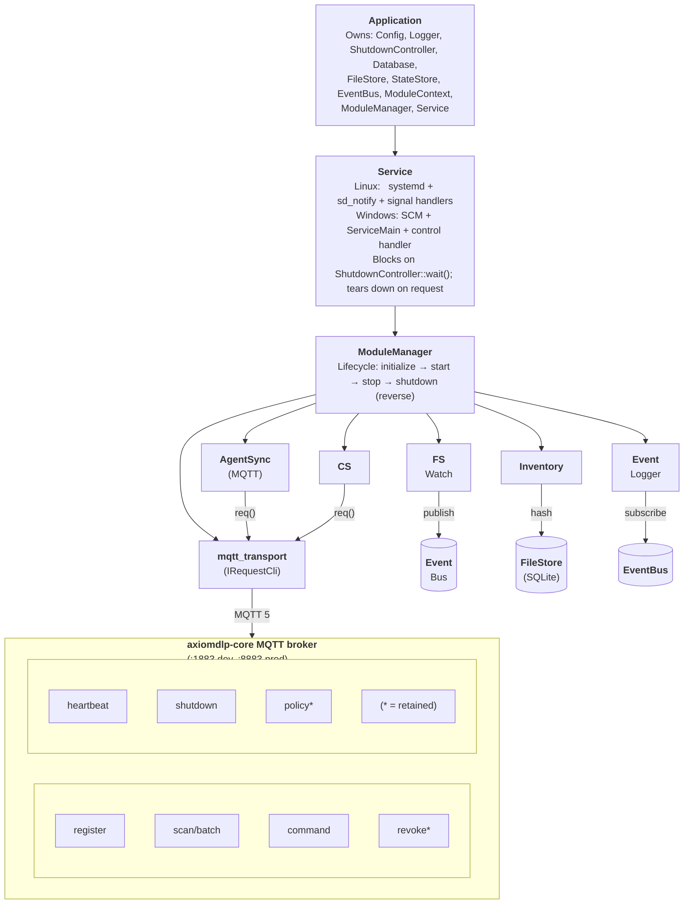

# AxiomDLP Endpoint Agent

Cross-platform endpoint data-loss-prevention agent written in C++20. Watches
the filesystem, inventories files, hashes content, stores metadata in SQLite,
scans text files for PII over a persistent **MQTT 5** session with the
AxiomDLP Core, and shuts down atomically with a typed reason.

**Current status:** MQTT migration complete (Phases 0–11 of the migration
roadmap). Agent transport is MQTT 5 exclusively; no gRPC, no HTTP client, no
protobuf anywhere in the dependency tree. Windows MSVC build pipeline and
the automated test suite (Phase 12) remain.

---

## Table of Contents

1. [Overview](#1-overview)
2. [Current Status](#2-current-status)
3. [Key Features](#3-key-features)
4. [Architecture](#4-architecture)
5. [Supported Platforms](#5-supported-platforms)
6. [Dependencies](#6-dependencies)
7. [Prerequisites](#7-prerequisites)
8. [Building on Linux](#8-building-on-linux)
9. [Building on Windows](#9-building-on-windows)
10. [Configuration](#10-configuration)
11. [Running the Agent](#11-running-the-agent)
12. [Project Structure](#12-project-structure)
13. [Modules Reference](#13-modules-reference)
14. [Data Flow](#14-data-flow)
15. [TLS and Security](#15-tls-and-security)
16. [Shutdown Model](#16-shutdown-model)
17. [Testing](#17-testing)
18. [Roadmap](#18-roadmap)
19. [Known Issues and Limitations](#19-known-issues-and-limitations)
20. [Contributing](#20-contributing)
21. [Related Documents](#21-related-documents)

---

## 1. Overview

AxiomDLP Endpoint Agent is the client-side component of the AxiomDLP
data-loss-prevention platform. It runs as a system service on Linux
(systemd) and Windows (Service Control Manager) and is responsible for:

- Observing file-system activity in real time
- Building and maintaining a local inventory of files with content hashes
- Sending file content chunks to the Core server for PII detection over
  MQTT 5
- Receiving server-pushed policy updates, commands, and revocation notices
  on per-agent MQTT topics
- Reporting agent identity and liveness via periodic heartbeats
- Shutting down cleanly when instructed by the server, the user, or an
  internal failure

The agent is designed as an extensible foundation. The current release
covers the "observe and report" layer. Enforcement (blocking, quarantining,
redacting), rich-document extraction, kernel-level hooks, and a user-facing
tray helper are planned for the next product phase (see `next.md`).

The codebase is organized around a strict separation between:

- **Framework** — `foundation/`, `events/`, `modules/`
- **Feature modules** — `features/<name>/`
- **Platform bindings** — `platform/<os>/`
- **Transport contract** — `net/i_request_client.h` (interface) plus the
  concrete implementation in `features/mqtt_transport/`
- **Wire protocol** — `docs/mqtt_protocol.md` (byte-identical with the
  matching file in the Core repository)

Every capability the agent offers is implemented as a module. Adding a new
capability means adding a folder under `src/features/` and registering it in
`application.cpp`. The framework itself does not change.

---

## 2. Current Status

### 2.1 What is complete

- Cross-platform service life cycle (systemd on Linux, SCM on Windows,
  foreground mode for both)
- Four build targets from two independent toolchains
- Real-time filesystem watching via efsw (inotify on Linux,
  ReadDirectoryChangesW on Windows)
- Periodic full-filesystem inventory with SHA-256 hashing
- SQLite storage with automatic schema migrations (version 4)
- **MQTT 5 transport** via libmosquitto 2.x — persistent session, jittered
  reconnect, MQTT 5 request/response correlation, Last Will & Testament,
  TLS with verified peer certificate and hostname
- **Enrollment and heartbeat over MQTT** — `agent_sync` publishes to
  `axiomdlp/register` and `axiomdlp/agents/{id}/heartbeat`, with
  `Response-Topic` / `Correlation-Data` correlation and typed error handling
- **Content scanning over MQTT** — `content_scanner` publishes overlapping
  text chunks to `axiomdlp/agents/{id}/scan/batch`, merges per-chunk
  verdicts, and skips unscored files (never commits a partial verdict)
- **Server-pushed control frames** — `command`, `policy` (retained), and
  `revoke` (retained) are subscribed on `axiomdlp/agents/{id}/...` and
  delivered to the shutdown controller or feature-module callbacks
- Content scanner for text files: overlapping chunking, per-chunk verdicts,
  hash-based deduplication, local persistence of results
- Atomic shutdown with typed reasons preserved end to end
- Fully static Windows binaries with static CRT (`/MT`) — no runtime
  redistributable required

### 2.2 What is pending (Phase 12–13)

The following items from the migration roadmap are still open:

- **Phase 12 — automated tests.** Unit, integration, load, chaos, TLS, and
  wire-format regression tests on all four targets. Currently the manual
  smoke test in §17 is the only verification.
- **Phase 13 — documentation polish.** `done.md` still says "Phase 5 of the
  gRPC migration" — needs a full rewrite. `docs/file_structure.md` is stale
  (predates even the gRPC era). `docs/architecture.md` describes the old
  gRPC pipeline. See §19.

### 2.3 What does not exist yet (Phase 2 product roadmap)

- Local policy engine and decision evaluation
- User-mode enforcement (file, clipboard, print)
- Kernel-mode enforcement (Linux eBPF, Windows Minifilter)
- Rich-document extraction (PDF, DOCX, XLSX, OCR)
- Advanced detection (EDM, PDM, document registry)
- IPC channel and user-session tray helper
- Remote command handling and auto-update
- Code signing and packaging (`.deb`, `.rpm`, MSI)
- macOS and ARM64 support
- Observability (Prometheus metrics) and hardening

---

## 3. Key Features

### 3.1 Filesystem awareness

- Real-time watcher with 300 ms trailing-edge debounce
- Event coalescing by priority: `modified > created > moved > deleted`
- Two-tier exclusion (glob patterns plus directory prefixes)
- Self-exclusion of the agent's own log and data directories
- Periodic full inventory for completeness (catches events the watcher
  missed, including events that occurred while the agent was stopped)

### 3.2 Content fingerprinting

- SHA-256 hashing streamed from disk in 1 MB chunks — constant memory
  regardless of file size
- Hash stored in the local `files` table and used for verdict deduplication
  (a copy or move of an already-scanned file is skipped)
- Content itself is never persisted; it is read into memory, transmitted,
  and discarded

### 3.3 Server connectivity (MQTT 5)

- **Persistent MQTT 5 session** — the sole server-facing transport. All
  server-pushed frames, all enrollment/heartbeat, and all content scans
  travel over a single TCP/TLS connection to the broker.
- **Request/response correlation** — every request carries a fresh ULID in
  both the JSON `correlation_id` field and the MQTT 5 `Correlation-Data`
  PUBLISH property. The response arrives on the topic named in
  `Response-Topic`, and the client routes it by correlation ID.
- **MQTT 5 CONNECT properties** — `Session Expiry Interval=3600`,
  `Receive Maximum=100`, `Maximum Packet Size=128 MB`, `Topic Alias
  Maximum=0`. Clean Start is false, so the broker retains subscriptions
  across brief TCP blips.
- **Last Will & Testament** — the agent sets a Will on
  `axiomdlp/sessions/{instance_uuid}/status` with payload
  `{"status":"offline"}` and a 5-second Will Delay Interval. A crashed
  agent is detected in seconds.
- **Jittered exponential backoff** — base 10 s, cap 300 s, ±20 % jitter.
  Reconnects do not thundering-herd the broker.
- **Typed shutdown frame** — on graceful stop, the agent publishes a
  `shutdown` message with its typed `ShutdownReason` before disconnecting
  cleanly. The broker does not fire the Will in this case.

### 3.4 Reliability

- Exponential backoff with 20 % jitter for reconnect — prevents
  thundering-herd behavior across a large fleet
- Interruptible sleep that wakes on shutdown request
- Per-module health status aggregated by `ModuleManager`
- Fail-safe configuration: bad config never prevents startup
- Async structured logging with non-blocking delivery and rotation
- Cross-thread `mosq_` access protected by `mosq_mu_` in the transport
  module — `set_agent_id()` (called from `agent_sync`'s thread) cannot race
  the manager thread's connect/teardown
- Subscriptions issued from the manager thread (after CONNACK), not from
  inside the loop callback — avoids a deadlock against
  `mosquitto_loop_stop` in the teardown path

### 3.5 Deployment

- Four build targets from two toolchains
- Fully static on both platforms — no shared library dependencies at
  runtime beyond OS system DLLs on Windows
- Windows binaries use static CRT — no `vcruntime140.dll` required
- Same source tree, same `find_package(...)` API, same imported targets
  on both paths

---

## 4. Architecture

### 4.1 High-level diagram



### 4.2 Layered source tree

- `foundation/` — application orchestration, config, logging, shutdown
- `events/` — event model and in-process publish/subscribe bus
- `modules/` — module framework (interface, base, context, manager, health)
- `features/` — one folder per capability
- `platform/` — OS-specific implementations behind interfaces
- `net/` — the `IRequestClient` interface (transport-agnostic)
- `util/` — hashing, glob matching, base64
- `storage/` — SQLite wrapper, migrations, repositories

Higher layers depend on lower layers. Lower layers never depend on higher
layers. Business logic never includes OS-specific headers.

### 4.3 Design invariants

1. **Every capability is a module.** Adding a feature is adding a folder
   under `src/features/<name>/` and one registration line in
   `application.cpp`.
2. **Modules communicate through the event bus.** No direct calls between
   feature modules — except through interfaces exposed on
   `ModuleContext` (such as `IRequestClient`).
3. **One shutdown authority.** `ShutdownController` is the only place a
   shutdown is requested. Every module reads the same reason.
4. **Fail-safe.** Bad config, missing paths, and failed modules never
   crash the agent.
5. **RAII everywhere.** No manual resource management.
6. **Platform isolation.** Only files under `src/platform/<os>/` include
   OS-specific headers.

---

## 5. Supported Platforms

Four build targets:

| Platform       | Toolchain             | Triplet / Toolchain File             |
| -------------- | --------------------- | ------------------------------------ |
| Linux x86_64   | GCC + `.deps/` cache  | `cmake/toolchains/linux-x86_64.cmake` |
| Linux i686     | GCC `-m32` + `.deps/` | `cmake/toolchains/linux-i686.cmake`   |
| Windows x86_64 | MSVC 2022 + vcpkg     | `x64-windows-static`                  |
| Windows x86    | MSVC 2022 + vcpkg     | `x86-windows-static`                  |

**Linux x86_64 and i686** are verified to build, link, and connect to a
live Core broker end-to-end.

**Windows x64 and x86** build cleanly via the CMake/vcpkg toolchain
workflow, but the MQTT connect path has not yet been exercised against a
live broker from a Windows host — that verification is part of Phase 12
(automated tests).

All four targets support TLS, the MQTT 5 transport, filesystem watching,
hashing, SQLite storage, and graceful shutdown.

---

## 6. Dependencies

### 6.1 Per-component dependency table

| Component        | Linux                                          | Windows                              |
| ---------------- | ---------------------------------------------- | ------------------------------------ |
| MQTT 5 client    | `libmosquitto-dev` 2.x via pkg-config          | vcpkg `mosquitto` 2.x                |
| TLS / crypto     | `.deps/openssl-linux-*` (built locally)        | vcpkg `openssl`                      |
| SQLite           | amalgamation from `.deps/sqlite3-src`          | vcpkg `sqlite3`                      |
| JSON             | system package or FetchContent                 | vcpkg `nlohmann-json`                |
| Logging          | FetchContent spdlog 1.14.1                     | vcpkg `spdlog` + `fmt`               |
| File watching    | FetchContent efsw 1.7.2                        | vcpkg `efsw`                         |
| Service manager  | libsystemd (via pkg-config, optional)          | SCM (part of `advapi32`)             |

### 6.2 Removed dependencies

The following were dependencies in earlier revisions and have been
removed:

- **gRPC** — replaced by libmosquitto. gRPC's `protoc` codegen,
  i686 target path pollution, and static Brotli/OpenSSL linking
  requirements made 32-bit cross-compilation fragile.
- **Protobuf** — removed with gRPC. Wire format is JSON over MQTT 5.
- **cpp-httplib** — was the HTTP client for `agent_sync` and
  `content_scanner`. Both modules now use `IRequestClient` backed by
  `MqttTransportModule`.
- **Boost 1.90 / 1.92** — removed several revisions ago.
- **Boost.Asio / Boost.Beast** — replaced by cpp-httplib (later gRPC,
  later MQTT).

### 6.3 Why MQTT 5

`docs/mqtt_protocol.md` is the authoritative wire contract and is kept
byte-identical with the matching file in the Core repository. The choice
of MQTT 5 over WebSocket or gRPC is documented there in §1 — short
version: broker-managed session state, retained messages for
policy/revoke, native LWT for crash detection, per-message QoS, and
broker-level ACL for cross-agent isolation. These are all properties
gRPC and WebSocket do not provide without application-level
reimplementation.

---

## 7. Prerequisites

### 7.1 Linux

Tested on Debian, Ubuntu, and Kali Linux. Install with:

```bash
sudo dpkg --add-architecture i386
sudo apt update
sudo apt install -y \
    build-essential \
    gcc-multilib g++-multilib \
    ninja-build git file clangd \
    libsystemd-dev libsystemd-dev:i386 \
    libmosquitto-dev libmosquitto-dev:i386 \
    pkg-config curl make
```

Notes:

- `gcc-multilib` and `g++-multilib` are required only for the i686 target
- `libsystemd-dev:i386` is required for the i686 target's `sd_notify`
  integration
- `libmosquitto-dev:i386` is required for the i686 target — without it,
  CMake fails at configure time with a clear message pointing at the
  missing package
- `curl` is used by `scripts/linux/build-openssl.sh` for the source
  download

### 7.2 Windows

Required:

- **Visual Studio 2022** with the "Desktop development with C++"
  workload (Build Tools also works)
- **CMake 3.24 or newer** on `PATH`
- **Ninja** on `PATH`
- **vcpkg** cloned to `C:\Users\<user>\vcpkg` with the `VCPKG_ROOT`
  environment variable set — the setup script handles this automatically
- **Long paths enabled** — set
  `HKLM\SYSTEM\CurrentControlSet\Control\FileSystem\LongPathsEnabled`
  to `1`

Optional but recommended:

- PowerShell 7 (the setup scripts work with PowerShell 5.1 but assume
  ASCII-only file content)

---

## 8. Building on Linux

### 8.1 One-shot build

```bash
./scripts/linux/build-all.sh release
```

On first run this script:

1. Clones the nlohmann/json source into `.deps/nlohmann_json-src`
   if missing
2. Runs `scripts/linux/build-openssl.sh` if either OpenSSL tree is
   incomplete — downloads and builds OpenSSL 3.3.2 for both
   `linux-x86_64` and `linux-i686` (takes 15–25 minutes)
3. Configures and builds the agent for both targets

On subsequent runs, everything is incremental and completes in around
30 seconds.

**libmosquitto is not built by the script.** It is expected to be
installed as a system package (`libmosquitto-dev` and, for i686,
`libmosquitto-dev:i386`). CMake finds it via pkg-config and fails with a
clear message if the package is missing.

### 8.2 Manual build

```bash
cmake --preset linux-x86_64-release
cmake --build --preset linux-x86_64-release

cmake --preset linux-i686-release
cmake --build --preset linux-i686-release
```

### 8.3 Available presets

| Preset                         | Build type | Output                                        |
| ------------------------------ | ---------- | --------------------------------------------- |
| `linux-x86_64-debug`           | Debug      | `build/linux-x86_64-debug/axiomdlp-agent`     |
| `linux-x86_64-release`         | Release    | `build/linux-x86_64-release/axiomdlp-agent`   |
| `linux-i686-debug`             | Debug      | `build/linux-i686-debug/axiomdlp-agent`       |
| `linux-i686-release`           | Release      | `build/linux-i686-release/axiomdlp-agent`     |

### 8.4 Verifying the build

```bash
file build/linux-x86_64-release/axiomdlp-agent
# ELF 64-bit LSB pie executable, x86-64

file build/linux-i686-release/axiomdlp-agent
# ELF 32-bit LSB pie executable, Intel 80386

ldd build/linux-x86_64-release/axiomdlp-agent | grep -E 'ssl|mosquitto|grpc|protobuf'
# libmosquitto.so.1 (system lib — the only external dependency)
# libssl/libcrypto are static; no gRPC, no protobuf
```

The one runtime dependency outside libc is `libmosquitto.so.1`. This is
the only shared library the agent requires — everything else (OpenSSL,
SQLite, spdlog, efsw, nlohmann/json) is statically linked into the
binary.

---

## 9. Building on Windows

### 9.1 One-time setup

```powershell
.\scripts\win\setup-windows-msvc.ps1
```

This script:

1. Verifies that Visual Studio 2022 with the C++ workload is present
2. Downloads vcpkg as a ZIP from `codeload.github.com` (about 25 MB) —
   avoids a slow `git clone`
3. Downloads a prebuilt `vcpkg.exe` from `vcpkg-tool/releases` (about
   3 MB) — avoids a bootstrap compile
4. Sets `VCPKG_ROOT` persistently for the current user

Total runtime is approximately 3 minutes on a normal connection.

### 9.2 Build

```powershell
# x64 Release
.\scripts\win\build-windows-msvc.ps1 -Arch x64

# x86 Release
.\scripts\win\build-windows-msvc.ps1 -Arch x86

# Debug
.\scripts\win\build-windows-msvc.ps1 -Arch x64 -Configuration Debug
```

The build script:

- Automatically initializes the Visual Studio environment via
  `vcvarsall.bat`, so it works from any PowerShell window (a Developer
  PowerShell prompt is not required)
- Preserves `VCPKG_ROOT` across Visual Studio environment initialization
  (otherwise `vcvarsall.bat` would overwrite it with the VS-bundled
  vcpkg, which requires `builtin-baseline` and lacks the required ports)
- Sets `CC=cl.exe` and `CXX=cl.exe` to override any GCC found on `PATH`
- Detects and cleans stale `CMakeCache.txt` files that reference a
  non-MSVC compiler
- Cleans the build directory when `-Clean` is passed

First Windows build takes ~20–30 minutes per architecture while vcpkg
compiles the dependency tree (OpenSSL, spdlog, fmt, nlohmann-json,
efsw, SQLite, mosquitto). Subsequent builds restore from vcpkg's binary
cache in 5–10 seconds. **The gRPC + protobuf dependency is gone**, which
is where most of the previous 40–60 min first-build time was spent.

### 9.3 Available presets

| Preset                            | Build type | Output                                           |
| --------------------------------- | ---------- | ------------------------------------------------ |
| `windows-x64-msvc-debug`          | Debug      | `build/windows-x64-msvc-debug/axiomdlp-agent.exe` |
| `windows-x64-msvc-release`        | Release    | `build/windows-x64-msvc-release/axiomdlp-agent.exe` |
| `windows-x86-msvc-debug`          | Debug      | `build/windows-x86-msvc-debug/axiomdlp-agent.exe` |
| `windows-x86-msvc-release`        | Release    | `build/windows-x86-msvc-release/axiomdlp-agent.exe` |

### 9.4 Verifying the build

```powershell
# Confirm architecture
dumpbin /headers build\windows-x64-msvc-release\axiomdlp-agent.exe |
    Select-String "machine"

# Confirm no external DLL dependencies
dumpbin /dependents build\windows-x64-msvc-release\axiomdlp-agent.exe
# Expected: KERNEL32, ADVAPI32, WS2_32, SHELL32, ole32, USER32, CRYPT32
```

On Windows, vcpkg's `mosquitto` port is linked statically by the
`x64-windows-static` and `x86-windows-static` triplets, so
`libmosquitto.dll` does **not** appear in the dependency list. The
resulting binary is fully self-contained.

### 9.5 Troubleshooting vcpkg downloads

If a vcpkg source download stalls (a known issue on slow links to the
GitHub CDN), the fallback is to download the file manually in WSL using
a parallel downloader, then copy it into the vcpkg downloads directory:

```bash
# In WSL
aria2c -x16 -s16 -d /tmp -o <filename> <url>
```

```powershell
# In PowerShell
copy \\wsl$\<distro>\tmp\<filename> $env:USERPROFILE\vcpkg\downloads\
```

vcpkg will pick up the pre-cached file silently. This workaround is
documented in `done.md` under Bugs W18–W20.

---

## 10. Configuration

### 10.1 Location

The agent looks for its configuration in the following order:

1. Path passed via `--config <path>` on the command line
2. `config/agent.default.json` relative to the current working directory
3. Platform default:
   - Linux: `/etc/axiomdlp/agent.json`
   - Windows: `%ProgramData%\AxiomDLP\agent.json`

If no configuration file is found, the agent starts with built-in
defaults and logs a warning. It never fails to start because of a
missing or invalid configuration file.

### 10.2 Structure

Configuration is a single JSON object with four top-level sections:

```json
{
  "logging": { ... },
  "storage": { ... },
  "server":  { ... },
  "modules": { ... }
}
```

### 10.3 The `server` section

All server-facing configuration lives in one place. Every module that
talks to the Core reads from this section.

```json
"server": {
  "base_url": "http://127.0.0.1:3000",
  "api_token": "axdlp_user_...",
  "heartbeat_interval_seconds": 60,
  "reconnect_backoff_seconds": 10,
  "reconnect_backoff_max_seconds": 300,
  "mqtt_port": 1883,
  "mqtt_tls": false,
  "mqtt_ca_path": "",
  "mqtt_keepalive_seconds": 60
}
```

| Field                          | Type    | Default                 | Purpose                                                |
| ------------------------------ | ------- | ----------------------- | ------------------------------------------------------ |
| `base_url`                     | string  | `http://127.0.0.1:3000` | Core base URL; the host is reused as the MQTT target   |
| `api_token`                    | string  | `""`                    | Bearer token (`axdlp_user_...`); sent as MQTT username |
| `heartbeat_interval_seconds`   | integer | `60`                    | Heartbeat period for `agent_sync`                      |
| `reconnect_backoff_seconds`    | integer | `10`                    | Initial backoff for reconnect                          |
| `reconnect_backoff_max_seconds`| integer | `300`                   | Maximum backoff cap                                    |
| `mqtt_port`                    | integer | `8883` (TLS default)    | TCP port for the MQTT broker. `1883` for plaintext.    |
| `mqtt_tls`                     | boolean | `true`                  | Enable TLS on the MQTT connection                      |
| `mqtt_ca_path`                 | string  | `""`                    | Optional PEM CA bundle; empty means system roots       |
| `mqtt_keepalive_seconds`       | integer | `60`                    | MQTT CONNECT keep-alive interval (seconds)             |

**`mqtt_tls` must be `true` in production.** The dev configs
(`agent.default.json`, `agent.default_win.json`) ship with it set to
`false` because the local dev broker is plaintext on `1883`. Before
deploying anywhere, set:

```json
"mqtt_port": 8883,
"mqtt_tls": true,
"mqtt_ca_path": "/path/to/ca.pem"
```

**`mqtt_ca_path` is ignored when `mqtt_tls` is false.** The config loader
logs a warning if you set it while TLS is off, so the mismatch is
visible at startup.

### 10.4 Module sections

Each module reads its own subsection under `modules`:

- `modules.filesystem_watcher` — watch paths, exclude patterns, debounce
  window
- `modules.inventory` — scan interval, hash policy, size limits,
  scannable categories
- `modules.agent_sync` — `enabled` only; all other fields come from
  `server`
- `modules.content_scanner` — batch size, chunk size, overlap, retry
  limits, text-extension allowlist

See `config/agent.schema.json` for the full schema.

### 10.5 Environment variable expansion

String values in the configuration can reference environment variables:

- Windows: `%VAR%`
- POSIX: `${VAR}`

Example:

```json
"watch_paths": [ "%USERPROFILE%" ]
```

Expansion happens at load time. Unresolved variables are passed through
unchanged.

### 10.6 Fail-safe behavior

The following are handled without aborting startup:

- Missing configuration file
- Malformed JSON
- Wrong-typed fields
- Out-of-range integer values
- Invalid enum values

Every problem produces a warning in the log and a fall-back to the safe
default for that field. The agent always starts.

### 10.7 Deprecated fields

`grpc_port`, `grpc_tls`, and `grpc_ca_path` — removed in Phase 10. If
they appear in a config file they are silently ignored; replace them
with the `mqtt_*` equivalents.

`verify_tls` at any level produces a warning that the field is ignored.
The agent always verifies TLS certificates and hostnames on `mqtts://`
and `https://`.

---

## 11. Running the Agent

### 11.1 Foreground mode (development)

Linux:

```bash
./build/linux-x86_64-release/axiomdlp-agent \
    --foreground \
    --config config/agent.default.json
```

Windows:

```powershell
.\build\windows-x64-msvc-release\axiomdlp-agent.exe `
    --foreground `
    --config config\agent.default_win.json
```

Console output is colored and always available. File output goes to
`logs/agent.log` with rotation.

### 11.2 Service mode (production)

Linux:

```bash
sudo ./build/linux-x86_64-release/axiomdlp-agent --install
```

This writes a systemd unit file to
`/etc/systemd/system/axiomdlp-agent.service`, runs `systemctl
daemon-reload`, and enables the service.

Windows:

```powershell
.\build\windows-x64-msvc-release\axiomdlp-agent.exe --install
```

This registers the service with the Service Control Manager, sets it to
auto-start, and starts it immediately.

### 11.3 Uninstalling

Linux:

```bash
sudo ./build/linux-x86_64-release/axiomdlp-agent --uninstall
```

Windows:

```powershell
.\build\windows-x64-msvc-release\axiomdlp-agent.exe --uninstall
```

### 11.4 Command line arguments

| Argument        | Meaning                                                |
| --------------- | ------------------------------------------------------ |
| `--install`     | Install as a system service and exit                   |
| `--uninstall`   | Remove the service and exit                            |
| `--foreground`  | Run in foreground mode (blocks; logs to console)       |
| `--config PATH` | Use this configuration file instead of the default     |

Any unrecognized argument produces a warning and is ignored.

### 11.5 Logs

Logs are written in the format:

```
[YYYY-MM-DD HH:MM:SS.mmm] [level] [t:thread-id] message
```

Levels follow standard severity: `trace`, `debug`, `info`, `warn`,
`error`, `critical`. The default level is `info`. Rotation is configured
for 5 MB per file and 3 historical files (approximately 20 MB total).

### 11.6 Getting a token

Before the first run, obtain an `axdlp_user_...` token from the Core:

```bash
# Register a new org + admin user; the response contains the API token
curl -s -X POST http://127.0.0.1:3000/api/v1/register \
  -H 'Content-Type: application/json' \
  -d '{"organization_name":"MyOrg","admin_username":"admin",
       "admin_email":"admin@myorg.local","admin_password":"TestPass123x"}' \
  | jq -r '.api_token'
```

Paste the resulting `axdlp_user_...` into `config/agent.default.json`
at `server.api_token`. The token is shown only once by the server — if
you lose it, generate a fresh one via `POST /api/v1/me/tokens` (from an
authenticated session) or `POST /api/v1/users/:id/tokens` (as an
`org_admin`).

### 11.7 Expected startup log

```
[info] AxiomDLP Agent v0.1.0
[info] Config loaded from: config/agent.default.json
[info] Database: opened 'data/agent.db'
[info] Migrations: schema version 4 -> 4
[info] ModuleManager: registering module 'filesystem_watcher' v1.0.0
[info] ModuleManager: registering module 'inventory' v1.0.0
[info] ModuleManager: registering module 'event_logger' v1.0.0
[info] ModuleManager: registering module 'mqtt_transport' v1.0.0
[info] ModuleManager: registering module 'agent_sync' v1.0.0
[info] ModuleManager: registering module 'content_scanner' v1.0.0
[info] mqtt_transport: initialized (host=127.0.0.1, port=1883, tls=false, keepalive=60s, instance=<hex>, agent_id=0)
[info] agent_sync module: initialized (heartbeat=60s)
[info] mqtt_transport: connected to 127.0.0.1:1883
[info] [event] type=mqtt_state path=-
[info] mqtt_transport: subscribed 'axiomdlp/replies/<hex>' (qos=1)
[info] agent_sync: registering over MQTT (hostname=<hostname>)
[info] mqtt_transport: agent_id set to N (was 0)
[info] mqtt_transport: subscribed 'axiomdlp/agents/N/command' (qos=2)
[info] mqtt_transport: subscribed 'axiomdlp/agents/N/policy' (qos=2)
[info] mqtt_transport: subscribed 'axiomdlp/agents/N/revoke' (qos=2)
[info] agent_sync: enrolled (agent_id=N, user_id=U, org_id=O)
```

Press Ctrl+C. Expected shutdown output:

```
[info] axiomdlp-agent received stop request (reason=user_requested)
[info] ModuleManager: stopping 6 module(s)
[info] mqtt_transport: published shutdown message
[info] mqtt_transport: disconnected (reason=0x00 The normal disconnection)
[info] mqtt_transport: stopped
[info] Service returned rc=0 (reason=user_requested)
[info] Application shutting down
```

---

## 12. Project Structure

```
axiomdlp-agent/
├── CMakeLists.txt                       Top-level build definition
├── CMakePresets.json                    Preset definitions for all targets
├── vcpkg.json                           Windows dependency manifest
├── README.md                            This document
├── done.md                              Implementation log and bug history (stale — see §19)
├── next.md                              Phase 2 product roadmap
├── LICENSE
├── .clangd
├── .gitignore
│
├── .deps/                               Linux dependency cache (gitignored)
│   ├── spdlog-src/
│   ├── nlohmann_json-src/
│   ├── efsw-src/
│   ├── sqlite3-src/
│   ├── openssl-src/
│   ├── openssl-linux-x86_64/
│   └── openssl-linux-i686/
│
├── vcpkg_installed/                     Windows dependency cache (gitignored)
│   ├── x64-windows-static/
│   └── x86-windows-static/
│
├── cmake/
│   └── toolchains/
│       ├── linux-x86_64.cmake
│       └── linux-i686.cmake
│
├── config/
│   ├── agent.default.json
│   ├── agent.default_win.json
│   └── agent.schema.json
│
├── data/                                Runtime SQLite database (gitignored)
├── logs/                                Runtime logs (gitignored)
│
├── scripts/
│   ├── linux/
│   │   ├── build-all.sh
│   │   ├── build-openssl.sh
│   │   └── merge-compile-commands.sh
│   └── win/
│       ├── setup-windows-msvc.ps1
│       └── build-windows-msvc.ps1
│
├── packaging/
│   ├── linux/systemd/axiomdlp-agent.service
│   └── windows/service_install.ps1
│
├── docs/
│   ├── mqtt_protocol.md                 AUTHORITATIVE MQTT wire contract (byte-identical with Core repo)
│   ├── architecture.md                  (stale — describes the old gRPC pipeline; see §19)
│   └── file_structure.md                (stale — predates the gRPC era; see §19)
│
└── src/
    ├── main.cpp
    │
    ├── foundation/
    │   ├── application.{h,cpp}
    │   ├── config.{h,cpp}
    │   ├── logger.{h,cpp}
    │   └── shutdown.h
    │
    ├── events/
    │   ├── event.{h,cpp}
    │   └── event_bus.{h,cpp}
    │
    ├── modules/
    │   ├── i_module.h
    │   ├── module_base.h
    │   ├── module_context.h
    │   ├── module_manager.{h,cpp}
    │   └── health.h
    │
    ├── platform/
    │   ├── paths.h
    │   ├── service.h
    │   ├── file_watcher.h
    │   ├── common/
    │   │   └── efsw_file_watcher.cpp
    │   ├── linux/
    │   │   ├── paths.cpp
    │   │   └── service.cpp
    │   └── windows/
    │       ├── paths.cpp
    │       └── service.cpp
    │
    ├── net/
    │   └── i_request_client.h           Transport-agnostic request/response interface
    │                                    (is_connected, set_agent_id, request, subscribe)
    │
    ├── util/
    │   ├── glob_match.{h,cpp}
    │   ├── file_hash.{h,cpp}
    │   ├── base64.{h,cpp}
    │   └── ulid.{h,cpp}
    │
    ├── storage/
    │   ├── sqlite_database.{h,cpp}
    │   ├── migrations.{h,cpp}
    │   ├── file_repository.{h,cpp}
    │   └── state_repository.{h,cpp}
    │
    └── features/
        ├── filesystem_watcher/
        │   └── filesystem_watcher_module.{h,cpp}
        ├── inventory/
        │   ├── inventory_module.{h,cpp}
        │   └── inventory_scanner.{h,cpp}
        ├── event_logger/
        │   └── event_logger_module.{h,cpp}
        ├── mqtt_transport/
        │   ├── mqtt_transport_module.{h,cpp}    IRequestClient implementation, libmosquitto client
        │   └── (see docs/mqtt_protocol.md)
        ├── agent_sync/
        │   └── agent_sync_module.{h,cpp}        register + heartbeat over MQTT
        └── content_scanner/
            └── content_scanner_module.{h,cpp}   scan/batch over MQTT
```

---

## 13. Modules Reference

### 13.1 `filesystem_watcher`

**Purpose:** Observe real-time filesystem changes.

**Implementation:** `efsw` library (inotify on Linux,
ReadDirectoryChangesW on Windows).

**Behavior:**

- 300 ms trailing-edge debounce (configurable)
- Coalesces multiple events on the same path within the debounce window
- Priority merge: `modified` (4) > `created` (3) > `moved` (2) >
  `deleted` (1)
- Self-excludes the agent's own log and data directories to prevent a
  feedback loop
- Two-tier exclusion: glob patterns plus explicit directory prefixes
- Watcher initialization runs asynchronously so slow recursive watches
  don't block service startup

**Events published:** `file_write`, `file_delete`, `file_access`
(depending on the underlying event type)

### 13.2 `inventory`

**Purpose:** Periodic full-filesystem scan to keep the `files` table
complete.

**Behavior:**

- Runs on a configurable interval (default 900 s)
- Captures rich metadata: path decomposition, nanosecond timestamps,
  POSIX mode, uid/gid, nlink, file type, category
- Computes SHA-256 for files that pass the scanner's eligibility filter
- Assigns explicit `scan_status`:
  - `pending` — file is eligible for scanning, has a hash, waiting for
    the content scanner
  - `not_applicable` — file is not a regular text file (directory,
    symlink, binary format)
  - `skipped_too_large` — exceeds the configured size limit
  - `scan_error` — hashing failed
- Batches inserts in groups of 5,000 rows inside a single transaction
- Graceful stop within about 20 ms of a shutdown request; partial
  progress is committed

**Events published:** none directly (writes to the `files` table)

### 13.3 `event_logger`

**Purpose:** Observability.

**Behavior:** Subscribes to all events on the bus and logs them at INFO
level. Includes `mqtt_state` events (connect / disconnect) published by
the transport module. No business logic.

**Events published:** none

### 13.4 `mqtt_transport`

**Purpose:** The sole server-facing transport. Implements `IRequestClient`
so feature modules can reach the Core without knowing the transport is
MQTT-specific.

**Implementation:** libmosquitto 2.x with MQTT 5 protocol mode, plus a
manager thread, a bounded request/response correlation map, and
per-topic subscriber dispatch.

**Lifecycle:**

1. `initialize` reads `server.base_url` (host), `mqtt_port`, `mqtt_tls`,
   `mqtt_ca_path`, `mqtt_keepalive_seconds`, `api_token`, and the two
   backoff bounds from config. Registers `mosquitto_lib_init()`.
   Loads or generates `instance_uuid` from the state table.
2. `start` spawns the manager thread.
3. Manager thread calls `connect_and_setup`:
   - `mosquitto_new(client_id="axiomdlp-{instance_uuid}", clean_start=false, this)`
   - `mosquitto_int_option(MOSQ_OPT_PROTOCOL_VERSION, MQTT_PROTOCOL_V5)`
   - `mosquitto_username_pw_set(username=token, password=nullptr)`
     — the `nullptr` is important: `""` sets the MQTT 5 password flag to
     an empty value, which mochi-mqtt rejects with CONNACK `0x82`
   - `mosquitto_tls_set` / `mosquitto_tls_opts_set` if `mqtt_tls`
   - register v5 callbacks (connect, disconnect, message) + log callback
   - `mosquitto_will_set_v5` for the LWT (5-second Will Delay)
   - `mosquitto_connect_bind_v5` with CONNECT properties
     (`Session Expiry=3600`, `Receive Max=100`, `Max Packet Size=128 MB`,
     `Topic Alias Max=0`)
   - `mosquitto_loop_start`
   - Wait up to 5 s for CONNACK (`connect_attempt_done_`)
   - Subscribe to `axiomdlp/replies/{instance_uuid}` and, if `agent_id`
     is already known, to `axiomdlp/agents/{id}/{command,policy,revoke}`
4. Manager thread parks on `connect_cv_` until `connected_` flips to
   false (disconnect) or shutdown is requested.
5. On reconnect, applies jittered backoff, tears down the client, and
   repeats.

**Server-to-agent messages** (delivered via `subscribe()` handlers or
internal dispatch):

| Topic | Delivered to |
| --- | --- |
| `axiomdlp/agents/{id}/command` | `subscribe("axiomdlp/agents/{id}/command", handler)` — currently no handler installed (Phase 2 milestone 22) |
| `axiomdlp/agents/{id}/policy` (retained) | `subscribe(...)` — currently no handler installed (Phase 2) |
| `axiomdlp/agents/{id}/revoke` (retained) | Handled internally — maps `token_revoked` → `AuthRevoked`, `agent_revoked` → `AgentRevoked` |

**Correlation-ID handling:** every PUBLISH response is matched against
the in-flight `pending_` map by `Correlation-Data` (MQTT 5 property)
or, as a fallback, by the JSON `correlation_id` field. On match, the
`PendingRequest` is woken and its response returned to the caller.

**Error mapping** (from CONNACK reason codes and response bodies):

| Condition | Action |
| --- | --- |
| CONNACK `0x87` (Not authorized) | `ShutdownController::request(AuthRevoked)` — permanent, no retry |
| Network failure (any `errno`) | Reconnect with jittered backoff |
| Response `{"error":"agent_revoked"}` | `ShutdownController::request(AgentRevoked)` |
| Response `{"error":"not_found"}` on heartbeat | Clear local `agent_id`, re-enroll |
| Server `ServerRevoke{token_revoked}` | `ShutdownController::request(AuthRevoked)` |
| Server `ServerRevoke{agent_revoked}` | `ShutdownController::request(AgentRevoked)` |

**Thread safety:** `mosq_` is guarded by `mosq_mu_` for cross-thread
access (request, publish, subscribe, teardown). The manager thread owns
the connect/teardown lifecycle; the loop thread handles callbacks;
`set_agent_id()` is safe to call from `agent_sync`'s thread. All three
synchronize through `mosq_mu_`.

**Health:** returns `ok("connected")` when the MQTT session is live,
`degraded("disconnected")` when the module is running but the session
is down, `failed` when the module isn't running.

### 13.5 `agent_sync`

**Purpose:** Agent identity management and liveness over MQTT.

**Behavior:**

- Calls `req_->request("axiomdlp/register", ...)` on first run when
  `agent_id` is not present in the local `state` table
- Persists the returned `agent_id` to `state` and calls
  `req_->set_agent_id(id)` so the transport subscribes to the
  agent-scoped `command`/`policy`/`revoke` topics
- Sends a heartbeat to `axiomdlp/agents/{id}/heartbeat` every
  `server.heartbeat_interval_seconds` (default 60 s)
- Sends an immediate validation heartbeat at startup when a saved
  `agent_id` exists — a revoked token or unknown agent is detected within
  milliseconds
- Interruptible sleep — wakes immediately on shutdown request
- Waits up to 30 s for the transport to report `is_connected()` before
  the first register attempt, so a slow broker connect doesn't trigger
  a spurious retry

**Error handling:**

| Response | Action |
| --- | --- |
| `{"ok":true, "agent_id":N, ...}` | Persist `agent_id`, call `set_agent_id(N)`, enter heartbeat loop |
| `{"ok":false, "error":"agent_revoked"}` | `ShutdownController::request(AgentRevoked)` |
| `{"ok":false, "error":"not_found"}` (heartbeat) | Clear `agent_id` from `state`, call `set_agent_id(0)`, re-enroll after 5 s |
| Timeout or transport not connected | Retry next interval (60 s) |
| CONNACK rejection (broker → transport) | Handled by the transport — triggers shutdown via `AuthRevoked` |

### 13.6 `content_scanner`

**Purpose:** Detect PII in text files by sending content chunks to the
Core over MQTT and merging the verdicts.

**Behavior:**

- Waits for `agent_id` to appear in the local `state` table (populated
  by `agent_sync`), then enters its scan loop
- Queries `fetch_pending_for_scan` on the local `files` table
- Filters by extension (against `text_extensions`), size, existence
- Computes SHA-256 of the current content; if an identical hash was
  previously scanned, reuses the cached verdict without an MQTT call
- Splits content into overlapping chunks:
  - Default 1 MB chunk size, 256-byte overlap
  - Overlap prevents PII from straddling a chunk boundary
- Batches chunks to respect `batch_size` (max chunks per request) and
  `batch_max_bytes` (max estimated payload per request)
- Publishes to `axiomdlp/agents/{id}/scan/batch` with `content_b64` fields
  (base64 — matches the server's `ScanChunk.ContentB64`)
- Merges per-chunk verdicts by `file_hash + chunk_index`
- Writes results back to the `files` table via
  `update_scan_result_by_path`
- **Never commits a partial verdict** — if any chunk in a file is missing
  a score (chunk error, timeout, or rejected batch), the whole file stays
  `pending` and is retried next cycle
- Content is never persisted on disk; read into memory, transmitted,
  and discarded

**Error handling:**

| Condition | Action |
| --- | --- |
| Transport not connected | Skip this cycle, retry next interval |
| `agent_id` not yet known | Skip this cycle, retry next interval |
| Request timeout | Leave chunks buffered, retry next cycle |
| `{"ok":false, "error":"agent_revoked"}` | `ShutdownController::request(AgentRevoked)` |
| `{"ok":false, "error":"not_found"}` | Clear `agent_id` from `state`, wait for `agent_sync` to re-enroll |
| Chunk-level `error` in `results[]` | Skip that chunk; file stays `pending` |
| Batch-level `{"ok":false, "error":"invalid_request"}` | Log, retry next cycle |

### 13.7 Agent-to-server message summary

Every frame the agent sends is defined in `docs/mqtt_protocol.md`.
Summarised:

| Message | Topic | QoS | Retain | Response |
| --- | --- | --- | --- | --- |
| Register | `axiomdlp/register` | 1 | no | via `Response-Topic` |
| Heartbeat | `axiomdlp/agents/{id}/heartbeat` | 1 | no | via `Response-Topic` |
| ScanBatch | `axiomdlp/agents/{id}/scan/batch` | 1 | no | via `Response-Topic` |
| Shutdown | `axiomdlp/agents/{id}/shutdown` | 1 | no | none |

Every request carries `{"v":1, "correlation_id":"<ulid>", ...}` and the
MQTT 5 `Response-Topic` + `Correlation-Data` PUBLISH properties. The
server echoes both on the response.

---

## 14. Data Flow

### 14.1 Inventory to verdict

```
1. Inventory walks the filesystem
   └── Writes metadata + hash, scan_status = 'pending'
       (only for files that pass eligibility: regular file,
        whitelisted extension, size below limit)

2. Content scanner queries pending files
   └── Reads content from disk, computes SHA-256
       └── If hash was previously scanned: reuse cached verdict,
           no MQTT call
       └── Otherwise:
           ├── Splits into overlapping chunks
           ├── Batches chunks up to batch_size / batch_max_bytes
           ├── Publishes to axiomdlp/agents/{id}/scan/batch (QoS 1)
           └── Merges per-chunk verdicts from the response

3. Verdict written back to `files` table
   └── is_sensitive, sensitivity, scan_status = 'scanned'

4. Enforcement (future) queries is_sensitive = 1 files
```

### 14.2 Enrollment to heartbeat

```
1. mqtt_transport starts
   └── Connects to the broker
       └── Subscribes axiomdlp/replies/{instance_uuid}

2. agent_sync starts
   └── Waits for transport.is_connected() (30 s budget)
       └── Reads agent_id from `state` table
           ├── If present:
           │   ├── req_->set_agent_id(id) → transport subscribes to
           │   │   agents/{id}/{command,policy,revoke}
           │   └── Sends validation heartbeat
           │       └── error:"agent_revoked" → Shutdown(AgentRevoked)
           │       └── error:"not_found"     → clear state, re-enroll
           │       └── ok → enter heartbeat loop
           └── If absent:
               ├── Publishes register request
               │   └── error:"agent_revoked" → Shutdown(AgentRevoked)
               │   └── ok: persists agent_id, set_agent_id(id)
               └── Enters heartbeat loop

3. content_scanner starts
   └── Polls `state` for agent_id (1 s ticks)
       └── Once present: enters scan loop (30 s interval default)
```

### 14.3 Shutdown

```
Any source:
  - SIGTERM / Ctrl+C → ShutdownController::request(UserRequested)
  - Service control stop → ShutdownController::request(UserRequested)
  - CONNACK 0x87 → ShutdownController::request(AuthRevoked)
  - Response {"error":"agent_revoked"} → ShutdownController::request(AgentRevoked)
  - ServerRevoke{token_revoked} → ShutdownController::request(AuthRevoked)
  - ServerRevoke{agent_revoked} → ShutdownController::request(AgentRevoked)
  - Any module fatal error → ShutdownController::request(FatalError)

ShutdownController:
  - First request wins; subsequent requests are no-ops
  - Wakes all waiters

Service main loop:
  - Unblocks from ShutdownController::wait()
  - Calls ModuleManager::stop_all() in reverse order
  - Calls ModuleManager::shutdown_all() in reverse order
  - Returns rc=0

During stop_all():
  - content_scanner joins its thread
  - agent_sync joins its thread
  - mqtt_transport:
      - publishes axiomdlp/agents/{id}/shutdown with the typed reason
      - calls mosquitto_disconnect_v5(reason=0x00)
      - calls mosquitto_loop_stop(force=false) — drains any pending publishes
      - calls mosquitto_destroy
  - event_logger unsubscribes
  - inventory joins its thread
  - filesystem_watcher stops efsw

Application:
  - Logs "Service returned rc=0 (reason=<reason>)"
  - Destroys members in reverse dependency order
  - Shuts down the logger last
```

The `mosquitto_loop_stop(force=false)` call is important — it drains
the loop's outbound queue, which is what guarantees the `shutdown`
message is actually sent before the transport is torn down.

---

## 15. TLS and Security

### 15.1 Threat model

Every MQTT CONNECT carries the `axdlp_user_...` API token as the
`Username` field. If this token is intercepted, an attacker can
impersonate the agent, receiving policy updates, commands, and
revocations that were intended for the legitimate agent, and can also
publish scan batches under the agent's identity. For this reason, TLS is
mandatory and never optional in production.

### 15.2 Transport security

- **MQTT (TLS enabled)** — `mosquitto_tls_set` with either the system
  trust store or a custom PEM bundle (`server.mqtt_ca_path`).
  `mosquitto_tls_opts_set(SSL_VERIFY_PEER, ...)` forces peer
  verification. Chain and hostname are both verified.
- **MQTT (TLS disabled)** — plaintext. **Development only.** A startup
  log line at WARN level makes this obvious.

### 15.3 No verification opt-out

The `verify_tls` field has been removed from every layer:

- Not parsed in `Config`
- Not passed to `MqttTransportModule`
- Not present in `agent.schema.json`

Legacy config files that contain `verify_tls` produce a warning that the
field is ignored. Verification still happens when TLS is on.

### 15.4 Certificate and hostname verification details

- SNI is set automatically by libmosquitto when the broker is
  identified by hostname (which it is — `host_` is parsed from
  `base_url`).
- Hostname verification uses libmosquitto's built-in TLS validation
  (OpenSSL's `X509_VERIFY_PARAM_set1_host` under the hood).
- `mqtt_ca_path` overrides the system trust store. When it is empty,
  the OpenSSL default trust paths are used.

### 15.5 Static linking

On Linux, the agent links OpenSSL statically but uses the system
`libmosquitto.so.1`. On Windows, vcpkg's `x64-windows-static` and
`x86-windows-static` triplets statically link everything, so the
resulting binary has no non-system DLL dependencies.

Verification:

```bash
ldd build/linux-x86_64-release/axiomdlp-agent | grep -E 'ssl|crypto|mosquitto'
# libmosquitto.so.1 => /usr/lib/x86_64-linux-gnu/libmosquitto.so.1
# (ssl and crypto are static — no dynamic libssl / libcrypto)
```

```powershell
dumpbin /dependents build\windows-x64-msvc-release\axiomdlp-agent.exe
# No libssl-*.dll, no libcrypto-*.dll, no libmosquitto.dll
```

### 15.6 Token handling

- The token is read from `server.api_token` at startup.
- If it is empty, `mqtt_transport`, `agent_sync`, and `content_scanner`
  all fail initialization with a clear error message.
- The token is never written to disk by the agent; it lives only in the
  config file, which the operator is responsible for protecting.
- The token is never logged in full. The only place it can leak is
  libmosquitto's own debug log output (which is routed to `debug` level
  and prefixed `[mqtt/*]`); at `info` level and above, the token never
  appears in the log.
- The `AuthHook` on the server side **does** log the first 20 characters
  of the token prefix on authentication failure so operators can
  distinguish "unknown token" from "revoked token". The remainder of the
  token never leaves the client.

### 15.7 Last Will & Testament

Every agent sets an LWT at CONNECT time:

- Topic: `axiomdlp/sessions/{instance_uuid}/status`
- Payload: `{"status":"offline"}`
- QoS: 1
- Retain: false
- Will Delay Interval: 5 s

If the agent disconnects ungracefully (network drop, crash, kill -9),
the broker publishes the LWT payload after 5 seconds. The server uses
`SessionHooks.OnDisconnect` as the authoritative disconnect signal; the
LWT is a secondary presence notification that only distinguishes
"network lost" from "graceful shutdown" in the SSE `EventAgent` event's
`reason` field.

A graceful shutdown suppresses the LWT via a clean MQTT disconnect
(`mosquitto_disconnect_v5(reason=0x00)`).

---

## 16. Shutdown Model

### 16.1 The single authority

`ShutdownController` (in `src/foundation/shutdown.h`) is the only
component that can initiate a shutdown. It exposes:

- `request(ShutdownReason)` — first caller wins, subsequent calls are
  no-ops
- `wait()` — blocks until a request arrives
- `wait_for(duration)` — bounded wait
- `is_requested()` — non-blocking check
- `reason()` — current reason (or `None`)

### 16.2 Shutdown reasons

| Reason | Cause |
| --- | --- |
| `None` | Initial state — not shutting down |
| `UserRequested` | Ctrl+C, SIGTERM, systemctl stop, SCM stop |
| `AuthRevoked` | CONNACK 0x87 or `ServerRevoke{token_revoked}` |
| `AgentRevoked` | `ServerRevoke{agent_revoked}` or heartbeat `{"error":"agent_revoked"}` |
| `ConfigError` | Fatal configuration error at startup |
| `FatalError` | Unrecoverable module failure |
| `ServerShutdown` | Server-side shutdown notice (reserved; not currently used) |

### 16.3 Propagation

Once requested, every module sees the reason via
`ModuleContext::shutdown.reason()` and can act accordingly. The final
log line always reports the reason:

```
Service returned rc=0 (reason=user_requested)
```

The MQTT transport publishes a `shutdown` message to
`axiomdlp/agents/{id}/shutdown` with the same reason before closing the
session, so the Core server also sees the reason in its logs (`mqtt
shutdown: agent disconnecting` on the server side).

---

## 17. Testing

### 17.1 Manual smoke test

Prerequisites: a running AxiomDLP Core server on
`http://127.0.0.1:3000` (HTTP) and `mqtt://127.0.0.1:1883` (MQTT), with a
valid `axdlp_user_...` token already written to `config/agent.default.json`
at `server.api_token`.

Linux:

```bash
# Terminal 1: start the Core
cd ~/axiomdlp-core && air
# Wait for:
#   {"msg":"MQTT broker listening","port":1883,"tls":false}
#   {"msg":"Microservice pipeline listening online",...,"mqtt_enabled":true,...}

# Terminal 2: start the agent
cd ~/axiomdlp-agent
./build/linux-x86_64-release/axiomdlp-agent \
    --foreground \
    --config config/agent.default.json
```

Expected log output on the agent:

```
[info] AxiomDLP Agent v0.1.0
[info] Config loaded from: config/agent.default.json
[info] Database: opened 'data/agent.db'
[info] Migrations: schema version 4 -> 4
[info] ModuleManager: registering module 'filesystem_watcher' v1.0.0
[info] ModuleManager: registering module 'inventory' v1.0.0
[info] ModuleManager: registering module 'event_logger' v1.0.0
[info] ModuleManager: registering module 'mqtt_transport' v1.0.0
[info] ModuleManager: registering module 'agent_sync' v1.0.0
[info] ModuleManager: registering module 'content_scanner' v1.0.0
[info] mqtt_transport: initialized (host=127.0.0.1, port=1883, tls=false, keepalive=60s, instance=<hex>, agent_id=0)
[info] mqtt_transport: connected to 127.0.0.1:1883
[info] [event] type=mqtt_state path=-
[info] mqtt_transport: subscribed 'axiomdlp/replies/<hex>' (qos=1)
[info] agent_sync: registering over MQTT (hostname=<host>)
[info] mqtt_transport: agent_id set to N (was 0)
[info] mqtt_transport: subscribed 'axiomdlp/agents/N/command' (qos=2)
[info] mqtt_transport: subscribed 'axiomdlp/agents/N/policy' (qos=2)
[info] mqtt_transport: subscribed 'axiomdlp/agents/N/revoke' (qos=2)
[info] agent_sync: enrolled (agent_id=N, user_id=U, org_id=O)
```

Expected log output on the Core server (same second):

```
{"msg":"mqtt auth: authenticated","client_id":"axiomdlp-<hex>","user_id":U,"org_id":O,"token_id":K,...}
{"msg":"mqtt session: established","client_id":"axiomdlp-<hex>","user_id":U,"org_id":O,...}
{"msg":"agent hub: registered","agent_id":N,"user_id":U,"org_id":O,"kind":"mqtt","total":1}
{"msg":"mqtt register: success","agent_id":N,...,"hostname":"<host>","os":"linux","agent_version":"0.1.0"}
```

Press Ctrl+C on the agent. Expected shutdown output on the agent:

```
[info] axiomdlp-agent received stop request (reason=user_requested)
[info] ModuleManager: stopping 6 module(s)
[info] mqtt_transport: published shutdown message
[info] mqtt_transport: disconnected (reason=0x00 The normal disconnection)
[info] mqtt_transport: stopped
[info] Service returned rc=0 (reason=user_requested)
[info] Application shutting down
```

And on the server:

```
{"msg":"mqtt session: terminated","client_id":"axiomdlp-<hex>","agent_id":N,"had_session":true,...}
```

### 17.2 What the smoke test proves

- **Transport layer** — libmosquitto connects, MQTT 5 CONNECT properties
  are accepted by the broker, MQTT 5 message callbacks fire.
- **Authentication** — the API token hashes to a `user_api_tokens` row,
  the broker's `AuthHook` accepts the CONNECT, `{user_id, org_id,
  token_id}` are populated.
- **Correlation** — request/response round-trips over `Response-Topic` +
  `Correlation-Data` return the correct payload to the correct caller.
- **Subscriptions** — the reply topic is subscribed, and after register
  the per-agent `command`/`policy`/`revoke` topics are subscribed.
- **Graceful shutdown** — the `shutdown` frame is delivered before the
  client disconnects, the broker fires `OnDisconnect`, the hub
  unregisters the session.

### 17.3 What the smoke test does NOT prove

- **PII verdicts** — unless the Core's PII service on port 8000 is
  running, every scan batch returns per-chunk errors and no files
  commit. Start the PII service before running the smoke test if you
  want to see `content_scanner: cycle done (committed=N, ...)`.
- **Windows build** — the MQTT connect path from a Windows host has not
  been verified end-to-end yet (Phase 12).
- **Reconnect behaviour** — the agent reconnects automatically if the
  broker restarts, but exercising that is a Phase 12 chaos test.
- **LWT firing** — a `kill -9` on the agent leaves the broker to
  publish the LWT after 5 s. Verifying this requires killing the agent
  ungracefully and watching `axiomdlp/sessions/{instance}/status` from a
  third MQTT client. See the protocol doc §8.3.

### 17.4 Verifying the MQTT protocol doc

The wire contract is kept byte-identical between the two repositories:

```bash
diff -q ~/axiomdlp-core/docs/mqtt_protocol.md \
        ~/axiomdlp-agent/docs/mqtt_protocol.md
# Expected: no output
```

Any difference is a contract drift — a coordinated commit is required
in both repositories. This diff is planned as a CI gate in Phase 12.

### 17.5 Test roadmap (Phase 12)

The full automated test suite is planned for Phase 12 of the migration
roadmap. It will include:

- **Unit tests** — C++ test binaries for:
  - `IRequestClient` request/response correlation (mock transport)
  - `agent_sync` state machine (register, heartbeat, re-enroll, revoked)
  - `content_scanner` chunking, deduplication, verdict merging
  - `shutdown` typed-reason propagation
  - `config` env-var expansion and fail-safe defaults
- **Integration tests** — end-to-end against a live Core broker, using
  a real agent process
- **Load tests** — 10,000 simulated agents against one Core instance,
  verifying broker stability and dispatcher behaviour under
  `maxInflight=256`
- **Chaos tests** — kill the broker mid-scan, corrupt MQTT frames, fill
  the send buffer, SIGKILL the agent and observe LWT
- **TLS tests** — wrong CA, wrong hostname, expired cert, plaintext
  attempt on a TLS port
- **Wire format tests** — confirm `content_b64` is the only chunk field,
  `correlation_id` is echoed correctly, MQTT 5 properties round-trip

### 17.6 Build verification (regression check)

After every change to a feature module, the four-target build is the
fastest regression check:

```bash
rm -rf build/
./scripts/linux/build-all.sh
```

Both Linux binaries should link cleanly. The only warnings expected are
from the vendored `sqlite3.c` amalgamation (upstream, unrelated to the
agent's code).

---

## 18. Roadmap

### 18.1 Migration phases 0–11 — complete

- **Phase 0** — wire protocol design (locked, in `docs/mqtt_protocol.md`)
- **Phase 7** — MQTT client foundation (`mqtt_transport` module,
  `IRequestClient` interface, config, EventBus `mqtt_state` events)
- **Phase 8** — `agent_sync` on MQTT (`register`, `heartbeat`)
- **Phase 9** — `content_scanner` on MQTT (`scan/batch`)
- **Phase 10** — removal of gRPC artifacts (deleted `grpc_transport/`,
  `agent.proto`, `build-grpc.sh`, `http_client.{h,cpp}`,
  `outbound_queue.{h,cpp}`; removed gRPC/protobuf from `vcpkg.json`
  and CMakeLists; removed transitional `grpc_*` config fields)
- **Phase 11** — config cleanup (JSON schema, defaults, `.bak` removal)

### 18.2 Phase 12 — automated tests (in progress next)

Unit, integration, load, chaos, TLS, and wire-format regression tests on
all four targets. Full specification is in §17.5.

### 18.3 Phase 13 — documentation polish

- Rewrite `done.md` as a snapshot of the current MQTT-native state
- Rewrite `docs/architecture.md` for the MQTT pipeline
- Delete or rewrite `docs/file_structure.md`
- Publish `docs/mqtt_client.md` describing the libmosquitto integration,
  reconnect strategy, LWT, and config keys on the agent side

### 18.4 Phase 2 (product) — see `next.md`

Milestones 15 through 25:

- Policy engine (local evaluation of `ServerPolicyUpdate` bundles)
- User-mode enforcement (file, clipboard, print)
- Extended content extraction (PDF, DOCX, XLSX, OCR)
- Advanced detection (EDM, PDM, document registry)
- IPC and tray helper
- Kernel enforcement (Linux eBPF, Windows Minifilter)
- Remote command handling (wired to the `command` topic)
- Platform expansion (macOS, ARM64)
- Observability and telemetry
- Hardening and tamper resistance

---

## 19. Known Issues and Limitations

### 19.1 `docs/file_structure.md` is stale

The file describes an architecture that does not exist in the current
source tree (`src/core/`, `src/interfaces/`, `kernel/`, `helper/`,
`external/`, `tests/unit/`, `tests/integration/`). It predates even the
gRPC era. Must be rewritten against the actual tree or deleted —
tracked as Phase 13.

### 19.2 `docs/architecture.md` is stale

Describes the old gRPC pipeline. Needs a full rewrite for the MQTT
transport — tracked as Phase 13.

### 19.3 `done.md` says "Phase 5 of the gRPC migration"

The file was last updated before the MQTT migration started. It needs a
full rewrite to reflect the current MQTT-native state — tracked as
Phase 13.

### 19.4 Windows MQTT connect path not yet smoke-tested

The Windows build (x64 and x86) produces a working binary per the
CMake/vcpkg toolchain, but the agent has not been started against a
live Core broker from a Windows host. The most likely gap is TLS
certificate path handling on Windows (`%ProgramData%` layout), which
uses the same OpenSSL code path as Linux but has not been exercised.
Tracked as Phase 12.

### 19.5 Windows path case sensitivity

The glob matcher used for exclusions is case-sensitive. NTFS is
case-insensitive. This can cause exclusions to miss when the OS reports
a path in a different case than the pattern. The workaround is to match
what the OS reports, but this is fragile. Tracked for future
improvement.

### 19.6 Windows Ctrl+C not handled in foreground mode

No `SetConsoleCtrlHandler` is registered on the Windows side.
`taskkill /PID` terminates the process without graceful shutdown. The
SCM path handles stop correctly; only the foreground path lacks graceful
handling. This means the shutdown frame is not published on Windows
foreground-mode `taskkill`, and the LWT is what eventually notifies the
broker.

### 19.7 `ModuleManager` does not skip failed modules

A module that returns `false` from `initialize()` still has `start()`
called on it. This has not caused problems because failures are rare
and the affected modules are fail-safe, but it should be fixed for
correctness.

### 19.8 `dev` and `inode` are placeholders

`dev` is always 0 and `inode` is a hash of the file path. This is
sufficient for uniqueness in the current schema, but it is not a real
inode reference. A future revision may need to read the actual device
and inode numbers from `stat()`.

### 19.9 `walks` table is unused

The schema exists (for scan history) but nothing populates it. Reserved
for future use.

### 19.10 Content scanner only handles text files

PDF, DOCX, XLSX, and images are marked `not_applicable`. Rich-document
extraction is a Phase 2 milestone.

### 19.11 No process or user attribution

Events carry a path but not the process or user that caused the
operation. This requires fanotify on Linux and a Minifilter on Windows,
both of which are Phase 2 milestones.

### 19.12 Base64 overhead in scan batches

Scan batches send file content base64-encoded in `content_b64` (to
match the server's `ScanChunk.ContentB64`), which costs ~33 % bandwidth
vs a binary payload. For the current workload (hundreds of KB to a few
MB per batch) this is fine. A future protocol revision could add a
CBOR binary mode negotiated via a message-level field. See
`docs/mqtt_protocol.md` §12 for the deferred CBOR option.

### 19.13 Command and policy frames are not yet consumed

`mqtt_transport` subscribes to `axiomdlp/agents/{id}/command` and
`/policy` (retained), but no subscriber handler is installed yet — the
frames are received and logged at DEBUG level then dropped. This is
intentional for Phase 0–11. Phase 2 milestone 15 (local policy engine)
will install a policy handler, and Phase 2 milestone 22 (remote
commands) will install a command handler.

### 19.14 No automated MQTT protocol doc identity check

The `diff -q` between the two `docs/mqtt_protocol.md` files is currently
a manual pre-merge check. It should be scripted as a CI gate in
Phase 12.

### 19.15 Linux OpenSSL build times

Building OpenSSL 3.3.2 for both Linux targets takes 15–25 minutes on
first run. This is a one-time cost per version bump. Cached trees under
`.deps/` are reused across subsequent builds. (libmosquitto is not built
locally — it is expected to be a system package.)

---

## 20. Contributing

### 20.1 General principles

- Ship small. Every change must build on all four targets before the
  next change begins.
- Verify on Linux x86_64, Linux i686, Windows x64, and Windows x86
  before merging.
- Update `done.md` when a milestone or bug fix is complete.
- Update `next.md` when a roadmap item changes.
- Keep `docs/` accurate — if the source tree changes, the docs must
  change too. Stale documentation is treated as a bug.
- **Changes to `docs/mqtt_protocol.md` require a coordinated commit in
  both the Core and agent repositories.** The file is the wire contract;
  a unilateral change is a bug even if it compiles.

### 20.2 Code style

- `clang-format` with the repository `.clang-format` file
- `clang-tidy` with the repository `.clang-tidy` file
- C++20 as the target standard
- RAII for all resources
- Exceptions are caught at module boundaries, not used for control flow

### 20.3 Testing requirements

- New module: at least a smoke test in the manual smoke-test document
- Bug fix: reproduce the bug first, then fix, then verify the fix
  resolves the reproduction
- New dependency: verify it builds on all four targets and does not
  introduce shared library dependencies beyond the OS + libmosquitto

### 20.4 Documentation requirements

- New module: add a subsection under section 13 of this README
- New config field: update section 10 and `config/agent.schema.json`
- New dependency: update section 6 and the appropriate platform section
- New MQTT message type: update `docs/mqtt_protocol.md` (in **both**
  repos) and bump the `"v"` field if the change is breaking
- Bug fix that required non-trivial debugging: add an entry under the
  appropriate section in `done.md`

### 20.5 Commit messages

Descriptive commit messages that explain what changed and why. Reference
specific bug identifiers (for example `W22`, `G4`) when applicable.

---

## 21. Related Documents

- **`docs/mqtt_protocol.md`** — Authoritative MQTT wire contract.
  **Byte-identical** with the matching file in the Core repository.
  Sections 4 (topics), 5 (QoS), 6 (correlation), 9 (message schemas),
  and 11 (gRPC→MQTT mapping) are the ones implementation code must match
  exactly.
- **`done.md`** — Implementation log, bug history, and lessons learned.
  Currently stale (still describes the pre-MQTT state); needs a rewrite
  in Phase 13.
- **`next.md`** — Phase 2 product roadmap with milestones 15 through 25
  covering the policy engine, enforcement, extraction, IPC, kernel
  hooks, remote commands, platform expansion, observability, and
  hardening.
- **`docs/architecture.md`** — Currently describes the old gRPC pipeline.
  Needs a rewrite in Phase 13.
- **`docs/file_structure.md`** — Stale since before the gRPC era. Do not
  rely on it. Deletion or rewrite tracked in Phase 13.
- **`config/agent.schema.json`** — Machine-readable JSON schema for the
  configuration file. Authoritative for field types, defaults, and
  allowed values.

---

**AxiomDLP Endpoint Agent** is designed to be a long-lived, extendable
foundation. Every capability added from here on slots into the module
framework without touching the core, and every wire change goes through
`docs/mqtt_protocol.md` so both sides stay in sync. The current release
is a working observe-and-report layer over a persistent MQTT 5 session;
the enforcement layer on top of it is the next product milestone.