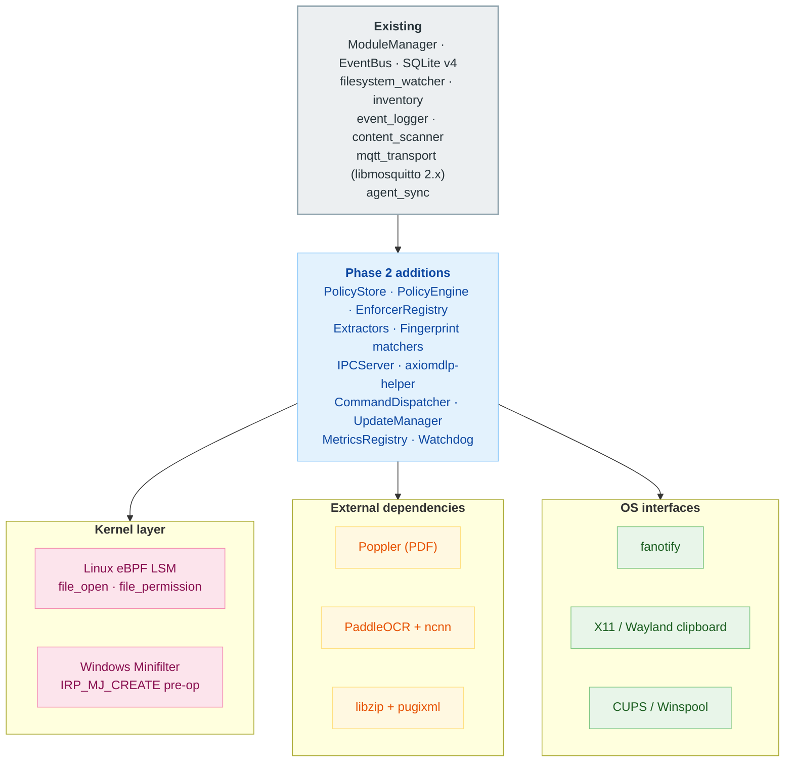

# AxiomDLP Endpoint Agent — Phase 2 README

**Version:** 1.1.0
**Status:** Design Document + Implementation Roadmap
**Scope:** Agent-side only. Server-side Phase 2 is documented separately.

This revision aligns the "Current State" section with the code that exists today. Earlier revisions described the transport as WebSocket + HTTP; the current agent uses MQTT 5 exclusively. What follows is the accurate baseline plus the remaining roadmap.

---

## Table of Contents

1. [Current State](#1-current-state)
2. [Phase 2 Goals](#2-phase-2-goals)
3. [Architecture Additions](#3-architecture-additions)
4. [Milestone 15 — Policy Engine](#4-milestone-15--policy-engine)
5. [Milestone 16 — User-Mode Enforcement](#5-milestone-16--user-mode-enforcement)
6. [Milestone 17 — Extended Content Extraction](#6-milestone-17--extended-content-extraction)
7. [Milestone 18 — Advanced Detection](#7-milestone-18--advanced-detection)
8. [Milestone 19 — IPC & Tray Helper](#8-milestone-19--ipc--tray-helper)
9. [Milestone 20 — Kernel Enforcement (Linux eBPF)](#9-milestone-20--kernel-enforcement-linux-ebpf)
10. [Milestone 21 — Kernel Enforcement (Windows Minifilter)](#10-milestone-21--kernel-enforcement-windows-minifilter)
11. [Milestone 22 — Remote Commands & Auto-Update](#11-milestone-22--remote-commands--auto-update)
12. [Milestone 23 — Platform Expansion](#12-milestone-23--platform-expansion)
13. [Milestone 24 — Observability & Telemetry](#13-milestone-24--observability--telemetry)
14. [Milestone 25 — Hardening & Tamper Resistance](#14-milestone-25--hardening--tamper-resistance)
15. [Testing Strategy](#15-testing-strategy)
16. [Build & Release](#16-build--release)
17. [Working Agreement](#17-working-agreement)

---

## 1. Current State

### 1.1 What Works

**Service and lifecycle**

- Cross-platform service: systemd on Linux, SCM on Windows, foreground mode on both
- Four build targets from two toolchains: Linux x86_64/i686, Windows x86_64/i686
- Fully static on both platforms; Linux binary has only `libmosquitto.so.1` as an external dependency
- Windows binaries use static CRT (`/MT`) — no `vcruntime140.dll` required
- Graceful shutdown with typed reasons propagated end-to-end
- Auth-failure shutdown driven by CONNACK reason codes

**Filesystem awareness**

- Real-time watcher via efsw (inotify on Linux, ReadDirectoryChangesW on Windows)
- 300 ms trailing-edge debounce
- Event coalescing by priority: `modified` > `created` > `moved` > `deleted`
- Two-tier exclusion (glob patterns plus directory prefixes)
- Self-exclusion of the agent's own log and data directories
- Periodic full inventory to catch events the watcher missed

**Content fingerprinting**

- SHA-256 streaming hash in 1 MB chunks — constant memory regardless of file size
- Hash stored in the local `files` table and used for verdict deduplication
- Content never persisted to disk; read into memory, transmitted, discarded

**Server connectivity — MQTT 5**

- Persistent MQTT 5 session via libmosquitto 2.x — the sole server-facing transport. No gRPC, no HTTP client, no protobuf in the dependency tree
- MQTT 5 CONNECT properties: `Session Expiry Interval=3600`, `Receive Maximum=100`, `Maximum Packet Size=128 MB`, `Topic Alias Maximum=0`, Clean Start false
- Request/response correlation via MQTT 5 `Response-Topic` and `Correlation-Data`, with a JSON `correlation_id` field as fallback
- Last Will & Testament on `axiomdlp/sessions/{instance_uuid}/status` with a 5-second Will Delay
- Jittered exponential backoff: base 10 s, cap 300 s, ±20 %
- Typed `shutdown` frame published before clean disconnect; graceful close suppresses the LWT
- Per-topic subscriber dispatch through the `IRequestClient` interface

**Enrollment and heartbeat**

- `agent_sync` publishes to `axiomdlp/register` on first run and persists the returned `agent_id` to the local `state` table
- Heartbeats to `axiomdlp/agents/{id}/heartbeat` every `server.heartbeat_interval_seconds` (default 60 s)
- Immediate validation heartbeat at startup when a saved `agent_id` exists
- On `not_found`, clears local `agent_id` and re-enrolls
- On `agent_revoked`, requests `AgentRevoked` shutdown

**Content scanning**

- `content_scanner` reads pending rows from the local `files` table
- Filters by extension, size, existence
- SHA-256 deduplication skips files whose content was already scanned
- Overlapping chunks: default 1 MB chunk size, 256-byte overlap
- Batches chunks up to `batch_size` and `batch_max_bytes`
- Publishes to `axiomdlp/agents/{id}/scan/batch` with `content_b64` fields
- Merges per-chunk verdicts by `file_hash + chunk_index`
- **Never commits a partial verdict** — if any chunk is missing a score, the whole file stays `pending`

**Server-pushed control frames**

- `axiomdlp/agents/{id}/command` — subscribed; no handler installed yet
- `axiomdlp/agents/{id}/policy` (retained) — subscribed; no handler installed yet
- `axiomdlp/agents/{id}/revoke` (retained) — handled internally; maps `token_revoked` → `AuthRevoked` and `agent_revoked` → `AgentRevoked`

**Storage**

- SQLite with schema migrations, currently version 4
- `files` table for inventory and scan verdicts
- `state` table for `instance_uuid` and `agent_id`

**Framework**

- Module framework (`IModule`, `ModuleContext`, `ModuleManager`, health reporting)
- In-process event bus
- Transport-agnostic `IRequestClient` interface
- Platform isolation: OS-specific code lives only under `src/platform/<os>/`
- Config load with env-var expansion and fail-safe defaults
- Structured async logging with rotation

**Manual verification**

- Linux x86_64 and i686 verified end-to-end against a live Core broker: enrollment, heartbeat, subscriptions, content scan, graceful shutdown, server-side disconnect
- Windows x64 and x86 build cleanly but have not been exercised against a live broker

### 1.2 What Does Not Exist

**Policy engine**

- The `axiomdlp/agents/{id}/policy` topic is subscribed but no handler is installed
- No `PolicyStore`, no policy evaluation, no local `Decision` type
- No version tracking, no hot-swap, no bundle verification

**Enforcement**

- No user-mode enforcers (files, clipboard, print)
- No kernel-level enforcement (eBPF, minifilter, fanotify)
- No pause/resume state

**Extended content extraction**

- Only text files are scanned
- No PDF, DOCX, XLSX, PPTX, or image (OCR) extraction
- No extractor registry, no content-type detection

**Advanced detection**

- No EDM, PDM, document registry, or structured-data matching
- Only server-side PII detection applies

**User interface**

- No IPC server
- No tray helper, notifications, pause/resume UI, override prompt
- No `axiomdlp-helper` binary

**Remote commands**

- The `axiomdlp/agents/{id}/command` topic is subscribed but no command dispatcher runs on the agent
- No command ack path

**Auto-update**

- No update manifest verification, no atomic binary swap, no rollback

**Observability**

- No metrics endpoint, no OpenTelemetry export
- Logging is structured with per-module tags; there is no Prometheus scrape

**Platforms**

- No macOS
- No ARM64 (Linux or Windows)

**Hardening**

- No watchdog, no anti-kill, no config HMAC, no binary self-hash
- No signed config or policy bundles on the agent

**Automated tests**

- The only automated test in the repo today is the manual smoke test in the README
- No unit, integration, load, chaos, TLS, or wire-format test suite

---

## 2. Phase 2 Goals

By the end of Phase 2, the agent must:

1. **Decide locally** — evaluate events against a cached policy set within 5 ms, using policy bundles pushed over the existing retained `axiomdlp/agents/{id}/policy` topic.
2. **Enforce** — block file writes and reads, clipboard copy, print jobs, and USB writes.
3. **See more** — extract text from PDFs, DOCX, XLSX, PPTX, and images via OCR.
4. **Match more** — exact file fingerprints, document fingerprints, and structured-data rules.
5. **Talk to the user** — tray icon, notifications, pause/resume, override prompt via IPC.
6. **Survive attack** — anti-kill, service watchdog, signed updates.
7. **Talk to the fleet** — receive and act on remote commands from the existing `command` topic; apply policy updates without restart.
8. **Report health** — Prometheus-style metrics for every subsystem, exposed on a loopback HTTP endpoint.

**Non-goals for Phase 2:** macOS, mobile, cloud/SaaS DLP, CASB, eDiscovery. Those are Phase 3+.

---

## 3. Architecture Additions

What exists today is the module framework, filesystem watcher, inventory, event bus, MQTT 5 transport, agent sync, content scanner, and SQLite storage. What Phase 2 adds is grouped below.



New top-level directories inside `src/`:

```
src/
├── policy/          # Policy store, engine, evaluator
├── enforcement/     # User-mode enforcers (files, clipboard, print)
├── extractors/      # PDF, DOCX, XLSX, PPTX, image extractors
├── fingerprint/     # EDM, PDM, structured-data matchers
├── ipc/             # Unix socket / named pipe server
├── updater/         # Auto-update with signature verification
├── telemetry/       # Metrics registry + loopback HTTP endpoint
├── watchdog/        # Self-monitoring + restart
├── commands/        # Handler for the existing `command` MQTT topic
└── platform/
    ├── linux/
    │   ├── ebpf/    # eBPF loader + programs
    │   └── fanotify/# fanotify backend
    └── windows/
        └── minifilter/ # Kernel driver + user-mode communicator
```

New helper binary:

```
axiomdlp-helper/     # Tray icon + notifications + IPC client
```

All new modules follow the existing `IModule` / `ModuleContext` pattern and are registered in `application.cpp`.

---

## 4. Milestone 15 — Policy Engine

**Goal:** Evaluate file events against a local policy set in under 5 ms, with no network dependency at decision time.

The agent already subscribes to `axiomdlp/agents/{id}/policy` (retained). This milestone installs the handler and builds the engine around it.

### 4.1 Deliverables

- `PolicyStore` — SQLite-backed cache of server-provided policy bundles
- `PolicyEngine` — evaluates `(event, scan_result)` → `Decision`
- `Decision` struct — action, risk score, matched policy ID, reason
- Policy version tracking and atomic hot-swap on update
- `policy` topic handler that downloads, verifies, and applies bundles
- Subscribes to `scan_result` events on the bus

### 4.2 Data Types

```cpp
// src/policy/policy.h

enum class PolicyAction {
    Allow,      // no action, log at debug
    Log,        // write to audit log, no user impact
    Alert,      // log + admin notification
    Coach,      // log + user educational popup
    Block,      // deny the operation
    Quarantine, // move file to encrypted vault
    Encrypt,    // encrypt file in place
    Redact,     // remove sensitive content
};

struct PolicyRule {
    std::string id;
    std::string name;
    int         priority;         // higher wins
    bool        enabled;

    // Match conditions (all must be true)
    std::vector<std::string> entity_types;   // "CREDIT_CARD", "SSN", ...
    int         min_risk_score = 0;          // 0-10
    double      min_confidence = 0.0;        // 0.0-1.0
    std::vector<std::string> file_extensions; // empty = any
    std::vector<std::string> path_patterns;   // glob, empty = any
    std::vector<std::string> event_types;     // "file_write", ...

    // Action
    PolicyAction action;
    bool         enforce_sync = true;         // block inline
    int          priority_override = 0;
};

struct Decision {
    PolicyAction action       = PolicyAction::Allow;
    int          risk_score   = 0;
    std::string  reason;
    std::string  policy_id;
    std::string  policy_name;
    bool         enforce_sync = false;
};
```

### 4.3 PolicyStore

- Backed by a new SQLite table `policies` (migration v5)
- `load_from_bundle()` — takes the URL, SHA-256, and Ed25519 signature from the `policy_update` frame
- Downloads the bundle, verifies SHA-256 and signature against the embedded public key, then writes to a `policies_new` table and commits
- `get_rules()` — returns an immutable snapshot (`std::shared_ptr<const std::vector<PolicyRule>>`)
- `version()` — monotonic counter for change detection
- Thread-safe; readers never block writers

### 4.4 PolicyEngine

```cpp
class PolicyEngine {
public:
    Decision evaluate(const Event& event, const ScanResult& scan);

private:
    std::shared_ptr<const std::vector<PolicyRule>> rules_;
};
```

Algorithm:

1. Iterate rules in descending priority.
2. For each rule, check every condition against the event and the scan.
3. First matching rule wins.
4. No match → `Decision{Allow}`.

### 4.5 Hot-Swap (over the existing `policy` topic)

The agent already subscribes to `axiomdlp/agents/{id}/policy` (retained). The handler installed in this milestone:

1. Receives a `policy_update` frame with `{version, url, sha256, sig}`.
2. If `version` is not newer than the current version, ignores.
3. Downloads the bundle in the background.
4. Verifies SHA-256.
5. Verifies Ed25519 signature against the embedded public key.
6. Opens a SQLite transaction, writes to `policies_new`, commits.
7. Atomically swaps the `rules_` shared pointer.
8. Publishes `policy_changed` on the event bus.

Because the topic is retained, an agent that reconnects after missing a push receives the current bundle on resubscribe. No polling is needed.

### 4.6 Success Criteria

1. 1,000 rules evaluate in under 5 ms on the target hardware.
2. A policy update takes effect within 100 ms of the retained message arriving.
3. A bundle with a bad signature is rejected and logged at ERROR; the previous rules remain active.
4. A missing or unreachable bundle leaves the previous policy set in place.
5. Every decision is recorded in a local audit table.

---

## 5. Milestone 16 — User-Mode Enforcement

**Goal:** Enforce `Block` decisions for files, clipboard, and print jobs without kernel support.

### 5.1 Deliverables

- `IEnforcer` interface
- `FileEnforcer` — inotify plus fanotify-based, blocks file reads and writes
- `ClipboardEnforcer` — X11 and Wayland (Linux), Windows clipboard
- `PrintEnforcer` — CUPS (Linux), spooler (Windows)
- `EnforcerRegistry` — routes decisions to the right enforcer

### 5.2 Interface

```cpp
// src/enforcement/enforcer.h

class IEnforcer {
public:
    virtual ~IEnforcer() = default;
    virtual std::string name() const = 0;
    virtual bool can_enforce(const std::string& event_type) const = 0;
    virtual bool enforce(const Decision& decision, const Event& event) = 0;
};
```

### 5.3 FileEnforcer (Linux)

Uses fanotify in `FAN_OPEN_PERM` mode:

1. Open a fanotify fd with `FAN_CLASS_CONTENT`.
2. Mark the mount points of interest.
3. On `FAN_OPEN_PERM`, suspend the calling process.
4. Publish a `file_access` event and wait for a `Decision`.
5. Call `write(fd, response)` with `FAN_ALLOW` or `FAN_DENY`.

Requires `CAP_SYS_ADMIN`; the agent runs as root on Linux.

**Fallback:** if fanotify is unavailable, fall back to inotify plus post-hoc quarantine.

### 5.4 FileEnforcer (Windows)

Windows has no user-mode API to block file opens. Two options:

1. **Minifilter** (Milestone 21) — kernel-level, unbypassable.
2. **Read-only folder trick** — racy and bypassable.

For Phase 2, the Windows `FileEnforcer` is notification-only and defers blocking to Milestone 21.

### 5.5 ClipboardEnforcer (Linux)

- X11: own the `CLIPBOARD` and `PRIMARY` selections; intercept `XConvertSelection`.
- Wayland: use `wlr-data-control-unstable-v1` (support varies by compositor).

Scan every clipboard payload. If `Decision::Block`, do not serve the selection.

### 5.6 ClipboardEnforcer (Windows)

- Register a clipboard viewer with `AddClipboardFormatListener`.
- On `WM_CLIPBOARDUPDATE`, read the clipboard and scan.
- If `Block`, call `EmptyClipboard()` and show a notification.

### 5.7 PrintEnforcer (Linux)

- Watch `/var/spool/cups/tmp/` for new spool files.
- Open and scan on creation.
- If `Block`, delete the spool file and send a CUPS cancel.

### 5.8 PrintEnforcer (Windows)

- Register a print monitor with `AddMonitor`.
- Intercept `StartDocPrinter` and `WritePrinter`.
- Scan the spooled data before it reaches the device.

### 5.9 Success Criteria

1. A `Block` on `file_access` prevents the read on Linux.
2. A `Block` on `clipboard_copy` clears the clipboard within 100 ms.
3. A `Block` on `print_job` cancels the print before it leaves the spooler.
4. Every enforcement action is recorded in the local audit table with the policy ID.
5. Enforcement failure does not crash the agent — it logs and continues.

---

## 6. Milestone 17 — Extended Content Extraction

**Goal:** Scan PDF, DOCX, XLSX, PPTX, and images with OCR.

The existing `content_scanner` already handles text files, splits content into overlapping 1 MB chunks with 256-byte overlap, deduplicates by SHA-256, and refuses to commit partial verdicts. This milestone plugs extractors into that pipeline.

### 6.1 Deliverables

- `IContentExtractor` interface
- `PdfExtractor` — Poppler or PDFium
- `DocxExtractor` — libzip plus XML parsing
- `XlsxExtractor` — same
- `PptxExtractor` — same
- `ImageOcrExtractor` — PaddleOCR C++ bindings (ncnn)
- `ExtractorRegistry` — routes by MIME and extension
- Content-type detection via magic bytes (libmagic)

### 6.2 Interface

```cpp
// src/extractors/extractor.h

struct ExtractedContent {
    std::string text;
    std::vector<std::string> images_b64;
    std::map<std::string, std::string> metadata;
    std::string error;
    bool ok() const { return error.empty(); }
};

class IContentExtractor {
public:
    virtual ~IContentExtractor() = default;
    virtual std::string name() const = 0;
    virtual bool supports(const std::string& mime, const std::string& ext) const = 0;
    virtual ExtractedContent extract(const std::vector<uint8_t>& data,
                                     const std::string& filename) = 0;
};
```

### 6.3 Dependencies and licensing

| Extractor | Library | License | Notes |
|-----------|---------|---------|-------|
| PDF | Poppler (libpoppler-cpp) | GPL-2.0 | GPL linkage is a commercial blocker for a closed agent |
| PDF (alt) | PDFium | BSD-3 | Recommended default |
| PDF (alt) | MuPDF | AGPL | Not compatible with a commercial agent |
| DOCX/XLSX/PPTX | libzip plus pugixml | BSD / MIT | — |
| OCR | PaddleOCR plus ncnn | Apache 2.0 | Bundle as a static library |
| Magic | libmagic | BSD | — |

PDFium is the safe default. Poppler is acceptable only if the agent can be shipped under GPL, which it cannot in its current commercial framing.

### 6.4 Pipeline

```
content_scanner (existing)
    |
    v
ExtractorRegistry::extract(data, filename)
    |
    +-- magic bytes -> PDF   -> PdfExtractor
    +-- magic bytes -> ZIP   -> try DOCX/XLSX/PPTX
    +-- magic bytes -> image -> ImageOcrExtractor
    +-- else                 -> treat as text
    |
    v
ExtractedContent { text, images_b64 }
    |
    +-- text   -> chunk (1 MB, 256 B overlap) -> batch -> send
    +-- images -> OCR each -> append text -> chunk -> batch -> send
```

The existing chunking, batching, deduplication, and partial-verdict rules apply unchanged.

### 6.5 Success Criteria

1. A 50-page PDF extracts to text in under 3 seconds.
2. A DOCX with embedded images extracts text and OCRs each image.
3. An XLSX with 10 sheets extracts all cells including formulas.
4. A PNG or JPG containing text produces the text via OCR.
5. Extraction errors do not crash the agent.

---

## 7. Milestone 18 — Advanced Detection

**Goal:** Move beyond regex — exact data match, document fingerprinting, and structured-data matching.

### 7.1 Deliverables

- `EdmMatcher` — exact data match
- `PdmMatcher` — partial document match
- `DocumentRegistry` — signed corpus of sensitive documents
- `StructuredDataMatcher` — CSV/JSON records against a schema
- `FingerprintStore` — SQLite-backed

### 7.2 EDM

The server compiles a list of exact values into a Bloom filter of HMACs. The filter and HMAC key are pushed to the agent inside the policy bundle or a dedicated retained topic. On scan, the agent HMACs every token in the file and checks membership. Plaintext values never leave the server.

```cpp
class EdmMatcher {
public:
    bool match(const std::string& text,
               std::vector<std::string>& out_matches) const;
private:
    std::vector<uint8_t> filter_;
    std::array<uint8_t, 32> hmac_key_;
    uint32_t k_ = 7;
    uint64_t m_ = 0;
};
```

### 7.3 PDM

The server shingles each protected document into 30-character chunks with stride 10, hashes each shingle, and stores the set in a Bloom filter. The agent computes the same shingles on the candidate file and counts matches. Above a threshold (e.g., 25%), the file is flagged with the source document name.

### 7.4 DocumentRegistry

- Signed list of document IDs with metadata (name, category, sensitivity)
- Downloaded and cached like a policy bundle
- The matcher returns the document ID and name when a match is found

### 7.5 Structured Data

- Policies embed a schema (e.g., "row must contain both `credit_card` and `email`")
- The matcher parses CSV and JSON and applies rules row by row

### 7.6 Success Criteria

1. A file containing one exact SSN from the EDM list is flagged.
2. A file with a 25% PDM shingle match is flagged with the source document name.
3. A CSV with one row meeting a structured-data rule is flagged.
4. An EDM list of 10 million values fits in under 20 MB of RAM.
5. Match time for a 1 MB file is under 50 ms.

---

## 8. Milestone 19 — IPC & Tray Helper

**Goal:** Give the user a visible agent, notifications, and pause/resume.

### 8.1 Deliverables

- `IPCServer` in the service (Unix socket on Linux, named pipe on Windows)
- `axiomdlp-helper` binary — tray icon, notifications, IPC client
- Length-prefixed JSON message protocol
- Auto-start of the helper on user login (XDG autostart on Linux, Run key on Windows)

### 8.2 IPC Protocol

```json
{
  "type": "notification",
  "id":   "evt_abc123",
  "title": "Sensitive file blocked",
  "body":  "/home/user/Downloads/pii.txt contains credit card data",
  "actions": ["view_details", "dismiss"],
  "severity": "warning"
}
```

Message types:

- `notification`
- `pause_dlp` / `resume_dlp`
- `query_status`
- `override_request` / `override_response`
- `user_feedback`
- `ping` / `pong`

### 8.3 Tray Icon

- **Linux:** `libayatana-appindicator3-dev`
- **Windows:** `Shell_NotifyIcon` via Win32
- **States:** green (running), yellow (paused), red (error)
- **Menu:** Status, Pause for 15m, Pause until restart, View events, About, Quit

### 8.4 Notifications

- **Linux:** `notify-send` via D-Bus or `libnotify`
- **Windows:** `Shell_NotifyIcon` balloon or WinRT toast
- Severity levels map to icon and colour

### 8.5 Pause/Resume

- The helper sends `pause_dlp` with a TTL in seconds
- The service sets `paused_until`
- The enforcer registry checks the timestamp before enforcing
- Policy can disallow pause (e.g., in a strict mode)

### 8.6 Override Request

1. The helper opens a dialog for a justification
2. Sends `override_request` over IPC
3. The service publishes a command-response request over MQTT to the Core on the agent-scoped topic, correlated by `correlation_id`
4. The admin approves or denies on the server
5. The response arrives on `axiomdlp/replies/{instance_uuid}` and is routed back through IPC to the helper

### 8.7 Success Criteria

1. Tray icon appears when the user logs in.
2. A blocked event shows a notification within 200 ms.
3. Pause/resume takes effect within 1 s.
4. Helper crash does not affect the service.
5. Service restart reconnects the helper automatically.

---

## 9. Milestone 20 — Kernel Enforcement (Linux eBPF)

**Goal:** Unbypassable enforcement of file operations via eBPF LSM programs.

### 9.1 Deliverables

- eBPF LSM programs: `file_open`, `file_permission`
- eBPF map for kernel-user communication
- User-space loader (libbpf)
- BPF CO-RE (Compile Once — Run Everywhere)

### 9.2 Architecture

```
+----------------------+          +---------------------+
|   User processes     |          |                     |
|   open(), write()    | ------>  |  Kernel LSM hooks   |
+----------------------+          |    (BPF programs)   |
                                  +----------+----------+
                                             |
                                             v
                                  +---------------------+
                                  |  BPF ring buffer    |
                                  +----------+----------+
                                             |
                                             v
                                  +---------------------+
                                  |  User-space loader  |
                                  |   (agent process)   |
                                  +----------+----------+
                                             |
                                             v
                                  +---------------------+
                                  |   PolicyEngine      |
                                  +---------------------+
```

### 9.3 Program 1 — `file_open`

Triggered on `security_file_open`. Looks up the file in a BPF hash map keyed by `(dev, inode)`. If present and marked DENY, returns `-EACCES`.

The map is populated by user-space when the policy engine blocks a specific path.

### 9.4 Program 2 — `file_permission`

Triggered on `security_file_permission` for write operations. Same map and semantics as above.

### 9.5 Communication Channel

- User-space writes decisions to a BPF hash map keyed by `(dev, inode)`
- Kernel program looks up by `(dev, inode)`
- Value: `u8` (0 = allow, 1 = deny) with a TTL

### 9.6 Loading

- `libbpf` with CO-RE plus a `.bpf.o` object compiled at build time
- Attached via `bpf_link` to the LSM hook
- Unloaded cleanly on agent shutdown

### 9.7 Requirements

- Linux 5.7+ (BPF LSM)
- `CONFIG_BPF_LSM=y` in the running kernel
- Root or `CAP_BPF` plus `CAP_PERFMON`

### 9.8 Fallback

If BPF LSM is unavailable, fall back to fanotify (Milestone 16).

### 9.9 Success Criteria

1. A blocked file open returns `EACCES`.
2. `strace -f /usr/bin/cat blocked.txt` shows `EACCES`.
3. Direct syscalls (`syscall(SYS_open, ...)`) also return `EACCES`.
4. No kernel oops under load.
5. Agent unload removes all BPF programs cleanly.

---

## 10. Milestone 21 — Kernel Enforcement (Windows Minifilter)

**Goal:** Unbypassable enforcement of file operations on Windows.

### 10.1 Deliverables

- Minifilter driver (`axiomdlpflt.sys`)
- User-space communication library
- Installer and uninstaller
- Driver signing (test cert for dev, EV cert for production)

### 10.2 Architecture

```
+----------------------+          +---------------------+
|  Win32 file APIs     |          |                     |
|  CreateFile()        | ------>  |  Windows I/O Mgr    |
+----------------------+          +----------+----------+
                                             |
                                             v
                                  +---------------------+
                                  |  Filter Manager     |
                                  |   (fltmgr.sys)      |
                                  +----------+----------+
                                             |
                                             v
                                  +---------------------+
                                  |  axiomdlpflt.sys    |
                                  +----------+----------+
                                             |
                                             v
                                  +---------------------+
                                  |  Agent (user-mode)  |
                                  |  via FltSendMessage |
                                  +---------------------+
```

### 10.3 Driver Responsibilities

- Register `IRP_MJ_CREATE` pre-op callback
- Send a message to user-space on each file open
- Wait up to 5 seconds for a response
- Response: `FLT_PREOP_SUCCESS_NO_CALLBACK` (allow) or `FLT_PREOP_COMPLETE` with `STATUS_ACCESS_DENIED` (block)

### 10.4 User-Space Communicator

- `FilterConnectCommunicationPort` plus `FilterSendMessage` and `FilterGetMessage`
- Dedicated thread
- Calls `PolicyEngine::evaluate` and returns the decision

### 10.5 Installation

- `axiomdlpflt.inf` — the driver INF
- `sc create axiomdlpflt binPath= ... type= kernel`
- `fltmc load axiomdlpflt`
- Uninstall: `fltmc unload` then `sc delete`

### 10.6 Requirements

- Windows 10+ (driver model 1.9+)
- Driver signed with a Microsoft-approved cert (EV cert for production; `bcdedit /set testsigning on` for dev)

### 10.7 Success Criteria

1. `CreateFile()` on a blocked path returns `ERROR_ACCESS_DENIED`.
2. Direct NT calls (`NtCreateFile`) are also blocked.
3. Driver unloads cleanly without a bugcheck.
4. No file system corruption under stress.
5. Signed driver loads on Windows 10 and 11 x64.

---

## 11. Milestone 22 — Remote Commands & Auto-Update

**Goal:** Control the fleet from the Core and update agents without admin intervention.

The agent already subscribes to `axiomdlp/agents/{id}/command`. This milestone installs the handler and builds the update path.

### 11.1 Deliverables

- Command handler for `axiomdlp/agents/{id}/command`
- Command ack publisher on `axiomdlp/replies/{instance_uuid}` using the same `correlation_id`
- Signature verification for update bundles
- Atomic binary swap on Linux and Windows
- Rollback on failed startup

### 11.2 Commands

| Command | Payload | Action |
|---------|---------|--------|
| `rescan` | `{}` | Trigger a full inventory scan |
| `pause` | `{"duration_sec": 900}` | Pause enforcement |
| `resume` | `{}` | Resume enforcement |
| `quarantine_file` | `{"path": "/..."}` | Move to vault |
| `uninstall` | `{}` | Uninstall and exit |
| `update` | `{"url": "...", "sha256": "...", "sig": "..."}` | Download, verify, install |
| `restart` | `{}` | Restart the service |
| `dump_logs` | `{"lines": 1000}` | Upload recent logs |
| `run_diagnostic` | `{}` | Run self-test, upload results |

### 11.3 Update Flow

1. Agent receives an `update` command carrying URL, SHA-256, and Ed25519 signature.
2. Downloads to `/var/lib/axiomdlp/updates/axiomdlp-agent.new`.
3. Verifies SHA-256.
4. Verifies the Ed25519 signature against the embedded public key.
5. On Linux:
   - Rename the current binary to `.old`
   - Rename `.new` to the current path
   - `chmod +x`
   - Restart via systemd
   - If the new binary fails a self-test within 30 seconds, revert to `.old`
6. On Windows:
   - Schedule the swap via `MoveFileEx(MOVEFILE_DELAY_UNTIL_REBOOT)` or use a helper service outside the agent
   - Verify by relaunching and self-testing

### 11.4 Embedded Public Key

```cpp
// src/updater/trusted_keys.h
constexpr const char* kUpdateSigningKeyHex =
    "9f8e7d6c5b4a39281706f5e4d3c2b1a0..."; // 32-byte Ed25519 public key
```

The key is compiled into the binary and cannot be replaced without a signed update.

### 11.5 Success Criteria

1. An unsigned update is rejected and logged at ERROR.
2. A signed update installs and the agent restarts within 10 seconds.
3. A corrupted binary fails self-test and rolls back automatically.
4. Linux update works without a full restart via `systemd-run`.

---

## 12. Milestone 23 — Platform Expansion

**Goal:** macOS and ARM64 support.

### 12.1 macOS

- **Filesystem watching:** FSEvents
- **Enforcement:** EndpointSecurity framework (requires Apple entitlements)
- **Service:** launchd plist
- **Tray:** NSStatusBar
- **Signing:** Apple Developer ID plus notarization
- **Distribution:** signed and notarized `.pkg`

### 12.2 ARM64 Linux

- Add `cmake/toolchains/linux-aarch64.cmake`
- Cross-compile via `aarch64-linux-gnu-g++`
- Build OpenSSL and libmosquitto for aarch64
- Verify eBPF works on aarch64

### 12.3 Windows ARM64

- Add `windows-aarch64.cmake` via llvm-mingw
- Build OpenSSL with `VC-WIN64-ARM`
- Verify the minifilter loads on Surface Pro X

### 12.4 Success Criteria

1. All six targets build on CI: linux-x86_64, linux-i686, linux-aarch64, windows-x86_64, windows-i686, windows-aarch64.
2. macOS agent starts, watches files, and enforces blocks.
3. Binary sizes stay under 15 MB compressed.
4. ARM64 binaries run on Raspberry Pi 4 (Linux) and Surface Pro X (Windows).

---

## 13. Milestone 24 — Observability & Telemetry

**Goal:** Every subsystem exposes metrics for fleet-wide visibility.

### 13.1 Deliverables

- `MetricsRegistry` — process-wide metrics
- HTTP endpoint on `127.0.0.1:9101/metrics` in Prometheus text format
- Structured logs with correlation IDs (already present)
- Optional OpenTelemetry exporter

### 13.2 Metrics

| Metric | Type | Description |
|--------|------|-------------|
| `axiom_agent_uptime_seconds` | gauge | Process uptime |
| `axiom_agent_module_health` | gauge | Per-module health 0/1/2/3 |
| `axiom_events_published_total` | counter | Events on the bus |
| `axiom_events_dropped_total` | counter | Outbound queue overflows |
| `axiom_scan_files_total` | counter | Files scanned |
| `axiom_scan_bytes_total` | counter | Bytes scanned |
| `axiom_scan_duration_seconds` | histogram | Scan latency |
| `axiom_decisions_total{action}` | counter | Decisions by action |
| `axiom_enforcement_total{result}` | counter | Enforcement by outcome |
| `axiom_policy_version` | gauge | Current policy version |
| `axiom_mqtt_reconnects_total` | counter | MQTT reconnect attempts |
| `axiom_mqtt_connected` | gauge | 1 if the MQTT session is live |
| `axiom_mqtt_messages_sent_total` | counter | Outbound MQTT PUBLISHes |
| `axiom_mqtt_messages_received_total` | counter | Inbound MQTT PUBLISHes |
| `axiom_ipc_connections` | gauge | Active helper connections |

### 13.3 Log Correlation

Every event carries a ULID `trace_id`. Logs include `trace_id` in the structured prefix so a single event can be followed from the filesystem watcher through the MQTT round-trip to the enforcement action.

### 13.4 OpenTelemetry (optional)

If `OTEL_EXPORTER_OTLP_ENDPOINT` is set:

- `content_scan` — one span per file
- `policy_evaluate` — one span per decision
- `enforce` — one span per enforcement action
- `mqtt_publish` — one span per outbound message

### 13.5 Success Criteria

1. `/metrics` returns valid Prometheus text.
2. Grafana scrapes and shows a full dashboard.
3. A single event can be traced end-to-end across the bus.
4. Metrics add under 1% CPU overhead.

---

## 14. Milestone 25 — Hardening & Tamper Resistance

**Goal:** The agent cannot be disabled, killed, or bypassed by a non-admin user.

### 14.1 Deliverables

- Service watchdog (a second process that restarts the agent if it dies)
- Anti-kill (kernel-level process protection via eBPF or minifilter)
- Configuration integrity check (HMAC over the config file)
- Binary integrity check (self-hash compared to a compiled-in value)
- Signed configuration and policy bundles
- Protected directories: `logs/`, `data/`, `updates/` at chmod 0700 owned by root

### 14.2 Watchdog

Two processes:

- `axiomdlp-agent` — the main service
- `axiomdlp-watchdog` — a small process that monitors the main via a heartbeat file

If the heartbeat file is not touched within 30 seconds, the watchdog restarts the agent via systemd or SCM.

The watchdog is protected by `ProtectSystem=strict` in the systemd unit and runs as a separate unit the main cannot stop.

### 14.3 Anti-Kill (Linux)

eBPF LSM hook on `security_task_kill`: if the target is the agent's process, deny the kill with `-EPERM`. Requires `CAP_BPF` and a kernel with BPF LSM. The exact hook name and version requirement must be verified against the target kernel before implementation.

### 14.4 Anti-Kill (Windows)

Minifilter pre-op on `IRP_MJ_SET_INFORMATION` with `FileDispositionInformation` for the agent's binary and data files. Returns `STATUS_ACCESS_DENIED` if a non-system process tries to delete them.

A more robust approach uses `ObRegisterCallbacks` to strip `PROCESS_TERMINATE` from handles opened against the agent's PID.

### 14.5 Configuration Integrity

On startup:

1. Read `config/agent.json`
2. Compute HMAC-SHA256 with a key derived from a machine-specific secret (TPM or file ACL)
3. Compare against `config/agent.json.hmac`
4. On mismatch, log ERROR and load defaults

This detects accidental corruption. It is not a hard tamper-resistance boundary; a determined attacker with write access to both files can bypass it.

### 14.6 Binary Integrity

Embed a SHA-256 of the running binary at build time. On startup:

1. Reopen `/proc/self/exe` on Linux or the module path on Windows
2. Compute SHA-256
3. Compare against the embedded value
4. On mismatch, log ERROR and continue in degraded mode with limited enforcement

As with config integrity, this detects accidental corruption, not deliberate tampering.

### 14.7 Success Criteria

1. `kill -9` on the agent as a non-root user fails with `EPERM`.
2. Deleting the agent binary as a non-root user fails.
3. Modifying the config file is detected at next startup.
4. The watchdog restarts the agent within 30 seconds of a crash.
5. None of the above prevents legitimate admin operations.

---

## 15. Testing Strategy

The current test surface is a manual smoke test. Phase 2 establishes the full pyramid.

### 15.1 Unit Tests

- **C++:** Catch2 plus doctest plus GoogleTest
- Target: 80% coverage on `src/policy`, `src/enforcement`, `src/extractors`, `src/fingerprint`, `src/commands`
- Run on every commit via CI

### 15.2 Integration Tests

- Agent against a live Go Core with an embedded MQTT broker in a docker-compose stack
- Dedicated test database
- Cover: enrollment, heartbeat, MQTT session, policy update via retained topic, scan batch, remote command dispatch and ack, shutdown propagation

### 15.3 Load Tests

- 10,000 simulated agents connecting to the Core broker
- Sustained 100 req/s per agent for 10 minutes
- Assert no server-side leaks and no dropped messages

### 15.4 Chaos Tests

- Kill the Core mid-scan — the agent must not lose data
- Network partition — the agent must queue and recover
- Kill the MQTT broker — the agent must reconnect with jittered backoff
- SIGKILL the agent — the broker must publish the LWT after 5 s
- Corrupt a policy bundle — the agent must reject it and keep the previous rules
- Fill the disk — the agent must not crash

### 15.5 Fuzz Tests

- **PDF extractor:** libFuzzer with a seed corpus
- **DOCX extractor:** libFuzzer
- **MQTT frame / correlation handling:** libFuzzer
- **IPC protocol:** libFuzzer

### 15.6 Penetration Tests

Per release:

- Attempt to bypass enforcement
- Attempt to forge a policy update
- Attempt to kill the agent
- Attempt to read the agent's private state
- Attempt to trigger a downgrade to an older signed bundle

### 15.7 Certification

- SOC 2 Type II
- ISO 27001
- Common Criteria (EAL2+)
- FIPS 140-2 for crypto modules

---

## 16. Build & Release

### 16.1 CI Pipeline

Triggered on every push:

1. Lint (`clang-tidy`, `clang-format`, `cppcheck`)
2. Unit tests on linux-x86_64
3. Cross-compile for linux-i686, windows-x86_64, windows-i686
4. Integration tests against a mock Core (docker-compose with the MQTT broker)
5. SBOM generation (CycloneDX)
6. Upload artifacts

Triggered on every tag:

1. All of the above
2. Sign binaries with the release key
3. Build `.deb`, `.rpm`, `.msi`
4. Sign packages
5. Publish to the release page
6. Publish SBOM

### 16.2 Versioning

- Semantic versioning: `MAJOR.MINOR.PATCH`
- Every binary embeds the git commit SHA
- Every update bundle includes a `min_version` field

### 16.3 Distribution

- **Linux:** `.deb`, `.rpm`, static tarball
- **Windows:** `.msi`, static `.exe`
- **macOS:** signed `.pkg`
- **Docker:** `axiomdlp/agent:<tag>` for testing

---

## 17. Working Agreement

### 17.1 Per Milestone

1. Design doc in this README
2. Interface in header files
3. Reference implementation
4. Unit tests
5. Integration tests
6. All four targets build clean
7. Commit with a descriptive message
8. Update this README to reflect the new state

### 17.2 Every New Module Must

- Implement `IModule`
- Receive `ModuleContext`
- Publish or subscribe to events via the bus
- Report health
- Have a metrics section
- Be fail-safe (errors logged, not fatal)
- Be documented in this README

### 17.3 Every New Subsystem Must

- Follow the three-file pattern: header, implementation, CMake wiring
- Have platform-specific implementations under `src/platform/<os>/` if it touches the OS
- Have a debug flag to disable it at runtime
- Have a self-test that runs at startup

### 17.4 Every Release Must

- Pass all unit and integration tests
- Have a signed SBOM
- Have a changelog entry
- Be backward compatible with the previous MINOR version's config

### 17.5 Definition of Done

- [ ] Code committed
- [ ] Tests pass
- [ ] Docs updated
- [ ] This README updated
- [ ] All four current targets build (six once Milestone 23 lands)
- [ ] Metrics exported
- [ ] Logs structured
- [ ] Error paths exercised

---

## Summary

**Phase 2 deliverables in order:**

| # | Milestone | Depends on | Notes |
|---|-----------|------------|-------|
| 15 | Policy Engine | — | Installs handler for the retained `policy` topic already subscribed |
| 16 | User-Mode Enforcement | 15 | New |
| 17 | Extended Extraction | — | Extends existing content_scanner chunking and dedup |
| 18 | Advanced Detection | 17 | New |
| 19 | IPC & Tray Helper | 16 | New |
| 20 | Kernel Enforcement (Linux) | 16 | New |
| 21 | Kernel Enforcement (Windows) | 16 | New |
| 22 | Remote Commands & Auto-Update | 19 | Installs handler for the `command` topic already subscribed |
| 23 | Platform Expansion | 22 | New |
| 24 | Observability | 15 | Extends existing structured logging with a metrics endpoint |
| 25 | Hardening | 20, 21, 22 | New |

**Estimated effort:** 6–9 months for one experienced systems engineer, 3–4 months for a small team of 3.

By the end of Phase 2, the agent is a production-grade enterprise DLP endpoint on par with Forcepoint, Symantec, and Microsoft Defender for Endpoint — deciding locally, enforcing at the file, clipboard, print, and kernel layers, extracting and fingerprinting rich content, talking to the fleet over the existing MQTT 5 transport, and surviving tampering attempts.